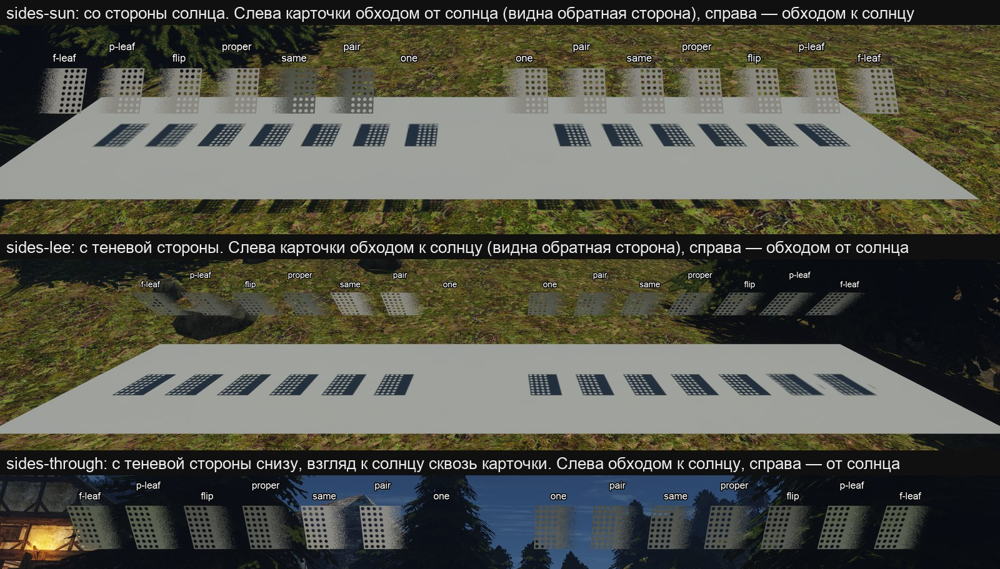
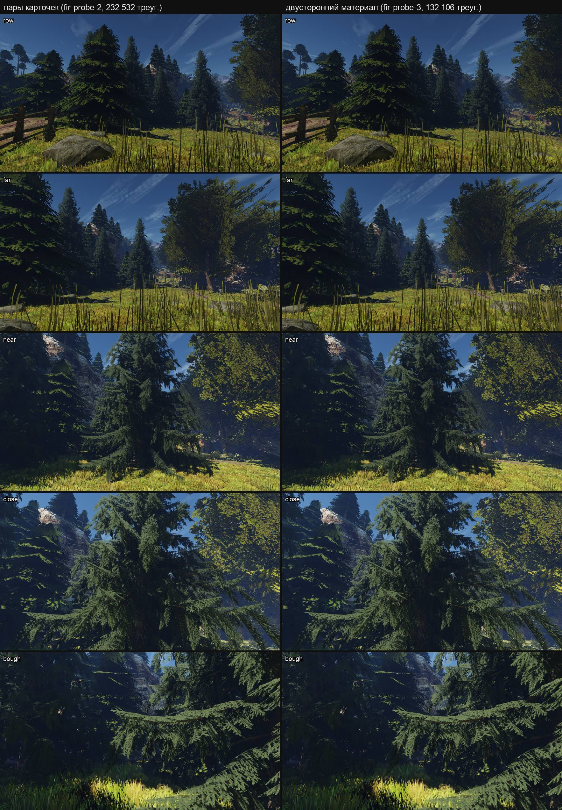

# Двусторонние материалы: что построено

Дата: 2026-11-17. Задача 2 [доработок движка под деревья](engine-plan.md): карточка листвы своего GLB рисуется, отбрасывает тень и видна лучам с обеих сторон, а в файле записана один раз. До этого каждый треугольник карточки писался дважды с обратным обходом: у ели А это 20 337 лишних треугольников из 47 096.

## Откуда берётся флаг

**Поле `"two_sided"` записи `materials.json`**, а не `doubleSided` из glTF.

| Значение | Что делает |
|---|---|
| `"same"` | обе стороны рисуются; сторона против обхода освещается той же нормалью вершины. Так освещался двойник карточки: у пары одни вершины и одни нормали |
| `"flip"` | обе стороны рисуются; на стороне против обхода нормаль вершины повёрнута к глазу. Так освещалась бы пара, у второй копии которой свои нормали |
| `"off"` или поля нет | материал односторонний, как раньше |

Не строка или любое другое слово (`true`, `1`, `"Flip"`, `"both"`, `""`) — запись отвергается целиком, как при ошибке в `antitile`.

Почему не `doubleSided`:

1. **Отпечаток базы.** Флаг glTF читал бы загрузчик `gltfmesh.cpp`, а он входит в отпечаток формата базы (`cmake/BaseFormat.cmake`). Правка загрузчика потребовала бы новой базы у всех. Разбор записей (`resources_textures.cpp`) в отпечаток не входит: формат базы и отпечаток не изменились.
2. **Готовые файлы.** `rigging_set.py` уже пишет `doubleSided: true` в свои GLB, экспортёр Blender — любому материалу, у которого не включено отсечение обратных граней. Если бы движок начал его читать, готовый контент молча изменил бы вид и тени.
3. **Место.** Свойства рендера материала уже живут в записи: `antitile`, `foliage`, `projection`. Одна запись — один материал во всех мешах.

Скрипты контента пишут `doubleSided` в GLB как справку для чужих программ (Blender покажет обе стороны). Движок его не читает.

**Почему значений два.** Задание требует переворачивать нормаль обратной стороны — это `"flip"`. Но карточки ели несут не нормаль своей плоскости, а нормаль от оболочки кроны, одну на обе копии: хвоя с тыла освещена так же, как с лица. С `"flip"` вид ели изменился бы, а задача — убрать двойников, не меняя вида. Поэтому ель пишет `"same"`, и её кадры совпали с прежними до шума прогона (раздел «Ель»). `"flip"` — для карточек с нормалью своей плоскости; на пробе он совпал с парой, у которой вторая копия несёт свои нормали.

## Что построено

- **Запись → материал → корзина.** `Resources::MaterialMapFiles` и `MaterialMaps` несут `twoSided`; `Material::twoSided` входит в сравнение материалов, поэтому односторонний, `same` и `flip` попадают в разные корзины. Корзина отдаёт шейдерам биты `BK_TWO_SIDED` и `BK_TWO_SIDED_FLIP`.
- **Проходы.** `Shaders::materialPipeline` для такого материала собирает конвейер без отсечения граней — в основном проходе, проходе глубины, каскадах теней, страницах VSM и тенях ламп, с мешлетами и без них. Шейдеры те же. Ключ кэша конвейеров получил признак «две стороны»: у остальных материалов конвейеры прежние, у двустороннего — один лишний на проход, общий для `same` и `flip`.
- **Мешлеты в VSM.** Там грани отсекает не конвейер, а сам меш-шейдер (`main.vert`, `gl_CullPrimitiveEXT`). Для корзины с `BK_TWO_SIDED` он оставляет обе стороны.
- **Нормаль обратной стороны.** `main.frag`, `sideNormal()`: при `BK_TWO_SIDED_FLIP` на стороне против обхода нормаль вершины берётся с обратным знаком — и для G-буфера, и как основа карты нормалей. Просвет листвы (`foliage`, `translucency`) считается в проходе солнца по нормали из G-буфера, поэтому идёт с обеих сторон без своей правки.
- **Лучи.** Экземпляр такого материала в сцене лучей получает `RtInstanceFlags::CullDisable`; описание геометрии — биты «две стороны» и «повернуть нормаль». Цикл альфа-проверки (`rt_common.glsl`, `rayQueryProceedAlphaTest`) больше не пропускает обратные грани такого материала. Пробы GI (`probe_trace.comp`) не считают попадание в его обратную сторону плохим и при `flip` поворачивают нормаль к лучу; то же в трассировщике путей и отладочном виде лучей.
- **Отсечения кластеров по конусу нормалей** в движке нет: править было нечего.

Действует только на меши предметов (типы `Static` и `Movable`). Меш мира, скины, морфы и частицы рисуются как раньше, даже если запись их текстуры несёт поле.

### Файлы

| Файл | Что в нём |
|---|---|
| `common/resources_textures.cpp`, `common/resources.h` | разбор поля, перенос в карты материала |
| `common/graphics/material.h`, `.cpp` | `Material::TwoSided`, поле в сравнении |
| `common/graphics/drawbuckets.h`, `.cpp`, `shader/scene.glsl` | биты корзины |
| `common/graphics/shaders.h`, `.cpp` | конвейер без отсечения, ключ кэша |
| `shader/materials/main.vert` | меш-шейдер страниц VSM оставляет обе стороны |
| `shader/materials/main.frag` | `sideNormal()` |
| `common/graphics/rtscene.h`, `.cpp` | флаг экземпляра, биты описания |
| `shader/lighting/rt/rt_common.glsl`, `rt/probe_trace.comp`, `pt/pathtrace_common.glsl`, `rt_dbg/rt_dbg.frag` | обратная сторона для лучей |
| `tests/foliage_tree_test.h` | тест `twoSidedRecords` в `gothic-material-texture-test` |
| `scripts/content/glb_cards.py` | `Mesh(pairs=False)`: карточка один раз, материал двусторонний; `pairs=True` — прежние пары |
| `scripts/content/mesh3d/blender/fir_tree.py`, `fir.py`, `tree_glb.py`, `tree_check.py`, `test_fir_tree.py` | ель без двойников, флаг `--pairs`, проверки |
| `scripts/content/fir_set.py` | запись лап с `"two_sided": "same"`; `probe … [--pairs \| --sides flip]` |
| `scripts/content/own_glb_probe.py`, `scripts/bench/own-glb-probe.bench` | вторая группа пробы — стороны материала |

Пучки луга (`landscape_grass_tufts.py`) и грубая ель пробы ветра (`tree_wind_probe.py`) остались в режиме пар: их вид и числа эта задача не трогает.

### Чем вышло иначе, чем в проекте

- **Флаг — поле записи, а не `doubleSided`**, и значений два. Причины — выше.
- **Сторона в пиксельном шейдере.** Tempest считает лицевой грань по часовой стрелке, а конвейеры отсекают лицевые. Поэтому сторона, которую показывает любой материал, — «обратная» для `gl_FrontFacing`, а сторона против обхода — `gl_FrontFacing == true`.
- **Пиксельному шейдеру не сообщают `MESH_TYPE`.** Первая проба показала, что `flip` ничего не меняет: поворот стоял под `#if (MESH_TYPE==T_OBJ)`, а пиксельные шейдеры собираются без этого определения. Условие заменено на «не частицы»; бит корзины ставится только мешам предметов. Это единственный круг правки.
- **Односторонняя карточка отбрасывает тень солнца только обходом от солнца** — во всех путях теней, и на `main` тоже. Двойники были нужны не только глазу, но и тени. Двусторонний материал отбрасывает тень при любом обходе.

## Проба сторон

Набор `glb-probe-2` (`own_glb_probe.py`, вне git), стенд [`own-glb-probe.bench`](../../../scripts/bench/own-glb-probe.bench) на Ryzen, 2560 × 1440, полдень. Ряд карточек 40 см наклонён к солнцу и висит над серой плитой, которая принимает тени. Ряд стоит дважды: обходом к солнцу и обходом от него.

| Карточка | Что это |
|---|---|
| `one` | одна копия, односторонний материал |
| `pair` | две копии с обратным обходом и общими нормалями — прежние двойники |
| `same` | одна копия, `"two_sided": "same"` — должна совпасть с `pair` |
| `proper` | две копии, у второй нормали своей стороны |
| `flip` | одна копия, `"two_sided": "flip"` — должна совпасть с `proper` |
| `proper-leaf`, `flip-leaf` | то же с листвой: `foliage` без ветра, `translucency` 0,6 |



Кадры при настройках стенда по умолчанию (лучи, VSM, мешлеты). На подписях `p-leaf` и `f-leaf` — карточки листвы.

Число — медиана яркости (0–255) половины карточки с дырами; в скобках — медиана её тени на плите. Плита на солнце — 161.

| Кадр, обход | `one` | `pair` | `same` | `proper` | `flip` | `proper-leaf` | `flip-leaf` |
|---|---|---|---|---|---|---|---|
| `sides-sun`, к солнцу (лицо на солнце) | 136,4 (161 — тени нет) | 136,1 (75) | 136,0 (76) | 135,9 (77) | 135,9 (78) | 135,7 (76) | 134,9 (76) |
| `sides-sun`, от солнца (видна обратная) | не видна (76) | 86,1 (74) | 85,9 (74) | 135,7 (75) | 135,8 (74) | 135,0 (85) | 134,7 (84) |
| `sides-lee`, к солнцу (видна обратная) | не видна (161 — тени нет) | 134,9 (70) | 134,9 (70) | 84,7 (70) | 81,8 (70) | 83,1 (70) | 81,6 (70) |
| `sides-lee`, от солнца (лицо в тени) | 85,6 (69) | 84,8 (70) | 83,9 (70) | 81,8 (70) | 79,9 (70) | 78,9 (81) | 76,9 (80) |
| `sides-through`, к солнцу (видна обратная) | не видна | 136,7 | 136,8 | 84,0 | 82,1 | 92,6 | 89,8 |
| `sides-through`, от солнца (лицо в тени) | 83,9 | 82,8 | 83,7 | 83,1 | 81,9 | 92,2 | 88,6 |

- **`same` = `pair`** везде, разница до 0,9.
- **`flip` = `proper`** на освещённой стороне до 0,3. В тени `flip` ниже соседа на 2–3. Это место в ряду, а не материал: в наборах, где `flip` и `proper`, `pair` и `same`, `proper-leaf` и `flip-leaf` поменяны местами, числа по местам повторились до 0,1.
- **Тень** даёт любая двусторонняя карточка при обоих обходах (69–78 при плите 161). Односторонняя обходом к солнцу тени не даёт и с тыла не видна.
- **Просвет** (`sides-through`: камера с теневой стороны снизу смотрит к солнцу): листва светлее такой же карточки без `foliage` на 8–9 и зеленее, `flip-leaf` — как `proper-leaf` на том же месте.
- **Без мешлетов** (`OPENGOTHIC_MS=0`): все числа равны прогону по умолчанию до 0,1.
- **Без лучей** (`OPENGOTHIC_RT=0`, тени VSM; плита 164): освещённые стороны — 138,1 у всех; сторона в тени — 35,4 у `pair` и `same`, 30,6 у `proper`, `flip` и листвы; тени всех пар и двусторонних карточек — 81–87 (у листвы до 93), у односторонней обходом к солнцу тени нет.
- **Без лучей и без VSM** (`OPENGOTHIC_RT=0 OPENGOTHIC_VSM=0`, каскады): карточки те же, тени — 85–94; то же с `OPENGOTHIC_MS=0`.

## Ель

Набор `fir-probe-3` — те же места, зёрна, масштабы, повороты и текстуры, что у `fir-probe-2`, ели без двойников, запись лап с `"two_sided": "same"`. По одному прогону [`fir-probe.bench`](../../../scripts/bench/fir-probe.bench) на Ryzen на каждый набор, 2560 × 1440, полдень, лучи, VSM и мешлеты — как по умолчанию на стенде. Кадры сняты на одних и тех же тиках игры.

| | `fir-probe-2`, пары | `fir-probe-3`, двусторонний материал |
|---|---|---|
| Треугольники пяти елей | 232 532 | 132 106 |
| Ель А | 47 096 | 26 759: кора 6 422, лапы 20 337 |
| GLB ели А | 1,39 МБ | 1,27 МБ (вершины те же, короче индексы) |



Слева — пары карточек, справа — двусторонний материал. Строки: `row`, `far`, `near`, `close`, `bough`.

**Вид, тень и тон не изменились.** Медиана яркости и среднее светлой десятой части по одним и тем же областям (левый верхний и правый нижний угол в пикселях кадра):

| Область | Медиана: пары → двусторонний | Светлые 10 %: пары → двусторонний |
|---|---|---|
| `row`, крона (560, 120 – 1280, 960) | 21,4 → 21,4 | 87,1 → 87,1 |
| `row`, тень на земле (960, 1040 – 1600, 1140) | 48,9 → 48,9 | 130,3 → 130,3 |
| `far`, крона (1160, 400 – 1400, 1040) | 44,2 → 44,2 | 118,5 → 118,5 |
| `far`, тень (560, 1110 – 1040, 1180) | 39,4 → 39,4 | 138,7 → 138,7 |
| `near`, крона (800, 0 – 1800, 1280) | 38,2 → 38,2 | 117,9 → 117,9 |
| `near`, тень (760, 1180 – 1960, 1340) | 61,1 → 61,1 | 172,2 → 172,2 |
| `close`, крона (600, 0 – 2200, 1440) | 43,6 → 43,6 | 128,6 → 128,6 |
| `bough`, крона (1000, 380 – 2560, 1400) | 33,0 → 32,9 | 157,5 → 157,5 |
| `bough`, земля под лапой (700, 1100 – 1600, 1400) | 55,6 → 54,5 | 203,9 → 203,9 |

По целым кадрам средняя разница пикселя — 0,02 уровня из 255 в четырёх кадрах и 0,19 в `bough`; пикселей с разницей больше 8 уровней — до 0,002 % и 0,52 %. Повтор прогона `fir-probe-3` против самого себя даёт 0,01–0,02 и 0,14; до 0,0004 % и 0,29 %. То есть четыре кадра совпали до шума прогона.

Остаток — пятно солнца на траве под лапой в кадре `bough`: медиана ниже на 1,1, больше 8 уровней отличаются 3,2 % пикселей области против 0,3 % в повторе. Отдельные травинки на краю тени кроны освещены или нет. Причина дальше не разбиралась; на вид кадры не отличить.

**Время кадра, грубо:** шаг lockstep между отметками журнала — 11,5–13,1 мс с парами и 11,3–12,3 мс с двусторонним материалом, весь прогон 3 453 шагов — 44,4 и 42,9 с. По одному прогону; это оценка, а не замер цены.

## Проверки

- `gothic-material-texture-test` (тест `twoSidedRecords`): поле разбирается, пять неверных значений отвергают запись; материал с полем и без — разные корзины; у предмета свой конвейер на каждый из четырёх проходов, общий для `same` и `flip`; у одностороннего, у `"off"`, у меша мира, скина и морфа конвейер прежний.
- Шейдеры собираются `glslangValidator` при сборке движка во всех вариантах.
- `test_fir_tree.py`: ель А — 26 500–27 000 рисуемых треугольников, плотность, развороты плоскостей и раскладка `COLOR_0` держатся; режим пар добавляет только двойников (47 096) и не меняет ни вершин, ни плотности.
- Кадры пробы и ели — выше.

## Ограничения

- Только меши предметов. Меш мира, скины, морфы и частицы поле не читают.
- Пути волос, прядей и глаз берут нормаль без поворота: `flip` на них не действует.
- Тени ламп на стенде не сняты: их конвейеры (`T_Shadow`, `T_Vsm`) проверяет только тест. Metal на Mac, трассировщик путей и отладочный вид лучей на стенде не проверялись.
- В пробе тени принимает плита над лугом, а не сама земля. Тень на земле — в кадрах ели.
- Пучки луга и грубая ель пробы ветра по-прежнему пишут двойников.
- Односторонний материал ведёт себя как раньше, включая тень только при обходе от солнца.
- Освободившиеся 20 337 треугольников ели пока ничем не заняты: гроздья из мелких побегов — следующая работа над елью.

## Как повторить

```sh
U="uv run --no-project --with numpy --with scipy --with pillow python"
$U scripts/content/own_glb_probe.py glb-probe-2
OPENGOTHIC_CONTENT=$HOME/.local/share/gothic-ai/content-staging/glb-probe-2 TEMPEST_WINDOW_SIZE=2560x1440 \
  BENCH_HOST=ryzen scripts/bench.sh own-glb-probe /absolute/out
$U scripts/content/fir_set.py probe fir-probe-3 --textures $WORK/tex
OPENGOTHIC_CONTENT=$HOME/.local/share/gothic-ai/remaster/trees-fir/fir-probe-3 TEMPEST_WINDOW_SIZE=2560x1440 \
  BENCH_HOST=ryzen scripts/bench.sh fir-probe /absolute/out
```

`fir_set.py probe … --pairs` собирает прежний набор с двойниками, `--sides flip` — ель с другим значением поля. Без мешлетов, лучей или VSM — `OPENGOTHIC_MS=0`, `OPENGOTHIC_RT=0`, `OPENGOTHIC_VSM=0` перед `scripts/bench.sh`.
