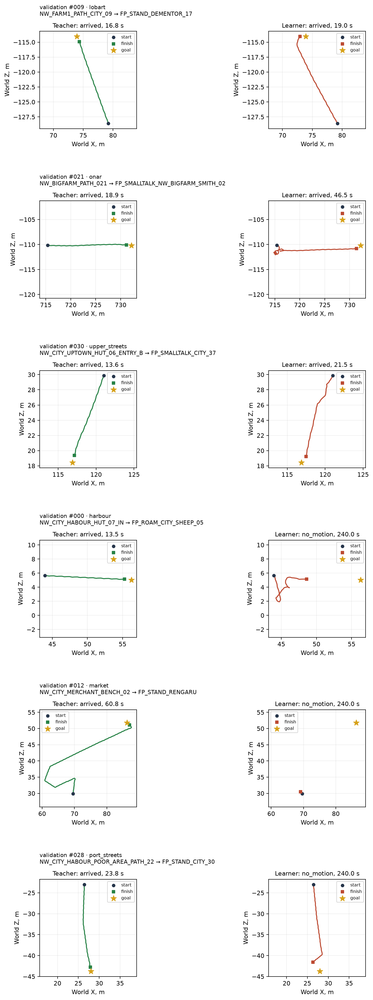

# DAgger без прошлых клавиш: остановка после первого раунда

2026-10-17, этап 5 [навигации](../../../docs/navigation.md).

**Ученик дошёл в 3/31 отложенных пар (9,68%) и 4/30 обучающих (13,33%). Цель ≥50% не достигнута.** Сработало стоп-правило первого раунда: **3/31 < 10%**, поэтому раунды 2 и 3 не проводились. Контроль Малета у забора не пройден: 240 с, до цели 8,00 м.

Прямой вход `previous_keys` удалён. Новый основной провал — продолжительные повороты на месте, часто с переключением направления. На отложенных парах они занимают **66,87% решений**. Тело действительно поворачивается; ошибка воспроизводится при совпадающих NumPy и C++ проходах.

## Вход, данные и обучение

[Подготовка данных](../../../scripts/nav_bc_data.py), [обучение](../../../scripts/nav_bc_train.py), [C++ политика](../../../OpenGothic/common/navpolicy.cpp).

Вектор уменьшен **2174 → 2166**: глаз **238×9**, знакомые дороги **10**, тело **14**. Карты памяти прежние: **9×32×32** и **9×25×25**. Политика не читает прошлые клавиши, мировую позу и подсказки учителя. Историю сохраняет GRU. `nav_demos.learner_input()` и формат записей сохранены; поле прошлых клавиш используется только для метрики, а не для признаков.

Заголовок весов содержит `preprocessing.vector_order = ["eye", "roads", "body"]` и `architecture.inputs.vector = [2166]`. C++ выбирает состав по этому заголовку, сверяет размеры архитектуры и тензоров, отвергает неизвестный состав. Чтение прежней схемы из 2174 чисел сохранено. Контракт новой схемы проверяет неизменность признаков при подмене прошлых клавиш, включая NaN.

Разбиение взято из **`ryzen:/home/kaifaty/gothic-ai/nav-bc/cache/index.json`**, без повторного распределения пар. Проверено равенство самих множеств: **125 обучающих / 31 отложенная пара**. Файл выбора поездок `pairs.jsonl` побайтово совпадает с первой ездой; те же seed, NPC, начальные позиции и лимит **240 с**.

| Данные раунда 1 | Эпизодов | Решений | Назначение |
|---|---:|---:|---|
| Успешные записи учителя, обучающие пары | 125 | 80 372 | Обучение |
| Первая езда ученика, обучающие пары | 30 | 72 000 | Обучение; включены все 30 неудачных поездок |
| Успешные записи учителя, отложенные пары | 31 | 16 826 | Проверка и выбор контрольной точки |
| Первая езда, отложенные пары и контроль | 32 | — | Исключены из обучения |
| **Итого обучение** | **155** | **152 372** | **125 различных пар** |

35 неуспешных записей учителя исключены. Ответы учителя `keys` в неудачных поездках ученика сохранены как цели. Ни отложенные DAgger-пары, ни контроль не добавляют обучающих примеров. Подготовка принимает повторяемый `--dagger-source`; следующие раунды могут объединять источники, сохраняя исходное разбиение.

Обучение с нуля: **20 эпох**, seed **17**, AdamW **3×10⁻⁴**, weight decay **10⁻⁴**, batch **8 эпизодов**, TBPTT **64 шага**, GRU **256**, ограничение нормы градиента **1**. Архитектура и веса loss прежние: головы **2/1/2/1/1/1**, веса классов `sqrt(N/(K_present*n))`, ограниченные `[0,5; 3]`. **614 223 параметра**, **1 014 344 MAC** на решение.

Выбрана **17-я эпоха** по прежнему критерию: среднее `turn macro-F1` и `forward balanced accuracy`. Метрика смены действия диагностическая и не меняет этот критерий. На выбранной точке общая accuracy вперёд **75,75%**, поворота **72,13%**, macro-F1 поворота **0,3953**. Loss: **0,5970 → 0,1170** к 20-й эпохе; метрики проверки колеблются, улучшение loss не гарантирует улучшения езды. [Краткая история 20 эпох](history.json), [полные метрики проверки](offline-metrics.json). Полная история обучения остаётся рядом с весами на Ryzen.

Все вычисления моделей и езда выполнены на Ryzen. Перед обучением проверен `nvidia-smi`: около **0,6 ГиБ** занято на RTX 3080. Время эпох с оценкой, без ожидания замка и импорта процессов — **428,63 с**. Максимальный RSS обучения **3,36 ГиБ**, подготовки **168,5 МиБ**, ниже 12 ГБ. Общий замок освобождался после каждой эпохи и каждых трёх пар; последняя пачка — две пары. Перед сбором проверялось свободное место. Ожидание чужих прогонов в эти времена не входит.

## Доходимость и застревания

| Раунд | Выборка | Дошло | Время всех поездок, медиана, с | Время успехов, медиана, с | Застреваний клавишами | Поездок с неподвижностью ≥3 с |
|---|---|---:|---:|---:|---:|---:|
| **1** | **Отложенные** | **3/31 (9,68%)** | **240,00** | **21,47** | **17** | **29/31** |
| 1 | Обучающие | 4/30 (13,33%) | 240,00 | 97,32 | 29 | 29/30 |
| 1 | Контроль Малета | 0/1 | 240,00 | — | 0 | 1/1 |

У сохранённого учителя на этих парах **31/31 и 30/30**, медианы **40,17 и 44,53 с**. Медиана времени успехов ученика относится только к его трём/четырём удачным поездкам; она не означает превосходства по времени над учителем на всей выборке.

Застревание клавишами: смещение в XZ **<50 см за 3 с**, поступательное действие запрошено не меньше **1,5 с** окна; перекрывающиеся окна объединяются. Суммарно **841,0 с** на отложенных и **600,9 с** на обучающих, максимальный эпизод **236,2 и 190,8 с**. Неподвижность считается отдельно: 3D-смещение между концами 3-секундного окна **≤25 см**. Получено **188 / 241 / 1** таких интервалов на отложенных / обучающих / контроле. Повороты без движения не требуют нажатого «вперёд», поэтому низкий счётчик застреваний не означает, что ученик идёт.

| Место | Отложенные | Обучающие |
|---|---:|---:|
| Гавань | 0/6 | 0/5 |
| Лобарта | 1/6 | 0/5 |
| Рынок | 0/5 | 0/5 |
| Онара | 1/6 | 4/5 |
| Улицы порта | 0/6 | 0/5 |
| Верхний квартал | 1/2 | 0/5 |

### Расхождение с учителем во время езды

Доля решений с несовпадением фактического действия ученика и ответа учителя в том же состоянии. Оси сравниваются по знаку, флаги — по ненулевому значению, как классы политики. Терминальный сброс клавиш исключён.

| Раунд / выборка | Решений | Вперёд | Вбок | Поворот | Шаг | Прыжок | Залезть | Любая голова |
|---|---:|---:|---:|---:|---:|---:|---:|---:|
| 1 / отложенные | 66 116 | 28,25% | 0% | 61,56% | 0% | 0% | 0% | 65,67% |
| 1 / обучающие | 64 413 | 36,85% | 0% | 66,66% | 0% | 0% | 0% | 74,24% |
| 1 / контроль | 2400 | 9,04% | 0% | 53,08% | 0% | 0% | 0% | 54,96% |

## Новая метрика вне езды: смена действия

Маска — хотя бы одна из **шести дискретных голов** `keys` отличается от `previous_keys`; углы головы не входят в выход политики и маску. На отложенных записях учителя это смена его собственного прошлого действия. Ни метки, ни маска не передаются на вход сети. У базы «повтори прошлые клавиши» точность всех голов на такой маске по определению **0%**.

| Раунд | Шагов смены | Вперёд | Вбок | Поворот | Шаг | Прыжок | Залезть | Все головы одновременно |
|---|---:|---:|---:|---:|---:|---:|---:|---:|
| **1** | **2834 / 16 826** | **72,55%** | 100% | **43,90%** | 100% | 100% | 100% | **35,07% (994/2834)** |

Это точность выбранной **17-й эпохи**, которая действительно ездила. На той же маске база «всегда вперёд» имеет accuracy вперёд **95,94%**, поворота **46,75%**. Новая модель уступает ей по этим двум accuracy. Четыре остальные головы имеют постоянные целевые классы: нет целевых strafe, jump, climb и бега; их 100% не устанавливают умение выполнять эти действия.

Во время езды `previous_keys` принадлежит ученику. Там та же маска означает запрос учителя исправить прошлое действие ученика, а не смену прошлого действия самого учителя. Accuracy всех голов на этой маске: отложенные **15,18% / 43 583 шага**, обучающие **6,78% / 47 893**, контроль **26,57% / 1351**. Эти числа не подменяют метрику вне езды выше. [Все метрики езды и отдельные пары](drive-metrics.json).

## Что делает ученик

| Выборка | Вперёд, доля решений | Поворот без движения | Нейтральное движение и поворот | Смен команд | Доля повторов соседних команд |
|---|---:|---:|---:|---:|---:|
| Отложенные | 27,41% | **66,87%** | 5,72% | 15 409 | 76,68% |
| Обучающие | 25,80% | **63,58%** | 10,62% | 10 920 | 83,04% |
| Контроль | 7,75% | **92,04%** | 0,21% | 733 | 69,45% |

«Вперёд» может сочетаться с поворотом; «поворот без движения» требует нулевых forward/strafe. Повторы считаются внутри эпизодов по шести головам, без терминальной строки. Во всех поездках `walk=1`, назад/strafe/jump/climb не нажимаются.

**Наблюдаемый провал сменился:** вместо долгого неизменного «вперёд» из первой езды ученик часто останавливает поступательное движение и продолжает поворачивать. На первой отложенной паре — **1097 смен команд**, **2119/2400 решений поворота на месте**, затем **37,8 с** одной команды поворота. За весь эпизод сумма модулей изменений фактического yaw тела — **19 449°**, около 54 оборотов с учётом обоих направлений. Это выполненные телом повороты, а не только записанные запросы.

| Пример | До цели в конце | Последние 10 с: путь XZ | Последние 100 решений: вперёд / поворот на месте | Наблюдение |
|---|---:|---:|---:|---|
| Отложенная 000, гавань | 7,66 м | 0 см | 0 / 100 | Уходит с почти прямой траектории учителя и остаётся вращаться |
| Отложенная 012, рынок | 27,38 м | 0 см | 0 / 100 | Учитель обходит через улицу; ученик почти не покидает старт, 99,75% решений — поворот на месте |
| Отложенная 028, улицы порта | 2,75 м | 0 см | 0 / 100 | Проходит большую часть пути, затем вращается рядом с целью; суммарный угловой путь 19 494° |
| Обучающая 005, поле Лобарта | 2,02 м | 0 см | 0 / 94 | Подходит близко, затем стоит или поворачивает; до радиуса успеха не доходит |

Из **28 неуспешных отложенных поездок**: **23** имеют путь за последние ≤10 с не больше 0,5 м; **1** движется локально со смещением ≤0,5 м; **3** ещё движутся на лимите; **1** закончилась досрочно при `actor_down`. На обучающих: **22 / 0 / 3 / 1** соответственно. Конкретная помеха и причина выведения NPC из строя этими траекториями не установлены.

Все три отложенных успеха показаны ниже: у учителя они занимают **16,80 / 18,87 / 13,57 с**, у ученика **19,03 / 46,47 / 21,47 с**. На этих коротких проходах ученик в итоге начинает двигаться к цели. Короткий прямой путь сам по себе успеха не гарантирует: пример 000 тоже имеет почти прямую траекторию учителя.

**Гипотеза для следующего исследования — сдвиг распределения обучающих действий.** В успешных обучающих записях учителя остановка составляет **3651/80 372 (4,54%)**, поворот — **14,63%**. В добавленных 72 000 решениях первой езды учитель требует остановки в **87,66%**, поворота в **98,06%**. После объединения — **43,82% остановок и 54,05% поворотов**. Это согласуется с частыми остановками и вращением новой политики. Отдельное влияние распределения данных, весов loss, критерия выбора контрольной точки и числа эпох не измерялось. После срабатывания стоп-правила подбор и следующие раунды прекращены.

## Контроль Малета у забора

Подготовка повторяет [первую езду](../2026-10-17-drive/README.md) и [исходный контроль](../2026-10-16-stuck/intentional.bench): герой в `NW_FARM1_ENTRANCE_03`, Малет смещён `(0,0,-1400)`, герой перемещён в `NW_FARM1_ENTRANCE_01`, ожидание **1000 мс**; затем `drive-current` к `FP_ROAM_FARM1_SHEEP_09`, лимит **240 с**.

**Не дошёл**, остаток **799,86 см**. Из 2400 решений **2209** — поворот без поступательного движения, **186** — вперёд. Последние 10 с путь нулевой; застреваний с запрошенным движением **0**, неподвижный интервал **1**. Прежняя политика проходила этот контроль за **107,4 с**; новый раунд его не сохраняет.

## Траектории сверху



Пары **009, 021, 030, 000, 012, 028**: все три отложенных успеха и по одному неуспеху из гавани, рынка и улиц порта, всего шесть мест. На каждой строке общий масштаб двух панелей. Круг — старт, квадрат — финиш, звезда — цель. Это XZ-траектории в метрах; мировые координаты используются только для анализа, на вход политики не поступают.

## Проверки и сохранённые файлы

- **23 теста прошли за 2,57 с** на Ryzen: `scripts/tests/test_nav_bc_*.py`, `scripts/tests/test_nav_drive.py`. Проверены отсутствие прошлых клавиш во входе, исходное разбиение, включение неудачных DAgger-поездок, маска смены и её агрегирование, экспорт и GRU.
- На Ryzen собраны `Gothic2Notr`, `gothic-body-runner`, `check-navpolicy`. Синтетический контракт: **1000 шагов**, максимальная ошибка логитов **2,79×10⁻⁹**.
- **Torch ↔ NumPy:** 1000 последовательных шагов отложенного эпизода `episodes__033`, один GRU без сброса. Максимальная ошибка логитов **5,72×10⁻⁶**, hidden **3,93×10⁻⁶**. [Числа](numpy-parity.json).
- **C++ ↔ NumPy:** 1000 последовательных исходных шагов `nav-demos/episodes/000`, без сброса GRU. Ошибка признаков **9,54×10⁻⁷**, логитов **3,81×10⁻⁶**, hidden **2,53×10⁻⁶**, допуск **10⁻⁴**. Это отдельная сверка на исходных признаках; Torch/NumPy выше использует кэш с float16. [Числа](cpp-parity.json).
- Все новые записи проверены `nav_demos.py check`: **62 эпизода / 132 929 решений, `validated=true`**. Сжатые samples — **2 120 462 732 байта**. [Результат](dagger-check.json).
- На Mac собраны движок и runner с `--parallel 2`, только компиляция. Заключительный вызов сборки: `ninja: no work to do`.
- Полный pytest, e2e и локальные вычисления моделей на Mac не запускались. В git сохранены отчёт, картинка и численные результаты; записей и весов в нём нет.

**Веса лучшего и единственного раунда:** `ryzen:/home/kaifaty/gothic-ai/nav-dagger/round-1/run/policy.navbc`, **2 467 390 байт**, эпоха **17**. Рядом — `best.pt`, `last.pt`, история и настройки обучения.

Новые записи: **`ryzen:/home/kaifaty/gothic-ai/nav-dagger/round-1/dagger/{validation,train,control}/`**. Исходные `nav-demos/` и `nav-drive/` использованы только для чтения. Кэш обучения — `round-1/bc-cache/`; эталоны — `round-1/parity-real/` и `round-1/run/reference-1000.npz`; сценарии и `pairs.jsonl` — в `round-1/`. Рабочие скрипты запуска — `nav-dagger/run-round.sh` и `nav-dagger/checks.sh`.

Основные команды на Ryzen; все пути вывода абсолютные:

```bash
task=/home/kaifaty/gothic-ai/nav-dagger
out="$task/round-1"
export PATH=/home/kaifaty/gothic-ai/nav-bc/.venv/bin:$PATH
export OPENBLAS_NUM_THREADS=1 OMP_NUM_THREADS=1 MKL_NUM_THREADS=1
lock=/home/kaifaty/gothic-ai/body-simulation.lock

flock "$lock" nvidia-smi
flock "$lock" python -I "$task/source/scripts/nav_bc_data.py" prepare \
  --source /home/kaifaty/gothic-ai/nav-demos --output "$out/bc-cache" \
  --split-index /home/kaifaty/gothic-ai/nav-bc/cache/index.json \
  --dagger-source /home/kaifaty/gothic-ai/nav-drive/dagger

# Один процесс и один захват замка на эпоху, перенос optimizer/GRU-весов через last.pt.
for epoch in {1..20}; do
  resume=()
  if [[ -f "$out/run/last.pt" ]]; then resume=(--resume); fi
  flock "$lock" python -I "$task/source/scripts/nav_bc_train.py" train \
    --cache "$out/bc-cache" --output "$out/run" --device cuda --threads 4 \
    --epochs "$epoch" "${resume[@]}"
  sleep 1
done
flock "$lock" python -I "$task/source/scripts/nav_bc_train.py" evaluate \
  --cache "$out/bc-cache" --output "$out/run" --device cuda
flock "$lock" python -I "$task/source/scripts/nav_bc_train.py" verify \
  --cache "$out/bc-cache" --output "$out/run" --device cpu --steps 1000
flock "$lock" python -I "$task/source/scripts/check_nav_policy.py" \
  --output "$out/parity-real" --weights "$out/run/policy.navbc" \
  --source /home/kaifaty/gothic-ai/nav-demos --steps 1000
flock "$lock" "$task/build/opengothic/gothic-navpolicy-contract" \
  "$out/run/policy.navbc" "$out/parity-real/parity.bin.gz"

cp /home/kaifaty/gothic-ai/nav-drive/pairs.jsonl "$out/pairs.jsonl"
bash "$task/source/scripts/nav-drive-batch.sh" --output "$out" \
  --runner "$task/build/opengothic/gothic-body-runner" \
  --assets /home/kaifaty/gothic-ai/game --save "$task/save_slot_1.sav" \
  --cache "$task/navmesh-cache" --weights "$out/run/policy.navbc" \
  --limit-ms 240000 --batch-size 3 --lock-wait 3600 --resume
flock "$lock" python -I "$task/source/scripts/nav_drive.py" analyze --output "$out"
flock "$lock" python -I "$task/source/scripts/nav_drive.py" plot \
  --output "$out" --indices 9,21,30,0,12,28
```
