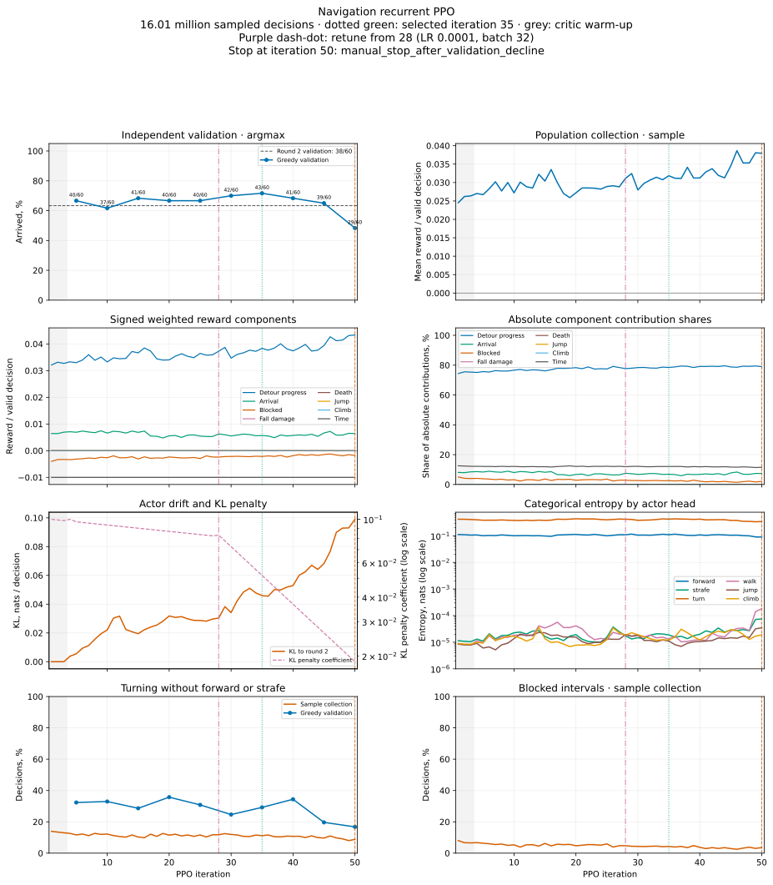
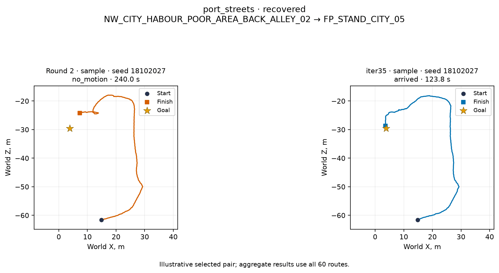
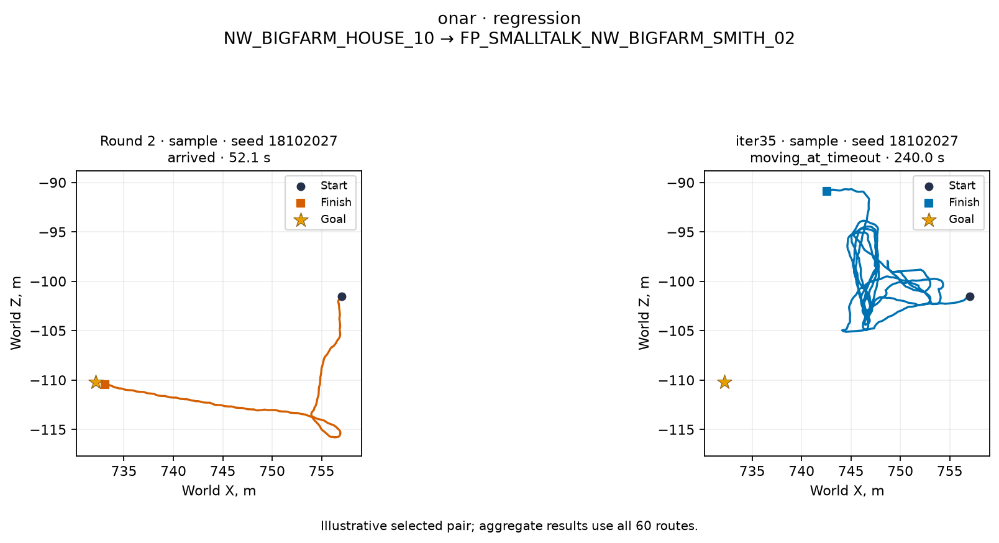
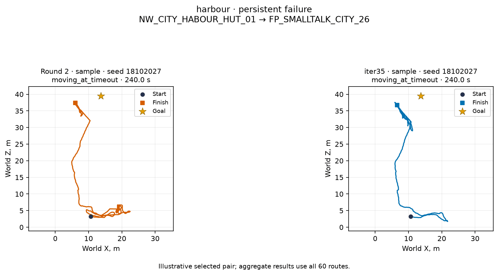
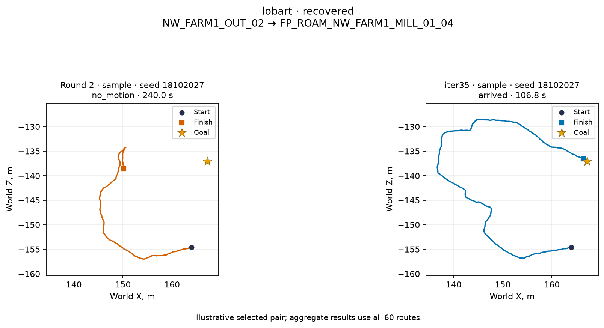
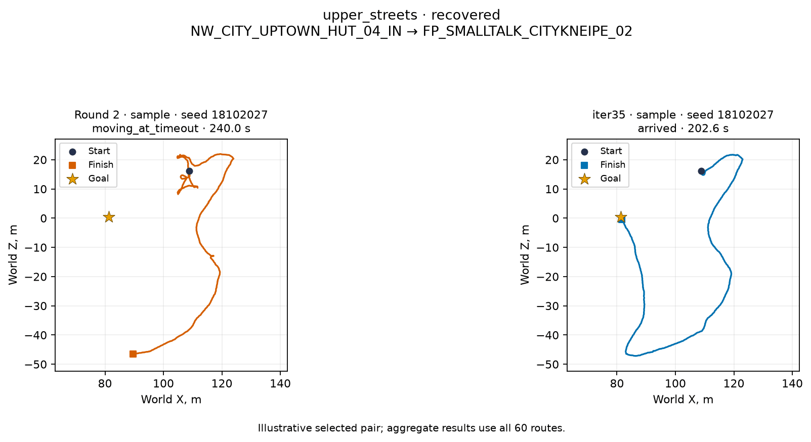
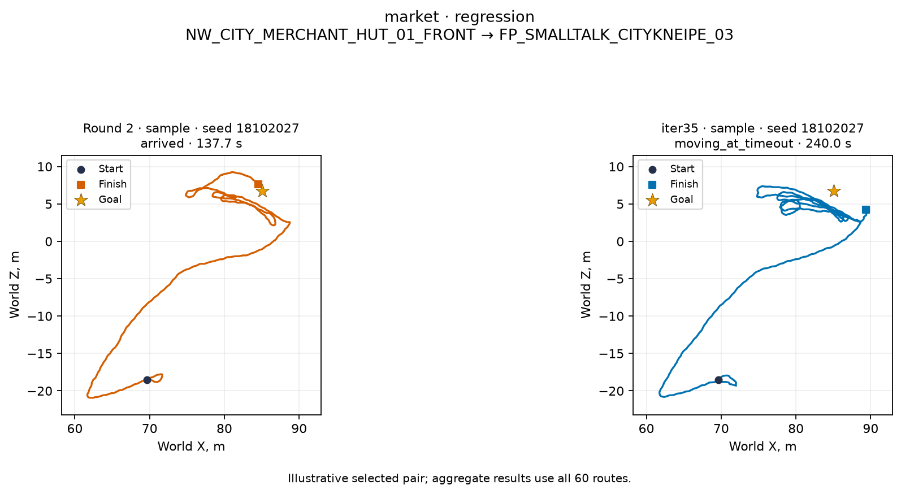

# Навигация: финал рекуррентного PPO — 18–19 октября 2026

**Главный выигрыш дала выборка действий; дополнительный прирост от PPO находится в пределах шума.** На независимом `holdout-cv.jsonl` раунд 2 / итерация 35 дошли при argmax в **33/60 / 35/60**, при softmax-выборке — в среднем **40,3/60 / 41,3/60**. Режим **sample** выбран по собственной валидации до запуска теста. Цель **≥42/60 и ≤15% поворотов на месте не достигнута**: у PPO при sample **68,89% успехов, 18,36% поворотов**. Два seed дали 42/60, но ни один не выполнил ограничение поворотов; лучший seed не выбирался по тесту.

Обучение остановлено пользователем после **итерации 50 / 16 006 484 принятых решений**: `manual_stop_after_validation_decline`. Выбранный по валидации чекпойнт — **35**. Причина, пять последних замеров и лучший чекпойнт сохранены в `run/state.json`, причина также в строке 50 `curves.jsonl`. Текущие веса 50 оставлены для разбора, цикл не перезапускается. В обычной игре обученная навигация пока не включена.

## Условия сравнения и выбор режима

Заявка **gq `547be2ad2457`** завершила все **16 замеров × 60 = 960 эпизодов**, четыре контроля Малета и контракт. Одинаковые нынешние `drive`, CharacterVirtual, сохранение и стартовые пары; лимит **240 с**, управление учителем — **0 решений**. Раунд 2 перемерен в этой заявке; прежние 33/60 в таблицы не подставлялись. Его новый argmax снова дал 33/60 и 31,70% поворотов.

**60 маршрутов** повторяются с тремя заранее фиксированными seed **18102027 / 18102028 / 18102029**; это **180 эпизодов, а не 180 независимых маршрутов**. Seed действий смещается на исходный индекс пары; seed мира самой пары сохраняется. Argmax измерен один раз для каждого набора весов. Сначала полностью завершена собственная валидация обоих весов и режимов; `final/mode-selection.json` зафиксирован до первого процесса теста. Выбор — наибольшая объединённая доля успехов; при равенстве меньше поворотов, затем упора, затем argmax. На тесте показаны оба режима, выбор не менялся.

| Веса | Режим | Дошёл по seed, из 60 | Среднее | Успех, % | Поворот, % решений |
|---|---:|---:|---:|---:|---:|
| Раунд 2 | argmax | 38 | 38,0/60 | 63,33 | 34,56 |
| Раунд 2 | sample | 42 / 43 / 46 | 43,7/60 | 72,78 | 19,94 |
| Итерация 35 | argmax | 43 | 43,0/60 | 71,67 | 29,23 |
| Итерация 35 | sample | 50 / 45 / 48 | 47,7/60 | 79,44 | 18,89 |

Валидация предпочла sample у обоих весов: **43,7/60** у раунда 2 и **47,7/60** у PPO. Разница на собственной валидации — четыре маршрута; на независимом тесте остался один.

## Независимый тест

| Веса | Режим | Дошёл по seed, из 60 | Среднее | Успех, % | Поворот, % решений |
|---|---:|---:|---:|---:|---:|
| Раунд 2 | argmax | 33 | 33,0/60 | 55,00 | 31,70 |
| Раунд 2 | sample | 39 / 41 / 41 | 40,3/60 | 67,22 | 21,66 |
| Итерация 35 | argmax | 35 | 35,0/60 | 58,33 | 38,78 |
| Итерация 35 | sample | 40 / 42 / 42 | 41,3/60 | 68,89 | 18,36 |

Выборка добавила раунду 2 **7,3 маршрута** относительно его argmax, итерации 35 — **6,3**. Сам PPO добавил **2** маршрута при argmax и **1** в среднем при выборке. При одинаковом первом/втором/третьем seed восстановлено **4/2/4** неудачи раунда 2, потеряно **3/1/3** его успеха: чистый итог каждый раз **+1**, а не только приобретения.

Парный bootstrap по **60 маршрутам**, с сохранением трёх seed внутри каждого маршрута и десяти маршрутов каждого района, даёт для добавки PPO **95% интервал −2,0…+4,3 маршрута на 60** (10 000 повторов, seed 19102026). Ноль внутри интервала. Это условная оценка по этим маршрутам и трём seed, без повторных обучений PPO; доказанного прироста от PPO нет.

### Время, застревания и прыжки

Поворот — решение с ненулевым turn и нулевыми forward/strafe; он не измеряет весь физический разворот. Упор — прежний детектор `drive` по движению и удерживаемому вводу. Серии малого смещения — объединённые окна ≥3 с со смещением ≤25 см. Время успеха условно на дошедших, поэтому сравнение разных наборов успехов само по себе не доказывает ускорение. Sample объединяет три прогона; число эпизодов и суммарные секунды у него втрое больше.

| Веса / режим | Эпизодов | Медиана успеха / всех, с | Упор, с (% времени) | Серий упора | Эпизодов / серий малого смещения | Пройдено, км | Прыжков/км |
|---|---:|---:|---:|---:|---:|---:|---:|
| Раунд 2 argmax | 60 | 38,77 / 154,28 | 1954,8 (22,99%) | 46 | 34 / 84 | 3,362 | 0,0 |
| Раунд 2 sample | 180 | 43,43 / 72,08 | 4346,5 (19,65%) | 217 | 99 / 454 | 11,419 | 0,0 |
| Итерация 35 argmax | 60 | 38,90 / 128,98 | 1113,8 (13,77%) | 34 | 29 / 97 | 3,284 | 0,0 |
| Итерация 35 sample | 180 | 41,42 / 91,00 | 4226,7 (19,29%) | 213 | 88 / 352 | 12,114 | 0,0 |

Прыжков и залезаний — **0 во всех четырёх группах теста**. Движение назад и вбок также не выбиралось. PPO при sample уменьшил долю поворотов с **21,66% до 18,36%**, но суммарная доля времени упора изменилась мало: **19,65% → 19,29%**. Медиана всех эпизодов выросла **72,08 → 91,00 с**. Сниженные повороты не равны надёжному достижению цели.

### По районам: argmax

Во всех парных ячейках ниже порядок **раунд 2 / итерация 35**. Каждый район содержит десять одинаковых маршрутов.

| Район | Дошёл, из 10 | Поворот, % | Медиана успеха, с | Упор, с | Серий малого смещения |
|---|---:|---:|---:|---:|---:|
| Рынок | 3 / 4 | 31,51 / 47,70 | 21,87 / 20,92 | 641,5 / 226,7 | 18 / 11 |
| Порт | 3 / 4 | 48,26 / 53,91 | 43,50 / 84,73 | 361,8 / 35,8 | 15 / 17 |
| Онар | 6 / 9 | 6,62 / 5,89 | 38,37 / 38,90 | 532,6 / 6,7 | 13 / 5 |
| Лобарт | 8 / 6 | 28,55 / 39,21 | 50,67 / 52,05 | 222,1 / 357,8 | 8 / 41 |
| Портовые улицы | 7 / 6 | 13,57 / 16,38 | 38,77 / 36,83 | 193,6 / 486,8 | 13 / 10 |
| Верхний квартал | 6 / 6 | 44,34 / 41,69 | 92,03 / 91,93 | 3,2 / 0,0 | 17 / 13 |

### По районам: sample

По **30 эпизодов на район**: те же десять маршрутов × три seed; порядок снова раунд 2 / итерация 35. Средняя доходимость на десяти маршрутах равна числителю, делённому на три. Прыжков/км во всех районах обоих режимов — **0**.

| Район | Дошёл, из 30 | Поворот, % | Медиана успеха, с | Упор, с | Серий малого смещения |
|---|---:|---:|---:|---:|---:|
| Рынок | 15 / 13 | 23,88 / 28,58 | 21,90 / 21,17 | 972,2 / 1011,8 | 130 / 119 |
| Порт | 12 / 13 | 34,27 / 25,79 | 81,22 / 98,80 | 799,4 / 1025,7 | 89 / 80 |
| Онар | 26 / 26 | 10,47 / 8,90 | 40,07 / 37,77 | 125,0 / 32,7 | 22 / 18 |
| Лобарт | 23 / 24 | 19,78 / 6,02 | 51,83 / 51,08 | 963,2 / 1136,7 | 94 / 63 |
| Портовые улицы | 24 / 25 | 14,29 / 11,81 | 47,37 / 55,60 | 824,5 / 859,6 | 57 / 35 |
| Верхний квартал | 21 / 23 | 14,76 / 14,18 | 42,73 / 44,03 | 662,2 / 160,2 | 62 / 37 |

Самые слабые районы сохранились: **рынок и порт**. При sample рынок даже ухудшился **15/30 → 13/30**, порт изменился **12/30 → 13/30**. Улучшение argmax у Онара сопровождается потерей успехов у Лобарта и на портовых улицах.

## Все итерации, перенастройка и спад

Все 50 точек взяты из `run/curves.jsonl`: валидация, средняя награда, взвешенные компоненты и их абсолютные доли, KL к раунду 2 и его коэффициент, энтропия шести голов, поворот и упор. Серая область — прогрев критика, пурпурная линия — перенастройка с 28, зелёная — лучший чекпойнт 35, оранжевая — остановка 50. Валидация здесь **argmax**, как и при выборе весов; финальная проверка sample не подменяет историю обучения.

**Прогрев:** три итерации / **960 410 решений**, KL = 0; три `.navbc` побайтно совпадают с раундом 2. Проба на одном сборе: коэффициенты **0,1 / 1 / 10** дали KL **0,003825 / 0,002006 / 0,000703**; выбрано **0,1**. Энтропия пробы сравнивалась с исходной политикой на тех же наблюдениях.

На итерации 27: **8 643 602 решения**, KL **0,02963**, награда **0,02883**. По решению пользователя с **итерации 28**:

| Параметр | До | После |
|---|---:|---:|
| LR актёра | 3×10⁻⁵ | 10⁻⁴ |
| Окон в пакете | до 8 одного эпизода | до 32 разных эпизодов |
| График коэффициента KL | 0,1 → 0,003 за общий потолок 150 млн | 0,083 → 0,01 за следующие 10 млн |
| `target_kl` пробы | 0,03 | 0,1 |

Якорь **8 643 602** и история смены сохранены в `state.json`; перезапуск не сдвигал график. Две эпохи, окно **32 / burn-in 16**, коэффициент энтропии **0,003** и награды остались прежними. Реальная межэпизодная упаковка сохранила индивидуальные GRU-состояния, burn-in и маску хвоста. Итерация 28: пакет **31,87 / 32**, **658** шагов оптимизатора, **639,76 с** против **684,98 с** на 27, ускорение **6,60%**. Peak allocated CUDA вырос **0,0896 → 0,2416 ГиБ**; это аллокатор Torch, а не вся память драйвера.

| Итерация | Решений, млн | Валидация, из 60 | Поворот валидации, % | Idle валидации, % | Награда / решение сбора | KL к раунду 2 | Коэффициент KL |
|---|---:|---:|---:|---:|---:|---:|---:|
| 5 | 1,601 | 40 | 32,35 | 0,01 | 0,02671 | 0,00551 | 0,09705 |
| 10 | 3,201 | 37 | 32,96 | 0,17 | 0,02719 | 0,02209 | 0,09349 |
| 15 | 4,802 | 41 | 28,65 | 0,02 | 0,03040 | 0,01946 | 0,09005 |
| 20 | 6,403 | 40 | 35,74 | 0,03 | 0,02721 | 0,03179 | 0,08675 |
| 25 | 8,003 | 40 | 30,83 | 1,93 | 0,02892 | 0,02866 | 0,08356 |
| 30 | 9,604 | 42 | 24,64 | 0,03 | 0,02800 | 0,03414 | 0,07248 |
| 35 | 11,205 | 43 | 29,23 | 0,05 | 0,03184 | 0,04594 | 0,05166 |
| 40 | 12,805 | 41 | 34,41 | 0,06 | 0,03123 | 0,05294 | 0,03681 |
| 45 | 14,406 | 39 | 19,65 | 19,20 | 0,03449 | 0,06822 | 0,02624 |
| 50 | 16,006 | 29 | 16,77 | 41,72 | 0,03794 | 0,09897 | 0,01870 |

Лучший argmax — **35: 43/60**. Затем **41 → 39 → 29**, хотя награда сбора выросла **0,03184 → 0,03794**, а повороты валидации снизились **29,23% → 16,77%**. На 50-й **41,72% решений — idle** против **0,05%** на 35-й. Это деградация достижения цели с отпусканием движения, а не успешное избавление от застреваний. KL вырос **0,04594 → 0,09897** при снижении коэффициента **0,05166 → 0,01870**.

Остановка — **ручная**, `manual_stop_after_validation_decline`. На 50-й впервые накоплено одно падение >15 п. п. относительно исторического лучшего; для автоматического коллапс-стопа нужны два подряд. Порог 30 млн и потолок 150 млн не достигнуты. Они не выдаются за пройденные проверки.

Энтропия не стала нулевой у всех голов, но разнообразие остаётся почти только у forward и turn. Значения ниже измерены на разных сборах, поэтому сами по себе не являются сравнением на одинаковых наблюдениях.

| Голова | Итерация 3 | Итерация 35 | Итерация 50 |
|---|---:|---:|---:|
| forward | 0,106572 | 0,110797 | 0,0897293 |
| strafe | 1,05121e-05 | 1,87912e-05 | 7,45998e-05 |
| turn | 0,410838 | 0,424222 | 0,343349 |
| walk | 7,88217e-06 | 1,31565e-05 | 0,000181236 |
| jump | 7,9019e-06 | 1,1083e-05 | 3,48361e-05 |
| climb | 8,38821e-06 | 1,2028e-05 | 1,89129e-05 |

**Награды не менялись:** +1 за метр прогресса Detour, +10 за успех, −0,05 за интервал упора, −0,1 за HP падения, −10 за смерть, −0,1 за нажатие jump/climb, −0,01 за решение. Невалидные пути маскируются. На 50-й абсолютная доля прогресса — **79,00%**, успеха — **7,38%**, времени — **11,53%**, упора — **2,05%**; остальные компоненты почти нулевые.

**Объяснение спада — гипотеза по данным, не установленная причина.** Рост краткосрочного прогресса не согласуется с успехом полной поездки. Сбор каждой итерации ограничен **40 с**, после него runner и эпизоды начинаются заново; поздние состояния 230–240 с из разбора ниже в такие сборы не попадают. Bootstrap критика корректно учитывает усечение, но не создаёт отсутствующих посещений поздних тупиков. Кроме того, штраф упора требует команды движения: отпускание движения уменьшает его, не приближая к цели. Это согласуется с ростом idle на 45–50, но отдельной причинной пробы награды/горизонта здесь не было.

## Шесть пар картинок: sample, один и тот же первый seed

Это **записанные траектории**, а не новый запуск и не реконструкция из модели. Слева раунд 2, справа итерация 35; CV, sample, **18102027**, одинаковый масштаб внутри пары. Выбор иллюстраций обеспечивает восстановленную неудачу, ухудшение и общий провал, затем покрытие районов. Агрегат выше использует все маршруты; эти картинки не служат оценкой частоты успеха.

**1. Портовые улицы — Неудача раунда 2 стала успехом.** `NW_CITY_HABOUR_POOR_AREA_BACK_ALLEY_02` → `FP_STAND_CITY_05`.

**2. Онар — Успех раунда 2 потерян.** `NW_BIGFARM_HOUSE_10` → `FP_SMALLTALK_NW_BIGFARM_SMITH_02`.

**3. Порт — Оба не дошли.** `NW_CITY_HABOUR_HUT_01` → `FP_SMALLTALK_CITY_26`.

**4. Лобарт — Неудача раунда 2 стала успехом.** `NW_FARM1_OUT_02` → `FP_ROAM_NW_FARM1_MILL_01_04`.

**5. Верхний квартал — Неудача раунда 2 стала успехом.** `NW_CITY_UPTOWN_HUT_04_IN` → `FP_SMALLTALK_CITYKNEIPE_02`.

**6. Рынок — Успех раунда 2 потерян.** `NW_CITY_MERCHANT_HUT_01_FRONT` → `FP_SMALLTALK_CITYKNEIPE_03`.

## Последние 10 секунд двадцати неудач итерации 35

Только **sample, seed 18102027**, без выбора удобного seed. На нём 40/60 успехов; все **20 неудач** разобраны. `actions.txt` содержит реальные действия политики; `NAVDEMO.keys` — метки учителя и для поведения **не использовались**. Абсолютные часы сенсоров сопоставлены со временем действий и траекторией; максимальное расхождение позиции **0,0000664 см**. Траектория включает последние полные 10 с; сенсоры заканчиваются на последнем решении перед терминальным кадром.

У четырёх NPC смещение почти нулевое и всё время удерживается «вперёд» (**00, 34, 47, 49**); **36** дёргается в пределах 27 см. **03, 09, 11** главным образом меняют курс на месте, с 73–93% turn-only. Восемь других продолжают двигаться/рыскать; ещё четыре (**07, 10, 52, 56**) увеличивают прямое расстояние до цели. Удаление по прямой может быть частью обхода, поэтому это не объявляется доказательством неверного маршрута. Назад, вбок, прыжок и залезание не применяются ни в одном из этих хвостов.

В таблице «путь / сдвиг» — физическая длина XZ и итоговое смещение за 10 с. Угол — размах курса, не сумма всех поворотов. «Стена <2 м» — доля кадров со свежим фронтальным лучом любого pitch и |normal_y|≤0,3; подвижная помеха с иной нормалью в этот счётчик не входит. Память проверена в последнем кадре и ещё четырёх кадрах хвоста.

**Цепочка памяти raw / вход:** `да` — 4-связная цепочка известных свободных ячеек к морковке; `у тела` — стартовая ячейка содержит сигнал опасности; `неизв.` — старт или цель не наблюдены; `вне/неизв.` — морковка вне ближней карты и локальная точка по её направлению неизвестна. Unknown не считается свободным. Порог уверенности/free/опасности **0,2**, дополнительно рассчитаны free 0,1/0,4 и расширение опасностей на 30 см. Такая цепочка **не доказывает зазор для тела или понимание пути сетью**; отсутствие цепочки не доказывает отсутствие реального обхода.

| № / схема | Район | Поведение | Путь / сдвиг, м | Размах курса, ° | Стена <2 м, % кадров | Цепочка raw / вход |
|---|---:|---:|---:|---:|---:|---:|
| [00](images/failure-000.png) | Рынок | Стоит, рыщет курсом; вперёд 100% | 0,45 / 0,04 | 24,1 | 10,00 | у тела / у тела |
| 01 (Ryzen) | Рынок | Идёт, приближается | 4,82 / 2,85 | 198,0 | 55,00 | вне/неизв. / вне/неизв. |
| 02 (Ryzen) | Рынок | Повороты с шагами; turn-only 59% | 5,68 / 3,70 | 171,0 | 75,00 | неизв. / у тела |
| 03 (Ryzen) | Рынок | Меняет курс на месте; turn-only 93% | 0,96 / 0,86 | 225,0 | 96,00 | неизв. / у тела |
| 06 (Ryzen) | Рынок | Рыскает с шагами; turn-only 46% | 5,67 / 2,77 | 252,0 | 63,00 | неизв. / неизв. |
| 07 (Ryzen) | Рынок | Удаляется от цели на 2,69 м | 4,31 / 3,86 | 99,0 | 23,00 | вне/неизв. / у тела |
| [09](images/failure-009.png) | Рынок | Качает курс ±; turn-only 89% | 0,98 / 0,96 | 72,0 | 50,00 | вне/неизв. / вне/неизв. |
| 10 (Ryzen) | Порт | Удаляется от цели на 2,27 м | 6,57 / 6,39 | 63,0 | 62,00 | неизв. / у тела |
| 11 (Ryzen) | Порт | Крутится/качается; turn-only 73% | 1,22 / 0,20 | 378,0 | 95,00 | у тела / у тела |
| 12 (Ryzen) | Порт | Идёт к цели, не успел | 8,00 / 7,85 | 36,0 | 84,00 | неизв. / неизв. |
| [15](images/failure-015.png) | Порт | Движется у близкой стены | 4,85 / 2,88 | 144,0 | 100,00 | у тела / у тела |
| 18 (Ryzen) | Порт | Повороты с шагами; turn-only 79% | 2,72 / 1,76 | 270,0 | 55,00 | вне/неизв. / вне/неизв. |
| 24 (Ryzen) | Онар | Блуждает, почти без прогресса | 7,02 / 5,03 | 126,0 | 56,00 | вне/неизв. / у тела |
| 29 (Ryzen) | Онар | Идёт, приближается | 7,99 / 6,87 | 99,0 | 56,00 | неизв. / неизв. |
| [34](images/failure-034.png) | Лобарт | Стоит; вперёд 100% | 0,00 / 0,00 | 27,0 | 79,00 | да / да |
| [36](images/failure-036.png) | Лобарт | Дёргается у помехи; вперёд 100% | 0,59 / 0,09 | 27,0 | 98,00 | у тела / у тела |
| 47 (Ryzen) | Портовые улицы | Стоит на крутом контакте; вперёд 100% | 0,00 / 0,00 | 9,0 | 100,00 | у тела / у тела |
| [49](images/failure-049.png) | Портовые улицы | Стоит при свободном фронте; вперёд 100% | 0,00 / 0,00 | 18,0 | 0,00 | да / да |
| 52 (Ryzen) | Верхний квартал | Удаляется от цели на 3,56 м | 6,74 / 6,10 | 90,0 | 0,00 | вне/неизв. / вне/неизв. |
| 56 (Ryzen) | Верхний квартал | Рыскает, удаляется на 1,02 м | 5,36 / 1,87 | 261,0 | 51,00 | неизв. / неизв. |

В git оставлены шесть показательных схем: **00, 09, 15, 34, 36, 49**, с палитрой 128 цветов и шириной 1500 px. Остальные **14** (01, 02, 03, 06, 07, 10, 11, 12, 18, 24, 29, 47, 52, 56), а также оригиналы всех двадцати схем находятся на Ryzen: **`/home/kaifaty/gothic-ai/nav-ppo/final/failure-analysis/failure-NNN.png`** (NNN — трёхзначный номер). В таблице и тексте они отмечены «Ryzen». Кривые сохранены только в SVG; шесть пар траекторий также сжаты до палитры 128 цветов.

Номера — исходные `index` в [holdout-cv.jsonl](../2026-10-18-rl-env/holdout-cv.jsonl); полная пара старт → цель написана на каждой схеме. На схемах зелёное — известное свободное, красное — любой канал опасности, серое — неизвестное. Лучи изображены приближённо по yaw/pitch: в записи нет origin глаза, roll головы и исходной позы старого дальнего луча. Старые лучи с age>100 мс исключены из геометрической оценки. Каналы free и опасности независимы и могут быть высокими одновременно; free не удостоверяет свободный объём капсулы. Это схема наблюдений, не точная коллизионная карта. Стрелки проецируются в XZ, подписанные расстояния — 3D.

### Что именно видно и известно

**00, рынок: подвижная помеха уже видна.** Итоговый сдвиг **4,4 см**, путь **44,7 см**, курс качается в пределах **24°**, «вперёд» — 100%. Горизонтально ближайшая стена далеко, но свежие лучи вниз попадают в **movable vob** на **0,38–0,49 м** (kind=3, normal_y≈0,537). Передние центральные ячейки raw имеют movable=1; во входе актёра после усреднения остаётся **0,25 / 0,50**. Политика не превращает этот сигнал в отход/обход. Начальная ячейка опасна, поэтому наш консервативный тест не подтверждает обход, но это не «глаз ничего не видит». [Схема 00](images/failure-000.png).

**36, Лобарт: низкая преграда видна лучам вниз.** При отсутствии близкой стены в горизонтальном срезе лучи с pitch около **−71°** видят поверхность с normal_y≈0 на **0,68–0,76 м**. Wall перед телом сохранён как **1,0** в raw и **0,50–0,75** во входе сети. Вперёд удерживается весь хвост, смещение **9,2 см**. Цель при этом **на 2,92 м выше** текущего положения; требуется изменение высоты маршрута, но запись не говорит, нужен ли прыжок, залезание или лестница. Это конкретный случай неиспользованного доступного сигнала, а не основание увеличивать дальность зрения. [Схема 36](images/failure-036.png).

**34, Лобарт: память содержит локальный обход, команда не меняется.** Нулевое смещение при 100% forward. В near спереди есть wall и ledge; один свежий наклонный луч попадает в static vob на **1,71 м**. Прямая к морковке пересекает опасные ячейки, но **во всех пяти снимках** и raw, и усреднённый вход содержат свободную цепочку к ней; в последнем кадре цепочка сохраняется и при расширении опасностей на 30 см. Морковка **4,70 м / 9,4°** от курса; цель в другой стороне, расхождение направлений **115,9°**. Не доказана физическая проходимость этой цепочки, но утверждение «память вообще не знает локального обхода» здесь неверно. [Схема 34](images/failure-034.png).

**49, портовые улицы: реальное отсутствие движения не объясняется записью карты.** Нулевая физическая длина пути, 100% forward, морковка **6,10 м / 0,7°**. Все **25 ячеек прямой к ней** в raw известны и свободны, все **13** усреднённых ячеек тоже; цепочка сохраняется в пяти снимках и после расширения опасностей. Горизонтально ближайшая стена около **9,5 м**, свежие лучи вниз видят землю, не стену; уклон **0,62°**, air/fall/climb/swim/sliding выключены. Нельзя честно назвать это стоянием лицом в видимую стену. Возможны неразрешённый зрением контакт/геометрия или исполнение движения, которых нет в записи контактов. Лучи из головы могут не задеть низкую помеху вплотную к ногам, а наблюдённый свободный отрезок выше неё не доказывает зазор для капсулы. Отличить их от недостаточного поведения выхода по этому хвосту невозможно. Это отдельный случай для точечного повтора с диагностикой контактов, а не доказанный дефект памяти. [Схема 49](images/failure-049.png).

**03 / 09 / 11: не только стена, но и неустойчивое решение о повороте.** Размах курса **225° / 72° / 378°**, смен направления turn **40 / 48 / 22** за десять секунд. У 09 весь последний двухметровый фронт во входе памяти известен и свободен, а 89% решений — turn-only; цель/морковка сбоку примерно на 98°. У 03/11 препятствия явно присутствуют в raw и входе, но связного обхода в последнем кадре не подтверждено. Называть эти хвосты однонаправленным вращением было бы неточно: значительная часть поворотов — колебания курса. 03 (Ryzen), [09](images/failure-009.png), 11 (Ryzen).

**15 и часть движущихся провалов: стена видна, полного обхода память не подтверждает.** У 15 фронтальная стенка ближе 1 м есть в 91% горизонтальных кадров и ближе 2 м во всех кадрах с учётом наклонных лучей; финальный ближайший hit **9,4 см**. Сигнал остаётся во входе сети, однако NPC продолжает движения/повороты около неё. У 01/06/10/12/18/24/29/52/56 часть подхода к цели неизвестна; местная свобода перед телом не означает известного пути целиком. Например, у 12 raw-цепочка в одном из пяти снимков есть, а после усреднения в этот момент связность отсутствует. [15](images/failure-015.png), 12 (Ryzen).

В последнем кадре прямая к морковке содержит опасные ячейки в **19/20** случаев и в raw, и во входе; неизвестные ячейки — в **18/20 raw**, **13/20 входов**. Подтверждённая цепочка к морковке в последнем кадре есть лишь в **двух** случаях (34/49); для остальных препятствие у стартовой ячейки или unknown не позволяют сделать вывод о знании обхода. Это диагностические пороги анализа, а не новый планировщик или характеристика скрытого состояния GRU.

### Чего не хватает по этим записям

**В первую очередь — устойчивого выхода из упора и выбора локального обхода.** Есть случаи, где препятствие и свободная альтернатива уже представлены на входе, но действие остаётся forward либо частыми противоположными поворотами. В наблюдаемой выборке нет движения назад/вбок или перехода через препятствие; головы strafe/walk/jump/climb почти детерминированы. Ещё один такой же короткий PPO-сбор не имеет подтверждённого преимущества: сначала нужны посещения поздних тупиков и последовательностей выхода, а не только первые 40 с маршрута. Это направление следующего эксперимента, не внесённая здесь правка.

**Зрение в целом не оказалось слепым.** Подвижная помеха 00, низкая поверхность 36 и стенка 15 видны. Но 49 остаётся несогласованностью «forward + свободный вход + нет движения»; здесь нужно сверять контакт с наблюдением, прежде чем приписывать всё обучению. Во входе глаза v2 также нет возраста/позы закэшированного дальнего луча, хотя память учитывает его исходную позу. При частых поворотах это ограничение представления, но причинность для этих неудач не проверена.

**Память содержит местные признаки, но не гарантирует план обхода.** Её raw near — 25 см, far — 2 м; сеть получает среднее **50 см / 8 м**. Усреднение может смешать свободную область и опасность и изменить связность. Уверенная местная свобода не заполняет неизвестное за углом. Данные не позволяют заключить, что одной дополнительной ёмкости GRU или замены памяти достаточно.

**Скачущая морковка не подтверждена.** Во всех двадцати хвостах её мировой размах **меньше 0,00002 м**. В **16/20** уже `beyond_known=true` и морковка совпадает с целью; в четырёх остальных она тоже неподвижна. Значит, повороты тела и меняющийся угол к морковке нельзя выдавать за дрожание её мировой точки. Возможна проблема слишком прямого/раннего перехода от знакомой дороги к цели: в большинстве таких хвостов линия к цели пересекает опасность/unknown. Но правильность этого перехода и физическая достижимость прямой на текущем месте отдельно не проверялись. Глаз, память и морковка в этом ходе не менялись. У пяти неудач (10/24/29/36/52) цель выше или ниже более чем на 2 м: их нельзя свести к задаче поворота в плоскости.

## Малет и контракт из той же финальной заявки

Контроль — Малет у забора, `pasture_fence_current_pose` → `FP_ROAM_FARM1_SHEEP_09`, веса **35**, CV, 240 с, без учителя.

| Режим | Seed | Дошёл | Время, с | Упор, с | Серий малого смещения |
|---|---:|---:|---:|---:|---:|
| argmax | 18102027 | 1/1 | 29,567 | 0,0 | 0 |
| sample | 18102027 | 1/1 | 28,500 | 0,0 | 0 |
| sample | 18102028 | 1/1 | 28,833 | 0,0 | 0 |
| sample | 18102029 | 1/1 | 28,133 | 0,0 | 0 |

Контракт [`check_nav_policy.py`](../../../scripts/check_nav_policy.py) + `gothic-navpolicy-contract`: **1000 настоящих последовательных решений**, NAVDEMO v2, GRU hidden 256 с переносом состояния; fixture взята из тестового argmax до сокращения сырых записей. Для замороженных весов итерации 35:

| Величина | Максимальная ошибка |
|---|---:|
| Предобработка | 9,53674×10⁻⁷ |
| Logits | **2,86102×10⁻⁶** |
| Скрытое состояние | **7,18981×10⁻⁷** |

Допуск logits/hidden **10⁻⁴** выполнен. Лог — `final/parity.log`; веса совпадают с `run/iter-000035/update/policy.navbc`.

## Данные, устройство обучения и проверки

Актёр — прежняя сеть v2, старт с весов раунда 2, отдельный рекуррентный критик с дополнительными Detour-остатком, первым углом, упором и воздухом. В актёр сетка не попадает; формат `.navbc` и C++ `NavPolicy` сохранены. GAE, рекуррентное восстановление состояний, маски невалидного пути и bootstrap реального конечного наблюдения проверяются профильными тестами.

**2400 учебных пар**, по 400 на район, seed 18103003, полный Detour **10,05–411,91 м**. Исключены оба направления финального теста, прежних замеров 27+30 из `nav-bc` и собственной валидации; генератор получил 1296 исключённых направленных пар. Первые 5 млн решений — **1858 пар ≤60 м**, затем весь набор. Собственная валидация: 300 независимых кандидатов, seed 18103001, учитель v2/CV, seed 18103002, первые десять успехов района в исходном порядке — **83 попытки**, 60/60 успехов учителя. Она отобрана до оценки ученика и не пересекается с обучением/тестом.

Первоначальный стоп механики был реальным: два одинаковых сбора по **286 935 решений** упали у runner 4 / слот 7 / 6,8 с. По повтору найден коллинеарный декодированный треугольник ландшафта №351692: Jolt нормализовал нулевой cross в NaN нормали опоры CharacterVirtual. По отдельному разрешению пользователя добавлена минимальная защита у источника — последняя конечная ненулевая нормаль персонажа либо вверх и счётчик CV; корректная нормаль сохраняется побитово. [Журнал физики](../../../docs/physics.md). Повтор **8×100 / 40 с / 320 140 решений / 1006 эпизодов** прошёл, включая проблемный слот и все 800 bootstrap. Один плохой эпизод теперь изолируется; стоп только при доле >0,1%. В принятых 50 итерациях **49 817 закрытых эпизодов, 0 нечисловых отбраковок**.

Проверки выполнены только по задаче:

- После слияния `origin/main` (`815ddb1c`, включая #274): **313 passed за 6,65 с**, весь профильный набор `scripts/tests/test_nav_*.py`, `gq quick ee8d236a9ca5`. Защита CV совпадает с `main`; обе истории журнала сохранены без повторов. На Mac повторно скомпилированы `Gothic2Notr` и `gothic-body-runner`: configure/build **RC 0**, своя `build/` удалена.
- Финальные прогоны `547be2ad2457`: Linux-сборка `Gothic2Notr`, runner и контракта; **79 passed за 1,06 с** (`test_nav_drive.py`, `test_nav_rl.py`, `test_nav_ppo_final.py`); 960 эпизодов, Малет 4/4 и C++/NumPy, описанные выше.
- Построение отчёта и разбор записей — `gq batch bc4adba3edad`, затем окончательный рендер с деталями низких помех и log-шкалой энтропии — **785b34c528bc**; **19 passed за 1,57 с** (`test_nav_ppo_report.py`, `test_nav_ppo_failures.py`). Проверяются реальный источник действий, часы, преобразование лучей, отделение земли/низкой стенки, unknown, усреднение каналов, полный региональный набор, объединение трёх seed и парный bootstrap. После добавления высоты цели и раздельных 3D-подписей схем — `gq 87ef26ff44cf`, ещё **6 passed за 0,09 с** по анализатору. Новых поездок или подбора по тесту в этом ходе не было.
- До перенастройки: **52 passed за 3,78 с** по оптимизатору и циклу. За все принятые итерации максимальная ошибка replay log-prob **1,28746×10⁻⁵**, logits **9,53674×10⁻⁶**, обе <10⁻⁴; максимальный peak allocated CUDA **0,241592 ГиБ**.
- После последней правки C++ выполнена компиляция `Gothic2Notr` и `gothic-body-runner` на Mac, configure/build **RC 0**. В этом финальном ходе C++ не менялся. Полный pytest и регрессия e2e не запускались, модели на Mac не запускались.

Веса и игровые записи остаются на Ryzen, в git — код, отчёт и графики. База всех путей ниже — **`/home/kaifaty/gothic-ai/nav-ppo/`**:

| Путь | Содержимое |
|---|---|
| `reference/round2.navbc` | точная исходная политика |
| `run/iter-000035/update/{policy.navbc,last.pt}` | выбранный актёр и тренировочный чекпойнт |
| `run/iter-000050/update/`, `run/state.json`, `run/curves.jsonl` | финальное состояние, ручной стоп и все 50 итераций |
| `training-pairs/pairs.jsonl`, `validation/holdout.jsonl` | замороженные обучающие/валидационные пары |
| `final/policy.navbc`, `final/completed.json`, `final/mode-selection.json` | неизменённые веса 35, завершение и выбор режима до теста |
| `final/{validation,test}/{round2,iter35}/{argmax,sample}/SEED/` | все 16 `metrics.json`, действия, траектории, известные пути и `tail-10s.bin.gz` |
| `final/control/`, `final/parity/`, `final/parity.log` | Малет, fixture и результаты контракта |
| `final/plots/batch_metrics.json`, `final/plots/comparison_pairs.json` | сводки, региональные числа, bootstrap и выбор иллюстраций |
| `final/failure-analysis/failures.json`, `final/failure-analysis/*.png` | все двадцать разборов, пять снимков памяти на эпизод и схемы |
| `source/scripts/nav_ppo_report.py`, `source/scripts/nav_ppo_failures.py`, `render-final.sh` | воспроизведение сводки и анализа без игры/модели |

SHA-256: раунд 2 — `2c6623d9adfe3930737d4a6fda59c7f75c781c1556d4a652f7d22b5ecf23132a`; итерация 35 — `6bd122914fa04a09ba567b2366793159564175580940d8a41e4ecb4c72aa665a`.

Сырые полные записи принятых сборов удалялись после обновления. В финальных замерах после подсчёта метрик оставлены исходные записи последних 10 с без перекодирования; полные действия/траектории сохранены. Свои `build/` на Mac и Ryzen удалены; на Ryzen после очистки свободно **57 ГБ**. Чужие папки не менялись. Для будущей езды runner нужно пересобрать через `build.sh` под `gq`.
