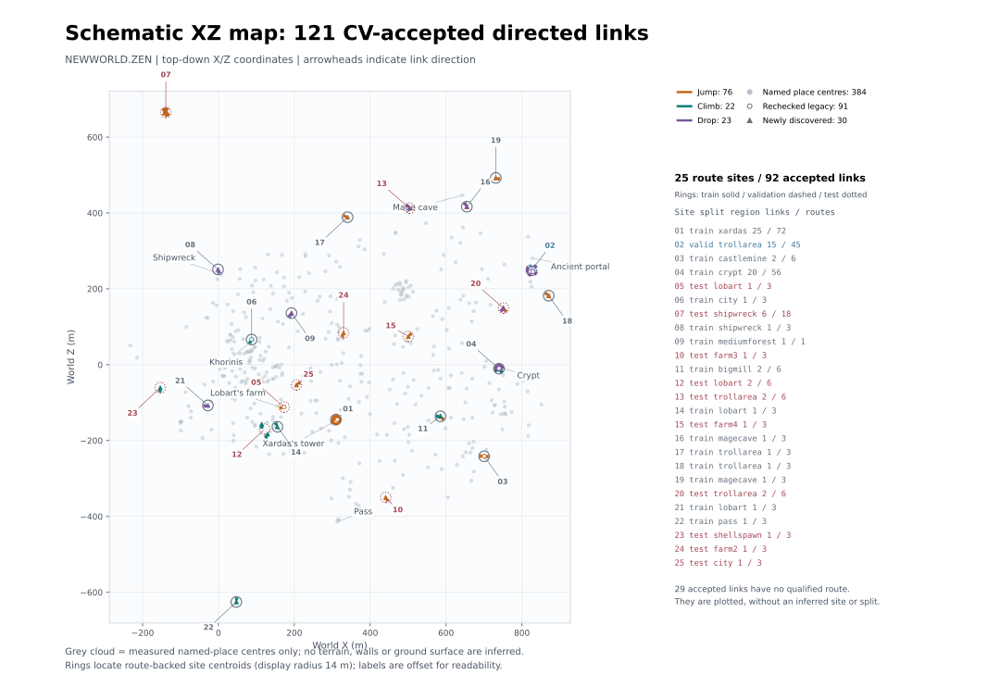
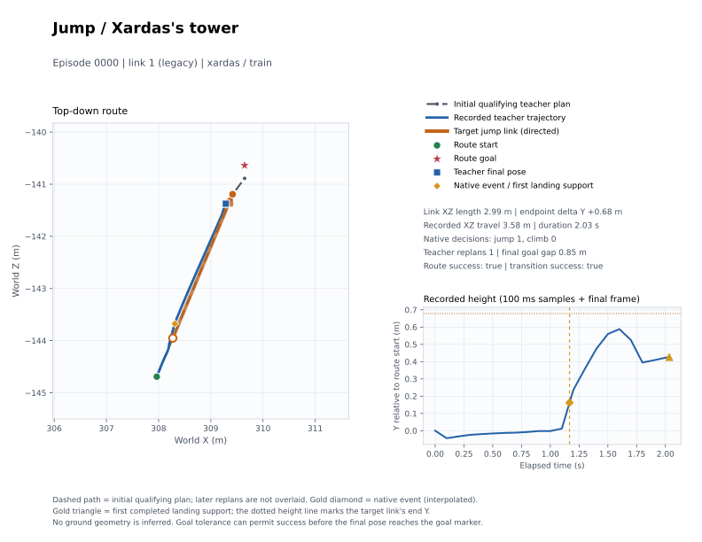
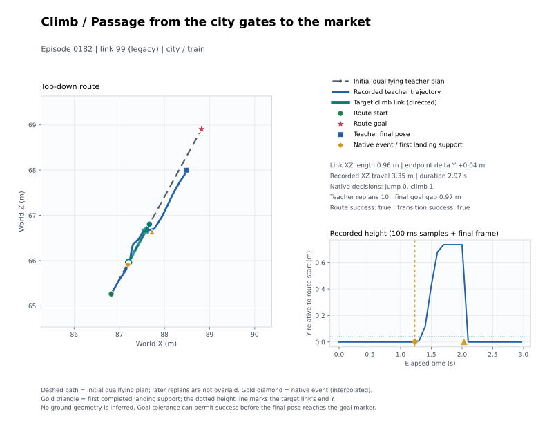
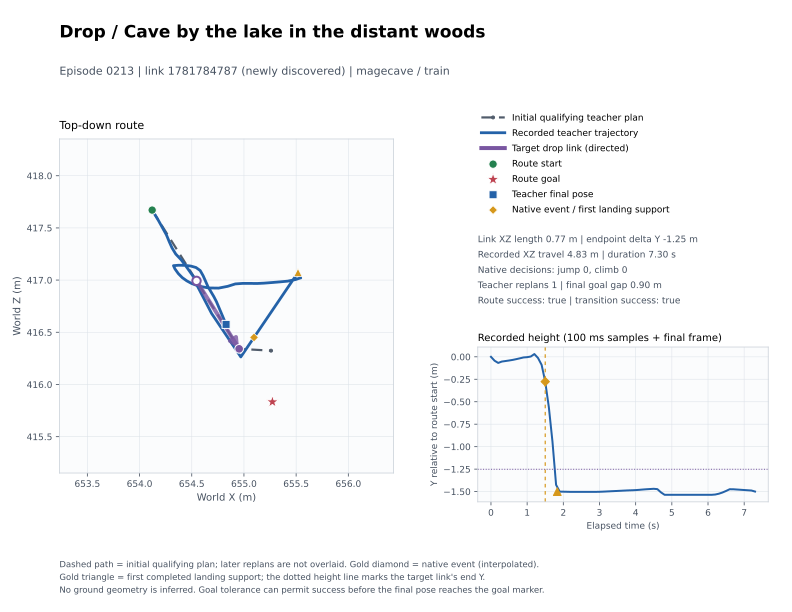
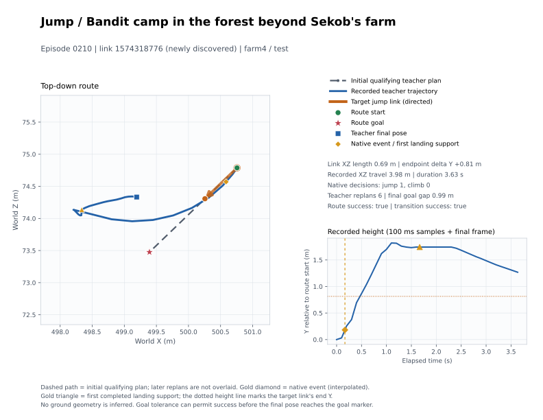

# Данные переходов на CharacterVirtual — 19 октября 2026

Подготовлены **121 переход**, **267 маршрутов** и **267 NAVDEMO v2 / 71 669 решений**. Учитель выполнил переход и дошёл до цели в **211/267 (79,03%)**: jump **136/174 (78,16%)**, climb **55/63 (87,30%)**, drop **20/30 (66,67%)**. Пользователь принял 267 вместо ≥300 маршрутов и drop 66,67% вместо 70%; эти отклонения не скрыты пересчётом. **Обучение не запускалось.**

Данные на Ryzen: `~/gothic-ai/nav-jumps/` и `~/gothic-ai/nav-demos-jumps/final/`. В git только код, этот отчёт и SVG. Текущий PPO, его процессы и файлы не менялись.

## 99 прежних links и новая проба

Первым коммитом перенесён `8beeadd1` — защита CV от NaN нормали опоры. Точные направленные links перепроверены той же нативной пробой с принудительным CV.

| Тип | Сохранились из 99 | Потеряны | Новые / кандидаты | Всего CV | Маршруты |
|---|---:|---:|---:|---:|---:|
| jump | 58/65 | 7 | 18/525 | 76 | 174 |
| climb | 16/16 | 0 | 6/525 | 22 | 63 |
| drop | 17/18 | 1 | 6/144 | 23 | 30 |
| **Всего** | **91/99** | **8** | **30/1194** | **121** | **267** |

Потери прежних links: **jump — 5 `landing_not_reached`, 2 `native_requests_climb`; drop — 1 `landing_not_reached`; climb — 0**. Во втором случае родной `tryJump` выбирает залезание, поэтому попытка не подтверждает именно jump. Проба `aaab14a7906e` дала ровно 30 новых; стоп «меньше 30» не сработал.

Для новых кандидатов старт сдвигается внутрь исходной опоры, ставится лучом вниз на физический пол, затем требуется **400 мс непрерывной опоры CV**. После коррекции пеший Detour без links должен оставаться ≥3× прямого и длиннее хотя бы на 10 м либо отсутствовать. Принятие link: нативное действие, посадка ≤60 см в 3D, наземный Detour ≤1,5 м / snap ≤25 см, 300 мс опоры, без урона. Подготовка может отклонить кандидата; сбор обрывается только при сбое runner/неполном ответе.

| Причина отказа новых кандидатов | jump | climb | drop | Всего |
|---|---:|---:|---:|---:|
| `takeoff_no_local_ground` | 191 | 191 | 80 | 462 |
| `native_requests_climb` | 173 | 0 | 0 | 173 |
| `native_transition_not_witnessed` | 0 | 129 | 37 | 166 |
| `native_has_no_climb` | 0 | 78 | 0 | 78 |
| `landing_not_reached` | 48 | 18 | 8 | 74 |
| `takeoff_deep_water` | 36 | 36 | 0 | 72 |
| `takeoff_ground_correction_too_far` | 28 | 28 | 3 | 59 |
| `takeoff_ground_not_walkable` | 16 | 16 | 7 | 39 |
| `damage` | 12 | 11 | 2 | 25 |
| `native_action_rejected` | 0 | 9 | 0 | 9 |
| `adjusted_not_shortcut` | 1 | 1 | 0 | 2 |
| `adjusted_transition_out_of_bounds` | 1 | 1 | 0 | 2 |
| `damage_during_preparation` | 0 | 1 | 1 | 2 |
| `landing_did_not_settle` | 1 | 0 | 0 | 1 |
| **Отказы** | **507** | **519** | **138** | **1164** |

Основные причины оставлены без исправления по решению пользователя: `takeoff_no_local_ground` — локальный луч не нашёл пол (**191 jump + 191 climb + 80 drop**); `native_requests_climb` — jump-проба родным действием выбирает climb (**173**); `native_transition_not_witnessed` — не подтверждено требуемое нативное состояние (**129 climb + 37 drop**).

## Места и маршруты

Принятые links покрывают **15 районов**. Район — ближайшее именованное место по книге мест, а не доказательство конкретной формы препятствия. В ограниченных 1194 кандидатах **нет монастыря**; принятых переходов там тоже нет. Городские примеры не объявляются крышами без геометрического подтверждения. Башня Ксардаса и разбойничий лагерь за фермой Секоба представлены на карте и примерах.

| Район | jump | climb | drop | Новые | Всего links |
|---|---:|---:|---:|---:|---:|
| bigmill | 1 | 1 | 0 | 2 | 2 |
| castlemine | 2 | 0 | 0 | 0 | 2 |
| city | 1 | 1 | 0 | 1 | 2 |
| crypt | 12 | 7 | 12 | 0 | 31 |
| farm2 | 1 | 0 | 0 | 1 | 1 |
| farm3 | 1 | 0 | 0 | 1 | 1 |
| farm4 | 1 | 0 | 0 | 1 | 1 |
| lobart | 1 | 3 | 1 | 4 | 5 |
| magecave | 2 | 0 | 1 | 3 | 3 |
| mediumforest | 1 | 0 | 1 | 2 | 2 |
| pass | 0 | 1 | 0 | 1 | 1 |
| shellspawn | 0 | 1 | 0 | 1 | 1 |
| shipwreck | 6 | 0 | 1 | 7 | 7 |
| trollarea | 9 | 8 | 7 | 6 | 24 |
| xardas | 38 | 0 | 0 | 0 | 38 |
| **Всего** | **76** | **22** | **23** | **30** | **121** |

Подбор `c24d1cd7b060`: **5754 пары → 1577 квалифицированных планов → 267 разных маршрутов через 92 links**. Проверялся конкретный id перехода в выбранном плане учителя v2 до морковки, а не соседство с ним; во всех 267 записях этот id есть и в фактическом trace планов. Среди квалифицированных вариантов выбрано до трёх подходов на link с разными сторонами/расстояниями. Больше подходящих маршрутов при этом ограничении не получилось; пользователь принял число 267.

Отказы планирования: старт без опоры — 1929, переход отсутствует в выбранном пути — 776, неполный путь — 689, чрезмерный snap к сетке — 783. Изменений знакомых дорог и морковки нет. Цель может лежать за пределами знакомого за препятствием; сокращение не навязывается дороге, которая его обходит.

Разбиение — по месту перехода: **25 пространственных кластеров**, все варианты одного link/места в одной части. Между концами links маршрутов разных частей минимум **32,06 м в 3D / 31,81 м по XZ**. Пересечения id или site между частями нет.

| Часть | jump | climb | drop | Маршруты | Удачные демонстрации | Все решения |
|---|---:|---:|---:|---:|---:|---:|
| train | 120 | 30 | 18 | 168 | 126 | 61 158 |
| validation | 15 | 24 | 6 | 45 | 45 | 2 961 |
| test | 39 | 9 | 6 | 54 | 40 | 7 550 |
| **Всего** | **174** | **63** | **30** | **267** | **211** | **71 669** |

| Район | jump | climb | drop | train | val | test | Маршруты | Удачные |
|---|---:|---:|---:|---:|---:|---:|---:|---:|
| bigmill | 3 | 3 | 0 | 6 | 0 | 0 | 6 | 0 |
| castlemine | 6 | 0 | 0 | 6 | 0 | 0 | 6 | 2 |
| city | 3 | 3 | 0 | 3 | 0 | 3 | 6 | 6 |
| crypt | 30 | 18 | 8 | 56 | 0 | 0 | 56 | 49 |
| farm2 | 3 | 0 | 0 | 0 | 0 | 3 | 3 | 1 |
| farm3 | 3 | 0 | 0 | 0 | 0 | 3 | 3 | 2 |
| farm4 | 3 | 0 | 0 | 0 | 0 | 3 | 3 | 3 |
| lobart | 3 | 9 | 3 | 6 | 0 | 9 | 15 | 11 |
| magecave | 3 | 0 | 3 | 6 | 0 | 0 | 6 | 6 |
| mediumforest | 0 | 0 | 1 | 1 | 0 | 0 | 1 | 0 |
| pass | 0 | 3 | 0 | 3 | 0 | 0 | 3 | 2 |
| shellspawn | 0 | 3 | 0 | 0 | 0 | 3 | 3 | 3 |
| shipwreck | 18 | 0 | 3 | 3 | 0 | 18 | 21 | 17 |
| trollarea | 27 | 24 | 12 | 6 | 45 | 12 | 63 | 54 |
| xardas | 72 | 0 | 0 | 72 | 0 | 0 | 72 | 55 |
| **Всего** | **174** | **63** | **30** | **168** | **45** | **54** | **267** | **211** |

## Записи учителя v2 на CV

Полный сбор **`1f07b8390ab1`** завершён, код 0. Лимит каждой попытки **240 с**; сохранены все успехи и отказы. `python3 -I scripts/nav_demos.py check` по всем 267 прошёл (`validated: true`), включая повторную проверку в `8b87fd7c46d3`. Ни одного повторного rollout ради улучшения итоговых чисел нет.

Успех демонстрации — **`demo_goal_action_landing_side_v1`**: цель достигнута, реальное действие засвидетельствовано, завершение на стороне посадки без возврата к взлёту. Для разных наземных компонентов сравнивается компонент конца; внутри общего компонента — полигон конца. Компоненты не объединяются off-mesh links. XZ/Y, snap, путь, HP и длительность опоры — метрики, а не критерии отказа демонстрации. Строгие условия пробы остаются условиями принятия link в сетку.

| Тип маршрута | Дошли до цели | Успех демонстрации | Доходимость | Все решения | jump решений | climb решений |
|---|---:|---:|---:|---:|---:|---:|
| jump | 160/174 | 136/174 | 78.16% | 46 305 | 587 | 0 |
| climb | 59/63 | 55/63 | 87.30% | 14 599 | 0 | 273 |
| drop | 26/30 | 20/30 | 66.67% | 10 765 | 0 | 0 |
| **Всего** | **245/267** | **211/267** | **79,03%** | **71 669** | **587** | **273** |

Успешные демонстрации содержат **16 765 решений, jump 230 / climb 82**; только они участвуют в объяснимости. Они покрывают **75 links (48 jump / 19 climb / 8 drop), 20 мест, 13 районов**. Остальные попытки сохранены для разбора и не объявляются положительными примерами. Разница 245 достигнутых целей и 211 демонстраций — отсутствие полного свидетельства требуемого перехода, а не подмена доходимости флагом цели.

### Метрики посадки

Это метрики **211 удачных демонстраций**, не дополнительные условия приёмки. Медиана [p10; p90]. XZ/Y взяты в первой завершённой позе на стороне посадки; snap — в первой опоре после события (в другой момент, если завершённая поза ещё без опоры). Максимальная серия опоры измеряется по физическим кадрам после события; 0 мс означает один поддержанный кадр до завершения, а не отсутствие опоры.

| Тип | N | XZ до конца, см | Y относительно конца, см | Snap первой опоры, см | Максимальная серия опоры, мс | Опора в завершённой позе |
|---|---:|---:|---:|---:|---:|---:|
| jump | 136 | 138.3 [32.0; 375.5] | -9.4 [-37.5; 18.0] | 15.6 [7.1; 53.2] | 1566.5 [0.0; 3833.5] | 136/136 |
| climb | 55 | 15.3 [3.7; 96.8] | -13.9 [-28.6; -4.6] | 17.6 [7.5; 31.1] | 333.0 [0.0; 2454.0] | 54/55 |
| drop | 20 | 153.7 [84.0; 204.8] | -7.1 [-24.8; 49.1] | 11.7 [7.1; 15.2] | 683.0 [0.0; 4227.3] | 20/20 |

| Отказ демонстрации | jump | climb | drop | Всего |
|---|---:|---:|---:|---:|
| `completed_landing_side_not_witnessed` | 14 | 1 | 3 | 18 |
| `landing_side_ambiguous` | 11 | 0 | 0 | 11 |
| `native_action_not_witnessed` | 0 | 4 | 7 | 11 |
| `returned_to_takeoff_after_landing` | 6 | 3 | 0 | 9 |
| `goal_not_reached:body_blocked` | 3 | 0 | 0 | 3 |
| `approach_never_on_transition` | 2 | 0 | 0 | 2 |
| `final_pose_not_on_landing_side` | 2 | 0 | 0 | 2 |
| **Всего** | **38** | **8** | **10** | **56** |

Drop принят пользователем на **66,67%**, то есть на **3,33 процентного пункта** ниже цели. Его десять отказов:

| Эпизоды / link | Число | Что не засвидетельствовано | Цель |
|---|---:|---|---:|
| 170–172 / 92, crypt | 3 | `native_action_not_witnessed`: падение относительно начала действия 0–12,93 см в проверяемом окне, недостаточно для свидетельства спуска >20 см | 2/3 |
| 188–190 / 325186183, shipwreck | 3 | `native_action_not_witnessed`: в окне действия спад 14,12–16,02 см; затем два `body_blocked`, один `path_timeout` | 0/3 |
| 191 / 880268177, mediumforest | 1 | `native_action_not_witnessed`: снизился на 36,74 см, но прошёл **85/85 кадров на actual CV**, без засвидетельствованного отрыва; снижение по земле не объявляется drop | 1/1 |
| 201–203 / 1230208767, trollarea | 3 | Реальный спуск 246–260 см есть; `completed_landing_side_not_witnessed` — не подтверждено завершение на полигоне/компоненте конца | 3/3 |

Объём на диске (байты; `du` — реально выделенные блоки):

| Что | Размер |
|---|---:|
| Gzip NAVDEMO samples финальных 267 | 1 142 387 783 |
| Каталоги эпизодов, учитываемые NAVDEMO check | 1 479 547 819 |
| Вся `nav-demos-jumps/final/`, файлы | 1 492 965 234 |
| Вся `nav-demos-jumps/final/`, `du` | 1 503 105 024 |
| Все прежние проверки + финал, файлы | 1 800 933 278 |
| Все прежние проверки + финал, `du` | **1 814 994 944 (~1,69 ГиБ)** |

Общий лимит 10 ГиБ соблюдён. Несжатый поток NAVDEMO — 12 458 804 166 байт; он читается порциями и не хранится распакованным.

## Объяснимость по входу ученика

Все 267: **jump 587, climb 273, начало падения/спрыгивания 32 решения**. У drop нет отдельной клавиши: считаются решения перед началом подтверждённого физического падения, в том числе незапланированные в неудачных попытках. 23 события находятся на drop-маршрутах, два — на jump-маршрутах, семь — на climb-маршрутах. **21** метка прямо привязана к нативному событию заданного drop; остальные подтверждены сопоставлением 100-мс динамики с физическим падением. Сырых 100-мс диагностик воздуха 55: это **не** число спрыгиваний.

Объяснимость рассчитана на **211 удачных эпизодах / 16 765 решениях**: jump 230, climb 82, начало drop 21: **20 на drop-маршрутах и одно дополнительное падение в jump-эпизоде 0178**. 18 меток прямо привязаны к нативному событию заданного link; для 0258/0260 начало найдено по динамике NAVDEMO и подтверждено нативным падением. Отбор требует исходные `transition_success=true`, цель и точную версию критерия; внешняя таблица не может подменить исход эпизода. Отказы сохранены в общем tally, но не участвуют в подборе порогов.

Признаки берутся только из `nav_demos.learner_input()`: глаз, память, скорость/голова и морковка. Мир, id link, путь, будущие состояния и текущие клавиши учителя не участвуют в правиле. Они используются только для меток исхода. Нативные кадры связывают drop с одним непрерывным физическим падением, содержащим событие, отсекают позднюю фазу jump/climb и короткий prep-air. Дубли NAVDEMO/native объединяются по физическому событию. Из обычной ходьбы исключены нативные действия/воздух и ±800 мс около подтверждённого drop; обычный подход перед jump остаётся отрицательным примером.

Направление — горизонтальная скорость при ≥20 см/с, при остановке — вперёд по корпусу как оценка предстоящего forward-действия. Угол на морковку измеряется отдельно; морковка не выбирает лучи. В направлении берутся лучи ±15°; память — конус ±20°, 25–600 см. Для точного положения попадания используются только свежие лучи `age_ms=0`.

### Простое правило препятствия

Выбор только на train по F1 против обычной ходьбы: **видимая вертикальная поверхность в направлении движения, высота образца 75–250 см над оценкой ног и дистанция <75 см**. Пороги фиксированы перед validation/test; это описательная калибровка правила, не обучение политики.

| Часть | jump объяснено | climb объяснено | jump+climb | Ложные на обычной ходьбе |
|---|---:|---:|---:|---:|
| train | 89/175 (50.86%) | 14/29 (48.28%) | 103/204 (50.49%) | 249/2668 (9.33%) |
| validation | 0/18 (0.00%) | 18/25 (72.00%) | 18/43 (41.86%) | 80/1635 (4.89%) |
| test | 10/37 (27.03%) | 2/28 (7.14%) | 12/65 (18.46%) | 26/1009 (2.58%) |
| Все | 99/230 (43.04%) | 34/82 (41.46%) | 133/312 (42.63%) | 355/5312 (6.68%) |

Цель ≥80% для основного правила **не достигнута**: 133/312 (42.63%); на отложенных местах вместе 30/108 (27.78%).

Для отделения выбора порога от отсутствия самого признака проверен также заранее заданный широкий диапазон **25–300 см, d<600 см** — верхняя граница покрытия в использованной сетке порогов, а не оценка всей информации глаза.

| Часть | Широкий диапазон: jump+climb | Ложные на ходьбе |
|---|---:|---:|
| train | 186/204 (91.18%) | 2338/2668 (87.63%) |
| validation | 22/43 (51.16%) | 1025/1635 (62.69%) |
| test | 27/65 (41.54%) | 480/1009 (47.57%) |
| Все | 235/312 (75.32%) | 3843/5312 (72.35%) |

### Правило края для спрыгивания

Выбрано на train по F1: в памяти near/far впереди есть **та же ячейка** `drop≥0.5` на d<75 см. Вероятность и дистанция берутся у одной ячейки. Канал `ledge` описывает верхнюю площадку и сам по себе не доказывает спуск.

| Часть | Начало drop объяснено | Ложные на обычной ходьбе |
|---|---:|---:|
| train | 10/12 (83.33%) | 33/2668 (1.24%) |
| validation | 6/6 (100.00%) | 69/1635 (4.22%) |
| test | 3/3 (100.00%) | 44/1009 (4.36%) |
| Все | 19/21 (90.48%) | 146/5312 (2.75%) |

На **20 удачных маршрутах drop** правило края объясняет **19/20 (95%)**. Таблица выше также включает дополнительное падение в jump-эпизоде 0178, для которого правило не сработало.

### Что видно в глазах, памяти и морковке

В таблице — **медиана [p10; p90]**, сантиметры для дистанции/высоты, градусы для угла морковки относительно корпуса. Высота — оценка высоты видимой поверхности над ногами; **не верх препятствия**. Для drop показан луч на нижнюю поверхность, для остальных — луч на вертикальную поверхность.

| Решение | Число | Есть измерение d/h | d, см | h, см | Угол морковки, ° |
|---|---:|---:|---:|---:|---:|
| jump | 230 | 191/230 | 48.8 [39.9; 325.3] | 230.2 [47.9; 267.8] | 0.0 [-7.4; 8.4] |
| climb | 82 | 50/82 | 37.2 [30.5; 49.2] | 129.7 [43.0; 212.6] | 0.0 [-9.2; 10.8] |
| drop_onset | 21 | 16/21 | 134.9 [117.5; 349.5] | -211.7 [-257.0; -136.9] | 7.7 [-15.5; 36.4] |
| ordinary_walk | 5312 | 4307/5312 | 196.6 [63.2; 629.1] | 160.5 [41.3; 277.5] | -0.1 [-35.0; 29.7] |

Память: доля решений, где максимальная вероятность соответствующего канала в выбранном конусе ≥0,5. Это описательные признаки; для правила drop дополнительно проверяется расстояние той же ячейки.

| Решение | near ledge | near drop | far ledge | far drop |
|---|---:|---:|---:|---:|
| jump | 57/230 (24.78%) | 82/230 (35.65%) | 42/230 (18.26%) | 81/230 (35.22%) |
| climb | 28/82 (34.15%) | 26/82 (31.71%) | 13/82 (15.85%) | 30/82 (36.59%) |
| drop_onset | 5/21 (23.81%) | 20/21 (95.24%) | 1/21 (4.76%) | 16/21 (76.19%) |
| ordinary_walk | 2270/5312 (42.73%) | 1403/5312 (26.41%) | 1502/5312 (28.28%) | 1221/5312 (22.99%) |

### Почему правило не объясняет все нажатия

| Причина пропуска основного jump/climb правила | Решений |
|---|---:|
| Сигнал есть, но вне высоты/дистанции порога, выбранного на train (`outside_fitted_height_or_distance`) | 108 |
| Есть попадания, но нет вертикальной поверхности впереди (`no_vertical_surface_in_direction`) | 33 |
| Нет образца вертикальной поверхности на высоте 25–300 см (`no_surface_sample_25_to_300cm`) | 23 |
| Нет свежего попадания луча в выбранном направлении (`no_fresh_direction_hit`) | 11 |
| Нет согласованной опоры для оценки высоты глаза (`no_eye_height_anchor`) | 4 |

Отсутствие вертикального образца не доказывает отсутствие препятствия: уступ/разрыв может давать только горизонтальные поверхности, край может быть закрыт, а близкая грань — оказаться вне узкого направления. Проба подтверждает возможность link; обязательность jump вместо пешего CV-прохода отдельно не проверялась. Учитель использует точку начала link и сетку, которых нет во входе ученика. Память ledge/drop и морковка не дают однозначного сигнала для каждого нажатия; частоты на обычной ходьбе выше показывают эту неоднозначность.

Граница измерения тоже существенна: NAVDEMO v2 не хранит начало луча, горизонтальное смещение глаза, roll и позу устаревшего луча. Высота глаза выводится из ≥3 согласованных свежих ground-попаданий и памяти; уровень ног — ближайшая известная высота памяти. Поэтому `no_fresh_direction_hit` означает отсутствие точного свежего измерения в выбранном конусе, **не пустой вход глаза**: ученик получает и старые дистанции. Анализ использует raw `learner_input()` до pooling/квантования NavPolicy, потерю мелких деталей при этом не оценивали. Эти ограничения не позволяют объявить все пропуски доказанной слепотой ученика.

Ни глаз, ни память, ни учитель, ни обучение ради достижения 80% не менялись. Числа выше фиксируют качество простого объяснения и пределы измерения.

## Карта и четыре примера сверху

Цвет — jump/climb/drop; окружность — один из 91 прежних links, треугольник — один из 30 новых. Кольца и таблица относятся к **25 местам с маршрутами / 92 links**. Остальные 29 принятых links показаны без выдуманного маршрута или split. Серое облако — только 384 центра мест, не поверхность земли и не сетка.

| Эпизод | Тип | Место | Link | Часть | ΔY концов, м | Время, с |
|---|---|---|---:|---|---:|---:|
| [0000](figures/episode-0000-jump.svg) | jump | башня Ксардаса | 1 | train | +0.68 | 2.033 |
| [0182](figures/episode-0182-climb.svg) | climb | проход от городских ворот к рынку | 99 | train | +0.04 | 2.967 |
| [0213](figures/episode-0213-drop.svg) | drop | пещера у озера в дальних лесах | 1781784787 | train | -1.25 | 7.300 |
| [0210](figures/episode-0210-jump.svg) | jump | разбойничий лагерь в лесу за фермой Секоба | 1574318776 | test | +0.81 | 3.633 |

Во всех четырёх достигнута цель и засчитан переход. Пунктир — исходный квалифицирующий план v2, синий — записанная траектория (100 мс + последний кадр), цветная стрелка — направленный link. Дальнейшие планы не накладываются. Золотые маркеры показывают интерполированную позицию в момент нативного события и записанную первую завершённую посадку. ΔY концов link не выдаётся за высоту препятствия.

### 0000: башня Ксардаса, jump

### 0182: проход от городских ворот к рынку, climb

### 0213: пещера у озера в дальних лесах, drop

### 0210: разбойничий лагерь в лесу за фермой Секоба, jump

## Правки и проверка

До полного сбора минимально исправлен учитель: удерживает выбранный локальный путь на подходе к link до той же морковки; подходит к старту в пределах 10 см, ждёт standing/выравнивания в run-idle, затем включает бег и родное действие. Drop продолжает движение по скорости вдоль узкого коридора. Изменений знакомых дорог, морковки, глаза, памяти, клавиш, NavPolicy и обучения нет. В последней фазе менялись только офлайн-учёт/анализ и иллюстрации; новых проходов учителя нет. Принудительный режим CV сохраняется, но родной полёт/залезание штатно временно выключает actual контроллер.

- На Ryzen собраны `Gothic2Notr` и `gothic-body-runner` (RelWithDebInfo), пройдены `check-navmesh` / `check-navkeyteacher`; последняя проверка 30/30 (`fb62947c15f8`) включала `check-navmesh` и **44 теста сборщика**.
- Финальная компиляция этих двух целей на Mac прошла без запуска игры или тестов; C++ после неё не менялся.
- Последние изменения анализа: **21 тест `test_nav_jump_observability.py`**; полный pytest и e2e-регрессия не запускались.
- NAVDEMO check всех 267: `validated: true`, **71 669 записей**. Объяснимость: `e6c0d7abc206`, `gq batch` 2 потока / 6 ГБ; пороги только train, разбиение по местам.
- Пять SVG отрисованы и просмотрены. Геометрия мира на них не дорисовывается.
- Свои `build/` на Mac и `~/gothic-ai/nav-jumps/build/` на Ryzen **удалены**. Записи, links, сетки и окружение сохранены.

Повторяемый анализ: `scripts/nav-jumps-remote.sh analyze` (отдельная заявка, включая NAVDEMO check). Подробные JSON/CSV остаются на Ryzen в `~/gothic-ai/nav-jumps/analysis/{observability.json,decisions.csv,navdemo-check.json}`. Карты строит `scripts/nav_jump_figures.py` из `accepted-links-cv.txt`, `places.json`, `routes/routes.jsonl` и компактных `episode.json` / `trajectory.txt`; ему не нужны samples или веса.

Предыдущие проверки и разбор 19 отказов по прежнему критерию пробы

Это история до принятия критерия демонстрации и полного сбора. Её прежние стопы и временные состояния не описывают итоговый набор выше.

## Почему остановилась первая запись

Заявка `0635e3128fcf` сохранила все 30 попыток: jump 4/10, climb 7/10, drop 2/10 по исходному учёту. Все 17 отказов разобраны по `teacher-paths.jsonl`, `trajectory.txt`, `actions.txt` и полям тела NAVDEMO v2. Номера ниже — исходные индексы маршрутов, они сохраняются при повторной проверке.

| Класс | Маршруты | Что произошло |
|---|---|---|
| `approach_never_on_transition` (5) | 76, 84, 85, 86, 123 | До края дошли: минимальная дистанция XZ до старта 12,4 / 12,3 / 12,3 / 12,3 / 8,5 см. Морковка совпадает с целью, `beyond_known=true`; это не обход знакомой дорогой. Каждый grounded replan менял drop на параллельный jump: 44→45, 47→48, 63→64 с теми же концами. Вместо спрыгивания учитель нажал jump. |
| `teacher_never_pressed_jump` (2) | 4, 8 | В 4 Detour сменил заданный link 2 на соседний 1; jump нажат, но для другого id, ближайшее попадание к заданному старту — 47,4 см. В 8 ближайшее попадание — 31,8 см: широкое условие «внутри коридора» уже включило бег, а окно нажатия требовало ≤25 см. NPC пересёк препятствие без jump. |
| `teacher_never_pressed_climb` (1) | 83 | Старт сбоку примерно на 35 см. Учитель сразу счёл тело находящимся на link, побежал к посадке и затем кружил у стены 240 с. Минимум до старта 22,1 см, но выравнивание и остановка одновременно не достигнуты. Клавиши climb нет ни разу. |
| `landing_not_witnessed` (6) | 1, 2, 6; 75, 77, 127 | В jump 1/2/6 цель достигнута; траектория проходит в 38,6 / 44,3 / 38,6 см от посадки. Учёт по решениям 100 мс дополнительно требовал `along≥0.8`; в последнем grounded решении у 1/6 было 0,79/0,78, хотя до посадки 70,6/79,6 см. Эпизод завершался без ожидания окончания нативного jump; NAVDEMO не хранит флаг BS_JUMP. В drop 75/77/127 реально выполнен соседний jump, посадка относительно заданного drop далеко: минимум по траектории 181,0 / 181,0 / 159,4 см. Эти drop нельзя объявить успешными смягчением радиуса. |
| `native_action_not_witnessed` (3) | 5; 91, 92 | В jump 5 нажатие в 16,9 см от старта, угол −1,2°, скорость 0; `walk=0`, подъём 57,7 см, но до завершения эпизода в 100-мс решениях ни одного `in_air`. Это отсутствие полного свидетельства в записи, а не доказанный отказ jump. В climb 91/92 нажатие в 20,8/19,8 см, угол −2,9/−4,2°, скорость 0, `walk=0`; подъём только 29,4/29,7 см и ни одного состояния climbing. Получился обычный прыжок у стены; цель не достигнута за 240 с. |

Два засчитанных исходным учётом drop (128/129) также использовали соседний jump 67 после drop 66. Новый учёт отвергает такое сочетание; исходные результаты выше не пересчитаны задним числом.

## Минимальное исправление

- Учитель сохраняет выбранный локальный коридор до той же морковки на подходе к переходу. После посадки, при уходе с маршрута или изменении морковки Detour пересчитывается. Это предотвращает подмену равных параллельных links; знакомые дороги и морковка не меняются.
- Для всех трёх типов боковая близость к коридору больше не означает, что переход начат. Учитель подходит пешком к началу link в пределах 10 см по XZ, ждёт standing и выравнивания в режиме `walk=false, forward=0`, затем включает бег и действие (для drop — только бег). Проба тоже запускает родное действие из покоя, сразу установив `WM_Run`: разбег в несколько метров она не использует. Продолжающийся drop распознаётся по положительной скорости вдоль link в коридоре шириной 10 см; он не останавливается повторно ради standing.
- Запись учителя дополнена `transition-frames.jsonl`: id, тип, физическая позиция, нативные jump/climb, опора и проверка посадки на каждом физическом кадре. Формат NAVDEMO v2 и вход ученика не изменены. Завершение записываемого эпизода v2 требует настоящей опоры, а не только отсутствия `in_air`.
- Учёт требует заданный id и соответствующее нажатие, нативное действие, затем опору в 60 см от посадки и пеший Detour до её точки ≤1,5 м со snap ≤25 см. Это геометрические и физические критерии пробы; прежние `along≥0.8` и радиус 1,5 м заменены. В пробе NPC после попадания останавливается на 300 мс; маршрут продолжает движение, поэтому учёт свидетельствует физическую опору при прохождении, не требует остановки учителя на 300 мс. Для drop нажатие jump/climb между началом и падением запрещено. Урон по-прежнему исключает успех.

Повторная проверка — ровно исходные 30 маршрутов, новая папка `repair-1/` (при второй исправленной попытке `repair-2/`). Исходные записи сохранены в `episodes/`. При результате ≥7/10 каждого типа и успешном `nav_demos.py check` заявка сама подаёт отдельный `gq batch` полного сбора 267 маршрутов в `final/`. Без достижения этого порога полный сбор не допускается. Лимит 10 ГиБ считается по всему `nav-demos-jumps/`, включая прежние попытки.

Первая исправленная проверка `4b9fe271a3f4`: движок/runner собраны, `check-navkeyteacher` и **46 Python-тестов passed**. Прогон остановлен вручную после **0/6 завершённых** (jump 0/3: 6, 8, 0; climb 0/1: 73; drop 0/2: 127, 84), ещё одна попытка прервана. Все файлы сохранены в `repair-1/`; это неполный результат, не 0/30.

Причина неуспешной первой правки установлена по новым физическим кадрам: в climb 73 отпускание forward в режиме walk началось при 6,6 см до старта, но остаточная анимация шага прошла ещё около 20 см. Тело покидало окно 10 см раньше, чем становилось standing, и циклически возвращалось. Во второй правке ожидание возвращено в прежний `walk=false, forward=0`, при котором в исходных успешных эпизодах остановка занимала одно решение. В drop 127 широкое условие grounded traversal включило run в 30 см сбоку от старта; отрыв с неподходящим направлением скорости дал первую опёртую посадку примерно в 135 см от заданной. Теперь drop также требует точного подхода и выравнивания; продолжение движения определяется узким коридором и положительной скоростью вдоль link.

**Вторая исправленная проверка — `49933174cdf9`**, на тех же исходных 30 индексах в `repair-2/`, завершена: **climb 10/10, jump 1/10, drop 0/10**. Все 19 отказов — `landing_not_witnessed`. Стоп после второй попытки сработал; полного сбора нет. Подробный разбор каждого отказа ниже. Быстрый контракт второй правки скомпилирован и прошёл. Финальная **RelWithDebInfo-компиляция Gothic2Notr и runner на Mac прошла**, без запуска игры и тестов; собственная локальная `build/` удалена.

Приёмка набора не завершена: полного сбора, объяснимости, карты мест и четырёх примеров сверху нет. Работа остановлена по стоп-правилу; доступные данные и все попытки сохранены.

## Стоп после второй проверки: все 19 отказов посадки

Исторический разбор по строгому критерию пробы. Ниже описаны причины прежнего отказа; действующий критерий демонстрации приведён в следующем разделе.

`49933174cdf9` завершила ровно исходные 30 маршрутов: **climb 10/10, jump 1/10, drop 0/10**. Все 30 дошли до цели; у 19 отказов причина `landing_not_witnessed`. Полный сбор 267 **не подан**: проверка ≥70% завершилась ошибкой до команды подачи. Учитель и критерии после этого не менялись, повторный прогон не запускался.

Источники — неизменённые `repair-2/episodes/NNNN/{episode.json,transition-frames.jsonl,teacher-paths.jsonl,trajectory.txt,actions.txt}` на Ryzen; конец link — из `routes/routes.jsonl`. Рассмотрены все физические кадры после засвидетельствованного действия, а не только решения 100 мс. Проецированный Detour endpoint совпадает с исходным концом link во всех этих эпизодах с точностью лучше 0,01 см. Подмена endpoint/id, 10-секундное окно и потерянный кадр здесь отказов не объясняют.

**Как читать таблицы.** XZ и ΔY — положение при **первой физической опоре после действия** относительно конца link; отрицательное ΔY означает ниже него. «Без опоры» — интервал непрерывного `supported=false`, содержащий нативное действие, до первого `supported=true`, с шагом примерно 33 мс. В jump он включает анимацию BS_JUMP; отдельный флаг `in_air/falling` включён лишь в конце, поэтому оба времени приведены раздельно. «Ближайшая опора» — минимум 3D-расстояния среди всех последующих кадров с опорой; snap указан в этом кадре. Опора в этой записи — тот же нативный предикат, что в пробе (состояния тела и луч к полу ±20 см).

**Ограничение CV-телеметрии.** На каждом кадре записан `supported`, но не `characterVirtualActive`. Все эпизоды имеют `physics_mode=cv`; суммарный `cv_frames` доказывает работу CV в эпизоде, но сам по себе не определяет момент возврата после полёта. В колонке CV «нет хвоста» означает, что запись закончилась в первом кадре опоры; «не измерено» — хвост есть, но агрегат не разделяет его с подходом. Для шести drop можно строго доказать CV **на кадрах с опорой после первой посадки**: минимум = `max(0, cv_frames − (frames − число последующих кадров supported=true))`. Это нижняя граница по счётчикам, не предположение по отсутствию `in_air`.

### Jump: 9 отказов

| Маршрут / link | Первая опора XZ / ΔY, см | Без опоры / in_air, с | CV на опоре после | Цель / финиш, с | Ближайшая опора 3D / snap, см | Почему не засчитано |
|---|---:|---:|---|---:|---:|---|
| 0 / 1 | 22.3 / -25.2 | 1.000 / 0.033 | нет хвоста | да / 2.033 | 33.7 / 32.30 | snap 32.30 > 25 |
| 1 / 1 | 22.8 / -25.0 | 1.000 / 0.033 | нет хвоста | да / 3.433 | 33.8 / 33.00 | snap 33.00 > 25 |
| 2 / 1 | 26.2 / -25.8 | 1.000 / 0.033 | нет хвоста | да / 4.833 | 36.8 / 35.21 | snap 35.21 > 25 |
| 3 / 2 | 35.7 / -18.0 | 1.000 / 0.033 | нет хвоста | да / 2.233 | 40.0 / 40.03 | snap 40.03 > 25 |
| 4 / 2 | 32.1 / -17.2 | 1.000 / 0.033 | не измерено | да / 4.967 | 25.4 / 25.43 | snap 25.43 > 25 |
| 5 / 2 | 31.8 / -17.2 | 1.000 / 0.033 | нет хвоста | да / 3.333 | 36.2 / 36.16 | snap 36.16 > 25 |
| 6 / 4 | 77.1 / -25.4 | 1.000 / 0.033 | не измерено | да / 2.433 | 41.9 / 41.92 | snap 41.92 > 25 |
| 7 / 4 | 72.7 / -25.1 | 1.000 / 0.033 | не измерено | да / 7.133 | 38.0 / 38.00 | snap 38.00 > 25 |
| 8 / 4 | 68.0 / -24.8 | 1.000 / 0.033 | нет хвоста | да / 3.333 | 72.4 / не запрошен | нет опоры ≤60 см (мин. 72.4) |

### Drop: 10 отказов

| Маршрут / link | Первая опора XZ / ΔY, см | Без опоры / in_air, с | CV на опоре после | Цель / финиш, с | Ближайшая опора 3D / snap, см | Почему не засчитано |
|---|---:|---:|---|---:|---:|---|
| 75 / 44 | 204.8 / -10.9 | 0.600 / 0.600 | нет хвоста | да / 3.800 | 205.0 / не запрошен | нет опоры ≤60 см (мин. 205.0) |
| 76 / 44 | 206.4 / -11.0 | 0.633 / 0.600 | нет хвоста | да / 5.500 | 206.7 / не запрошен | нет опоры ≤60 см (мин. 206.7) |
| 77 / 44 | 204.8 / -10.9 | 0.600 / 0.600 | нет хвоста | да / 3.800 | 205.0 / не запрошен | нет опоры ≤60 см (мин. 205.0) |
| 84 / 47 | 178.1 / -16.5 | 0.667 / 0.633 | нет хвоста | да / 2.300 | 178.8 / не запрошен | нет опоры ≤60 см (мин. 178.8) |
| 85 / 47 | 178.1 / -16.5 | 0.667 / 0.633 | да, ≥24 кадров | да / 3.733 | 154.0 / не запрошен | нет опоры ≤60 см (мин. 154.0) |
| 86 / 47 | 178.1 / -16.5 | 0.667 / 0.633 | да, ≥50 кадров | да / 4.600 | 97.5 / не запрошен | нет опоры ≤60 см (мин. 97.5) |
| 123 / 63 | 191.2 / -7.1 | 0.733 / 0.700 | да, ≥45 кадров | да / 5.433 | 102.0 / не запрошен | нет опоры ≤60 см (мин. 102.0) |
| 127 / 66 | 133.0 / -7.1 | 0.700 / 0.667 | да, ≥57 кадров | да / 5.833 | 109.7 / не запрошен | нет опоры ≤60 см (мин. 109.7) |
| 128 / 66 | 133.1 / -7.1 | 0.700 / 0.667 | да, ≥28 кадров | да / 4.867 | 81.8 / не запрошен | нет опоры ≤60 см (мин. 81.8) |
| 129 / 66 | 133.1 / -7.1 | 0.700 / 0.667 | да, ≥21 кадров | да / 4.633 | 65.4 / не запрошен | нет опоры ≤60 см (мин. 65.4) |

### Сравнение с принятой нативной пробой

В пробе: нативное действие; **3D ≤60 см** до конца; реальная опора; Detour до посадки complete, длина ≤1,5 м и **startSnapDistance ≤25 см**; затем остановка и **300 мс непрерывной опоры в этой зоне**; без урона. Snap — полное расстояние в 3D, не только XZ. Учёт второй проверки требовал те же геометрию/опору/Detour/snap, но принимает один валидный кадр, **не требует 300 мс**. Таким образом, по времени он слабее пробы, а не отвергает успешную 300-мс посадку. `allowTransitions=false` не ужесточает nearest/snap: обе ветки ищут ближайшую точку по наземным полигонам; нативная проба этих links шла на сетке без off-mesh links.

| Link / тип | Посадка принятой CV-пробы: 3D, см | Время от действия до принятия, с | Опора при принятии |
|---|---:|---:|---|
| 1 / jump | 19.8 | 1.334 | ≥300 мс |
| 2 / jump | 15.2 | 1.334 | ≥300 мс |
| 4 / jump | 14.9 | 1.467 | ≥300 мс |
| 44 / drop | 42.4 | 2.400 | ≥300 мс |
| 47 / drop | 47.8 | 2.333 | ≥300 мс |
| 63 / drop | 45.9 | 2.466 | ≥300 мс |
| 66 / drop | 52.6 | 2.200 | ≥300 мс |

**Восемь jump (0–7).** Учёт опору видит: она попала внутрь 60-см сферы, запрос пути выполнен и complete, но snap составляет **25,43–41,92 см**, выше того же 25-см порога пробы. Путь при этом короткий (0–6,91 см). Это отбрасывание измеренного результата по дополнительному условию пробы, не потеря опоры или id. Сам snap не разложен в записи на XZ/Y, поэтому по нему нельзя утверждать, что NPC стоял над разрывом: физическая опора есть. Эпизоды 0/1/2/3/5 завершаются в первом кадре опоры; 4 пишет ещё 34 мс; 6/7 идут ещё 200 мс, но внутри 60 см зафиксировано лишь **133 мс** непрерывной опоры и snap остаётся выше порога. Успешная проба, напротив, доводит NPC до точной посадки и принимает после остановки на 300 мс. В этих записях такой финал не засвидетельствован.

**Jump 8.** Настоящая опора появилась за **68,0 см по XZ и на 24,8 см ниже конца** (72,4 см в 3D): недолёт до требуемой зоны. Эпизод закончился в том же кадре по радиусу цели 1 м. Кадров опоры внутри 60 см нет.

**Все десять drop.** Физически спрыгнули и приземлились, но мимо заданной зоны: первая опора в **133,0–206,4 см по XZ** от конца, на **7,1–16,5 см ниже**. Шесть эпизодов затем продолжили движение по земле; для них возврат CV на опоре доказан указанными нижними границами. Ни в одном из десяти нет кадра опоры внутри 60 см даже при последующей ходьбе: ближайший результат — 65,4 см в 129. `landing_path_complete=false` здесь не свидетельство плохого Detour: writer вообще не запрашивает путь за пределами 60 см. Причина отказа — геометрия посадки.

**Почему достижение цели не спасает результат.** Эпизод завершается при расстоянии до цели <1 м и опоре, тогда как проба ведёт к самому концу link. Поэтому цель может быть достигнута при недолёте до зоны посадки или после пролёта через неё в воздухе. Во всех 19 позиция финиша действительно находится в радиусе цели (43,6–99,8 см); это не ошибка флага `success`.

**Вывод и стоп.** Доказанной ошибки, при которой кадр удовлетворяет критерию посадки, а учёт его теряет, нет: в 19 эпизодах найдено **0 кадров**, одновременно проходящих 60 см + опору + Detour/snap. Восемь jump нельзя называть падением мимо — они физически приземлились в 60 см, но не дали полного свидетельства по условиям пробы; записи слишком рано заканчиваются для проверки 300 мс. Один jump и все drop действительно не попали в требуемую зону на опоре. Пороги не ослаблялись; учитель, учёт и маршруты не исправлялись; 30 не повторялись; полный сбор и обучение не запускались. На этом этапе сохранялся стоп после двух исправленных попыток; дальнейшее решение пользователя приведено ниже.

| Тип | Достигли цели | Засчитано | Итог посадки |
|---|---:|---:|---|
| climb | 10/10 | 10/10 | Все приняты учётом второй проверки |
| jump | 10/10 | 1/10 | 8 — опора ≤60 см, snap >25 см; 1 — недолёт, 72,4 см 3D |
| drop | 10/10 | 0/10 | 10 — посадка мимо, 133–206 см по XZ |

Собственная Ryzen `~/gothic-ai/nav-jumps/build/` удалена после разбора; локальная `build/` удалена после прежней успешной компиляции. Записи, исходные ссылки, сетки и Python-окружение сохранены. Проверена арифметика всех 30 эпизодов и классификация всех 19 отказов; новых изменений движка или сборщика нет, повторные сборки и тесты не запускались.

