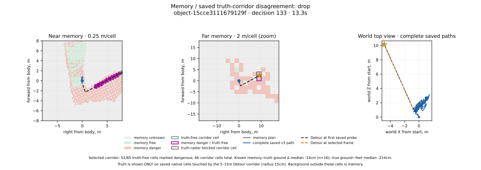
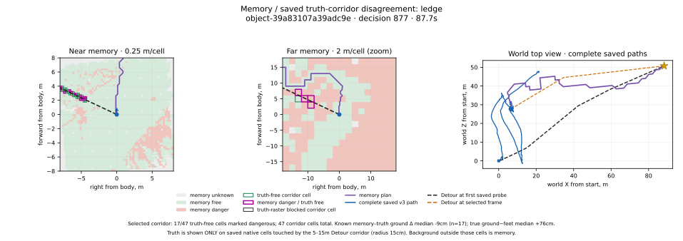
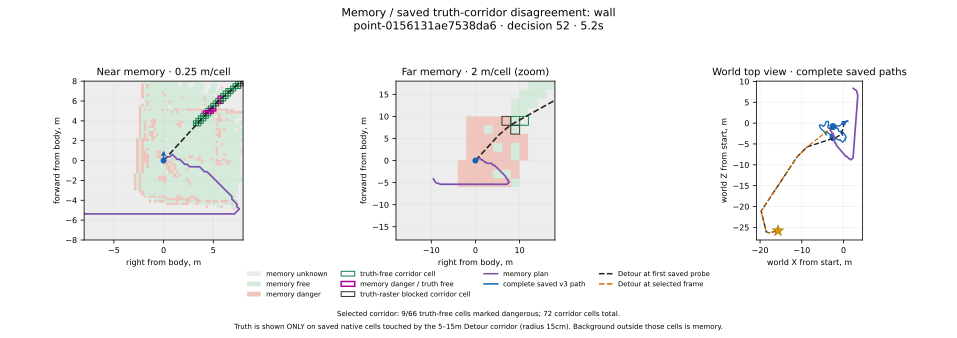
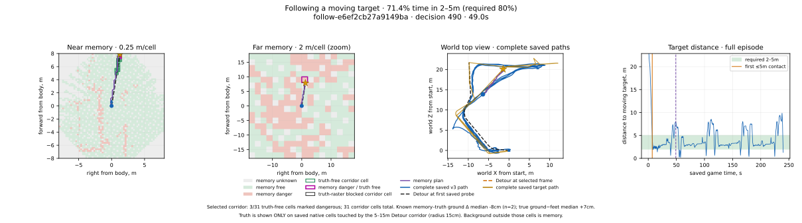
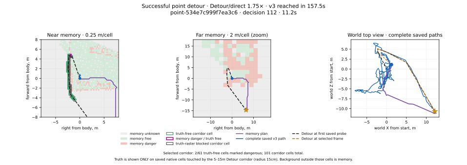

# Учитель навигации v3 — 20 октября 2026

**Основное узкое место — представление глаза и памяти.** При замене только карт памяти истинным растром тот же планировщик и исполнитель улучшают результат на неподвижных целях с 20/60 до 48/60. Сам честный v3 критерии не прошёл: точки остановлены после второй попытки, обучение ученика не запускалось. Оракул используется только для сравнения карт.

Итоги перепроверены по сохранённым `oracle-experiment/metrics.json` и `oracle-experiment/coverage/metrics.json`. Краткая числовая выгрузка — [results.json](results.json). В финальном ходе новые игровые прогоны не выполнялись.

| Цель и метрика | v2, сетка Detour | v3, истинный растр | v3, память ученика | Критерий честного v3 |
|---|---:|---:|---:|---|
| Точки за знакомыми дорогами, успехи | 30/30 | 22/30 (73,3%) | 10/30 (33,3%) | ≥80% успехов v2; не пройден |
| Видимые объекты, успехи | 30/30 | 26/30 (86,7%) | 10/30 (33,3%) | ≥80% успехов v2; не пройден |
| «Следовать», время в 2–5 м после сближения | 14,82% | 64,60% | 28,04% | ≥80%; не пройден |
| «Подойти», сближение до 2 м | 9/18 | 7/18 | 6/18 | ≥80%; не пройден |

На статических целях оракул существенно приближается к v2; оставшиеся 12/60 неудач сохраняют работу для плана, исполнения и дискретизации карты. Геометрическая планка v2 не переносится на следование: его преследователь всё время идёт шагом.

## Устройство и контракт честности

[`NavMemoryTeacher`](../../../OpenGothic/common/navmemoryteacher.cpp) принимает только `learner_input()` и своё состояние: глаз, тело, предыдущие клавиши, дороги, цель и полные near/far из NAVDEMO v2. Near — 64×64 по 25 см, far — 100×100 по 2 м. Мировая поза, Detour и идентификаторы объектов в этот интерфейс не входят.

- A* перепланируется на каждом решении, 10 Гц. Любое ненулевое значение wall/ledge/drop/water/movable закрывает клетку; препятствия расширяются на радиус тела с запасом 15 см. Неизвестное проходимо с ценой ×4 относительно свободного.
- На знакомой части маршрут ведёт к морковке. За знакомым — к текущей цели. Для объектов и движения `beyond_known=1`, морковка совпадает с целью; знакомые дороги не используются.
- Под телом снимается дополнительное раздувание, исходная опасность сохраняется. При опасном старте ищется свободная клетка до 1 м и проверяется выход назад или вбок. При упоре и плане за спиной показаны реальные `forward=-1` и `strafe=±1`; jump/climb всегда выключены. Гистерезис плана не добавлялся: без изменения эгоцентрической рамки между решениями его нельзя было корректно перенести.
- Цель движущегося сценария обновляется на каждом решении. Сценарий задают неизменные seed, старт, маршрут и шаблон цели. Текущая поза и разрешённое движком имя узла цели не определяют его идентичность.

Сохранённый replay [`gothic-navmemoryteacher-contract`](../../../OpenGothic/tests/navmemoryteacher_contract.cpp) сравнивает все восемь полей клавиш и цепочку предыдущих действий после сброса на каждый эпизод:

| Вид цели | Эпизоды v3 | Повторённых решений | Расхождения клавиш / предыдущих действий |
|---|---:|---:|---:|
| Точки, вторая попытка | 30 | 50 184 | 0 / 0 |
| Объекты | 30 | 49 961 | 0 / 0 |
| Следование | 18 | 41 540 | 0 / 0 |
| Подход | 18 | 11 502 | 0 / 0 |
| **Итого** | **96** | **153 187** | **0 / 0** |

Требование 1000 решений каждого вида выполнено с запасом. Числа взяты из сохранённых `contract.json`, проверены их совпадения с `episode.json`. Контрфактический пересчёт старых входов исправленным планировщиком ниже отдельно от этого контракта.

## Отбор сценариев

Зафиксированы одни и те же 96 сценариев: 30 точек, 30 объектов, 18 следований, 18 подходов; лимит эпизода 240 с. Точки взяты из обучающих пар PPO, где v2 прошёл более 30% физического пути с `beyond_known`; по пять на каждый из шести районов. У всех выбранных статических сценариев успешный v2. Источники исключений — `holdout-cv.jsonl` и валидация `nav-ppo`.

Объекты отобраны из 18 371 кандидата по 30 разным местам: входы, мельница, проходы. Нужны наземный путь и необходимость обхода: Detour/прямая ≥1,5 **или** прямая непроходима. При расширении отбора разрешён луч к краю входа, до 65 см от центра: среди выбранных **19 видны по центру, 11 — только по краю**. Причины отсева по порядку фильтров: 14 835 не видны, 1430 без необходимого обхода, 855 с неподдержанным стартом, 7 без полного пути, 18 с неуспехом v2; ещё 1196 геометрических кандидатов не потребовали запуска v2. Эти счётчики не равны независимым частотам каждого дефекта.

Разбиение объектов — по месту, движения — по району, с фиксированными seed (базовый seed сценариев 19102026). Фактический состав:

| Вид | Train | Валидация | Test |
|---|---:|---:|---:|
| Точки из обучающих пар | 30 | 0 | 0 |
| Объекты, разные места | 17 | 0 | 13 |
| Следование, разные районы | 12 | 3 | 3 |
| Подход, разные районы | 12 | 3 | 3 |

Ограничение корпуса: квалифицированных объектов в валидации нет; следующему сбору потребуется её добор. Тридцать точек — диагностическая обучающая выборка, не независимый тест обобщения. В этом исследовании результаты трёх учителей сопоставляются на полном зафиксированном наборе; выбор по test не использовался для настройки ученика.

## Точки: две попытки и остановка

| Попытка v3 | Успехи против 30/30 v2 | Среднее время, с | Путь / Detour | Упоры | Назад | Вбок |
|---|---:|---:|---:|---:|---:|---:|
| Первая, запас 30 см | 8/30 (26,7%) | 170,7 | 2,08× | 216 | 646 (1,26%) | 4142 (8,09%) |
| Последняя, исправленный старт и запас 15 см | 10/30 (33,3%) | 167,3 | 3,99× | 409 | 4869 (9,70%) | 12 673 (25,25%) |

Средние включают неудачи и таймауты. Упоры — сохранённые `blocked_spans`; путь / Detour — среднее индивидуальных отношений. Уменьшение запаса и выход из старта позволили больше двигаться, но часто добавили петли вместо достижения цели.

Разбор всех 22 первоначальных неудач показал `start_not_found` в **215/350** выбранных кадров: расширенные препятствия закрывали собственную клетку тела. Дополнительно: граница near/far — 135 кадров; запас 30 см закрывал цель при открытом варианте 0 см в 41 кадре, запас 15 см открывал 26 из них; переключение плана отмечено в трёх эпизодах. Исправление старта было единственной разрешённой второй попыткой.

После неё:

- На тех же **старых 350 входах**, контрфактически: **215 → 11** `start_not_found`. Это не сравнение старых клавиш с новыми.
- В **новых 50 184 решениях**: **5366 (10,69%)**; в новой диагностической выборке хвостов — **55/330**. Разные знаменатели не объединяются.
- Из 20 неудач девять вообще не достигли `beyond_known`. При начале самого длинного упора десять ещё были на знакомой части, медиана остатка дороги 37,3 м. У десяти упор начался при `beyond_known=1`: в шести подтверждён последний знакомый узел, медиана расстояния до него по XZ 15,6 м; у четырёх предшествующий узел не подтверждён, поскольку этот режим был уже на старте.
- Длина участка `beyond_known` по успешному v2: медиана **8,2 м у успехов v3 / 24,6 м у неудач**. Сам v3 прошёл на таких участках 10,4 / 56,9 м, включая петли. Передача начинается до 6 м **перед** последним знакомым узлом; это не расстояние после его прохождения.
- В точном кадре начала упора 18/20 неудач имеют запомненное близкое препятствие, 10/20 — неизвестную текущей памяти цель; восемь пересекаются. Контекст начала: 19 рядом с запомненным препятствием, один не определён. Чистый фронтир не доказан; позднее забывание не объясняет начало упора.

Повтор остался ниже стоп-порога 50% от v2. Учитель для точек больше не менялся. Объекты и движение затем проверены отдельно по указанию пользователя.

## Сравнение карты и покрытие памяти

Оракул подставляет растр наземных полигонов Detour в **те же** near/far. Нет неизвестного; вне полигонов — опасно. Учитываются высота, связность этажа и разрывы поверхности; переходы jump/climb не открывают землю. Сохраняются эрозия Detour радиусом 20 см и запас v3 15 см. План и клавиши v3 заморожены. Сохранены 96 честных v3, выполнены 96 v2 и 96 оракулов; готовые эпизоды при продолжении не повторялись. У оракула NAVDEMO не создаётся.

Для статических целей:

| Набор | Учитель | Среднее время, с | Средний путь, м | Путь / Detour | Упоры | Назад / вбок, решений |
|---|---|---:|---:|---:|---:|---:|
| Точки | v2 | 56,2 | 46,3 | 1,43× | 31 | 0 / 0 |
| Точки | v3-оракул | 91,3 | 40,4 | 1,38× | 24 | 1389 / 4118 |
| Точки | v3-память | 167,3 | 114,5 | 3,99× | 409 | 4869 / 12 673 |
| Объекты | v2 | 45,6 | 36,8 | 0,99× | 2 | 0 / 0 |
| Объекты | v3-оракул | 69,2 | 39,7 | 1,02× | 26 | 97 / 199 |
| Объекты | v3-память | 166,5 | 107,7 | 3,74× | 363 | 1050 / 10 211 |

Средние включают все эпизоды; окончание рядом с целью позволяет отношению пути быть немного меньше единицы. У v2 на объектах есть одно решение climb в одном эпизоде; у обоих v3 jump/climb отсутствуют.

Покрытие считается **по траекториям честного v3**, а не по оракулу. Фиксированная выборка 1 Гц с seed 20102026 плюс последнее решение: 15 413 кадров, 13 662 пригодных коридора. Из остальных: 1200 путей короче 5 м, 182 неполных, 241 с переходом, 128 без подходящей опоры. Коридор — 5–15 м вдоль текущего истинного пути, радиус 15 см. Near и far не дублируются. Повторные наблюдения одной клетки в разные моменты считаются отдельно.

Из **627 800 истинно проходимых клеток-наблюдений**:

| Память | Число | Доля |
|---|---:|---:|
| Свободно | 325 533 | **51,85%** |
| Неизвестно | 243 491 | **38,78%** |
| Опасно, хотя проходимо | 58 776 | **9,36%** |

Всего в коридорах память отмечает опасными 79 886 из 710 330 клеток-наблюдений; **58 776 / 79 886 = 73,57% её опасностей ложные** относительно растра. Это другой знаменатель, чем 9,36%. Ячейка считается опасной при любом ненулевом опасном канале, неизвестной — при нулевой confidence или free, свободной — при положительных обоих и отсутствии опасности.

Эталон здесь — статическая наземная сетка: она не учитывает живых NPC. Поэтому совпадение movable с проходимым растром само по себе не доказывает ошибку глаза. В трёх основных примерах ниже рассматриваются drop, ledge и wall; на иллюстрации следования встречается движущееся препятствие.

| Слой / исход честного v3 | Свободно среди проходимых | Неизвестно | Ложно опасно | Ложные среди всех опасностей памяти |
|---|---:|---:|---:|---:|
| Near | 52,42% | 39,80% | 7,78% | 76,86% |
| Far | 42,28% | 21,58% | 36,14% | 63,66% |
| Успех, 26 эпизодов | 55,97% | 34,92% | 9,11% | 77,76% |
| Неудача, 70 эпизодов | 51,56% | 39,06% | 9,38% | 73,30% |

Для следования исход определяется порогом 80% после первого сближения: все 18 честных v3 его не прошли. В строках успеха поэтому 10 точек + 10 объектов + 6 подходов. Полные разбивки по виду и исходу — в `results.json`. На far истинно проходимых клеток меньше, а доля ложно закрытых существенно выше. Общие доли взвешены количеством клеток, поэтому near с его мелкими клетками доминирует; это не оценка площади мира и не независимые статистические испытания.

### Откуда ложные опасности

В существующих счётчиках опасных каналов: drop **33 971**, ledge **16 698**, wall **30 653**, movable 2492, water 899. Каналы пересекаются; эти числа включают как истинные, так и ложные опасности. Отдельный глобальный счётчик ложных по каждому каналу не сохранялся. Ниже показаны конкретные ложные срабатывания drop, ledge и wall на сохранённых проходимых клетках.

Код памяти сравнивает высоту запомненной земли **с текущей высотой ног**, а не с соседней клеткой: перепад вверх от 50 см даёт ledge, вниз от 50 см — drop ([код](../../../OpenGothic/common/game/navigationmemory.cpp#L268)). Так плавный проходимый склон с общим перепадом 0,5 м на 10 м может стать опасным, хотя локальной ступени там нет. Дополнительный drop возникает из Clearance более чем на 50 см ниже ног при отсутствии более свежего нормального Ground ([код](../../../OpenGothic/common/game/navigationmemory.cpp#L279)). При переносе карты на новую сетку опасные каналы объединяются максимумом; остаточный ненулевой сигнал также закрывает клетку. Это объяснимые механизмы, а их вклад в общие 73,57% отдельно не измерен.

По одному растру нельзя достоверно назвать поверхность лестницей или скалой. Подписи примеров различают измеренный перепад высот, проходимость Detour и гипотезу о семантике опасности; изображения не подменяют геометрию сцены.

### Почему впереди остаётся неизвестное

**Свободное по пути луча размечается.** DDA заполняет Free и Clearance в пересечённых XZ-клетках до попадания, но не заполняет промежутки между лучами ([код](../../../OpenGothic/common/game/navigationmemory.cpp#L154), [запись](../../../OpenGothic/common/game/navigationmemory.cpp#L186)). Ground появляется только в конечной точке попадания с normalY ≥0,7 ([код](../../../OpenGothic/common/game/navigationmemory.cpp#L217)). Видимость воздуха не подтверждает поверхность пола.

Глаз имеет 238 направлений: 17 yaw × 14 pitch с шагом pitch 10°. Для горизонтально направленной головы высотой 1,8 м над ровным полом только ряд −10° попадает в пол в диапазоне 5–15 м, примерно на 10,2 м. Это геометрическая иллюстрация разреженности, а не измеренная частота всех записанных лучей: реальная поза головы меняется. Промежутки, окклюзия и перенос карты оставляют дырки.

Среди **всех** неизвестных клеток-наблюдений коридора 279 887 из 279 937 (99,982%) имеют confidence=0, и только 50 — положительную confidence при free=0. Это указывает прежде всего на отсутствие текущего свидетельства, а не на массовый запрет писать Free. Отдельно глаз при пустом свежем near может вернуть старый far-луч: память проверяет `sampledAtMs` и пропускает его, поэтому такой near не обновляет её каждые 100 мс, а ждёт far-обновления 500 мс ([глаз](../../../OpenGothic/common/game/navigationeye.cpp#L151), [память](../../../OpenGothic/common/game/navigationmemory.cpp#L114)). Забывание и квантование также учитываются; доли каждого источника дырок не установлены.

NAVDEMO хранит расстояние, тип, normalY и возраст луча, но не его мировой origin/direction. Поэтому точные мировые конечные точки старых far-лучей из этих записей не восстанавливаются. Следующий шаг — менять представление наблюдения и памяти: локальный уклон/связность соседних поверхностей вместо абсолютного перепада от ног, согласованная обработка свежего near и оценка покрытия поверхности. В этом PR глаз и память только читаются.

На трёх выбранных кадрах drop / wall / ledge есть 75 / 79 / 120 попаданий в землю из 238 направлений. Из них с записанной **трёхмерной** дальностью 5–15 м — лишь 0 / 5 / 10, медиана дальности — 1,28 / 2,47 / 2,24 м. На этих кадрах измерения пола сконцентрированы рядом с NPC. Это наблюдение по трём кадрам, без переноса его частот на весь набор и без подмены горизонтального расстояния длиной луча.

## Примеры сверху

На картах истина показана только там, где уже сохранены пробы коридора. Остальной фон не означает непроходимость. Путь учителя, текущий план по памяти и сохранённый истинный путь различаются легендой; дополнительные игровые запросы не делались.

### Ложный drop

`object-15cce3111679129f`, решение 133, 13,3 с: 51 из 66 клеток коридора ложно опасны; drop срабатывает в 52 клетках. Истинный путь проходит через отмеченную опасность.

Конкретно near `[34,54]` на расстоянии 5,66 м: истинный пол на **214,79 см ниже ног**, память — на 224,68 см ниже. Соседняя проходимая клетка через 25 см выше лишь на **0,315 см**. Источник drop — большой абсолютный перепад от NPC при почти ровном локальном участке. Форма всего спуска к нему не установлена. Среди истинно проходимых клеток этого кадра ложно закрыта 51 из 65.

### Ложный ledge

`object-39a83107a39adc9e`, решение 877, 87,7 с: 17 из 47 клеток ложно опасны; ledge срабатывает в 17. Высотный перепад нужно отличать от локальной непроходимой ступени.

Near `[40,12]` на 5,32 м: истинный пол **+59,92 см** к ногам, запомненный **+51,74 см**; сосед через 25 см ниже всего на **0,354 см**. Это прямой пример закрытия локально почти ровного проходимого пола из-за общего подъёма. Одна ложная клетка также имеет wall: каналы пересекаются.

### Ложный wall

`point-0156131ae7538da6`, решение 52, 5,2 с: девять из 72 клеток ложно опасны; wall срабатывает в десяти. Видна разница дискретного препятствия в памяти и проходимого коридора.

Все девять ложных wall находятся в near на 6,39–8,50 м; истинный пол **+9,82 см** к ногам, запомненная высота у них отсутствует. Этот случай нельзя приписать абсолютному высотному порогу. По сохранённым данным источник wall — стена, навес, перенос клетки или коллизия — не установлен; среди проходимых клеток ложно закрыты 9 из 66.

### Следование

`follow-e6ef2cb27a9149ba`, решение 490, 49 с. График дистанции дополняет вид сверху: в данном эпизоде честный v3 провёл в требуемом диапазоне 71,36% времени после сближения, ниже 80%.

### Успешный непрямой маршрут

`point-534e7c999f7ea3c6`, решение 112, 11,2 с. Сохранённый истинный путь — 28,17 м против 16,12 м напрямую (1,75×, шесть углов); эпизод завершён за 157,5 с. Показаны и петли v3. Вид препятствия по этим данным не установлен. Среди десяти успешных объектов отношение Detour/прямая лишь 1,00–1,04; они не доказывают большой обход скалы, поэтому такой подписи у них нет.

## Движущиеся цели: сначала исправить постановку

У v2-follow **42 103 из 42 103 решений — шаг, бега нет**. Цель чередует бег и шаг по участкам маршрута. У оракула бег включён в 13 045/42 103 решений, у памяти — в 20 301/41 540; в текущем v3 он зависит от защёлки движения цели и дистанции более 4 м. Разрыв 15% →65% поэтому нельзя целиком приписывать карте: v2 и v3 имеют разные правила темпа. Сравнение оракул ↔ память сохраняет одинаковый контроллер v3.

В подходе цель всегда идёт шагом с паузами 2–4 с. У **тех же девяти seed во всех трёх режимах** возникает `target_down`: цель мертва или без сознания, а не просто остановилась. Поэтому «цель бежит быстрее» не объясняет 9/18 в подходе. Созданная цель остаётся уязвимой, `cheat god` защищает только героя; сохранённые метрики не позволяют разделить причину на исходное состояние, чужой урон, падение и воду. Эти девять случаев сохранены в общем знаменателе. Среди оставшихся девяти v2 дошёл в 9/9, оракул — в 7/9, память — в 6/9; это дополнительный разрез, основной результат остаётся 9/18, 7/18 и 6/18.

Для следующей задачи предлагается:

1. Бег преследователя при отставании более 5 м, возврат к шагу в диапазоне с гистерезисом; сохранение дистанции 2–5 м и возможность догонять бегущую цель. Скорость должна зависеть от устойчивого отставания, а не только от краткой защёлки движения.
2. Если цель почти не сместилась 2–3 с, но её активный участок ещё дальше 2 м, повторить проекцию и планирование **её собственного** пути либо выбрать доступный следующий узел. Сейчас команда следующего участка выдаётся только после освобождения очереди и сближения до 1,2 м; у застрявшей цели такого события может не быть. Позиция цели для преследователя уже пересчитывается 10 Гц.
3. Проверять жизнеспособность и наземный старт цели до замера, отдельно отмечать потерю цели и причины остановки. После исправления постановки сравнивать все три режима на одинаковом темпе и заново применять пороги. Здесь постановка и контроллеры не менялись.

## Записи и выполненные проверки

На Ryzen в `~/gothic-ai/nav-demos-v3/`:

| Группа доступных примеров | Эпизоды | Решения | Назад | Вбок |
|---|---:|---:|---:|---:|
| `examples/point/`, только успешные точки | 10 | 4217 | 153 (3,63%) | 785 (18,62%) |
| `v3-visible/object/` | 30 | 49 961 | 1050 (2,10%) | 10 211 (20,44%) |
| `v3-visible/follow/` | 18 | 41 540 | 3914 (9,42%) | 8822 (21,24%) |
| `v3-visible/approach/` | 18 | 11 502 | 621 (5,40%) | 2410 (20,95%) |
| **Итого примеров** | **76** | **107 220** | **5738 (5,35%)** | **22 228 (20,73%)** |

Исходные 30 точек второй попытки (50 184 решения) сохранены отдельно в `v3-retry/` для диагностики, первая попытка — в `v3/`; в `examples/point/` только ссылки на десять успешных записей. На объектах и движении сохранены также неудачные эпизоды. Доли назад/вбок пересекаются и не складываются в долю уникальных решений. Корпус демонстрирует выходы из упора, но целевые задачи в целом не приняты для обучения.

Формат — NAVDEMO v2, 173 838 байт на несжатое решение с полными near/far. Сохранённый `nav_demos.py check` прошёл: `v3-visible` — **66 эпизодов / 103 003 решения**, `examples` — **10 / 4217**, `validated=true` в обоих JSON. Каталог visible с метаданными занимает 1,69 ГБ, файлы успешных точек — 58 МБ; каталог примеров ссылается на исходники без дублирования. Суммарный учтённый объём эксперимента и записей после расчёта покрытия — 4,59 ГБ, ниже бюджета 15 ГиБ. В оракульном каталоге только действия, траектории и метрики, NAVDEMO нет.

Проверки на Ryzen выполнены ранее заявками этой задачи: сборка движка и runner **RelWithDebInfo**; 22 self-test контракта v3, контракт v2, NavMesh и 12 проверок растра. В `6f69e0eb720f` прошли 80 целевых Python-тестов; после исправления движущейся идентичности `444db95c75a9` — 70 целевых тестов. Финальный replay сохранённых честных решений — ноль расхождений, как в таблице выше. Полный pytest и общая регрессия e2e не запускались.

Финальная **компиляция на Mac** также прошла: `RelWithDebInfo`, AppleClang 21, Darwin arm64, `Gothic2Notr` и `gothic-body-runner`, два потока, код выхода 0. Собранные программы не запускались. Исходники движка после неё не менялись. Свои `build/` на Ryzen и `OpenGothic/build/` в этом worktree удалены после завершения работы; записи и метрики сохранены.

Пять иллюстраций сделаны из сохранённых входов и коридоров; [скрипт](../../../scripts/nav_teacher_v3_report_figures.py) умеет извлечь ровно эти пять кадров и повторить рисунки без игры. Выборка иллюстрирует механизмы, а не оценивает их распространённость. Полный отчёт с SVG и JSON занимает менее 1,5 МБ в git.

Полные первичные результаты остаются на Ryzen в `~/gothic-ai/nav-teacher-v3/`: `campaign-metrics.json`, `retry-metrics.json`, `point-retry-analysis/summary.json`, `qualification-expanded.json`, `visible-navdemo-check.json`, `examples-navdemo-check.json`, `oracle-experiment/metrics.json`, `oracle-experiment/coverage/metrics.json`; выбранные сценарии — `expanded-scenarios.jsonl`. Последние экспериментальные результаты получены заявкой **444db95c75a9** с продолжением готовых эпизодов. SHA256 зафиксированного набора и runner приведены в [results.json](results.json).
