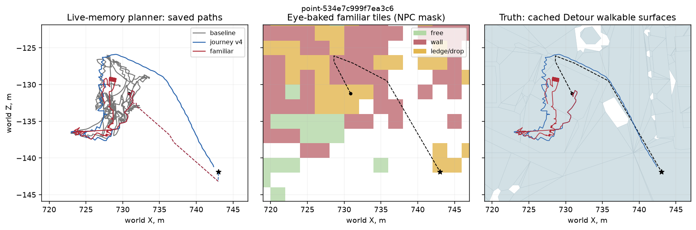
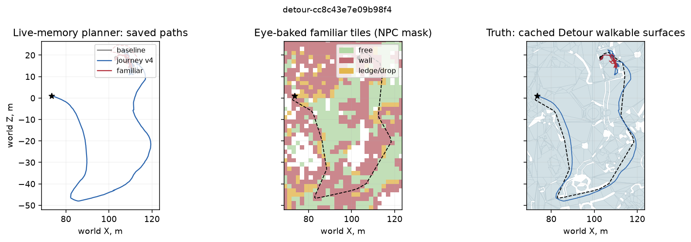
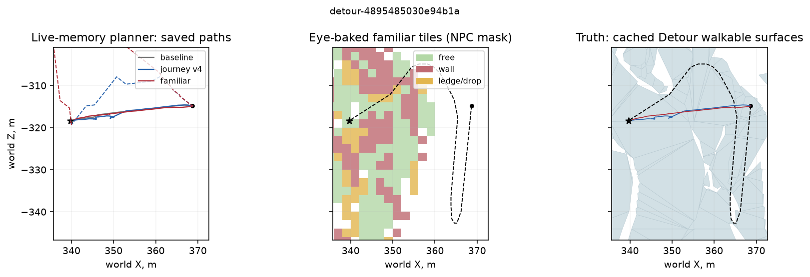

# Память навигации v4: поход и знакомая местность

2026-10-22. **Контракты памяти выполнены, прироста доходимости на неизменном учителе v3 нет.** За знакомыми дорогами местный дошёл в 26/30 → 25/30 → 24/30 случаев, чужак — в 22/30 → 20/30 → 20/30. Знакомая карта достаточно хорошо покрывает первый набор, но хранит много опасных флагов на проходимых коридорах. При уверенности 0,35 учитель v3 всё равно считает любую опасность запретом. Это согласуется с двумя потерянными успехами, однако конкретные клетки, изменившие решение, не записаны.

Решение пользователя от 2026-10-22 сохраняется: память похода на минуты; местному — долгая карта, полученная только его возможным зрительным опытом; чужаку — без неё. Navmesh/Detour используются исключительно для постановки, эталона и этого анализа. V4 остаётся на стенде. Демонстрации, ученик и DAgger не запускались. После получения шести режимов выполнен только анализ сохранённых данных, без новых игровых прогонов.

## Что реализовано

- Статическая память: `exp(-age/300 с - path/300 м)` вместо 30 с / 30 м. Movable сохраняет τ=5 с. Near — 16 м / 25 см, far — 200 м / 2 м; выход за скользящее окно по-прежнему вытесняет наблюдение.
- Общий атлас мира: тайлы 2 м, запечённые тем же глазом (238 лучей, четыре направления) и классификатором памяти. Исходные позы — поддержанные физикой точки авторских дорог через 2 м и их узлы. Navmesh не растеризуется в атлас. Movable не запекаются.
- Личная маска строится из того же `KnownRoads::Knowledge`, дома/исходной позиции, распорядка и известных по книге мест. Полуширина дорожного коридора — 8 м, радиус места — 20 м. Допускаются только тайлы, чей сохранённый источник наблюдения также доступен этому NPC. Сведения разных источников в одном тайле не объединяются: остаётся одна исходная поза.
- В far знакомая клетка подставляется при отсутствии живой памяти либо её confidence<0,35. Её confidence фиксирована: 0,35; канал `familiar=1`. Живое наблюдение с confidence≥0,35 перекрывает знакомую клетку целиком, включая старую стену. При противоречащей измеренной высоте пола знакомый тайл также отклоняется. Near остаётся живым.
- Версия памяти — 4; NAVDEMO v3 добавляет восьмой канал, 187 934 байта на решение. Читатель сохраняет поддержку v1/v2. В этом эксперименте `record=false`, новых NAVDEMO нет. Baseline сообщает память 3 / формат 2, v4 — память 4 / формат 3; валидатор проверяет идентичность своего режима и принимает готовые эпизоды без повторного исполнения.

Выключатели: `OPENGOTHIC_NAV_FAMILIAR_MAP=0` отключает знакомый слой; `OPENGOTHIC_NAV_JOURNEY_MEMORY=0` возвращает затухание v3. В обычной игре навигационная память пока не подключена.

## Постановка и итог по маршрутам

Один и тот же учитель v3, без β и изменения планировщика. По 121 замороженному `detour-val` из `codex/nav-dagger3`, 30 точек из [отчёта teacher-v3](../2026-10-20-teacher-v3/README.md) и 9 `nav-perception-safety` в каждом режиме: **906 навигационных + 54 safety-эпизода**. Для местного и чужака используется один региональный NPC, выбранный по ближайшей точке распорядка к замороженному старту; цель при выборе не участвует. У чужака меняется профиль знания, а не физическое тело. Всего 160 стартов, 51 разный NPC.

| Память | Кто | detour-val, успехи | Длина / Detour | beyond-roads, успехи | Длина / Detour |
|---|---|---:|---:|---:|---:|
| v3 baseline | местный | 107/121 | 1,034 | 26/30 | 1,705 |
| v4 journey | местный | 106/121 | 1,030 | 25/30 | 1,290 |
| v4 journey + familiar | местный | 105/121 | 1,023 | 24/30 | 1,464 |
| v3 baseline | чужак | 104/121 | 1,087 | 22/30 | 1,896 |
| v4 journey | чужак | 104/121 | 1,060 | 20/30 | 1,577 |
| v4 journey + familiar | чужак | 104/121 | 1,060 | 20/30 | 1,577 |

Длина / Detour здесь — среднее отношений **по всем эпизодам, включая неудачи**. Числитель — реально пройденная XZ-длина до завершения; знаменатель — сохранённая 3D-длина Detour. Допуск достижения — 1 м; физический NPC иногда срезает консервативную сетку. Поэтому отношение может быть меньше 1, а уменьшение среднего за счёт короткого неудачного пути не означает улучшения навигации.

На одинаковых успешных маршрутах картина другая:

| Сравнение | Набор | Общих успехов | Длина / Detour до → после |
|---|---|---:|---:|
| baseline → journey, местный | beyond-roads | 24 | 1,097 → 1,126 |
| journey → familiar, местный | beyond-roads | 24 | 1,126 → 1,126 |
| baseline → journey, чужак | beyond-roads | 19 | 1,231 → 1,289 |
| journey → familiar, местный | detour-val | 105 | 0,6174 → 0,6159 |

Таким образом, **1,70 → 1,29 не подтверждает сокращения успешных походов**. У знакомого слоя в detour-val семь общих успехов стали короче более чем на метр, восемь — длиннее; новых успехов нет. За знакомыми дорогами 27/30 пар journey/familiar имеют побайтно одинаковые `actions.txt` и `trajectory.txt`, в detour-val — 79/121.

У чужака journey/familiar совпадают побайтно на всех 30 beyond-roads и 115/121 detour-val. На оставшихся шести при пустой маске есть небольшие различия исполнения, без изменения суммарных 104 успехов. Приписывать их знакомому знанию оснований нет; источник этой вариативности по сохранённым данным не установлен.

## Попадают ли маршруты в знакомую карту

Маски восстановлены офлайн по сохранённым road events, исходным авторским координатам, книге мест и атласу. Используется родной `knownroads.cpp`. Числа известных узлов/рёбер и четыре счётчика маски совпали с native во **всех 160/160 профилях**. Из сохранённого Detour-кэша восстановлены 151/151 полных эталонных путей; максимальное расхождение с записанной длиной — **0,0021 см**. В кэше 48 287 полигонов проходимой поверхности.

Покрытие — XZ-длина внутри личной маски, а не доля площади всего мира. Эталонный коридор проверен в пределах ±15 см от оси (радиус тела учителя): середины отрезков с шагом ≤25 см, три поперечные полосы с весами ¼, ½, ¼. Итоги взвешены длиной маршрутов. Это доступность карты; фактическое использование знакомых клеток после приоритета живой памяти не записано.

| Набор | Старт в маске | Эталонный коридор в маске | Медиана по маршрутам | Реальный путь baseline в маске | Реальный путь familiar в маске |
|---|---:|---:|---:|---:|---:|
| beyond-roads | 24/30 | 78,71% | 92,09% | 90,20% | 87,55% |
| detour-val | 47/121 | 29,50% | 24,30% | 67,64% | 67,12% |

За знакомыми дорогами отсутствие выигрыша **не объясняется отсутствием покрытия**. Название этого набора относится к знанию Малета при прежнем отборе teacher-v3; региональный житель текущего замера может знать большую его часть. В detour-val покрытие действительно ограничено: большинство стартов вне маски, около 70% эталонного коридора без знакомых тайлов. Длинные обходы baseline объясняют более высокое покрытие реально пройденного пути, чем короткого эталона.

Для выбранных 8 м / 20 м маска содержит в медиане **64,40%** допустимых тайлов личной местности, диапазон **36,28–70,80%**. Остальное не дорисовывается: глаз не наблюдал тайл с допустимой для NPC исходной позы. Полуширина 8 м соответствует половине ближнего окна и оставляет место обходу вдоль дороги; радиус 20 м захватывает подход к месту. Это проверенный компактный исходный выбор, а не оптимум по доходимости: он дал 78,71% покрытия beyond-roads при 12,35 МБ на 300 NPC. Расширение радиусов само по себе не устраняет ошибочные опасности.

## Что в карте мешает и где она помогла

| Набор | Коридор в знакомых тайлах с любой опасностью | Со стеной | С уступом | С провалом |
|---|---:|---:|---:|---:|
| beyond-roads | 52,45% | 35,04% | 12,25% | 24,79% |
| detour-val | 19,35% | 12,40% | 3,39% | 8,69% |

Проценты относятся ко **всей** длине эталонного коридора, включая незнакомую часть. Каналы пересекаются и не складываются. Это означает пересечение проходимого эталона с опасно размеченным тайлом 2 м, а не доказательство несуществующей стены: настоящая стена рядом с проходом может занимать ту же клетку. Проекция XZ также не различает этажи. Из 197 369 тайлов всего атласа 52 338 имеют опасность, из них 52 173 одновременно имеют Free. Сохранены и ошибки исходного зрения, и грубость растра.

По коду неизменного v3 `dangerous()` блокирует клетку при любом ненулевом wall/ledge/drop/water/movable после 8-битного округления. Знакомая опасность 0,35 превращается в **89/255 и жёсткий запрет**, а не в умеренную стоимость. Free той же клетки запрет не снимает. Кроме того, при выборе одного источника на тайл предпочитается наблюдение с большим количеством классов; это может сохранять смешанные опасные клетки. Последнее — вывод из кода, отдельного сравнения альтернативных источников не было.

Две потери при добавлении familiar к journey:

| Сценарий / местный | Journey | Familiar | Первое различие плана при одинаковой позиции | Покрытие эталона / опасно / стена |
|---|---|---|---:|---:|
| `point-534e7c999f7ea3c6`, Onar / Bennet | успех, 74,667 с / 62,02 м | timeout 240 с / 184,00 м | 0 с | 63,09% / 63,09% / 50,81% |
| `detour-cc8c43e7e09b98f4`, upper_streets / VLK_496_BUERGERIN | успех, 224,867 с / 217,65 м | timeout 240 с / 54,91 м | 11,3 с | 99,24% / 72,63% / 60,80% |

В обоих случаях карта доступна, план меняется до расхождения поз, а затем успешный исход теряется. Это сильнее предположения «карта просто не покрыла район». Но без записанных live near/far нельзя отделить конкретную запечённую стену от влияния знакомого Free на цену пути или от дальнейшей обратной связи исполнения.





Сокращения успешного пути также есть. `detour-4895485030e94b1a` (PAL_297_RITTER): **32,51 → 28,73 м**, 20,600 → 16,667 с; первое различие плана в нулевой позе, старт незнаком, покрытие коридора 18,38%. `object-3a2801249f2b49f8` (Mortis): **21,36 → 18,24 м**, 13,500 → 10,333 с. Это локальная помощь в длине уже успешного маршрута; какой отдельный тайл её обеспечил, неизвестно.



На всех трёх схемах слева показаны **сохранённые траектории и пунктиром первые различающиеся локальные планы**, в центре — настоящие запечённые тайлы в маске NPC, справа — проходимая геометрия сохранённого Detour-кэша и эталон. Круг — старт, звезда — цель; зелёный — Free без опасностей, красный — Wall, жёлтый — Ledge/Drop. При совмещении классов цвет отдаётся опасности. **Слева нет изображения клеток живой памяти:** такие сетки и полные лучи в `record off` не сохранялись. Справа нет полной collision-геометрии стен. Поэтому исходное требование трёх изображений «живая карта / знакомая карта / истинная геометрия» выполнено только частично; данные для недостающей живой карты не выдумывались и новый прогон не делался.

## Почему journey у чужака даёт 22 → 20

Это **три потери и один выигрыш**, а не две потери. Маска знакомой карты отсутствует во всех этих эпизодах.

| Сценарий | Baseline | Journey | Первое отличие команды | Первое отличие плана |
|---|---|---|---:|---:|
| `point-04947589e1fbe474`, port_streets | успех, 104,367 с / 104,09 м | body_blocked, 240 с / 107,15 м; до цели 3,32 м | 12,8 с | 0,2 с |
| `point-061a569774cdf7d0`, lobart | успех, 184,800 с / 101,28 м | timeout, 240 с / 66,43 м; до цели 22,18 м | 0,8 с | 0,4 с |
| `point-131c6bc7cc66fe0c`, market | успех, 107,333 с / 135,01 м | timeout, 240 с / 124,00 м; до цели 11,02 м | 1,6 с | 1,3 с |
| `point-534e7c999f7ea3c6`, onar | timeout, 240 с / 257,33 м | успех, 74,667 с / 62,02 м | 4,4 с | 0,4 с |

До первой отличающейся команды позиции пар совпадают точно; у трёх потерь планы непусты на всех записанных решениях. Это изменение выбранного пути и последующего исполнения, а не отсутствие плана. У Лобарта и рынка команды расходятся за 0,8/1,6 с и 1,04/1,24 м хода: объяснять начало расхождения стеной, устаревшей за несколько минут, нельзя.

Механизм, видимый в коде: v3 задаёт цену свободной клетки `1 + 3*(1-knownFree)`. Увеличение τ/λ сразу повышает confidence/Free старых наблюдений и меняет цены A*, даже пока состав видимых препятствий одинаков. Для любой статической записи с начала эпизода нижние оценки confidence на момент первой отличающейся команды составляют baseline→journey: порт **0,438→0,921**, Лобарт **0,941→0,994**, рынок **0,910→0,991**. Все значительно выше порога округления опасности в ноль. Это согласуется с ранним изменением стоимости свободного пути, но не восстанавливает точную клетку развилки.

Долгая история потенциально дольше удерживает ошибочную опасность: при одном только старении порог ½/255 достигается примерно за 187 с у v3 и 1870 с у v4, если наблюдение не вытеснено и не обновлено. Влияние именно такого позднего запрета на эти неудачи не доказано. Оснований численно приписать 22→20 накопленным ложным стенам и подобрать новые τ/λ из этих записей нет; оставлены заданные **300 с / 300 м**. На 19 общих успехах средняя длина / Detour также ухудшилась: 1,231→1,289.

## Safety: вода совпадает с baseline

Во всех шести режимах обрывы **3/3 безопасны**, уступы **3/3 безопасны**, вредных падений нет. На обрывах есть три безопасных спуска больше высоты шага. Вода: **3/3 входа, один глубокий вход с плаванием**, два безопасных эпизода, один с неатрибутированным ущербом. Глубина проверяется относительно физического порога этого NPC **140 см**.

| Вода | Мокрых кадров | Глубоких кадров | Максимальная глубина | Покрытие пути знакомой картой местного |
|---|---:|---:|---:|---:|
| `water-bigfarm-lake-1` | 890 | 0 | 23,76 см | 100%, Water |
| `water-bigfarm-lake-2` | 819 | 0 | 31,74 см | 100%, Water |
| `water-lake-2` | 801 | 293 | 159,96 см | 0% |

Для каждого из трёх берегов SHA-256 `trajectory.txt` и `perception-safety-frames.jsonl` **одинаков во всех шести режимах**. Следовательно, familiar-local не добавил и не устранил водный провал baseline. Два мелких случая полностью покрыты знакомым Water, но физический исход не изменился. Глубокий случай лежит вне маски выбранного SLD_827_SOELDNER: знакомой информации там нет. У него потеряно 520 HP без установленного источника; глубина и плавание подтверждены независимо от неоднозначной атрибуции HP. Водный критерий остаётся открытым.

Три cliff-траектории также вне маски (0%); три ledge-траектории Ксардаса внутри неё (100%, запечённый Wall). Их безопасный результат сам по себе не подтверждает пользу знакомого слоя: свежая память может его перекрыть.

## Цена памяти

Ryzen 3950X, прежняя Linux RelWithDebInfo-сборка. Это встроенные таймеры завершённых **batch**-эпизодов, не тихий парный микробенч. Средние взвешены количеством вызовов в 151 навигационном эпизоде каждого режима; eye и планирование в эти интервалы не входят. Update — одно обновление памяти, view — выдача двух окон одному NPC.

| Режим | Update, мкс | View, мкс | Вызовов view |
|---|---:|---:|---:|
| baseline, местный | 81,55 | 764,17 | 87 668 |
| journey, местный | 84,89 | 786,12 | 88 380 |
| familiar, местный | 84,70 | 1397,10 | 90 869 |
| baseline, чужак | 80,42 | 759,46 | 105 053 |
| journey, чужак | 83,31 | 777,89 | 104 922 |
| familiar, чужак | 74,23 | 699,72 | 105 614 |

Наблюдавшиеся ранее 769 мкс не означают отдельного большого роста от 300-секундной истории: по всему набору journey у местного **+21,95 мкс / +2,87%** к baseline. Хранилище остаётся фиксированными окнами, список за 300 секунд не обходится. Знакомый слой добавляет к journey **610,98 мкс / 77,72%**, к baseline — **82,82%**.

Сравнение только побайтно одинаковых траекторий journey/familiar также показывает рост: beyond-roads (27 пар) **803,29→1371,00 мкс**, detour-val (79 пар) **768,88→1397,79 мкс**. По коду непустая знакомая маска заставляет обходить и пустые клетки far (100×100) и искать тайл бинарным поиском в общем атласе; для пустой маски эта работа пропускается. Это конкретный кандидат для кэша тайлов текущего окна. **Кэш не добавлен:** он требует отдельной проверки и парного замера, а после результатов новые прогоны запрещены. У чужака familiar заметно быстрее journey при той же пустой маске, поэтому точный причинный процент и дисперсию из batch-таймеров выводить нельзя.

| Хранение знакомого слоя | Объём |
|---|---:|
| Общие 197 369 тайлов, по 24 байта в памяти | 4 736 888 байт с контейнером |
| 17 329 исходных поз | 207 972 байта с контейнером |
| Маска одного NPC | 24 696 байт |
| Общий атлас + позы + маски/контейнеры 300 NPC | **12 353 660 байт = 12,35 МБ** |

Это вычисление по фактическим native `sizeof`/размерам, а не RSS процесса и не сумма сериализованных файлов. Прежние живые окна в эти 12,35 МБ не включены. Бюджет **≤50 МБ на мир выполнен**, запас 37,65 МБ. Цена на Mac **не измерена**; Linux-таймеры не подставляются вместо неё. Полная Mac-сборка и контракт памяти выполнены (проверка ниже); цену на Mac по уточнению пользователя не измеряем.

## Проверки и воспроизведение анализа

- Заявка `fbdf6f078514`: Linux-сборка, контракты памяти и 37 целевых Python-тестов прошли. Скала через 120 с / 150 м имеет confidence **0,40657**; у чужака незнакомая скала отсутствует, у местного до первого живого взгляда **0,35**, свежий проход перекрывает знакомую стену, movable через 60 с **<10⁻⁵**. Проверяется и происхождение тайлов, не только пустота маски чужака.
- После исправления идентичности режимов — **27 тестов валидатора** прошли, включая каждый из шести режимов и сохранение готовых эпизодов. Читатель NAVDEMO v1/v2/v3 проверялся отдельно; формат старого корпуса сохранён.
- Запекание `435da81e2f74`: 51 NPC / 160 стартов, native-проверка масок и бюджета. Все шесть итоговых режимов завершены. Неудачные первые попытки v4 остановились на проверке метаданных; готовые первые эпизоды сохранены, повторно не исполнялись.
- 2026-10-22, Mac arm64 / AppleClang 21: `CMAKE_BUILD_PARALLEL_LEVEL=3 scripts/build-engine.sh` (RelWithDebInfo, полный `Gothic2Notr`) и `cmake --build OpenGothic/build --target check-navigation-memory --parallel 3` прошли, **14/14 групп** контрактов памяти; скала через 120 с / 150 м — **0,406570**, familiar и movable пройдены. Локальный `OpenGothic/build` удалён; игра и замеры цены не запускались.
- 2026-10-22, совместимость ученика: `drive`/`drive-current`/`speed` и каждый reset population выбирают память из `preprocessing.navigation_memory_version` весов (нет поля → 3: 30 с / 30 м без familiar; 4 → 300 с / 300 м); `OPENGOTHIC_NAV_JOURNEY_MEMORY=0|1` явно переопределяет выбор, а метаданные и writer используют фактический режим. Полная Mac-сборка повторно прошла; `gothic-navpolicy-contract --memory` на NAVDEMO 1/2 × формате весов 1/2 прошёл **36 комбинаций + 44 отказа**, confidence скалы через 120 с / 150 м **0,00012341 / 0,40657**, legacy очищает familiar; прежние **14/14** групп памяти также прошли. NAVDEMO v3 для восьмиканального ученика пока отклоняется. Локальный build удалён; игра, обучение и замеры цены не запускались.
- Финальный офлайн-анализ: 160/160 совпавших профилей и 151/151 полных эталонов, проверка водных трасс хешами. Полной регрессии и новых игровых прогонов после получения результатов нет.

Полные исходные файлы остаются на Ryzen в `~/gothic-ai/nav-memory-v4/`: `input/`, `discovery/`, `bake/`, `bake-npcs/`, `evaluation/<режим>/<набор>/<id>/`, `safety/<режим>/<метка>/`, `cache/`. Локальная рабочая копия и большие промежуточные расчёты — в игнорируемой `.ryzen/nav-memory-v4/`. В git сохранены [числа, парные изменения и покрытие каждого маршрута](results.json) и три PNG; суммарно менее 1,5 МБ. Собственный Linux build удалён после анализа; исходные данные сохранены.

Сборка офлайн-помощника на Mac (игра и модели не запускаются):

```sh
c++ -std=c++17 -O2 -DDT_POLYREF64 \
  -Wno-deprecated-declarations -Wno-nontrivial-memcall \
  -IOpenGothic/common \
  -IOpenGothic/lib/Tempest/Engine/include \
  -IOpenGothic/lib/rapidjson/include \
  -IOpenGothic/lib/recastnavigation/Detour/Include \
  scripts/nav_memory_v4_geometry.cpp \
  OpenGothic/common/game/knownroads.cpp \
  OpenGothic/lib/recastnavigation/Detour/Source/*.cpp \
  -o .ryzen/nav-memory-v4/nav-memory-v4-geometry
uv run --no-project --with numpy --with matplotlib \
  python scripts/nav_memory_v4_report.py \
  --data .ryzen/nav-memory-v4 \
  --geometry .ryzen/nav-memory-v4/nav-memory-v4-geometry \
  --output reports/navigation/2026-10-22-memory-v4
```

Этот анализ читает готовые эпизоды, восстанавливает только их маски и геометрический эталон, строит таблицы и схемы. Он не вызывает runner, не меняет готовые эпизоды и не записывает NAVDEMO. Точные причины на уровне live-клеток, отдельный тихий замер/кэш и цена Mac остаются открытыми; отрицательный результат не используется для пересмотра решения пользователя о долгой памяти.
