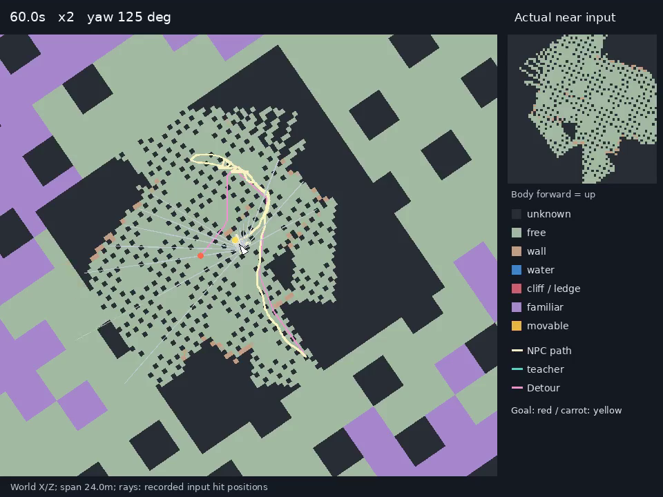
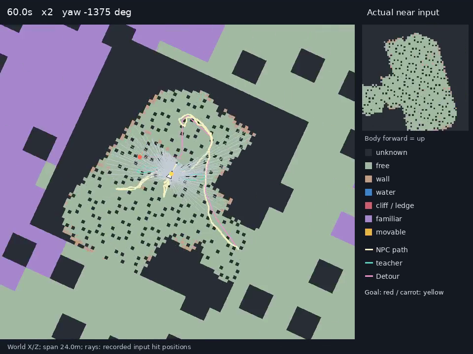

# Живой набор навигации

Baseline завершён в согласованном составе: **63/63** записи — HD **27**, it35 **27**, BC4 **9**. У каждой записи есть боковое видео, трасса, `topdown.mp4`, `timeline.png` и `summary.json`. Последняя заявка `4de2eb6f23da`: **exit 0, 1665 с**; готовые **54** записи переиспользованы, добавлены **9** записей следования.

Учитель квалифицирован на **10/13** постановках. №3 включён по решению пользователя с пометкой **«эталон не квалифицирован»**. №4 — **не квалифицирован**, три попытки; модели на нём не запускались. №9: дверь записана, лестница — **не квалифицирована**. По решению пользователя поиск других мест завершён.

Полная таблица раунда: [README на NAS](/mnt/shared/gothic-ai/nav-live/baseline/README.md). Неизменяемые входы последней фазы: [suite.json](/mnt/shared/gothic-ai/nav-live/baseline/extension/943431e2590c-a2964efaf4f4/suite.json); [результат квалификации](/mnt/shared/gothic-ai/nav-live/baseline/extension/943431e2590c-a2964efaf4f4/result.json).

## Набор и источники

Состав десяти сценариев фиксирован. Старт, цель, NPC, время и seed заданы в
[`scenarios.json`](../../../scripts/nav-live/scenarios.json). Места заморожены (`places_frozen: true`): новые раунды сохраняют координаты,
цели, NPC и время суток; вода, личные точки распорядка и час рынка больше
не выбираются заново. Следование имеет явное разрешение `teacher_qualification_required:false` и
пометку «эталон не квалифицирован». Лестница остаётся исключённой; №4 не квалифицирован после трёх попыток; координаты прежнего отклонённого места не используются для учеников. `bc4_compare:true` добавляет BC4 для №3/4.
Изменение входов запрещает продолжение старого завершённого раунда.

| № | Сценарий | Место и источник | Итог |
|---|---|---|---|
| 1 | Малет у забора | `(14926,1739,-15914)` → `FP_ROAM_FARM1_SHEEP_09`; [контроль 28,867 с](../2026-10-16-stuck/README.md); Detour 20,85 м | v3b прошёл за 26,433 с, 265 решений; запись проверена |
| 2 | Возврат с дороги | Три позиции из [PR #574](https://github.com/kaifaty/GothicAI/pull/574), `reports/physics/2026-10-30-routine-return/entry-on-trace.jsonl` коммита `971d9cd7a`: городской страж у дерева, Лобарт у края поля, Эрол у сосны; отклонения от waynet 11,65 / 12,01 / 16,13 м | v3b: 17,633 / 98,033 / 19,067 с к ближайшим личным точкам; Вино заменён из-за заблокированной капсулы, координаты Лобарта скопированы без сдвига |
| 3 | Спутник за героем | Новый маршрут: рынок → узкие улицы → таверна → рынок | Эталон не квалифицирован: 28,246%, 14,955 м, 90 с стояния; три модели ×3 seed включены без квалификации |
| 4 | Видимая цель за статическим препятствием | Пара из тех же 79 видимых `detour-val`; прямую перекрывает статический объект или рельеф, исключая стены домов/заборы | **Не квалифицирован**: 0/3 попытки; timeout / кромка 53,008 см / падение. Модели не запускались; числа ниже |
| 5 | Тупик у стены | Новая координата `(1500,-186,1200)` у верфи: Detour 52,83 м, отношение 2,1667, snap 0,171 см; первый участок уходит от цели | v3b: 51,967 с, 0 падений и глубоких заходов |
| 6 | Берег гавани | Новая пара на геометрии водных проб v5: `NW_CITY_WAY_TO_SHIP_08` → `NW_CITY_WAY_TO_SHIP_FISCHER_06` | v3b прошёл за 28,433 с, 0 глубоких заходов и падений |
| 7 | Тропа над обрывом | Safety-fixture `cliff-bridge-201-back200`, мост, link `1230208767`; [источник](../2026-10-22-teacher-v3b/README.md); верхний участок коридора до спуска, Y цели уточнён по физическому полу с 10614,061 до 10587,980 см, XZ сохранены | v3b: 8,133 с, 0 падений и глубоких заходов |
| 8 | Рынок с распорядками | Новый переход через `NW_CITY_MERCHANT_PATH_20`, 06:59; максимум 6 движущихся NPC из 24 измеренных часов | v3b: 84,200 с; обычные NPC не удаляются и не замораживаются |
| 9 | Дверь и лестница раздельно | Дверь: тот же REICH02, `NW_CITY_UPTOWN_PATH_08 → NW_CITY_REICH02_01`, первый этаж, Y≈900 см. Лестница: прежние координаты и кадр ниже | Дверь прошла за 5,233 с. В 45 validation-переходах нет подтверждённого внутреннего подъёма ≥2 м; лестница не квалифицирована |
| 10 | Местный и чужак | Новый путь Фернандо по улице верхнего квартала: `NW_CITY_UPTOWN_PATH_08 → NW_CITY_UPTOWN_PATH_12`, прямая 40,670 м, граф 51,15 м, диапазон высот 15,71 см | v3b: 42,700 с; HD/it35 и BC4 местный/чужак записаны ×3 seed |

В `water-scenarios.jsonl` v5 все 98 кандидатов имеют split `train`: отдельного
водного validation в этом файле нет. Для №6 выбрана **новая** пара в гавани;
обе ориентации прежних train-пар исключены. Замороженные test-пары читаются
только как метаданные запрета; test-поездок и записей нет. Ветку routine-return
и её данные этот набор не изменяет.

Seed: **18102027, 18102028, 18102029**. В №2 каждому seed соответствует одна из трёх позиций; остальные принятые места повторяются на всех трёх seed. HD/it35: по 24 поездки до следования и по три follow; BC4: шесть местный/чужак №10 и три follow. Время суток, NPC и координаты закреплены в наборе; обычные распорядки включены.

## Команда и файлы

```bash
scripts/nav-live.sh \
  --weights /mnt/shared/gothic-ai/archive/nav-dagger3-20261030/hd-run/policy.navbc,/mnt/shared/gothic-ai/archive/nav-ppo/run/iter-000035/update/policy.navbc \
  --round baseline
```

Команда подаёт заявку через `gq` и возвращает ID без ожидания и опроса очереди. Этапы подготовки, учителя, smoke и baseline продолжаются отдельными вызовами; готовые прогоны с теми же фактическими входами не снимаются повторно. Снимок исходников и набора закрепляется для каждой заявки, бинарник и веса — по SHA-256. Изменённые веса требуют новой метки раунда. Повтор завершённого раунда после уборки возвращает готовый README без сборки и заявки. Последнее дополнение выполнено через `--stage extend` одной заявкой без пересборки; повторять его для завершённого baseline не требуется.

BC4: `/mnt/shared/gothic-ai/nav-bc4/bc4/policy.navbc`. Выбор действий — выборка из softmax, β=0; настройки политики, учителя, памяти и глаза не менялись.

`source.mp4` — боковая следящая камера bench. `live-decisions.jsonl` на частоте решений (100 мс): поза, цель/морковка, действие, вероятности всех голов, энтропия, скорость, stuck, safety и контакты CV. `live-observations.bin.gz` каждые 400 мс: реальные uint8 near/far (с familiar при наличии) и попадания лучей; `live-format.json` хранит раскладку и путь Detour. Видео и трассы пишутся одним процессом в одном прогоне. `actions.txt` и `trajectory.txt` сохраняют путь и действия учителя.

`topdown.mp4` ×2 показывает память по классам с легендой, лучи, направление NPC, цель/морковку и пути ученика/v3b/Detour. `timeline.png` содержит действия всех голов, вероятности, скорость и отметки stuck/safety/контакта. `summary.json` содержит требуемые метрики и их источники. Стояние/кружение: скорость <20 см/с, кружение дополнительно требует поворота. Контакт — начало native CV blocked/steep; stuck измеряется отдельно. Кромка/глубокая вода: 16 направлений до 5 м, шаг 10/25 см; `censored=true` означает ≥5 м. Падения и глубокие заходы — по физическим кадрам.

Во всех сценариях старт героя выбирается общим поиском до 80 точек Detour в кольце 2–6 м вокруг NPC. Луч опоры идёт с высоты навмеша +2 м вниз на 5 м; капсула проверяется на найденном полу. При отсутствии места сохраняется `setup_rejected:true` с причиной, без падения игры. Правило действует с записью и без неё; диагностика — `live-guide-start.json`.

## Итоговая таблица baseline

Числитель — приезды, для №3 — достижение порога 80%. Медианный/худший seed: приезд, затем время и seed; №3 — доля в полосе, затем дистанция и стояние. «—» означает, что эта модель для данного сценария не предусмотрена. Все ссылки ниже ведут в папки NAS или в файлы того же прогона.

| № | v3b | HD | it35 (прошлая модель) | BC4 | BC4 местный | BC4 чужак |
|---|---|---|---|---|---|---|
| 1 | прошёл: 26.433 с / 265 решений; [01-maleth-fence](/mnt/shared/gothic-ai/nav-live/baseline/teacher/01-maleth-fence-59619ac71331); [видео](/mnt/shared/gothic-ai/nav-live/baseline/teacher/01-maleth-fence-59619ac71331/source.mp4), [topdown](/mnt/shared/gothic-ai/nav-live/baseline/teacher/01-maleth-fence-59619ac71331/topdown.mp4), [timeline](/mnt/shared/gothic-ai/nav-live/baseline/teacher/01-maleth-fence-59619ac71331/timeline.png), [JSON](/mnt/shared/gothic-ai/nav-live/baseline/teacher/01-maleth-fence-59619ac71331/summary.json) | 3/3 приездов; [медиана 18102029 / 01-maleth-fence](/mnt/shared/gothic-ai/nav-live/baseline/HD/01-maleth-fence/seed-18102029) (24.633 с): [видео](/mnt/shared/gothic-ai/nav-live/baseline/HD/01-maleth-fence/seed-18102029/source.mp4), [topdown](/mnt/shared/gothic-ai/nav-live/baseline/HD/01-maleth-fence/seed-18102029/topdown.mp4), [timeline](/mnt/shared/gothic-ai/nav-live/baseline/HD/01-maleth-fence/seed-18102029/timeline.png), [JSON](/mnt/shared/gothic-ai/nav-live/baseline/HD/01-maleth-fence/seed-18102029/summary.json); [худший 18102028 / 01-maleth-fence](/mnt/shared/gothic-ai/nav-live/baseline/HD/01-maleth-fence/seed-18102028) (31.700 с): [видео](/mnt/shared/gothic-ai/nav-live/baseline/HD/01-maleth-fence/seed-18102028/source.mp4), [topdown](/mnt/shared/gothic-ai/nav-live/baseline/HD/01-maleth-fence/seed-18102028/topdown.mp4), [timeline](/mnt/shared/gothic-ai/nav-live/baseline/HD/01-maleth-fence/seed-18102028/timeline.png), [JSON](/mnt/shared/gothic-ai/nav-live/baseline/HD/01-maleth-fence/seed-18102028/summary.json) | 3/3 приездов; [медиана 18102027 / 01-maleth-fence](/mnt/shared/gothic-ai/nav-live/baseline/it35/01-maleth-fence/seed-18102027) (27.100 с): [видео](/mnt/shared/gothic-ai/nav-live/baseline/it35/01-maleth-fence/seed-18102027/source.mp4), [topdown](/mnt/shared/gothic-ai/nav-live/baseline/it35/01-maleth-fence/seed-18102027/topdown.mp4), [timeline](/mnt/shared/gothic-ai/nav-live/baseline/it35/01-maleth-fence/seed-18102027/timeline.png), [JSON](/mnt/shared/gothic-ai/nav-live/baseline/it35/01-maleth-fence/seed-18102027/summary.json); [худший 18102028 / 01-maleth-fence](/mnt/shared/gothic-ai/nav-live/baseline/it35/01-maleth-fence/seed-18102028) (27.100 с): [видео](/mnt/shared/gothic-ai/nav-live/baseline/it35/01-maleth-fence/seed-18102028/source.mp4), [topdown](/mnt/shared/gothic-ai/nav-live/baseline/it35/01-maleth-fence/seed-18102028/topdown.mp4), [timeline](/mnt/shared/gothic-ai/nav-live/baseline/it35/01-maleth-fence/seed-18102028/timeline.png), [JSON](/mnt/shared/gothic-ai/nav-live/baseline/it35/01-maleth-fence/seed-18102028/summary.json) | — | — | — |
| 2 | прошёл: 17.633 с / 177 решений; [02-routine-return-forest-tree](/mnt/shared/gothic-ai/nav-live/baseline/teacher/02-routine-return-forest-tree-1c3f65d2ab91); [видео](/mnt/shared/gothic-ai/nav-live/baseline/teacher/02-routine-return-forest-tree-1c3f65d2ab91/source.mp4), [topdown](/mnt/shared/gothic-ai/nav-live/baseline/teacher/02-routine-return-forest-tree-1c3f65d2ab91/topdown.mp4), [timeline](/mnt/shared/gothic-ai/nav-live/baseline/teacher/02-routine-return-forest-tree-1c3f65d2ab91/timeline.png), [JSON](/mnt/shared/gothic-ai/nav-live/baseline/teacher/02-routine-return-forest-tree-1c3f65d2ab91/summary.json)<br>прошёл: 98.033 с / 981 решений; [02-routine-return-farm-edge](/mnt/shared/gothic-ai/nav-live/baseline/teacher/02-routine-return-farm-edge-e476acb99449-recheck-7644259bfd62-37df22448498); [видео](/mnt/shared/gothic-ai/nav-live/baseline/teacher/02-routine-return-farm-edge-e476acb99449-recheck-7644259bfd62-37df22448498/source.mp4), [topdown](/mnt/shared/gothic-ai/nav-live/baseline/teacher/02-routine-return-farm-edge-e476acb99449-recheck-7644259bfd62-37df22448498/topdown.mp4), [timeline](/mnt/shared/gothic-ai/nav-live/baseline/teacher/02-routine-return-farm-edge-e476acb99449-recheck-7644259bfd62-37df22448498/timeline.png), [JSON](/mnt/shared/gothic-ai/nav-live/baseline/teacher/02-routine-return-farm-edge-e476acb99449-recheck-7644259bfd62-37df22448498/summary.json)<br>прошёл: 19.067 с / 191 решений; [02-routine-return-forest-pine](/mnt/shared/gothic-ai/nav-live/baseline/teacher/02-routine-return-forest-pine-c93434483ad1); [видео](/mnt/shared/gothic-ai/nav-live/baseline/teacher/02-routine-return-forest-pine-c93434483ad1/source.mp4), [topdown](/mnt/shared/gothic-ai/nav-live/baseline/teacher/02-routine-return-forest-pine-c93434483ad1/topdown.mp4), [timeline](/mnt/shared/gothic-ai/nav-live/baseline/teacher/02-routine-return-forest-pine-c93434483ad1/timeline.png), [JSON](/mnt/shared/gothic-ai/nav-live/baseline/teacher/02-routine-return-forest-pine-c93434483ad1/summary.json) | 3/3 приездов; [медиана 18102029 / 02-routine-return-forest-pine](/mnt/shared/gothic-ai/nav-live/baseline/HD/02-routine-return-forest-pine/seed-18102029) (14.200 с): [видео](/mnt/shared/gothic-ai/nav-live/baseline/HD/02-routine-return-forest-pine/seed-18102029/source.mp4), [topdown](/mnt/shared/gothic-ai/nav-live/baseline/HD/02-routine-return-forest-pine/seed-18102029/topdown.mp4), [timeline](/mnt/shared/gothic-ai/nav-live/baseline/HD/02-routine-return-forest-pine/seed-18102029/timeline.png), [JSON](/mnt/shared/gothic-ai/nav-live/baseline/HD/02-routine-return-forest-pine/seed-18102029/summary.json); [худший 18102028 / 02-routine-return-farm-edge](/mnt/shared/gothic-ai/nav-live/baseline/HD/02-routine-return-farm-edge/seed-18102028) (39.733 с): [видео](/mnt/shared/gothic-ai/nav-live/baseline/HD/02-routine-return-farm-edge/seed-18102028/source.mp4), [topdown](/mnt/shared/gothic-ai/nav-live/baseline/HD/02-routine-return-farm-edge/seed-18102028/topdown.mp4), [timeline](/mnt/shared/gothic-ai/nav-live/baseline/HD/02-routine-return-farm-edge/seed-18102028/timeline.png), [JSON](/mnt/shared/gothic-ai/nav-live/baseline/HD/02-routine-return-farm-edge/seed-18102028/summary.json) | 3/3 приездов; [медиана 18102027 / 02-routine-return-forest-tree](/mnt/shared/gothic-ai/nav-live/baseline/it35/02-routine-return-forest-tree/seed-18102027) (24.367 с): [видео](/mnt/shared/gothic-ai/nav-live/baseline/it35/02-routine-return-forest-tree/seed-18102027/source.mp4), [topdown](/mnt/shared/gothic-ai/nav-live/baseline/it35/02-routine-return-forest-tree/seed-18102027/topdown.mp4), [timeline](/mnt/shared/gothic-ai/nav-live/baseline/it35/02-routine-return-forest-tree/seed-18102027/timeline.png), [JSON](/mnt/shared/gothic-ai/nav-live/baseline/it35/02-routine-return-forest-tree/seed-18102027/summary.json); [худший 18102028 / 02-routine-return-farm-edge](/mnt/shared/gothic-ai/nav-live/baseline/it35/02-routine-return-farm-edge/seed-18102028) (88.833 с): [видео](/mnt/shared/gothic-ai/nav-live/baseline/it35/02-routine-return-farm-edge/seed-18102028/source.mp4), [topdown](/mnt/shared/gothic-ai/nav-live/baseline/it35/02-routine-return-farm-edge/seed-18102028/topdown.mp4), [timeline](/mnt/shared/gothic-ai/nav-live/baseline/it35/02-routine-return-farm-edge/seed-18102028/timeline.png), [JSON](/mnt/shared/gothic-ai/nav-live/baseline/it35/02-routine-return-farm-edge/seed-18102028/summary.json) | — | — | — |
| 3 | эталон не квалифицирован: 180.000 с / 1800 решений; [03-follow-hero](/mnt/shared/gothic-ai/nav-live/baseline/teacher/03-follow-hero-recheck-1c9a1fde8d40-a2964efaf4f4); [видео](/mnt/shared/gothic-ai/nav-live/baseline/teacher/03-follow-hero-recheck-1c9a1fde8d40-a2964efaf4f4/source.mp4), [topdown](/mnt/shared/gothic-ai/nav-live/baseline/teacher/03-follow-hero-recheck-1c9a1fde8d40-a2964efaf4f4/topdown.mp4), [timeline](/mnt/shared/gothic-ai/nav-live/baseline/teacher/03-follow-hero-recheck-1c9a1fde8d40-a2964efaf4f4/timeline.png), [JSON](/mnt/shared/gothic-ai/nav-live/baseline/teacher/03-follow-hero-recheck-1c9a1fde8d40-a2964efaf4f4/summary.json); 28,278% / 14,955 м / 90 с стояния | 1/3 достигли порога 80%; [медиана 18102028 / 03-follow-hero](/mnt/shared/gothic-ai/nav-live/baseline/HD/03-follow-hero/seed-18102028) (180.000 с): [видео](/mnt/shared/gothic-ai/nav-live/baseline/HD/03-follow-hero/seed-18102028/source.mp4), [topdown](/mnt/shared/gothic-ai/nav-live/baseline/HD/03-follow-hero/seed-18102028/topdown.mp4), [timeline](/mnt/shared/gothic-ai/nav-live/baseline/HD/03-follow-hero/seed-18102028/timeline.png), [JSON](/mnt/shared/gothic-ai/nav-live/baseline/HD/03-follow-hero/seed-18102028/summary.json); полоса 33.2222%, дистанция 10.891 м, стояние 49.3 с; [худший 18102027 / 03-follow-hero](/mnt/shared/gothic-ai/nav-live/baseline/HD/03-follow-hero/seed-18102027) (180.000 с): [видео](/mnt/shared/gothic-ai/nav-live/baseline/HD/03-follow-hero/seed-18102027/source.mp4), [topdown](/mnt/shared/gothic-ai/nav-live/baseline/HD/03-follow-hero/seed-18102027/topdown.mp4), [timeline](/mnt/shared/gothic-ai/nav-live/baseline/HD/03-follow-hero/seed-18102027/timeline.png), [JSON](/mnt/shared/gothic-ai/nav-live/baseline/HD/03-follow-hero/seed-18102027/summary.json); полоса 25.4444%, дистанция 13.469 м, стояние 46.4 с | 0/3 достигли порога 80%; [медиана 18102029 / 03-follow-hero](/mnt/shared/gothic-ai/nav-live/baseline/it35/03-follow-hero/seed-18102029) (180.000 с): [видео](/mnt/shared/gothic-ai/nav-live/baseline/it35/03-follow-hero/seed-18102029/source.mp4), [topdown](/mnt/shared/gothic-ai/nav-live/baseline/it35/03-follow-hero/seed-18102029/topdown.mp4), [timeline](/mnt/shared/gothic-ai/nav-live/baseline/it35/03-follow-hero/seed-18102029/timeline.png), [JSON](/mnt/shared/gothic-ai/nav-live/baseline/it35/03-follow-hero/seed-18102029/summary.json); полоса 5.1667%, дистанция 12.993 м, стояние 62.3 с; [худший 18102027 / 03-follow-hero](/mnt/shared/gothic-ai/nav-live/baseline/it35/03-follow-hero/seed-18102027) (180.000 с): [видео](/mnt/shared/gothic-ai/nav-live/baseline/it35/03-follow-hero/seed-18102027/source.mp4), [topdown](/mnt/shared/gothic-ai/nav-live/baseline/it35/03-follow-hero/seed-18102027/topdown.mp4), [timeline](/mnt/shared/gothic-ai/nav-live/baseline/it35/03-follow-hero/seed-18102027/timeline.png), [JSON](/mnt/shared/gothic-ai/nav-live/baseline/it35/03-follow-hero/seed-18102027/summary.json); полоса 4.8333%, дистанция 13.669 м, стояние 79.0 с | 0/3 достигли порога 80%; [медиана 18102027 / 03-follow-hero](/mnt/shared/gothic-ai/nav-live/baseline/bc4/03-follow-hero/seed-18102027) (180.000 с): [видео](/mnt/shared/gothic-ai/nav-live/baseline/bc4/03-follow-hero/seed-18102027/source.mp4), [topdown](/mnt/shared/gothic-ai/nav-live/baseline/bc4/03-follow-hero/seed-18102027/topdown.mp4), [timeline](/mnt/shared/gothic-ai/nav-live/baseline/bc4/03-follow-hero/seed-18102027/timeline.png), [JSON](/mnt/shared/gothic-ai/nav-live/baseline/bc4/03-follow-hero/seed-18102027/summary.json); полоса 14.3889%, дистанция 20.750 м, стояние 38.4 с; [худший 18102029 / 03-follow-hero](/mnt/shared/gothic-ai/nav-live/baseline/bc4/03-follow-hero/seed-18102029) (180.000 с): [видео](/mnt/shared/gothic-ai/nav-live/baseline/bc4/03-follow-hero/seed-18102029/source.mp4), [topdown](/mnt/shared/gothic-ai/nav-live/baseline/bc4/03-follow-hero/seed-18102029/topdown.mp4), [timeline](/mnt/shared/gothic-ai/nav-live/baseline/bc4/03-follow-hero/seed-18102029/timeline.png), [JSON](/mnt/shared/gothic-ai/nav-live/baseline/bc4/03-follow-hero/seed-18102029/summary.json); полоса 9.2778%, дистанция 17.765 м, стояние 34.0 с | — | — |
| 4 | **Не квалифицирован**: 0/3; timeout 90 с; кромка 53,008 см <100; падение 1 / кромка 6,992 см. [три попытки](/mnt/shared/gothic-ai/nav-live/baseline/extension/943431e2590c-a2964efaf4f4/result.json) | не запускался | не запускался | не запускался | — | — |
| 5 | прошёл: 51.967 с / 520 решений; [05-wall-pocket](/mnt/shared/gothic-ai/nav-live/baseline/teacher/05-wall-pocket-e05d8c09dbec); [видео](/mnt/shared/gothic-ai/nav-live/baseline/teacher/05-wall-pocket-e05d8c09dbec/source.mp4), [topdown](/mnt/shared/gothic-ai/nav-live/baseline/teacher/05-wall-pocket-e05d8c09dbec/topdown.mp4), [timeline](/mnt/shared/gothic-ai/nav-live/baseline/teacher/05-wall-pocket-e05d8c09dbec/timeline.png), [JSON](/mnt/shared/gothic-ai/nav-live/baseline/teacher/05-wall-pocket-e05d8c09dbec/summary.json) | 2/3 приездов; [медиана 18102029 / 05-wall-pocket](/mnt/shared/gothic-ai/nav-live/baseline/HD/05-wall-pocket/seed-18102029) (29.367 с): [видео](/mnt/shared/gothic-ai/nav-live/baseline/HD/05-wall-pocket/seed-18102029/source.mp4), [topdown](/mnt/shared/gothic-ai/nav-live/baseline/HD/05-wall-pocket/seed-18102029/topdown.mp4), [timeline](/mnt/shared/gothic-ai/nav-live/baseline/HD/05-wall-pocket/seed-18102029/timeline.png), [JSON](/mnt/shared/gothic-ai/nav-live/baseline/HD/05-wall-pocket/seed-18102029/summary.json); [худший 18102028 / 05-wall-pocket](/mnt/shared/gothic-ai/nav-live/baseline/HD/05-wall-pocket/seed-18102028) (90.000 с): [видео](/mnt/shared/gothic-ai/nav-live/baseline/HD/05-wall-pocket/seed-18102028/source.mp4), [topdown](/mnt/shared/gothic-ai/nav-live/baseline/HD/05-wall-pocket/seed-18102028/topdown.mp4), [timeline](/mnt/shared/gothic-ai/nav-live/baseline/HD/05-wall-pocket/seed-18102028/timeline.png), [JSON](/mnt/shared/gothic-ai/nav-live/baseline/HD/05-wall-pocket/seed-18102028/summary.json) | 0/3 приездов; [медиана 18102028 / 05-wall-pocket](/mnt/shared/gothic-ai/nav-live/baseline/it35/05-wall-pocket/seed-18102028) (90.000 с): [видео](/mnt/shared/gothic-ai/nav-live/baseline/it35/05-wall-pocket/seed-18102028/source.mp4), [topdown](/mnt/shared/gothic-ai/nav-live/baseline/it35/05-wall-pocket/seed-18102028/topdown.mp4), [timeline](/mnt/shared/gothic-ai/nav-live/baseline/it35/05-wall-pocket/seed-18102028/timeline.png), [JSON](/mnt/shared/gothic-ai/nav-live/baseline/it35/05-wall-pocket/seed-18102028/summary.json); [худший 18102029 / 05-wall-pocket](/mnt/shared/gothic-ai/nav-live/baseline/it35/05-wall-pocket/seed-18102029) (90.000 с): [видео](/mnt/shared/gothic-ai/nav-live/baseline/it35/05-wall-pocket/seed-18102029/source.mp4), [topdown](/mnt/shared/gothic-ai/nav-live/baseline/it35/05-wall-pocket/seed-18102029/topdown.mp4), [timeline](/mnt/shared/gothic-ai/nav-live/baseline/it35/05-wall-pocket/seed-18102029/timeline.png), [JSON](/mnt/shared/gothic-ai/nav-live/baseline/it35/05-wall-pocket/seed-18102029/summary.json) | — | — | — |
| 6 | прошёл: 28.433 с / 285 решений; [06-harbour-water](/mnt/shared/gothic-ai/nav-live/baseline/teacher/06-harbour-water-83140ce185ef); [видео](/mnt/shared/gothic-ai/nav-live/baseline/teacher/06-harbour-water-83140ce185ef/source.mp4), [topdown](/mnt/shared/gothic-ai/nav-live/baseline/teacher/06-harbour-water-83140ce185ef/topdown.mp4), [timeline](/mnt/shared/gothic-ai/nav-live/baseline/teacher/06-harbour-water-83140ce185ef/timeline.png), [JSON](/mnt/shared/gothic-ai/nav-live/baseline/teacher/06-harbour-water-83140ce185ef/summary.json) | 3/3 приездов; [медиана 18102028 / 06-harbour-water](/mnt/shared/gothic-ai/nav-live/baseline/HD/06-harbour-water/seed-18102028) (46.533 с): [видео](/mnt/shared/gothic-ai/nav-live/baseline/HD/06-harbour-water/seed-18102028/source.mp4), [topdown](/mnt/shared/gothic-ai/nav-live/baseline/HD/06-harbour-water/seed-18102028/topdown.mp4), [timeline](/mnt/shared/gothic-ai/nav-live/baseline/HD/06-harbour-water/seed-18102028/timeline.png), [JSON](/mnt/shared/gothic-ai/nav-live/baseline/HD/06-harbour-water/seed-18102028/summary.json); [худший 18102027 / 06-harbour-water](/mnt/shared/gothic-ai/nav-live/baseline/HD/06-harbour-water/seed-18102027) (46.667 с): [видео](/mnt/shared/gothic-ai/nav-live/baseline/HD/06-harbour-water/seed-18102027/source.mp4), [topdown](/mnt/shared/gothic-ai/nav-live/baseline/HD/06-harbour-water/seed-18102027/topdown.mp4), [timeline](/mnt/shared/gothic-ai/nav-live/baseline/HD/06-harbour-water/seed-18102027/timeline.png), [JSON](/mnt/shared/gothic-ai/nav-live/baseline/HD/06-harbour-water/seed-18102027/summary.json) | 3/3 приездов; [медиана 18102028 / 06-harbour-water](/mnt/shared/gothic-ai/nav-live/baseline/it35/06-harbour-water/seed-18102028) (29.467 с): [видео](/mnt/shared/gothic-ai/nav-live/baseline/it35/06-harbour-water/seed-18102028/source.mp4), [topdown](/mnt/shared/gothic-ai/nav-live/baseline/it35/06-harbour-water/seed-18102028/topdown.mp4), [timeline](/mnt/shared/gothic-ai/nav-live/baseline/it35/06-harbour-water/seed-18102028/timeline.png), [JSON](/mnt/shared/gothic-ai/nav-live/baseline/it35/06-harbour-water/seed-18102028/summary.json); [худший 18102029 / 06-harbour-water](/mnt/shared/gothic-ai/nav-live/baseline/it35/06-harbour-water/seed-18102029) (29.800 с): [видео](/mnt/shared/gothic-ai/nav-live/baseline/it35/06-harbour-water/seed-18102029/source.mp4), [topdown](/mnt/shared/gothic-ai/nav-live/baseline/it35/06-harbour-water/seed-18102029/topdown.mp4), [timeline](/mnt/shared/gothic-ai/nav-live/baseline/it35/06-harbour-water/seed-18102029/timeline.png), [JSON](/mnt/shared/gothic-ai/nav-live/baseline/it35/06-harbour-water/seed-18102029/summary.json) | — | — | — |
| 7 | прошёл: 8.133 с / 82 решений; [07-cliff-trail](/mnt/shared/gothic-ai/nav-live/baseline/teacher/07-cliff-trail-df890f365005); [видео](/mnt/shared/gothic-ai/nav-live/baseline/teacher/07-cliff-trail-df890f365005/source.mp4), [topdown](/mnt/shared/gothic-ai/nav-live/baseline/teacher/07-cliff-trail-df890f365005/topdown.mp4), [timeline](/mnt/shared/gothic-ai/nav-live/baseline/teacher/07-cliff-trail-df890f365005/timeline.png), [JSON](/mnt/shared/gothic-ai/nav-live/baseline/teacher/07-cliff-trail-df890f365005/summary.json) | 1/3 приездов; [медиана 18102027 / 07-cliff-trail](/mnt/shared/gothic-ai/nav-live/baseline/HD/07-cliff-trail/seed-18102027) (60.000 с): [видео](/mnt/shared/gothic-ai/nav-live/baseline/HD/07-cliff-trail/seed-18102027/source.mp4), [topdown](/mnt/shared/gothic-ai/nav-live/baseline/HD/07-cliff-trail/seed-18102027/topdown.mp4), [timeline](/mnt/shared/gothic-ai/nav-live/baseline/HD/07-cliff-trail/seed-18102027/timeline.png), [JSON](/mnt/shared/gothic-ai/nav-live/baseline/HD/07-cliff-trail/seed-18102027/summary.json); [худший 18102029 / 07-cliff-trail](/mnt/shared/gothic-ai/nav-live/baseline/HD/07-cliff-trail/seed-18102029) (60.000 с): [видео](/mnt/shared/gothic-ai/nav-live/baseline/HD/07-cliff-trail/seed-18102029/source.mp4), [topdown](/mnt/shared/gothic-ai/nav-live/baseline/HD/07-cliff-trail/seed-18102029/topdown.mp4), [timeline](/mnt/shared/gothic-ai/nav-live/baseline/HD/07-cliff-trail/seed-18102029/timeline.png), [JSON](/mnt/shared/gothic-ai/nav-live/baseline/HD/07-cliff-trail/seed-18102029/summary.json) | 1/3 приездов; [медиана 18102027 / 07-cliff-trail](/mnt/shared/gothic-ai/nav-live/baseline/it35/07-cliff-trail/seed-18102027) (60.000 с): [видео](/mnt/shared/gothic-ai/nav-live/baseline/it35/07-cliff-trail/seed-18102027/source.mp4), [topdown](/mnt/shared/gothic-ai/nav-live/baseline/it35/07-cliff-trail/seed-18102027/topdown.mp4), [timeline](/mnt/shared/gothic-ai/nav-live/baseline/it35/07-cliff-trail/seed-18102027/timeline.png), [JSON](/mnt/shared/gothic-ai/nav-live/baseline/it35/07-cliff-trail/seed-18102027/summary.json); [худший 18102029 / 07-cliff-trail](/mnt/shared/gothic-ai/nav-live/baseline/it35/07-cliff-trail/seed-18102029) (60.000 с): [видео](/mnt/shared/gothic-ai/nav-live/baseline/it35/07-cliff-trail/seed-18102029/source.mp4), [topdown](/mnt/shared/gothic-ai/nav-live/baseline/it35/07-cliff-trail/seed-18102029/topdown.mp4), [timeline](/mnt/shared/gothic-ai/nav-live/baseline/it35/07-cliff-trail/seed-18102029/timeline.png), [JSON](/mnt/shared/gothic-ai/nav-live/baseline/it35/07-cliff-trail/seed-18102029/summary.json) | — | — | — |
| 8 | прошёл: 84.200 с / 842 решений; [08-market-crowd](/mnt/shared/gothic-ai/nav-live/baseline/teacher/08-market-crowd-ef33c9add115); [видео](/mnt/shared/gothic-ai/nav-live/baseline/teacher/08-market-crowd-ef33c9add115/source.mp4), [topdown](/mnt/shared/gothic-ai/nav-live/baseline/teacher/08-market-crowd-ef33c9add115/topdown.mp4), [timeline](/mnt/shared/gothic-ai/nav-live/baseline/teacher/08-market-crowd-ef33c9add115/timeline.png), [JSON](/mnt/shared/gothic-ai/nav-live/baseline/teacher/08-market-crowd-ef33c9add115/summary.json) | 2/3 приездов; [медиана 18102029 / 08-market-crowd](/mnt/shared/gothic-ai/nav-live/baseline/HD/08-market-crowd/seed-18102029) (87.733 с): [видео](/mnt/shared/gothic-ai/nav-live/baseline/HD/08-market-crowd/seed-18102029/source.mp4), [topdown](/mnt/shared/gothic-ai/nav-live/baseline/HD/08-market-crowd/seed-18102029/topdown.mp4), [timeline](/mnt/shared/gothic-ai/nav-live/baseline/HD/08-market-crowd/seed-18102029/timeline.png), [JSON](/mnt/shared/gothic-ai/nav-live/baseline/HD/08-market-crowd/seed-18102029/summary.json); [худший 18102028 / 08-market-crowd](/mnt/shared/gothic-ai/nav-live/baseline/HD/08-market-crowd/seed-18102028) (90.000 с): [видео](/mnt/shared/gothic-ai/nav-live/baseline/HD/08-market-crowd/seed-18102028/source.mp4), [topdown](/mnt/shared/gothic-ai/nav-live/baseline/HD/08-market-crowd/seed-18102028/topdown.mp4), [timeline](/mnt/shared/gothic-ai/nav-live/baseline/HD/08-market-crowd/seed-18102028/timeline.png), [JSON](/mnt/shared/gothic-ai/nav-live/baseline/HD/08-market-crowd/seed-18102028/summary.json) | 3/3 приездов; [медиана 18102027 / 08-market-crowd](/mnt/shared/gothic-ai/nav-live/baseline/it35/08-market-crowd/seed-18102027) (85.067 с): [видео](/mnt/shared/gothic-ai/nav-live/baseline/it35/08-market-crowd/seed-18102027/source.mp4), [topdown](/mnt/shared/gothic-ai/nav-live/baseline/it35/08-market-crowd/seed-18102027/topdown.mp4), [timeline](/mnt/shared/gothic-ai/nav-live/baseline/it35/08-market-crowd/seed-18102027/timeline.png), [JSON](/mnt/shared/gothic-ai/nav-live/baseline/it35/08-market-crowd/seed-18102027/summary.json); [худший 18102029 / 08-market-crowd](/mnt/shared/gothic-ai/nav-live/baseline/it35/08-market-crowd/seed-18102029) (85.333 с): [видео](/mnt/shared/gothic-ai/nav-live/baseline/it35/08-market-crowd/seed-18102029/source.mp4), [topdown](/mnt/shared/gothic-ai/nav-live/baseline/it35/08-market-crowd/seed-18102029/topdown.mp4), [timeline](/mnt/shared/gothic-ai/nav-live/baseline/it35/08-market-crowd/seed-18102029/timeline.png), [JSON](/mnt/shared/gothic-ai/nav-live/baseline/it35/08-market-crowd/seed-18102029/summary.json) | — | — | — |
| 9 (дверь) | прошёл: 5.233 с / 53 решений; [09-door-stairs-door](/mnt/shared/gothic-ai/nav-live/baseline/teacher/09-door-stairs-door-recheck-1c9a1fde8d40-a2964efaf4f4); [видео](/mnt/shared/gothic-ai/nav-live/baseline/teacher/09-door-stairs-door-recheck-1c9a1fde8d40-a2964efaf4f4/source.mp4), [topdown](/mnt/shared/gothic-ai/nav-live/baseline/teacher/09-door-stairs-door-recheck-1c9a1fde8d40-a2964efaf4f4/topdown.mp4), [timeline](/mnt/shared/gothic-ai/nav-live/baseline/teacher/09-door-stairs-door-recheck-1c9a1fde8d40-a2964efaf4f4/timeline.png), [JSON](/mnt/shared/gothic-ai/nav-live/baseline/teacher/09-door-stairs-door-recheck-1c9a1fde8d40-a2964efaf4f4/summary.json) | 3/3 приездов; [медиана 18102028 / 09-door-stairs-door](/mnt/shared/gothic-ai/nav-live/baseline/HD/09-door-stairs-door/seed-18102028) (2.567 с): [видео](/mnt/shared/gothic-ai/nav-live/baseline/HD/09-door-stairs-door/seed-18102028/source.mp4), [topdown](/mnt/shared/gothic-ai/nav-live/baseline/HD/09-door-stairs-door/seed-18102028/topdown.mp4), [timeline](/mnt/shared/gothic-ai/nav-live/baseline/HD/09-door-stairs-door/seed-18102028/timeline.png), [JSON](/mnt/shared/gothic-ai/nav-live/baseline/HD/09-door-stairs-door/seed-18102028/summary.json); [худший 18102029 / 09-door-stairs-door](/mnt/shared/gothic-ai/nav-live/baseline/HD/09-door-stairs-door/seed-18102029) (2.567 с): [видео](/mnt/shared/gothic-ai/nav-live/baseline/HD/09-door-stairs-door/seed-18102029/source.mp4), [topdown](/mnt/shared/gothic-ai/nav-live/baseline/HD/09-door-stairs-door/seed-18102029/topdown.mp4), [timeline](/mnt/shared/gothic-ai/nav-live/baseline/HD/09-door-stairs-door/seed-18102029/timeline.png), [JSON](/mnt/shared/gothic-ai/nav-live/baseline/HD/09-door-stairs-door/seed-18102029/summary.json) | 3/3 приездов; [медиана 18102029 / 09-door-stairs-door](/mnt/shared/gothic-ai/nav-live/baseline/it35/09-door-stairs-door/seed-18102029) (34.433 с): [видео](/mnt/shared/gothic-ai/nav-live/baseline/it35/09-door-stairs-door/seed-18102029/source.mp4), [topdown](/mnt/shared/gothic-ai/nav-live/baseline/it35/09-door-stairs-door/seed-18102029/topdown.mp4), [timeline](/mnt/shared/gothic-ai/nav-live/baseline/it35/09-door-stairs-door/seed-18102029/timeline.png), [JSON](/mnt/shared/gothic-ai/nav-live/baseline/it35/09-door-stairs-door/seed-18102029/summary.json); [худший 18102028 / 09-door-stairs-door](/mnt/shared/gothic-ai/nav-live/baseline/it35/09-door-stairs-door/seed-18102028) (43.133 с): [видео](/mnt/shared/gothic-ai/nav-live/baseline/it35/09-door-stairs-door/seed-18102028/source.mp4), [topdown](/mnt/shared/gothic-ai/nav-live/baseline/it35/09-door-stairs-door/seed-18102028/topdown.mp4), [timeline](/mnt/shared/gothic-ai/nav-live/baseline/it35/09-door-stairs-door/seed-18102028/timeline.png), [JSON](/mnt/shared/gothic-ai/nav-live/baseline/it35/09-door-stairs-door/seed-18102028/summary.json) | — | — | — |
| 9 (лестница) | **Не квалифицирована**: REICH02, timeout 90 с при двух проверках; [первая запись](/mnt/shared/gothic-ai/nav-live/baseline/teacher/09-door-stairs-331aeef07997), [повтор](/mnt/shared/gothic-ai/nav-live/baseline/teacher/09-door-stairs-331aeef07997-recheck-7644259bfd62-37df22448498); [кадр](house09-topdown-60s.png); координаты ниже | не запускался | не запускался | — | — | — |
| 10 | прошёл: 42.700 с / 427 решений; [10-local-stranger](/mnt/shared/gothic-ai/nav-live/baseline/teacher/10-local-stranger-recheck-1c9a1fde8d40-a2964efaf4f4); [видео](/mnt/shared/gothic-ai/nav-live/baseline/teacher/10-local-stranger-recheck-1c9a1fde8d40-a2964efaf4f4/source.mp4), [topdown](/mnt/shared/gothic-ai/nav-live/baseline/teacher/10-local-stranger-recheck-1c9a1fde8d40-a2964efaf4f4/topdown.mp4), [timeline](/mnt/shared/gothic-ai/nav-live/baseline/teacher/10-local-stranger-recheck-1c9a1fde8d40-a2964efaf4f4/timeline.png), [JSON](/mnt/shared/gothic-ai/nav-live/baseline/teacher/10-local-stranger-recheck-1c9a1fde8d40-a2964efaf4f4/summary.json) | 3/3 приездов; [медиана 18102029 / 10-local-stranger](/mnt/shared/gothic-ai/nav-live/baseline/HD/10-local-stranger/seed-18102029) (16.567 с): [видео](/mnt/shared/gothic-ai/nav-live/baseline/HD/10-local-stranger/seed-18102029/source.mp4), [topdown](/mnt/shared/gothic-ai/nav-live/baseline/HD/10-local-stranger/seed-18102029/topdown.mp4), [timeline](/mnt/shared/gothic-ai/nav-live/baseline/HD/10-local-stranger/seed-18102029/timeline.png), [JSON](/mnt/shared/gothic-ai/nav-live/baseline/HD/10-local-stranger/seed-18102029/summary.json); [худший 18102028 / 10-local-stranger](/mnt/shared/gothic-ai/nav-live/baseline/HD/10-local-stranger/seed-18102028) (19.167 с): [видео](/mnt/shared/gothic-ai/nav-live/baseline/HD/10-local-stranger/seed-18102028/source.mp4), [topdown](/mnt/shared/gothic-ai/nav-live/baseline/HD/10-local-stranger/seed-18102028/topdown.mp4), [timeline](/mnt/shared/gothic-ai/nav-live/baseline/HD/10-local-stranger/seed-18102028/timeline.png), [JSON](/mnt/shared/gothic-ai/nav-live/baseline/HD/10-local-stranger/seed-18102028/summary.json) | 3/3 приездов; [медиана 18102027 / 10-local-stranger](/mnt/shared/gothic-ai/nav-live/baseline/it35/10-local-stranger/seed-18102027) (42.733 с): [видео](/mnt/shared/gothic-ai/nav-live/baseline/it35/10-local-stranger/seed-18102027/source.mp4), [topdown](/mnt/shared/gothic-ai/nav-live/baseline/it35/10-local-stranger/seed-18102027/topdown.mp4), [timeline](/mnt/shared/gothic-ai/nav-live/baseline/it35/10-local-stranger/seed-18102027/timeline.png), [JSON](/mnt/shared/gothic-ai/nav-live/baseline/it35/10-local-stranger/seed-18102027/summary.json); [худший 18102028 / 10-local-stranger](/mnt/shared/gothic-ai/nav-live/baseline/it35/10-local-stranger/seed-18102028) (43.600 с): [видео](/mnt/shared/gothic-ai/nav-live/baseline/it35/10-local-stranger/seed-18102028/source.mp4), [topdown](/mnt/shared/gothic-ai/nav-live/baseline/it35/10-local-stranger/seed-18102028/topdown.mp4), [timeline](/mnt/shared/gothic-ai/nav-live/baseline/it35/10-local-stranger/seed-18102028/timeline.png), [JSON](/mnt/shared/gothic-ai/nav-live/baseline/it35/10-local-stranger/seed-18102028/summary.json) | — | 3/3 приездов; [медиана 18102028 / 10-local-stranger-local](/mnt/shared/gothic-ai/nav-live/baseline/bc4/10-local-stranger-local/seed-18102028) (50.200 с): [видео](/mnt/shared/gothic-ai/nav-live/baseline/bc4/10-local-stranger-local/seed-18102028/source.mp4), [topdown](/mnt/shared/gothic-ai/nav-live/baseline/bc4/10-local-stranger-local/seed-18102028/topdown.mp4), [timeline](/mnt/shared/gothic-ai/nav-live/baseline/bc4/10-local-stranger-local/seed-18102028/timeline.png), [JSON](/mnt/shared/gothic-ai/nav-live/baseline/bc4/10-local-stranger-local/seed-18102028/summary.json); [худший 18102027 / 10-local-stranger-local](/mnt/shared/gothic-ai/nav-live/baseline/bc4/10-local-stranger-local/seed-18102027) (59.400 с): [видео](/mnt/shared/gothic-ai/nav-live/baseline/bc4/10-local-stranger-local/seed-18102027/source.mp4), [topdown](/mnt/shared/gothic-ai/nav-live/baseline/bc4/10-local-stranger-local/seed-18102027/topdown.mp4), [timeline](/mnt/shared/gothic-ai/nav-live/baseline/bc4/10-local-stranger-local/seed-18102027/timeline.png), [JSON](/mnt/shared/gothic-ai/nav-live/baseline/bc4/10-local-stranger-local/seed-18102027/summary.json) | 3/3 приездов; [медиана 18102028 / 10-local-stranger-stranger](/mnt/shared/gothic-ai/nav-live/baseline/bc4/10-local-stranger-stranger/seed-18102028) (35.133 с): [видео](/mnt/shared/gothic-ai/nav-live/baseline/bc4/10-local-stranger-stranger/seed-18102028/source.mp4), [topdown](/mnt/shared/gothic-ai/nav-live/baseline/bc4/10-local-stranger-stranger/seed-18102028/topdown.mp4), [timeline](/mnt/shared/gothic-ai/nav-live/baseline/bc4/10-local-stranger-stranger/seed-18102028/timeline.png), [JSON](/mnt/shared/gothic-ai/nav-live/baseline/bc4/10-local-stranger-stranger/seed-18102028/summary.json); [худший 18102027 / 10-local-stranger-stranger](/mnt/shared/gothic-ai/nav-live/baseline/bc4/10-local-stranger-stranger/seed-18102027) (57.467 с): [видео](/mnt/shared/gothic-ai/nav-live/baseline/bc4/10-local-stranger-stranger/seed-18102027/source.mp4), [topdown](/mnt/shared/gothic-ai/nav-live/baseline/bc4/10-local-stranger-stranger/seed-18102027/topdown.mp4), [timeline](/mnt/shared/gothic-ai/nav-live/baseline/bc4/10-local-stranger-stranger/seed-18102027/timeline.png), [JSON](/mnt/shared/gothic-ai/nav-live/baseline/bc4/10-local-stranger-stranger/seed-18102027/summary.json) |

Все seed доступны в каталогах: [HD](/mnt/shared/gothic-ai/nav-live/baseline/HD/), [it35](/mnt/shared/gothic-ai/nav-live/baseline/it35/), [bc4](/mnt/shared/gothic-ai/nav-live/baseline/bc4/). Глубокие заходы во всех 63 записях — **0**; падения: HD **2** (№7, seed 18102027/18102029), it35 **0**, BC4 **0**.

## Папки всех seed

| Постановка | HD | it35 | BC4 |
|---|---|---|---|
| 01-maleth-fence | [seed-18102027](/mnt/shared/gothic-ai/nav-live/baseline/HD/01-maleth-fence/seed-18102027), [seed-18102028](/mnt/shared/gothic-ai/nav-live/baseline/HD/01-maleth-fence/seed-18102028), [seed-18102029](/mnt/shared/gothic-ai/nav-live/baseline/HD/01-maleth-fence/seed-18102029) | [seed-18102027](/mnt/shared/gothic-ai/nav-live/baseline/it35/01-maleth-fence/seed-18102027), [seed-18102028](/mnt/shared/gothic-ai/nav-live/baseline/it35/01-maleth-fence/seed-18102028), [seed-18102029](/mnt/shared/gothic-ai/nav-live/baseline/it35/01-maleth-fence/seed-18102029) | — |
| 02-routine-return-farm-edge | [seed-18102028](/mnt/shared/gothic-ai/nav-live/baseline/HD/02-routine-return-farm-edge/seed-18102028) | [seed-18102028](/mnt/shared/gothic-ai/nav-live/baseline/it35/02-routine-return-farm-edge/seed-18102028) | — |
| 02-routine-return-forest-pine | [seed-18102029](/mnt/shared/gothic-ai/nav-live/baseline/HD/02-routine-return-forest-pine/seed-18102029) | [seed-18102029](/mnt/shared/gothic-ai/nav-live/baseline/it35/02-routine-return-forest-pine/seed-18102029) | — |
| 02-routine-return-forest-tree | [seed-18102027](/mnt/shared/gothic-ai/nav-live/baseline/HD/02-routine-return-forest-tree/seed-18102027) | [seed-18102027](/mnt/shared/gothic-ai/nav-live/baseline/it35/02-routine-return-forest-tree/seed-18102027) | — |
| 03-follow-hero | [seed-18102027](/mnt/shared/gothic-ai/nav-live/baseline/HD/03-follow-hero/seed-18102027), [seed-18102028](/mnt/shared/gothic-ai/nav-live/baseline/HD/03-follow-hero/seed-18102028), [seed-18102029](/mnt/shared/gothic-ai/nav-live/baseline/HD/03-follow-hero/seed-18102029) | [seed-18102027](/mnt/shared/gothic-ai/nav-live/baseline/it35/03-follow-hero/seed-18102027), [seed-18102028](/mnt/shared/gothic-ai/nav-live/baseline/it35/03-follow-hero/seed-18102028), [seed-18102029](/mnt/shared/gothic-ai/nav-live/baseline/it35/03-follow-hero/seed-18102029) | [seed-18102027](/mnt/shared/gothic-ai/nav-live/baseline/bc4/03-follow-hero/seed-18102027), [seed-18102028](/mnt/shared/gothic-ai/nav-live/baseline/bc4/03-follow-hero/seed-18102028), [seed-18102029](/mnt/shared/gothic-ai/nav-live/baseline/bc4/03-follow-hero/seed-18102029) |
| 05-wall-pocket | [seed-18102027](/mnt/shared/gothic-ai/nav-live/baseline/HD/05-wall-pocket/seed-18102027), [seed-18102028](/mnt/shared/gothic-ai/nav-live/baseline/HD/05-wall-pocket/seed-18102028), [seed-18102029](/mnt/shared/gothic-ai/nav-live/baseline/HD/05-wall-pocket/seed-18102029) | [seed-18102027](/mnt/shared/gothic-ai/nav-live/baseline/it35/05-wall-pocket/seed-18102027), [seed-18102028](/mnt/shared/gothic-ai/nav-live/baseline/it35/05-wall-pocket/seed-18102028), [seed-18102029](/mnt/shared/gothic-ai/nav-live/baseline/it35/05-wall-pocket/seed-18102029) | — |
| 06-harbour-water | [seed-18102027](/mnt/shared/gothic-ai/nav-live/baseline/HD/06-harbour-water/seed-18102027), [seed-18102028](/mnt/shared/gothic-ai/nav-live/baseline/HD/06-harbour-water/seed-18102028), [seed-18102029](/mnt/shared/gothic-ai/nav-live/baseline/HD/06-harbour-water/seed-18102029) | [seed-18102027](/mnt/shared/gothic-ai/nav-live/baseline/it35/06-harbour-water/seed-18102027), [seed-18102028](/mnt/shared/gothic-ai/nav-live/baseline/it35/06-harbour-water/seed-18102028), [seed-18102029](/mnt/shared/gothic-ai/nav-live/baseline/it35/06-harbour-water/seed-18102029) | — |
| 07-cliff-trail | [seed-18102027](/mnt/shared/gothic-ai/nav-live/baseline/HD/07-cliff-trail/seed-18102027), [seed-18102028](/mnt/shared/gothic-ai/nav-live/baseline/HD/07-cliff-trail/seed-18102028), [seed-18102029](/mnt/shared/gothic-ai/nav-live/baseline/HD/07-cliff-trail/seed-18102029) | [seed-18102027](/mnt/shared/gothic-ai/nav-live/baseline/it35/07-cliff-trail/seed-18102027), [seed-18102028](/mnt/shared/gothic-ai/nav-live/baseline/it35/07-cliff-trail/seed-18102028), [seed-18102029](/mnt/shared/gothic-ai/nav-live/baseline/it35/07-cliff-trail/seed-18102029) | — |
| 08-market-crowd | [seed-18102027](/mnt/shared/gothic-ai/nav-live/baseline/HD/08-market-crowd/seed-18102027), [seed-18102028](/mnt/shared/gothic-ai/nav-live/baseline/HD/08-market-crowd/seed-18102028), [seed-18102029](/mnt/shared/gothic-ai/nav-live/baseline/HD/08-market-crowd/seed-18102029) | [seed-18102027](/mnt/shared/gothic-ai/nav-live/baseline/it35/08-market-crowd/seed-18102027), [seed-18102028](/mnt/shared/gothic-ai/nav-live/baseline/it35/08-market-crowd/seed-18102028), [seed-18102029](/mnt/shared/gothic-ai/nav-live/baseline/it35/08-market-crowd/seed-18102029) | — |
| 09-door-stairs-door | [seed-18102027](/mnt/shared/gothic-ai/nav-live/baseline/HD/09-door-stairs-door/seed-18102027), [seed-18102028](/mnt/shared/gothic-ai/nav-live/baseline/HD/09-door-stairs-door/seed-18102028), [seed-18102029](/mnt/shared/gothic-ai/nav-live/baseline/HD/09-door-stairs-door/seed-18102029) | [seed-18102027](/mnt/shared/gothic-ai/nav-live/baseline/it35/09-door-stairs-door/seed-18102027), [seed-18102028](/mnt/shared/gothic-ai/nav-live/baseline/it35/09-door-stairs-door/seed-18102028), [seed-18102029](/mnt/shared/gothic-ai/nav-live/baseline/it35/09-door-stairs-door/seed-18102029) | — |
| 10-local-stranger | [seed-18102027](/mnt/shared/gothic-ai/nav-live/baseline/HD/10-local-stranger/seed-18102027), [seed-18102028](/mnt/shared/gothic-ai/nav-live/baseline/HD/10-local-stranger/seed-18102028), [seed-18102029](/mnt/shared/gothic-ai/nav-live/baseline/HD/10-local-stranger/seed-18102029) | [seed-18102027](/mnt/shared/gothic-ai/nav-live/baseline/it35/10-local-stranger/seed-18102027), [seed-18102028](/mnt/shared/gothic-ai/nav-live/baseline/it35/10-local-stranger/seed-18102028), [seed-18102029](/mnt/shared/gothic-ai/nav-live/baseline/it35/10-local-stranger/seed-18102029) | — |
| 10-local-stranger-local | — | — | [seed-18102027](/mnt/shared/gothic-ai/nav-live/baseline/bc4/10-local-stranger-local/seed-18102027), [seed-18102028](/mnt/shared/gothic-ai/nav-live/baseline/bc4/10-local-stranger-local/seed-18102028), [seed-18102029](/mnt/shared/gothic-ai/nav-live/baseline/bc4/10-local-stranger-local/seed-18102029) |
| 10-local-stranger-stranger | — | — | [seed-18102027](/mnt/shared/gothic-ai/nav-live/baseline/bc4/10-local-stranger-stranger/seed-18102027), [seed-18102028](/mnt/shared/gothic-ai/nav-live/baseline/bc4/10-local-stranger-stranger/seed-18102028), [seed-18102029](/mnt/shared/gothic-ai/nav-live/baseline/bc4/10-local-stranger-stranger/seed-18102029) |

№4 и лестница №9: записей моделей нет; папки отрицательных эталонов указаны в таблицах выше и ниже.

## №3: следование

Порог **80%** сохранён. Эталон **не квалифицирован**: **50 833/179 967 мс = 28,245734%** после первого сближения; `summary.json` за весь прогон — **28,277778%**. Средняя дистанция **14,954769 м**, стояние **90 с**, горизонт **180 с**. Для таблицы ниже все модели и эталон используют метрики `summary.json` за весь прогон.

| Модель | Seed | Полоса 2–5 м, % | Средняя дистанция, м | Стояние, с | NAS |
|---|---|---:|---:|---:|---|
| v3b — эталон не квалифицирован | 18102027 | 28,2778 | 14,954769 | 90,0 | [папка](/mnt/shared/gothic-ai/nav-live/baseline/teacher/03-follow-hero-recheck-1c9a1fde8d40-a2964efaf4f4) |
| HD | 18102027 | 25.4444 | 13.468712 | 46.4 | [папка](/mnt/shared/gothic-ai/nav-live/baseline/HD/03-follow-hero/seed-18102027) |
| HD | 18102028 | 33.2222 | 10.890880 | 49.3 | [папка](/mnt/shared/gothic-ai/nav-live/baseline/HD/03-follow-hero/seed-18102028) |
| HD | 18102029 | 84.4444 | 3.876192 | 15.7 | [папка](/mnt/shared/gothic-ai/nav-live/baseline/HD/03-follow-hero/seed-18102029) |
| it35 | 18102027 | 4.8333 | 13.668928 | 79.0 | [папка](/mnt/shared/gothic-ai/nav-live/baseline/it35/03-follow-hero/seed-18102027) |
| it35 | 18102028 | 27.1667 | 12.937224 | 68.5 | [папка](/mnt/shared/gothic-ai/nav-live/baseline/it35/03-follow-hero/seed-18102028) |
| it35 | 18102029 | 5.1667 | 12.992779 | 62.3 | [папка](/mnt/shared/gothic-ai/nav-live/baseline/it35/03-follow-hero/seed-18102029) |
| bc4 | 18102027 | 14.3889 | 20.750163 | 38.4 | [папка](/mnt/shared/gothic-ai/nav-live/baseline/bc4/03-follow-hero/seed-18102027) |
| bc4 | 18102028 | 18.6667 | 17.738461 | 41.4 | [папка](/mnt/shared/gothic-ai/nav-live/baseline/bc4/03-follow-hero/seed-18102028) |
| bc4 | 18102029 | 9.2778 | 17.764820 | 34.0 | [папка](/mnt/shared/gothic-ai/nav-live/baseline/bc4/03-follow-hero/seed-18102029) |

Средняя физическая дистанция — `target-trajectory.txt`, левый отсчёт с весом по длительности интервала. Скорость героя: средняя **0,955311 м/с**, медиана **0,999999**, максимум **1,000111**; ведомой v3b: средняя **0,932754**, медиана **0,195633**, максимум **3,683058 м/с**. Герой идёт **100 см/с** без бега, с остановками и разворотами; маршрут 4/4 звена физически проходим. `start_not_found` v3b: **755/1800** решений; кружение **10,7 с**, падения и глубокие заходы **0**.

## №4: три отклонённые попытки

Источник — **121** validation-пара `detour-val`, **79** с видимой целью. После исключения стен домов/заборов — **25** статических кандидатов, начальную проверку кромки ≥1 м прошли **25**. Из первых трёх полных поездок v3b квалифицированы **0**; выбранного места нет. ROCK/FELS/CLIFF подтверждений было **0/121**, требование скалы снято пользователем. Новое место больше не ищется; прогонов HD/it35/BC4 на №4 — **0**.

| Validation ID / препятствие | Старт → цель (см) | Приезд / время / решения | Падения / глубокая вода | Мин. кромка, см (порог 100) | Путь / стояние / контакты | Итог и файлы |
|---|---|---|---|---|---|---|
| `object-3a2801249f2b49f8` / `static_vob: NW_CITY_COUNTER_01.MRM` | `NW_CITY_ARMORY_PECK` → `cm:5525,800,7107` | нет / 90.000 с / 900 | 0 / 0 | 158.046875 | 3.009 м / 88.4 с / 16 | **Не квалифицирован**: `path_timeout`; [папка](/mnt/shared/gothic-ai/nav-live/baseline/teacher/04-visible-detour-static-943431e2590c-a2964efaf4f4-object-3a2801249f2b49f8); [видео](/mnt/shared/gothic-ai/nav-live/baseline/teacher/04-visible-detour-static-943431e2590c-a2964efaf4f4-object-3a2801249f2b49f8/source.mp4), [topdown](/mnt/shared/gothic-ai/nav-live/baseline/teacher/04-visible-detour-static-943431e2590c-a2964efaf4f4-object-3a2801249f2b49f8/topdown.mp4), [timeline](/mnt/shared/gothic-ai/nav-live/baseline/teacher/04-visible-detour-static-943431e2590c-a2964efaf4f4-object-3a2801249f2b49f8/timeline.png), [JSON](/mnt/shared/gothic-ai/nav-live/baseline/teacher/04-visible-detour-static-943431e2590c-a2964efaf4f4-object-3a2801249f2b49f8/summary.json) |
| `detour-6fe686e1fa271176` / `static_vob: NW_CITY_COUNTER_01.MRM` | `cm:6570.68311,749.999329,7511.2085` → `cm:5525,800,7107` | да / 7.733 с / 78 | 0 / 0 | 53.007812 | 15.042 м / 0.2 с / 0 | **Не квалифицирован**: `teacher_edge_clearance_below_threshold`; [папка](/mnt/shared/gothic-ai/nav-live/baseline/teacher/04-visible-detour-static-943431e2590c-a2964efaf4f4-detour-6fe686e1fa271176); [видео](/mnt/shared/gothic-ai/nav-live/baseline/teacher/04-visible-detour-static-943431e2590c-a2964efaf4f4-detour-6fe686e1fa271176/source.mp4), [topdown](/mnt/shared/gothic-ai/nav-live/baseline/teacher/04-visible-detour-static-943431e2590c-a2964efaf4f4-detour-6fe686e1fa271176/topdown.mp4), [timeline](/mnt/shared/gothic-ai/nav-live/baseline/teacher/04-visible-detour-static-943431e2590c-a2964efaf4f4-detour-6fe686e1fa271176/timeline.png), [JSON](/mnt/shared/gothic-ai/nav-live/baseline/teacher/04-visible-detour-static-943431e2590c-a2964efaf4f4-detour-6fe686e1fa271176/summary.json) |
| `detour-7979c74019067a96` / `world: landscape` | `cm:36110.6875,4573.79785,-33872.125` → `NW_PASS_08` | да / 16.367 с / 164 | 1 / 0 | 6.992188 | 34.374 м / 0.7 с / 1 | **Не квалифицирован**: `teacher_fell`; [папка](/mnt/shared/gothic-ai/nav-live/baseline/teacher/04-visible-detour-static-943431e2590c-a2964efaf4f4-detour-7979c74019067a96); [видео](/mnt/shared/gothic-ai/nav-live/baseline/teacher/04-visible-detour-static-943431e2590c-a2964efaf4f4-detour-7979c74019067a96/source.mp4), [topdown](/mnt/shared/gothic-ai/nav-live/baseline/teacher/04-visible-detour-static-943431e2590c-a2964efaf4f4-detour-7979c74019067a96/topdown.mp4), [timeline](/mnt/shared/gothic-ai/nav-live/baseline/teacher/04-visible-detour-static-943431e2590c-a2964efaf4f4-detour-7979c74019067a96/timeline.png), [JSON](/mnt/shared/gothic-ai/nav-live/baseline/teacher/04-visible-detour-static-943431e2590c-a2964efaf4f4-detour-7979c74019067a96/summary.json) |

Все три: NPC `NONE_100_XARDAS`, местный, **12:00**, seed **18102027**. Первые две пары перекрывает статическая деревянная стойка `NW_CITY_COUNTER_01.MRM`, третью — `world/landscape`. Для первой старт `NW_CITY_ARMORY_PECK` = `(6527,72852; 749,997986; 7472,58984)`; цель третьей `NW_PASS_08` = `(33970,9062; 3567,90479; −31831,6836)`. Фактические пути и Detour сохранены в каждой папке. Приезд во второй/третьей попытке не означает прохождения требований безопасности.

## №9: лестница

Дверь того же REICH02: `NW_CITY_UPTOWN_PATH_08 → NW_CITY_REICH02_01`, первый этаж — учитель **5,233 с**, **53 решения**, модели записаны. Лестница: старт `(11253,9814; 900,004761; −3067,74683)`, цель `(10678,1602; 1303,14429; −2519,7522)`. Две проверки v3b завершились `path_timeout` на **90 с**. На 60 с №9: `(10911,639; 900,028; −2488,788)`, максимум Y **1105,188 см**; в №10 прежнего домашнего варианта максимум Y **1144,984 см**, цель Y **1300,045 см**. Среди **45** validation-переходов нет подтверждённой внутренней лестницы с подъёмом ≥200 см. Исходный отрицательный результат сохранён, другое место не подставлялось.





## Проверки и лимиты

- Артефакты: **63/63**, **39 011** решений, **9 768** кадров входов. Проверены комплект файлов, количество решений, длительность бокового/topdown видео, SHA-256 трасс, фактические координаты/NPC/seed/бинарник/входы и неизменность весов. Ошибок **0**.
- Повторяемость: **одинаковый seed дал одинаковые действия; запись вкл/выкл — одинаковые действия**. Малет, HD, seed 18102027: три прогона по **9,133 с / 92 решения**. SHA-256 `actions.txt`: `458694a0ad190875aeb016516db0f2bd27bda2380083b3160174987e33d37b60`. [smoke](/mnt/shared/gothic-ai/nav-live/baseline/smoke/01-maleth-fence-59619ac71331).
- Целевая проверка fixture после слияния main: **7 passed, 140 deselected, 2,78 с** (`test_nav_drive.py`, `test_nav_demos_v4_collect.py`, фильтр `live_`). Проверены формат/отрисовка/метрики, запрет live в train, продолжение готовых записей, follow с неквалифицированным эталоном, bounded static qualification и бюджет.
- C++ собирался Apple clang на Mac (`Gothic2Notr`, navpolicy/navmesh contracts) и GCC на Ryzen; exit **0**. Последняя фаза C++ не меняла. Контракт `--live-format`: две записи по **125 874 байта**, 55 байт/луч. `--nearby-ground`: **80** точек при старте ниже/на полу и **44** при старте выше; поиск 2–6 м, физический пол, связность и повторяемость проверены.
- Набор помечен `training_eligible:false`; сборщик train запрещает ID, варианты и обе ориентации пар/маршрутных звеньев. `navdemos live on` требует `record off`, обучающий NAVDEMO не создаётся. Test-поездок **0**; preflight: **0** совпадений с **917** защищёнными test-парами.
- `runtime.json`: **7906/10 800 с** (2 ч 11 мин 46 с), остаток **2894 с**. Последняя заявка **1665 с** <1 ч. Учитывается исполнение фаз после собственной блокировки; ожидание очереди/блокировки не суммируется как машинное время. [runtime](/mnt/shared/gothic-ai/nav-live/baseline/runtime.json).
- NAS: **1,709,832,343 байт** из **5 000 000 000**. Видео и трассы находятся только на NAS.
- Уборка: все **11** собственных Ryzen-каталогов build/binaries/base-cache/venv/uv-cache/navmesh-cache/workers/extension-binaries отсутствуют, build-маркеры отсутствуют. Дополнительно удалены три Python-кэша из собственных source snapshots (**163 684 байта**); исходные снимки сохранены. На Mac собственная сборка (**434 229 248 байт**) и Python/pytest-кэши удалены; финальная проверка не нашла сборок или кэшей.
- `origin/main` слит в `codex/nav-live`; один конфликт в `docs/navigation.md` разрешён сохранением обеих добавленных записей. Код nav-live при слиянии не изменился.
