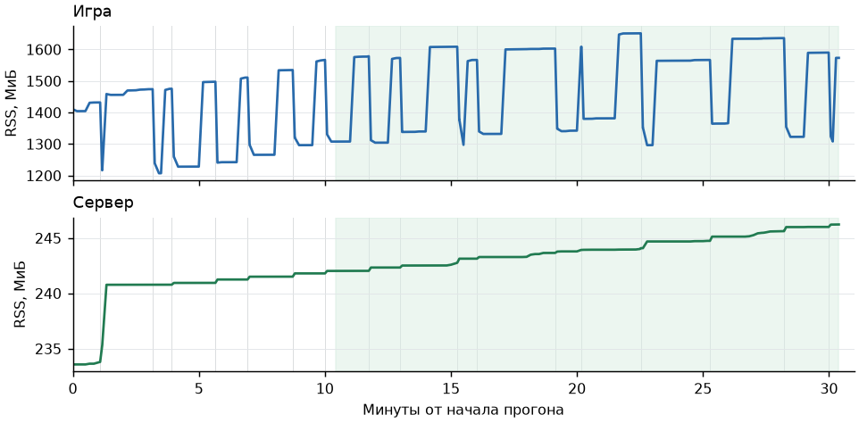

# P30: приёмочный получасовой прогон

**Итог — `done`, 19 октября 2026 года.** Прогон `soak5-p30` на Ryzen,
`edc32749` после merge `main` с #279, #280, #286, #287 и #288. Все 10 проверок прошли.
Длительность **1823,6 с**: обычный мир новой игры, `LLM=fake`, 30 FPS, герой и спутник-мечник.
Волны 3–4 бандитов чередовались у Кавалорна и под башней; мир не замораживался.

Всего 21 волна и 71 бой с lease, до четырёх одновременно. Герой погиб 15 раз;
17 загрузок — 15 после смерти и две плановые посреди боя. Три волны закончились
обычным уходом после 75 с. Короткая 21-я волна проверила свежий lease/reset после
последней загрузки; поэтому измерение длиннее 30 минут. Спутник не погибал.

[Результат сценария, gzip](full-result.json.gz), [полный JSONL, gzip](full.jsonl.gz),
[71 бой: команды, отказы, цели, задержки и застои](fights.csv).
Номера строк относятся к распакованному JSONL; итог — **1011**.

## Пороги

| Проверка | Порог | Получилось | Итог |
|---|---|---|---|
| Сбои, fallback, таймауты политики, сироты release | 0 | Все 0 | done |
| Захват подходящих нападающих при свободном месте | ≥95% | **71/73 = 97,26%** | done |
| Принятые команды / решения | ≥95% | **6800/6909 = 98,42%** | done |
| Release после конца боя | ≤2 с; без lease и `body` без lease | **71/71**, максимум **0,506 с**, остаточных владельцев 0 | done |
| RSS игры на загрузку за последние 20 минут | Контроль 182,8 + 10% = **201,08 МиБ** | **26,55 МиБ/загрузку** | done |
| RSS сервера за последние 20 минут | Рост ≤5% | **+1,74%** | done |
| Сервис p95 / p99 | Оба ≤20 мс | **5,08 / 6,06 мс**, 58 828 вызовов `step` | done |
| Серверный лог | 0 трассировок и ошибок моста | 0 | done |
| Загрузки, свежий lease и reset | Все проверки | **17/17**, свежие проверки **67/67** | done |
| Разговоры между волнами | Ответ получен | **21/21** | done |

Восемь одиночных таймаутов опроса были терпимыми; `accept_wait_timeouts` и
`setup_timeouts` — 0. `finish_deadline`, поздних release и `release_orphan_timeout` — 0.

## Память и активные бои

Серые линии — загрузки, зелёный фон — окно RSS **625,360–1823,529 с**
(строки **353 → 1010**). Игра: **1307,73 → 1573,20 МиБ**, +20,30%; прирост
265,47 МиБ / 10 загрузок = **26,55 МиБ/загрузку**. Сервер: **242,02 → 246,22 МиБ**.
Графики используют 229 отсчётов до записи результата; `active_count` включает наблюдение
и ожидающий захват. Максимум lease — 4.

Контроль **182,8 МиБ/загрузку** взят из `soak2-control` без P30, **до #280**.
Это историческая база, оставленная решением пользователя от 19 октября с допуском 10%.
Прежний порог игры «≤5% за 20 минут» снят; для сервера он сохранён.

## Концы боёв и захват

| Причина конца | С lease | Без lease: наблюдение и заявки |
|---|---:|---:|
| `loading` | 40 | 3 |
| `hero_down` | 13 | 0 |
| `npc_unavailable` | 12 | 4 |
| `native_restored` | 3 | 0 |
| `target_lost` | 2 | 21 |
| `npc_down` | 1 | 0 |
| `acquire_exhausted` | 0 | 18 |
| `attached` | 0 | 17 |
| **Всего** | **71** | **63** |

Два пропуска остались в знаменателе 73. Оба — в короткой 21-й волне,
окно подходящего состояния **0,631 с**, затем герой ушёл за пределы доступности.

| NPC | Причина пропуска | Строка JSONL |
|---|---|---:|
| `BANDIT_1` | `body acquire cancelled: target_invalid`; ещё один `target_invalid` | 1003 |
| `BANDIT_3` | `native_queue_busy` | 1005 |

`BANDIT_N` сокращено от `DIR_NPC_SOAK_BANDIT_N`. Ещё 10 кандидатов — Кавалорн,
нападавший на постороннего: все исключены как `target_not_allowed`, в знаменатель не входят
(строки 49, 152, 247, 349, 445, 540, 638, 741, 835, 932).

Отказы команд: `masked` 31, `target_invalid` 30, `locked` 28, `not_owned` 2,
`TimeoutError` 1. Для ещё 17 решений отдельной причины нет в сводке;
все 109 непринятых решений сохранены в знаменателе 6909.

## Застои и исходы

`stall_broken` — **19**, по одному в 19 боях: герой ударил после **15,01–15,21 с**
без урона цели. Всего 28 интервалов без урона: **16,01–56,00 с**, сумма **741,38 с**.
У 52 боёв интервалов 0, у 10 — один, у 9 — два. `wait_200` — **5162/6909 = 74,71%** решений.
Подробности каждого боя — в CSV.

Больше 60 с длились 19 боёв; **13 без падения цели**:

| Волна / цель | Боёв | Длительность, с |
|---|---:|---:|
| 2 / спутник | 1 | 63,50 |
| 10 / спутник | 1 | 69,15 |
| 12 / герой и спутник | 4 | 73,79–74,71 |
| 16 / герой | 3 | 74,61–75,24 |
| 18 / герой и спутник | 4 | 73,79–74,71 |

Падение одной цели учитывается по всем её боям в том же мире и волне: отдельный бой
мог завершиться загрузкой, не успев записать падение. В CSV сохранены оба признака.
Исход считается один раз на цель, по пику одновременных lease:

| Нападающих на цель | Цель | Встреч | Цель упала | Остальные исходы волны |
|---|---|---:|---:|---|
| 3 | Герой | 20 | 15 | 2 плановые загрузки, 3 ухода |
| 1 | Спутник | 10 | 0 | 7 загрузок, 3 ухода |
| 1 | Герой, короткая проверка | 1 | 0 | Уход по длительности |

Цели разные: герой пассивен, спутник бьёт сам; на исходы влияет живой мир.
[Видео первой волны](wave.mp4) — фрагмент **25 с**, 480×270, H.264, **389 217 байт**.
Штатная запись бенча без звука, обрезана и сжата из `soak5-p30/soak-wave.mp4`.

## Что нашли по дороге

- Возврат тела и остановка движения: [#253](https://github.com/kaifaty/GothicAI/pull/253);
  возврат далёкого NPC после ухода героя: [#279](https://github.com/kaifaty/GothicAI/pull/279).
- Одиночный таймаут опроса больше не завершает бой: [#259](https://github.com/kaifaty/GothicAI/pull/259).
- RSS росла и без P30: glibc удерживала свободную память после загрузки мира.
  `malloc_trim` — [#280](https://github.com/kaifaty/GothicAI/pull/280),
  подтверждение плато на 24 загрузках — [#288](https://github.com/kaifaty/GothicAI/pull/288).
- Медленная инициализация и неопределённый захват: обработка и восстановление в
  [#286](https://github.com/kaifaty/GothicAI/pull/286).
- `stale_observation` при 30 FPS: порядок отправки/принятия команды исправлен в
  [#287](https://github.com/kaifaty/GothicAI/pull/287).
- В самом сценарии исправлены смерть спутника, смена оружия без сброса общей подписки,
  гонки проверки загрузки, учёт захвата по завершённой сводке и исключение неподходящих целей.
- После ревью терминальный `acceptance_timeout` добавлен в порог сбоев (также через
  `end_trigger`), запись видео сохранена при попадании в общий кэш Ryzen без локальной сборки.
  В приёмочном архиве таких концов и `accept_wait_timeouts` нет; исходные данные не менялись.

Прежние короткие и полные попытки использовались для этих исправлений; приёмочные данные
выше взяты только из `soak5-p30`. В этом ходе новых прогонов не было.
Шаг 5 принят. Живой бой у Кавалорна (шаг 6) остаётся открытым.
