# Связи обломков: удар рвёт только то, что рядом

**Цель.** Ящик и бочка не распадаются сразу на все детали. Удар рвёт гвозди и обручи рядом с собой. Всё, что осталось соединено, падает одним телом: стенка, угол ящика, бочка с проломом. Сколько порвётся, решает удар:
- кулак выбивает доску-две;
- двуручное оружие выносит стенку;
- огненный шар разносит всё.

Это шаг 1 [системы разрушения](../2026-11-destruction-system/README.md) («эталон дерева»), второй круг вида. Решение пользователя — 2026-11-08: «Да, делай связи».

**Почему.** Клип после [#1000](https://github.com/kaifaty/GothicAI/pull/1000): доски больше не проваливаются, обручи спадают, но обе вещи распадаются слишком ровно. Бочка ложится ромашкой из 20 клёпок, ящик — досками, разложенными рядами, будто его разобрали.

| Бочка, 15 с после удара | Ящик, 15 с после удара |
|---|---|
| 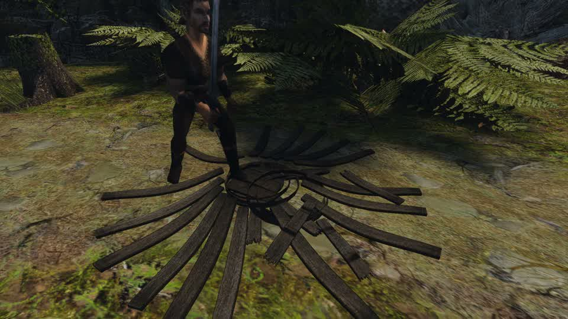 | 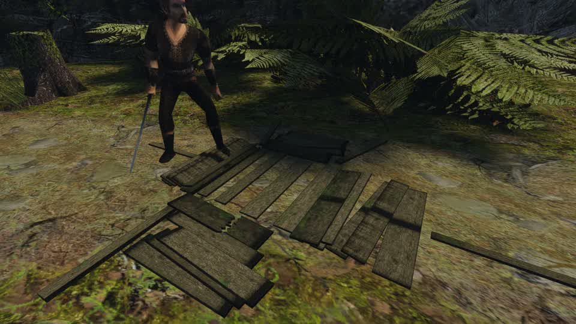 |

Причин две:
- при поломке рвутся сразу все соединения: все гвозди, все обручи, все пазы днищ;
- каждый кусок получает одинаковый толчок от центра (`outward`). Это ловушка «ровный толчок во все стороны» из [заметки о дереве](../../content/2026-11-wood-fracture/README.md#как-делают-другие).

## Как ломается на деле

**Авторские сломанные визуалы Готики** — эталон остатков ([перепись](../2026-11-destruction-system/README.md#что-похоже-на-разрушаемое-но-не-ломается)):
- `NW_HARBOUR_CRATEBROKEN_01` — коробка без части стенок, рядом лежит целая стенка, её доски так и остались сбиты вместе;
- `OC_BARREL_V1_DESTROYED` — днище с обрубками клёпок.

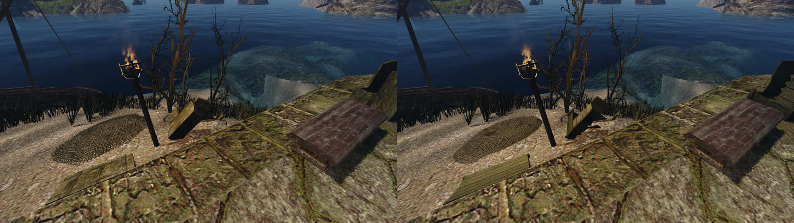

**Ящик рвётся в стыках.** Гвозди выходят у ударенных досок, доски срываются через шляпки ([заметка о дереве](../../content/2026-11-wood-fracture/README.md#как-ломается-на-деле), CSIR 1932). Остальные гвозди держат. Вывод: после удара остаются стенки и углы, сбитые вместе.

**Бочку держат обручи, затянутые на клёпках.** Описания разбитой бочки не нашлось. Вывод из устройства и авторского визуала:
- от удара клёпки вминаются и ломаются поперёк, а обруч остаётся на остальных клёпках;
- обруч спадает, когда держать ему нечего — ушло больше половины клёпок его пояса.

## Как это решают другие

- **NVIDIA Blast.** У кусков есть связи с запасом прочности. Урон приходит в точку, с радиусом и спадом по расстоянию. Связь с исчерпанным запасом рвётся. После этого связные группы кусков («острова») становятся отдельными телами ([Blast 1.1](https://docs.nvidia.com/gameworks/content/gameworkslibrary/blast/1.1/api_docs/files/pageintroduction.html)). Новые версии считают напряжение по графу, и силу порванных связей получают расходящиеся группы ([Omniverse](https://docs.omniverse.nvidia.com/extensions/latest/ext_blast.html)).
- **Unreal Chaos.** Есть кластеры, порог урона по уровню кластера или по прочности материала и связности ([DamageModelTypeEnum](https://dev.epicgames.com/documentation/en-us/unreal-engine/python-api/class/DamageModelTypeEnum)). Ловушки по форуму:
  - кластер ломается целиком, если задет любой его кусок;
  - лишние связи в графе оставляют куски висеть в воздухе ([форум UE](https://forums.unrealengine.com/t/break-geometry-collection-smallest-pieces-first/501898)).
- **Source.** Обломки рисуются руками, сразу стенками и обрубками, без связей ([Prop_Data](https://developer.valvesoftware.com/wiki/Prop_Data)). Дёшево, но каждая поломка выглядит одинаково, от кулака и от взрыва.

## Что у нас: по коду

- **Точка и вид удара.** `meleeStrike` и `damageMovableVob` хранят точку удара `breakPoint` и направление `breakDirection`. Вид удара на месте известен: кулак, одноручное или двуручное (`FractureRule::Melee`), стрела (`arrow`), толчок или сила заклинания. При этом он не сохраняется.
- **Поломка.** `breakMovableVob` создаёт по телу на кусок. Скорость кусков задаёт `FractureMotion` — удар с затуханием, толчок от центра, вращение и предел. Фильтр групп Jolt не даёт обручам сталкиваться с деревом своей поломки.
- **Куски формата 3** лежат в системе координат целой вещи, и тело куска стоит в позе вещи. Поэтому несколько кусков складываются в одно составное тело (`StaticCompoundShape`) без сдвигов.
- **Рисунок и сохранение — по куску.** `syncFragments` даёт куску матрицу его тела; сохранение пишет у куска `present`, `permanent` и время сна. Уборка (`cleanupFragments`) и «три крупнейших» тоже идут по куску.

## Способ

### 1. Формат

В версии 3 после кусков идёт необязательный блок:

```
bonds N
bond A B KIND x y z
```

- `A < B` — номера кусков.
- `x y z` — точка связи в сантиметрах исходника, в той же системе, что вершины кусков.
- Файл без блока ведёт себя как сейчас: каждый кусок — своё тело.

| `KIND` | Что | Прочность |
|---|---|---|
| `NAIL` | гвоздь: доска к стойке, бруску, торцу | 1,0 |
| `HOOP` | обруч держит клёпку; все связи одного обруча — его кольцо | 1,0 |
| `GROOVE` | доска днища в пазу клёпки | 1,2 |
| `DOWEL` | шкант между досками днища | 0,8 |
| `ALONG` | полосы доски, ещё не расколотой вдоль волокна | 0,7 |
| `ACROSS` | половины клёпки или доски, ещё не сломанной поперёк | 1,5 |

### 2. Кто пишет связи

Связи находит резчик [`scripts/fracture/debris.py`](../../../scripts/fracture/debris.py) при резке версии 3, рядом с оболочками. Генераторы и упаковку при этом не правили.
- **Где касаются.** Два куска касаются, если точки замкнутых деталей одного лежат не дальше 3 мм от граней другого на площади от 1 см². Шаг выборки — 5 мм. Шляпки гвоздей в счёт не идут.
- **Точка связи** — середина касания.
- **Вид связи** — по именам деталей, которые даёт генератор: `stave-`, `hoop-`, `lid-`, `bottom-` у бочки; `plank-`, `post-`, `batten-`, `lid-` у ящика. Суффиксы `-strip-`, `-half-`, `-top` значат куски одной детали.
- **Без связей.** Обломки с другими именами режутся без блока связей, как прежде.

- **Ящик.**
  - `NAIL` — у деталей разной ориентации, касающихся гранью: доска к стойке, доска к средней планке, доска крышки к торцу. Доски одной стенки, лежащие встык, не связаны.
  - `ALONG` — между полосами раскола, `ACROSS` — между половинами излома.
- **Бочка.**
  - `HOOP` — клёпка к каждому обручу, через пояс которого она проходит.
  - `GROOVE` — доска днища к клёпкам по своей дуге.
  - `DOWEL` — соседние доски днища.
  - Клёпки получают подрезы поперёк между обручами, связанные `ACROSS`. Тогда у удара клёпки ломаются, а не выходят целиком.
  - Предел — 64 куска.

### 3. Правило поломки (движок)

Правило детерминированное.
1. **Радиус по виду удара** `R`: кулак 20 см, одноручное 35, двуручное 55, стрела 12, толчок 30. Огненный шар и другие удары силой заклинания рвут все связи.
2. **Связь рвётся**, если ближний из двух её кусков стоит от точки удара не дальше `R / прочность`. Расстояние — до оболочки куска. У связи `HOOP` расстояние берётся только у клёпки (куска не из `METAL`): обруч держится на клёпках, пока цело кольцо.
3. **Ударенный кусок** — ближайший к точке кусок не из `METAL` — теряет все свои связи. Обруч ударенным не бывает: меч по обручу бьёт клёпку под ним. Вещь целиком из `METAL` берёт просто ближайший кусок.
4. **Кольцо.** Обруч отпускает клёпки только так: если у него порвано больше половины связей `HOOP`, рвутся и остальные, и обруч спадает.
5. **Острова.** Связные группы по уцелевшим связям становятся телами.
   - Один кусок — его оболочка, как сейчас.
   - Несколько кусков — `StaticCompoundShape` из их оболочек.
   - Масса группы — сумма масс кусков. Трение, звук и плавучесть берутся по материалу с наибольшим объёмом в группе.
6. **Толчок.** Одиночные куски получают `FractureMotion`, как сейчас. Группа из нескольких кусков получает унаследованное движение и удар с затуханием от своего центра масс, без толчка от центра вещи и без вращения.
7. **Фильтр обручей — между группами.** Группа только из `METAL` не сталкивается с группами своей поломки, в которых есть `WOOD`.

Числа меняются без сборки: `OPENGOTHIC_FRACTURE_BONDS="fist=20,one=35,two=55,arrow=12,impact=30,nail=1,hoop=1,groove=1.2,dowel=0.8,along=0.7,across=1.5,ring=0.5"`. Их подбирают по клипу.

**Уборка, остатки и сохранение — по группам.**
- Группа исчезает целиком.
- Навсегда остаются три самые крупные по объёму группы.
- Сохранение пишет у куска номер его группы. Старое сохранение без номеров — каждый кусок своя группа.

**Второй шаг, после приёмки.** Повторный удар по группе рвёт её дальше — [способ](#второй-шаг-повторный-удар). Сильный удар группы о землю рвёт её связи — следующий шаг.

## Приёмка

Принимает пользователь — по клипу стенда `own-wood-fracture-clip`: «было» — `working-12` (без связей), «стало» — набор со связями. Удар одноручным, сбоку и вблизи.

**Вердикт 2026-11-09: принято.** Пользователь принял по клипам третьего круга и ящик, и бочку («Принимаю оба»). Набор `working-13` включён в рабочий контент игры (`building_set.py enable working-13`). Принято с известными изъянами бочки: пролом в пять клёпок читается слабо, внутренняя сторона клёпок освещена как наружная. Остатки второй раз не ломаются — это второй шаг.

Ограждения — не повод для приёмки, только защита от явной поломки:
- **Одноручный удар.**
  - Групп больше одной.
  - Самая крупная группа — не меньше 40% объёма вещи: вещь не рассыпается целиком.
  - Отдельных кусков не больше 12.
- **Огненный шар** (`destruction-on`): все связи порваны.
- **Физика.**
  - 0 провалов.
  - Через 15 с всё на суше спит.
  - Физика p95 ≤ 2 мс.
  - Тел после поломки меньше, чем кусков.

## Обломки со связями: набор `working-13`

2026-11-08, ветка `claude/debris-bonds-content`. Связи находит резчик (пункт 2 «Способа»). Движок их пока не читает — это отдельная задача.

**Бочка: десять клёпок подрезаны.** В `barrel.json` ключ `debris.broken` 3 → 10. Подрезанная клёпка — две половины с рваным краем посередине между вторым и третьим обручем. Половины связаны `ACROSS`: у места удара клёпка ломается, вдали остаётся целой.
- Целая `model.glb` не изменилась (SHA-256 `cae24a5a…`).
- Открытых рёбер 0, вывернутых оболочек 0, куски заходят друг в друга не больше чем на 0,04 мм.
- В сборе швы подрезов не видны: обломки читаются целой бочкой.

| В сборе | Вразлёт |
|---|---|
| 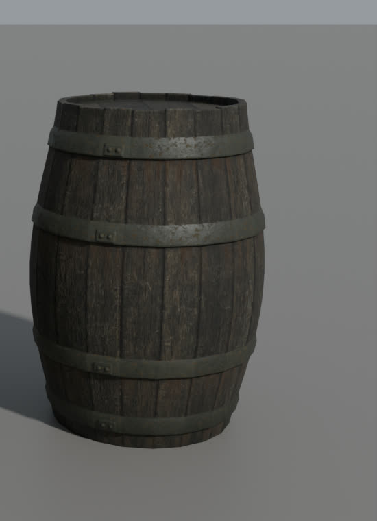 | 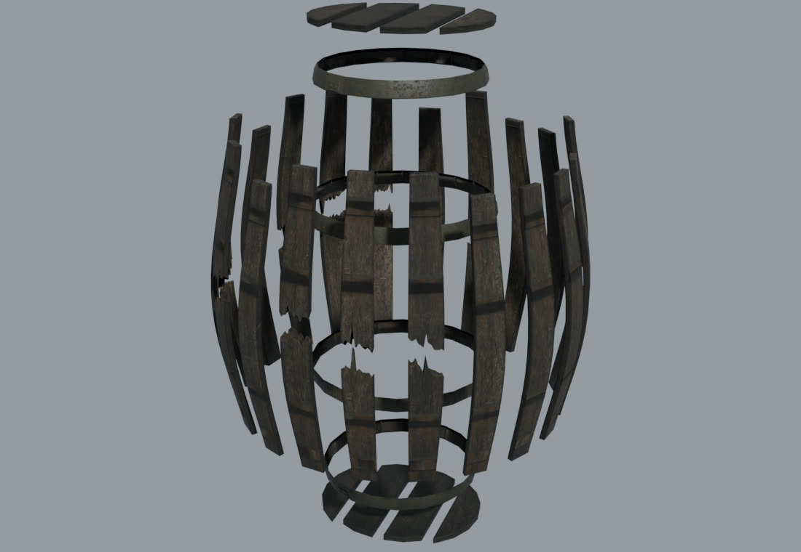 |

Атлас перепечён по `barrel-debris-atlas.json`, обломки упакованы `pack_prop.py --debris`. Упаковка шла в копию части бочки `barrel-bonds-1`, чтобы `barrel-wear-metal0` и `working-12` остались как были. Прежние обломки сохранены в `mesh3d-barrel-concept/debris-b3` и `debris-atlas-b3`.

**Набор `working-13`** собран `building_set.py compose` из тех же двенадцати частей, что `working-12`, только с `barrel-bonds-1` вместо `barrel-wear-metal0`. Обломки ящика, как и в `working-12`, скопированы из `rigging-build/crate/atlas/`, источник записан в `composition.json`. `.convex-parts` мебели сделал `convex-parts.sh content`. `enable` не запускался.

**Резка** — `fracture.sh content`, повтор `--verify` дал те же байты:

| | Куски | Оболочки | Связи | Групп в целой |
|---|---|---|---|---|
| Бочка | 42 (было 35) | 164 (было 160) | `HOOP` 80, `GROOVE` 56, `DOWEL` 6, `ACROSS` 10 | 1 |
| Ящик | 38 | 38 | `NAIL` 127, `ALONG` 5, `ACROSS` 1 | 1 |

Связи ящика:
- доски торцов прибиты к своим стойкам;
- доски боков — к стойкам и средней планке;
- доски крышки — к верхним доскам торцов, крайние ещё и к стойкам и верхним доскам боков.

Доски одной стенки встык не связаны. У бочки каждая клёпка или половина держится на тех обручах, через пояс которых проходит. Доски днищ сидят в пазах своих клёпок и связаны шкантами между собой.

## Клип со связями

2026-11-08, ветка `codex/debris-bonds`. Движок читает связи (пункты 1 и 3 «Способа»), набор `working-13` их несёт. Числа `OPENGOTHIC_FRACTURE_BONDS` и разлёта — умолчания, ничего не подбиралось. Второй круг: правило обруча (пункт 3, решение пользователя по первому клипу) и камера со стороны удара. Третий: герой уходит из пролома перед крупной парой «после».

**Стенд** — `own-wood-fracture-clip`, Ryzen, окно 1280×720, тот же удар одноручным оружием в сторону +z. «Было» — `working-12` (без связей), «стало» — `working-13`, один и тот же движок и одни камеры. Клипы (слева «было: без связей», справа «стало: связи») собраны [`make_clip.py`](../../content/2026-11-wood-fracture/clips/make_clip.py) заметки о дереве:
- [`clips/barrel-was-now.mp4`](clips/barrel-was-now.mp4) — бочка;
- [`clips/crate-was-now.mp4`](clips/crate-was-now.mp4) — ящик.

**Камеры.** Удар открывает четверть +x/−z вещи: у бочки это клёпки `stave-06…10`, у ящика — угол у стойки `post-al`. Обе камеры стоят на этой стороне под углом, герой у них слева:
- крупная пара — `240 100 -140`, цель `20 5 -20`, 2,9 м;
- запись — `300 120 -200`, цель `0 -10 -10`, 3,8 м.

Камеры подбирались четырьмя пробными прогонами, 24 точки: со стороны −z под 45°, сбоку от +x, низко, сверху. Удар, связи и разлёт при этом не менялись.

**Герой в проломе.** Выпад одноручным заводит героя корпусом в контур вещи. У бочки это ровно четверть пролома, и с любой камеры на стороне удара пролом закрыт ([кадры второго круга](barrel-bonds-hole-hidden.jpg)). Поэтому после записи, когда куски уснули, `destruction2 stand` ставит героя туда, где он стоял до удара, и только потом снимается крупная пара «после». Так сделано для обоих предметов и для «было», чтобы пары сравнивались одинаково. Запись идёт как раньше, с героем. Герой сдвигается у бочки на 70,5 см, у ящика на 18,9 см. Стенд объявляет `# @timeout 600`. Почему капсула героя входит в тело группы — отдельный вопрос, здесь не разбирался.

Группы с именами кусков даёт [`clip_groups.py`](clip_groups.py). Порядок кусков в `model.fracture` — это порядок узлов в выводе `fracture-gltf-extract --nodes model.debris.glb <вывод>`, а не порядок в JSON GLB. Внимание: у экстрактора два аргумента, и второй он перезаписывает. Вызов с одним путём после `--nodes` принимает `--nodes` за исходник и обнуляет GLB.

| Бочка, 15 с | Ящик, 15 с |
|---|---|
| 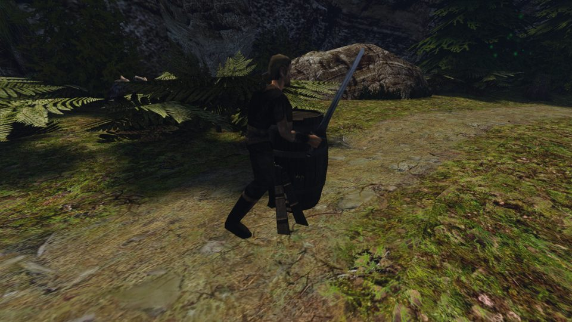 | 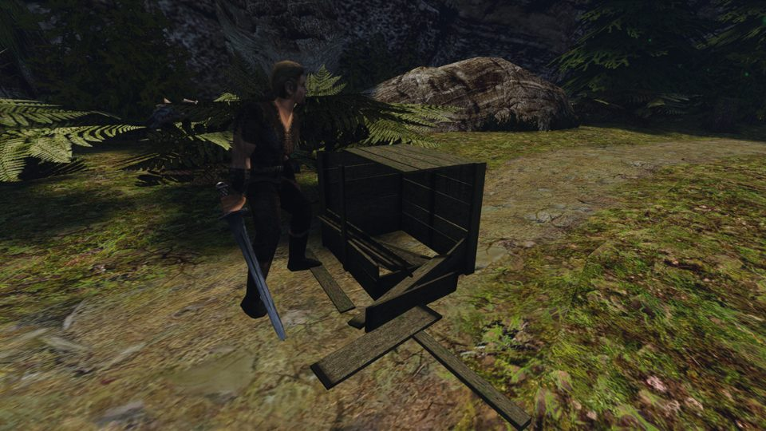 |

**Ограждения** (одноручный удар; через 15 с после поломки, если не сказано иное):

| Ограждение | бочка | ящик | порог |
|---|---|---|---|
| Кусков | 42 | 38 | — |
| Групп = тел | 9 (в первом круге 12) | 13 | больше одной, тел меньше, чем кусков |
| Доля объёма крупнейшей группы | 0,80 (было 0,76) | 0,66 | ≥ 0,40 |
| Одиночных кусков | 8 (было 11) | 12 | ≤ 12 |
| Провалились (кусков / тел) | 0 / 0 | 0 / 0 | 0 |
| Спят (кусков / тел) | 42/42, 9/9 | 38/38, 13/13 | все |
| Проникновение в землю по контакту Jolt, см | 0,09 | 0,50 | ≤ 1 |
| Рисунок под землёй по вершинам, см | 7,24 (`stave-08-top`; на пробном прогоне 2,10) | 0,71 | — |
| Кусков друг в друга (разные группы), см | 0,50 | 0,50 | ≤ 1 |
| Обручи на земле | 0 из 4 (было 3) | — | — |
| Медиана смещения кусков, см | 4,4 (без связей 80,7) | 1,1 (без связей 82,4) | — |
| Дрожь 13→15 с, см | 0 | 0 | 0 |
| Поломка в движке, мс | 0,58 и 8,14 в двух одинаковых прогонах (без связей 0,31 и 0,56) | 0,20 и 0,18 (без связей 0,20 и 0,22) | — |

**Какие группы через 0,5, 2 и 15 с.** Группы одинаковы во всех трёх отметках: связи рвутся только в миг поломки (повторный удар и удар о землю — второй шаг заметки).
- **Бочка.** Крупнейшая группа (34 куска): клёпки `stave-01…05`, `stave-11…20` с верхними половинами `stave-02-top`, `05-top`, `11-top`, `13-top`, `15-top`, `16-top`, `17-top`, крышка `lid-1…4`, днище `bottom-1…4` и все четыре обруча `hoop-1…4`. Одиночные (8): `stave-06`, `stave-07` и `stave-07-top`, `stave-08` и `stave-08-top`, `stave-09` и `stave-09-top`, `stave-10` — пролом в пять клёпок. Других групп нет. Обручам порвано по 5 связей из 20 (не больше половины), поэтому все они остались на бочке.
- **Ящик** — как в первом круге. Крупнейшая группа (26 кусков): стойки `post-ar`, `post-bl`, `post-br`, весь бок B (`plank-side-b-1…5`), верхняя доска бока A (`plank-side-a-1` тремя полосами), торец B (`plank-end-b-1…5`), верхняя доска торца A (`plank-end-a-1` двумя половинами), крышка `lid-3…6`, планки `batten-a`, `batten-b`. Одиночные (12): стойка `post-al`, доски бока A `plank-side-a-2` (две полосы), `-3`, `-4`, `-5`, доски торца A `plank-end-a-2…5`, крышка `lid-1`, `lid-2`.

**Огненный шар** (`destruction-on`, `working-13`, разбор `destruction_compare.measured`) не переснимался: правило обруча работает только для ударов с радиусом, сила заклинания по-прежнему рвёт все связи. Числа первого круга:
- пять вещей (три ящика, две бочки) — у всех все связи порваны: через 15 с у каждой вещи групп столько же, сколько кусков (3 × 38 + 2 × 42 = 198 тел);
- физика p95 1,84 мс (порог 2), среднее 0,70 мс, кадр с поломкой 15,7 мс, поломка в движке 0,10–0,40 мс, 119,5 FPS;
- сон через 15 с: на суше спят 197/197, в воде 1 (спит к 30 с), под землёй 0.

**Вид — что видно на клипе.**
- **Ящик** со стороны удара читается лучше прежнего: угол выбит, внутрь коробки видно, доски лежат перед ней. Остальное стоит коробкой с крышкой, ничего не висит.
- **Бочка.** Обручи больше не падают: бочка стоит целиком с четырьмя обручами. Верхние половины `07…09-top` выпали, две нижние клёпки пролома отогнуты наружу. Крупная пара теперь без героя ([до | после, крупно](barrel-bonds-breach.jpg)). Видны отогнутые клёпки, светлые сколы на изломах и выемка в кромке у крышки. Верхняя часть пролома читается слабо: сквозь неё видна внутренняя сторона дальней стенки с обручами, освещённая так же, как наружная. Это наблюдение о свете внутри вещи, здесь не правилось.

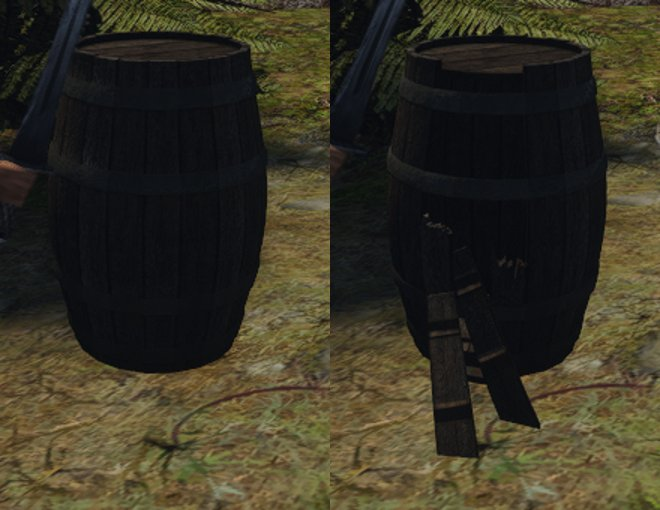

**Первый круг (до правила обруча).** Обручи `hoop-2…4` теряли все связи и падали сквозь стоящую бочку: обруч сам считался ближним куском своих связей `HOOP` и, оказавшись ближе `R = 35 см` к удару, рвал все 20, как бы далеко ни стояли клёпки. Было 12 тел, 11 одиночных кусков, доля крупнейшей группы 0,76, 3 обруча на земле. Камеры стояли сбоку от +x и сзади (+x/+z); пролом закрывал герой.

## Второй шаг: повторный удар

2026-11-09, решение пользователя после приёмки: «Давай сразу сделаем, чтобы повторные удары продолжали разрушение».

**Цель.** Остаток бьётся дальше по тем же правилам, что целая вещь. Ящик с выбитым углом от следующего удара теряет ещё стенку или угол, бочка с проломом — ещё клёпки. Так до отдельных деталей. Сейчас остаток не ломается вовсе: клинок о него останавливается, и только. Кроме того, герой проходит сквозь остаток.

**Что у нас: по коду.**
- Клинок видит тела обломков (`C_Fragment`): тело больше 0,5 м останавливает замах, мелкие куски только толкаются (`collisionworld_melee.cpp`). Поломку при этом зовёт только `meleeStoppedMovableVob`, а он принимает лишь целую вещь (`contact.movableVob`).
- Стрелы, сила заклинания и толчок ломают через `damageMovableVob`: тоже только целую вещь.
- Контроллер персонажа (`CharacterVirtual`) сталкивается с `C_Item` и `C_MovableVob`, но не с `C_Fragment` (`collisionworld_character.cpp`). Оболочки живых тел (`C_LivingBody`) с обломками тоже не сталкиваются. Поэтому выпад героя заводит его в контур бочки, а в остаток ящика можно войти.

### Способ

1. **Остаток** — группа из нескольких кусков. Одиночный кусок — это одна деталь, он дальше не ломается, только толкается, как сейчас.
2. **Чем бьют.** Клинок и кулак, когда остаток остановил замах; стрела; сила заклинания. Вид удара — тот же `FractureHit`. Толчок (`Impact`: тело о тело, остаток о землю) остаток в этом шаге не ломает: иначе куски первой поломки рвались бы при падении, и принятый вид изменился бы. Удар о землю — следующий шаг.
3. **Запас прочности.** Целая вещь копит урон до `health` своего класса. Остаток копит так же, его запас — `health × доля объёма × remnant`. По умолчанию `remnant = 0,5`: поломанная вещь расшатана, гвозди наполовину вышли, обруч ослаб. При `remnant = 0` ломает каждый удар. Новое число — в `OPENGOTHIC_FRACTURE_BONDS`, вместе с остальными. Удар ниже запаса только толкает остаток, как сейчас.
4. **Правило** — пункты 1–5 «Способа», но только над уцелевшими связями внутри ударенного остатка. Точка удара переводится в систему кусков через позу тела остатка. Ударенный кусок — ближайший кусок остатка не из `METAL`. Кольцо обруча считает все его связи `HOOP`, порванные и раньше. Сила заклинания рвёт все связи остатка.
5. **Новые тела.** Каждая новая группа и каждый кусок получают скорость старого тела в своём центре масс (`v + ω × r`) и толчок по пункту 6 «Способа»: центр — центр масс остатка. Фильтр обручей — между всеми группами вещи.
6. **Один замах — одна поломка остатка**, как у целой вещи.
7. **Персонаж и остаток.** Контроллер персонажа сталкивается с телами обломков, крупнейший размер которых — от 0,5 м (порог клинка): упирается в них и толкает, как подвижную вещь. Мелкие куски остаются проходимыми. Ловушка: в миг поломки герой может стоять внутри нового тела, и тогда разведение толкнёт остаток. Новое тело не сталкивается с персонажем, пока они не разойдутся.
8. **Остатки навсегда.** После каждой поломки три крупнейшие группы вещи заново выбираются навсегда. Группа, выпавшая из тройки, получает обычный срок уборки с этого мига.
9. **Сохранение** пишет, какие связи порваны, и накопленный урон каждого остатка. Сохранение схемы 3 грузится так: связи между кусками одной группы целы, урона нет.

### Приёмка

Принимает пользователь по клипу: тот же удар одноручным по бочке и ящику, потом второй и третий удар по остатку, камера со стороны удара. Ограждения:
- первый удар даёт те же группы, что на принятом клипе: бочка 9 тел, ящик 13;
- каждый повторный удар, пробивший запас, рвёт остаток: тел больше, крупнейшая группа меньше;
- герой не входит в остаток, а по доскам на земле проходит без остановок;
- 0 провалов; через 15 с после последнего удара всё спит; проникновение — не больше 1 см;
- огненный шар по-прежнему рвёт всё; физика p95 `destruction-on` — не больше 2 мс; время поломки остатка записано;
- сохранение между ударами даёт после загрузки те же связи и группы, и следующий удар — тот же итог, что без сохранения.

## Клип повторных ударов

2026-11-10, ветка `codex/bonds-repeat`. Движок — второй шаг по пунктам 1–9 «Способа» выше, числа разлёта и радиусов прежние, `remnant=0.5`. Набор `working-13`.

**Стенд** — [`own-wood-remnant-clip`](../../../scripts/bench/own-wood-remnant-clip.bench), Ryzen, окно 1280×720. Место, seed, полдень и камеры — как у `own-wood-fracture-clip`. По бочке, потом по ящику:
1. первый удар одноручным, как на принятом клипе;
2. три повторных удара по крупнейшей группе: `destruction2 remnant 6` бьёт, пока остаток не порвётся, не больше 6 замахов;
3. проход героя по обломкам (`destruction2 walk 300`).

Запись одна на вещь: от первого удара до прохода после третьего разрыва. Крупный кадр — после каждого разрыва, перед ним `destruction2 stand`.

Клипы:
- [`clips/barrel-remnant.mp4`](clips/barrel-remnant.mp4) — бочка, 74,5 с;
- [`clips/crate-remnant.mp4`](clips/crate-remnant.mp4) — ящик, 76,4 с.

Крупные кадры после первого удара и каждого из трёх разрывов остатка (слева направо, сверху вниз):

| Бочка | Ящик |
|---|---|
| 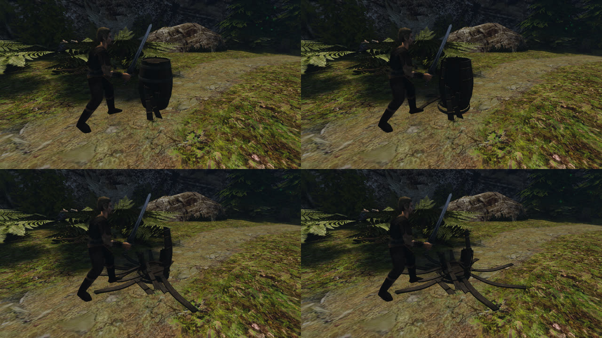 | 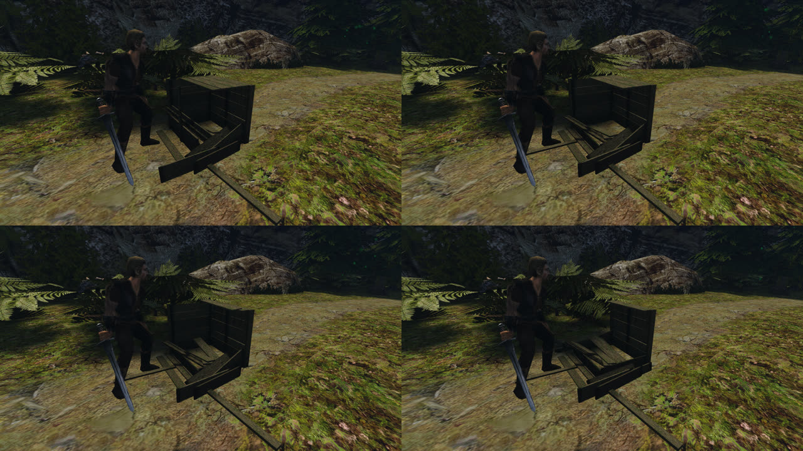 |

**Куда ставить героя.** Прямой удар одноручным (`S_1HATTACK`) опускает клинок на верх вещи в 126 см вперёд и 28 см вправо от ног героя. Это журнал клинка `melee-blade-shadow.jsonl`, касания верха на высоте 110 см: 125,8–128,9 и 27,3–28,9 см в шести прогонах.

Первые прицелы, «75 см перед гранью группы, лицом к её середине», давали один разрыв, а дальше по 6 пустых замахов:
- у бочки клинок опускался на дальний край, где после первого разрыва стоит отломанная клёпка: одиночный кусок останавливает замах, но не ломается;
- у ящика без передней стенки клинок уходил под край крышки в пустой ящик.

Теперь стенд ищет точку материала лучом сверху. Начинает со стороны первого удара и обходит остаток шагами по 30°. На линии к центру масс крупнейшей группы лучи вниз через 2 см находят первую точку её собственного тела. Сторону он пропускает, если сверху раньше лежит отломанный кусок или он выше этой точки в 20 см вокруг неё. Герой встаёт так, чтобы посадка клинка пришлась на эту точку. У бочки второй разрыв пришёлся со стороны −90°, у ящика третий — с −60°, остальные — со стороны первого удара.

**Ограждения.** Значения взяты через 15 с после каждого разрыва.

| Ограждение | Бочка: удар → 1 → 2 → 3 | Ящик: удар → 1 → 2 → 3 | Порог |
|---|---|---|---|
| Замахов на разрыв | — → 1 → 1 → 1 | — → 2 → 1 → 1 | ≤ 6 |
| Тел | 9 → 19 → 26 → 31 | 13 → 15 → 17 → 23 | растёт |
| Доля объёма крупнейшей группы | 0,803 → 0,571 → 0,365 → 0,232 | 0,661 → 0,620 → 0,547 → 0,404 | падает |
| Кусков в ней | 34 → 24 → 17 → 12 | 26 → 24 → 22 → 16 | — |
| Провалились (кусков / тел) | 0 / 0 везде | 0 / 0 везде | 0 |
| Спят (тел) | 9/9, 19/19, 26/26, 31/31 | 13/13, 15/15, 17/17, 23/23 | все |
| Проникновение в землю по контакту Jolt, см | 0,01; 0,50; 0,50; 0,50 | 0,50 везде | ≤ 1 |
| Кусков друг в друга (разные группы), см | 0,50; 0,50; 0,63; 0,51 | 0,50; 0,50; 0,50; 0,54 | ≤ 1 |
| Обручи на земле | 0, 1, 2, 2 из 4 | — | — |
| Герой в остатке / в одиночном куске от 0,5 м, см | 2,34 / 3,93; 0 / 0; 0 / 1,07; 4,13 / 4,47 | 0 / 0; 0 / 0; 0 / 0; 0 / 1,42 | — |
| Поломка в движке, мс | 0,56; 0,17; 0,13; 0,13 | 0,16; 0,10; 0,08; 0,10 | — |

Пояснения к таблице:
- **Кусков друг в друга** считаются только пары, которые движок сталкивает, — по правилу групп, как `fractureGroupFilter`: группа только из металла не сталкивается с группой, где есть дерево. Прежний замер фильтровал пары по материалу кусков и после первого разрыва бочки показывал 2,35 см. Это упавший обруч `hoop-4` проходил сквозь нижний обруч `hoop-1` остатка, где есть клёпки, и проходил по замыслу.
- **Герой в остатке на 4,13 см после третьего разрыва бочки** — это не «внутри». Удар отломил низ бочки прямо у капсулы героя. Новое тело по пункту 7 он проходит, пока они не разойдутся, а стоит он, пока не двинется. Капсулу замер берёт 25 × 180 см, а радиус бочки около 30 см.
- **Одиночные куски у ног героя** (до 4,47 см) — это лёгкие клёпки на земле. Ноги по замыслу проходят по ним, а не встают сверху.
- Первый удар (2,34 / 3,93 см) — прежний выпад в контур целой бочки.

**Какие куски отпадают.** По [`clip_groups.py`](clip_groups.py) после каждого разрыва остаток делится на крупнейшую группу и одиночные куски. Других составных групп не появляется.

Бочка (первый удар — как в разделе «Клип со связями»):
1. Отпадают крышка `lid-1…4`, обручи `hoop-3`, `hoop-4` (кольцо: порвано больше половины связей, считая порванные первым ударом) и клёпки `stave-03`, `stave-04`, `stave-02-top`, `stave-05-top`.
2. Отпадают обручи `hoop-1`, `hoop-2` и клёпки `stave-01`, `stave-17-top`, `stave-18…20`.
3. Отпадают `stave-12`, `stave-14`, `stave-13-top`, `stave-15-top`, `stave-16-top`. Остаётся низ бочки: днище `bottom-1…4` и восемь клёпок или их половин — `stave-02`, `05`, `11`, `11-top`, `13`, `15`, `16`, `17`.

Ящик:
1. Отпадают средняя планка `batten-a` и доска крышки `lid-3`.
2. Отпадают доски крышки `lid-4`, `lid-5`.
3. Отпадают стойка `post-bl` и торец B (`plank-end-b-2…4`, обе полосы `plank-end-b-5`). Остаётся коробка без крышки: бок A (полосы `plank-side-a-1`), весь бок B, верх торцов A и B, стойки `post-ar` и `post-br`, `lid-6`, `batten-b`.

**Проход по обломкам.** Его делает `destruction2 walk 300`, проход идёт в той же записи. Линия 3 м идёт через центр отломанных кусков и держится от крупнейшей группы на её радиус плюс 40 см. Из направлений с шагом 30° берётся то, вдоль которого больше кусков в 40 см от линии. Герой идёт клавишей «вперёд» туда и обратно, не больше 4 с на проход.

| | Бочка (6 кусков на линии) | Ящик (2 куска на линии) | Порог |
|---|---|---|---|
| Пройдено туда / обратно, см | 311,9 / 309,6 (104 / 103%) за 1,10 / 1,33 с | 311,5 / 309,9 (104 / 103%) за 1,10 / 1,33 с | ≥ 90% пути |
| Ноги над землёй, наибольшее, см | 0,002 / 0,0005 | 0,15 / 0,18 | ≤ 20 |
| Ноги под землёй, наибольшее, см | 0,001 / 0,001 | 0,002 / 0,13 | не проваливается |
| Сдвинуто кусков | 8 / 9 | 2 / 2 | — |

Герой проходит, не останавливаясь и не подскакивая, и толкает клёпки и доски. У ящика куски лежат вплотную к остатку, поэтому на линию, держащую зазор, их попало только два.

**Время поломки остатка в движке** — от 0,08 до 0,17 мс на разрыв: бочка 0,13–0,17, ящик 0,08–0,10. Первый удар — 0,56 и 0,16 мс.

**Огненный шар** (`destruction-on`, `working-13`, Ryzen `quiet`, разбор `destruction_compare.measured`). Мелкие обломки (меньше 0,5 м) лежат отдельным слоем `C_FragmentSmall`, которого нет в маске контроллера персонажа. Три прогона ветки и один чистой `main` (d4bddd984) в тот же час:

| | Ветка, 1 | Ветка, 2 | Ветка, 3 | `main` |
|---|---|---|---|---|
| Физика p95, мс (порог 2) | 1,89 | 1,95 | 1,91 | 1,83 |
| Физика, среднее, мс | 0,71 | 0,73 | 0,72 | 0,72 |
| FPS | 117,2 | 118,6 | 116,5 | 116,6 |
| Самый долгий кадр с поломкой, мс | 26,5 | 14,7 | 15,4 | 136,6 |

- На суше во всех прогонах спят 197/197, в воде 1 (спит к 30 с), под землёй 0.
- Тел 198: сила заклинания по-прежнему рвёт все связи.
- Медиана p95 ветки 1,91 мс, на 0,07 мс дороже `main`. До разделения слоёв было 1,96 / 2,04 / 1,96 мс против 1,83: контроллер собирал из широкой фазы и мелкие куски.
- Длинный кадр с поломкой бывает и у `main` (136,6 мс) — это не цена ветки.

**Что видно на клипе.**
- **Ящик** разваливается постепенно, как задумано. Сначала выбит угол, потом слетают доски крышки, потом торец со стойкой. Задняя часть стоит коробкой до конца, доски лежат перед ней.
- **Бочка.** Первый разрыв остатка снимает крышку и верхние обручи. Со второго разрыва клёпки отпадают по одной и раскрываются вокруг днища лучами: к третьему разрыву бочка лежит почти «ромашкой», которую ругали в первом круге. Причина — одиночный кусок получает толчок от центра (`outward`, пункт 6 «Способа»), а центр здесь — центр масс остатка. Числа разлёта приняты на клипе первого удара и здесь не менялись. Это вопрос к следующему кругу вида.
- **Герой** на кадрах стоит слева: перед каждым кадром его возвращает `destruction2 stand`. На записи видно, как он обходит остаток и бьёт сбоку.

### Разрыв остатка без толчка от центра: решение не принято

2026-11-10. По просьбе пользователя при разрыве остатка отпавшие одиночные куски больше не получают толчка от центра (`outward = 0`); первый удар не менялся. `own-wood-fracture-clip` даёт прежнее: бочка 9 тел, медиана смещения 4,4 см; ящик 13 тел, 1,09 см; провалов 0, всё спит.

**Бочка всё равно ложится лучами.** Крупные кадры `own-wood-remnant-clip` после первого удара и трёх разрывов остатка:

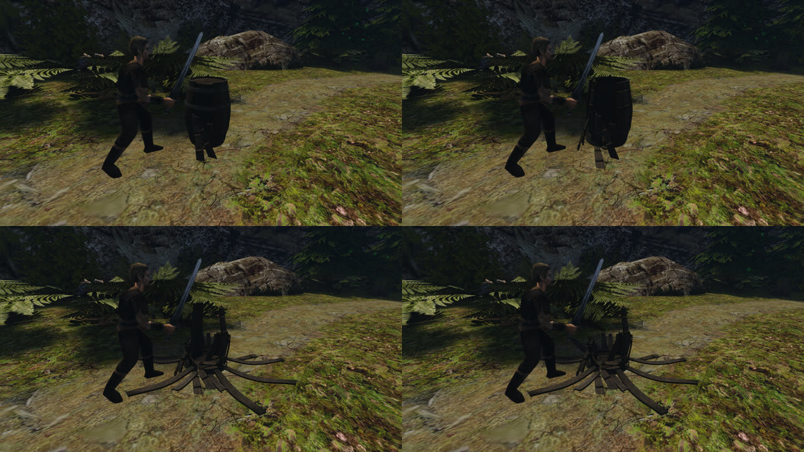

**Скорости кусков в миг разрыва** (`destruction2_start.motion`). «Наружу» — от центра остатка, наклон — длинной оси от вертикали:

| Разрыв | Кусок | Скорость, см/с: всего / наружу / вверх | ω, рад/с | 0,5 с: наружу, наклон | 2 с: наружу, наклон |
|---|---|---|---|---|---|
| 2 | `stave-19` | 52,5 / +28,5 / −44,0 | 0,75 | +19 см, 21° | +50 см, 87° |
| 2 | `stave-18` | 54,8 / +27,2 / −46,0 | 1,13 | +19 см, 18° | +55 см, 88° |
| 2 | `stave-15-top` | 94,0 / −11,8 / −78,9 | 3,00 | +43 см, 50° | +49 см, 90° |
| 2 | `stave-14` | 56,6 / −19,1 / −47,5 | 0,75 | +7 см, 6° | +52 см, 89° |
| 2 | `stave-13-top` | 79,1 / −37,7 / −66,4 | 1,12 | −20 см, 19° | −21 см, 83° |
| 2 | `stave-12` | 48,9 / −26,2 / −41,0 | 1,87 | +0,4 см, 1° | +50 см, 79° |
| 3 | `stave-20` | 57,5 / +12,3 / −47,2 | 0,44 | +17 см, 18° | +51 см, 86° |
| 3 | `stave-01` | 58,7 / +1,5 / −48,3 | 2,31 | +7 см, 8° | +52 см, 90° |

Что из этого видно:
- **Главная скорость в миг разрыва — вниз.** Это 41–79 см/с: удар с затуханием (`hit=150`, `falloff=60`) идёт по направлению клинка, а прямой удар опускается сверху. Наружу и внутрь куски уходят с ±12–41 см/с, знак разный.
- **Клёпки сначала стоят.** Через 0,5 с наклон у большинства 1–21°.
- **К 2 с клёпки лежат (79–90°), почти все наружу.** Их центр уходит на 50–55 см — это полдлины клёпки 110 см. Наружу падают и те, что стартовали внутрь (`stave-14`, `stave-12`).
- **Лучи даёт не толчок, а опрокидывание.** Клёпка без обручей и соседей опрокидывается сама, через нижний край наружу. Обручи `hoop-1…4` к этому времени уже упали по правилу кольца.

Числа не подбирались. Варианты для решения:
1. Принять как есть: бочка без обручей рассыпается клёпками наружу.
2. Держать клёпки дольше вместе: например, обруч отпускает их позже — правило кольца или его доля `ring`.
3. Убрать у разрыва остатка удар по направлению клинка или вращение, тогда клёпки оседают медленнее. Но опрокидываться они будут всё равно.

**Найдено на этой пересъёмке: куски не засыпают рядом с героем.** Повторилось в двух прогонах:
- После второго разрыва бочки через 15 с спят только 5 тел из 29, хотя наибольшая скорость 0,0007 см/с.
- После последнего разрыва ящика спят 21 из 23 (2·10⁻⁶ см/с).
- Капсула героя заходит в отпавший одиночный кусок у его ног на 8,25 см (бочка) и 6,44 см (ящик); до правки было до 4,47 см. Без толчка от центра куски падают туда, где герой стоит после замаха.
- Куски друг в друга — до 1,01 см (бочка, разрывы 2 и 3) при пороге 1.

Похоже, контроллер героя, стоящего на куске или упираясь в него, каждый кадр будит его вместе со всем островом соприкасающихся тел. Это не разбиралось.

#### Сравнение A (`ring=0.5`) и B (`ring=0.75`), предварительно

2026-11-10, те же камеры и удары. B задаётся только переменной: `OPENGOTHIC_FRACTURE_BONDS="ring=0.75"`. Сон кусков у ног героя ещё не починен (ниже), поэтому клипы `*-remnant-a|b.mp4` будут сняты после починки. Здесь — крупные кадры бочки после первого удара и трёх подходов к остатку.

| A, `ring=0.5` | B, `ring=0.75` |
|---|---|
| 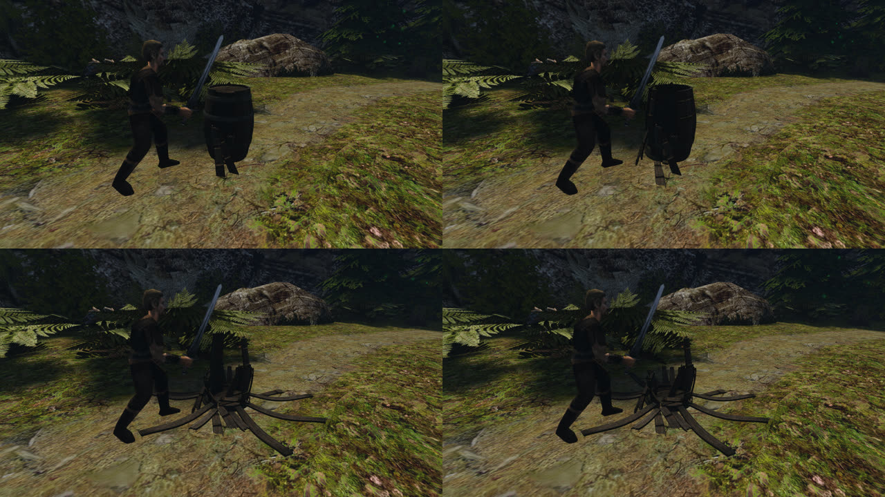 | 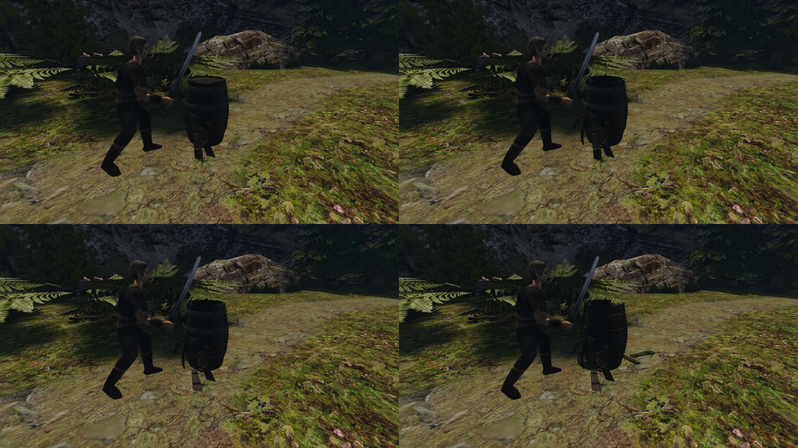 |

| Бочка | A | B |
|---|---|---|
| Замахов на подход (6 — предел) | 1, 1, 1 | 1, 6 без разрыва, 3 |
| Тела после разрывов | 9 → 19 → 29 → 31 | 9 → 17 → 27 |
| Крупнейшая группа, доля объёма | 0,803 → 0,571 → 0,313 → 0,232 | 0,803 → 0,596 → 0,314 |
| Клёпок отпадает за разрыв | 4, 8, 2 | 4, 8 |
| Обручи на остатке после разрыва | `hoop-1…2`; нет; нет | все четыре; `hoop-1…2` |
| Последний обруч спадает | на втором разрыве остатка | не спадает: `hoop-1…2` держат низ |
| Обручи на земле | 2, 2, 2 из 4 | 0, 2 из 4 |
| Спят через 15 с, тел | 19/19, 5/29, 31/31 | 17/17, 27/27 |

Что видно:
- **A.** Первый разрыв остатка снимает крышку и верхние обручи. Второй отпускает нижние, и восемь клёпок ложатся лучами — «ромашка».
- **B.** После первого разрыва все обручи на месте, бочка стоит с проломом. Второй разрыв снимает верхние обручи `hoop-3…4` и восемь клёпок, но нижние `hoop-1…2` держат остаток стоя.
- **Второй подход в B не вышел за 6 замахов.** Клинок у точки посадки упирался в отломанные клёпки, зажатые ещё целыми обручами (контакт на высоте около 107 см, нормаль от героя). Порвал остаток только третий подход, на 3-м замахе.
- **Ящик.** У него нет связей `HOOP`, поэтому в B те же группы, что в A: 13 → 15 → 17 → 23 тела. Отдельный клип ящика для B не нужен.

#### Сон кусков у ног героя: что найдено

Стенд с выключенным столкновением контроллера с обломками (временный переключатель, в код не вошёл): после второго разрыва бочки спят 26/26, после последнего разрыва ящика — 23/23. Значит, сон держит контроллер героя.

**Исправлено (в коде).** Стоящий персонаж не будит спящий обломок:
- пока его опора — спящий обломок, вес ей не передаётся;
- спящий обломок толкается, только если персонаж идёт в него по горизонтали.

Контракт: герой стоит на клёпке 15 и 3 кг и у доски 15 кг. Кусок засыпает вместе с таким же без героя, к 470-му кадру, и больше не просыпается. До правки клёпку 15 кг под героем будили трижды за 30 с. После правки в прогоне A ящик спит (23/23), а бочка после второго разрыва — нет: 5/29.

**Не исправлено.** Трасса толчков контроллера в окне 15 с после второго разрыва бочки:
- одну отпавшую клёпку он толкнул 275 раз, каждые 2–4 шага;
- глубина 0, сближение 1–9 см/с, импульсы 0,002–0,016 Н·с, клёпка всё время активна;
- на обломке герой не стоял.

Правило «стоящий персонаж обломки не толкает вовсе» усыпило бочку (29/29). Но в контракте прислонённая к стоящему герою клёпка с ним проходит сквозь героя и ложится под ним; без правила он её отталкивает. Правило откатил.

Почему толчки не дают уснуть, не понятно. По настройкам Jolt тело засыпает, если за 2 с не ушло дальше 1,6 м, а `AddImpulse` таймер сна активного тела не сбрасывает. Это и предстоит разобрать.

Попутно: обломок засыпает за 470 кадров (~8 с), а не за 2 с. Сон Jolt копит время одного подшага за кадр, а у обломков 4 подшага столкновений.
