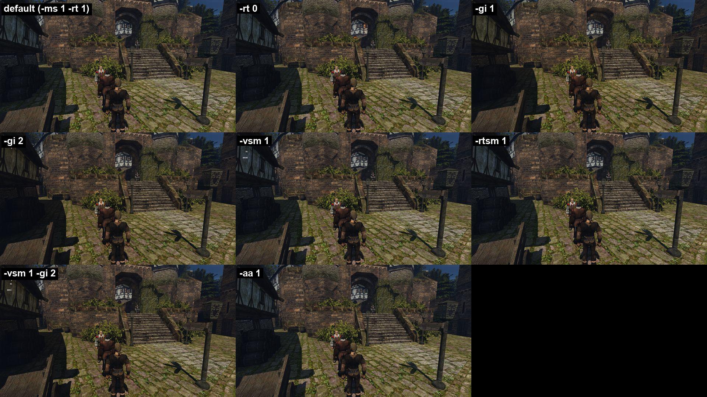
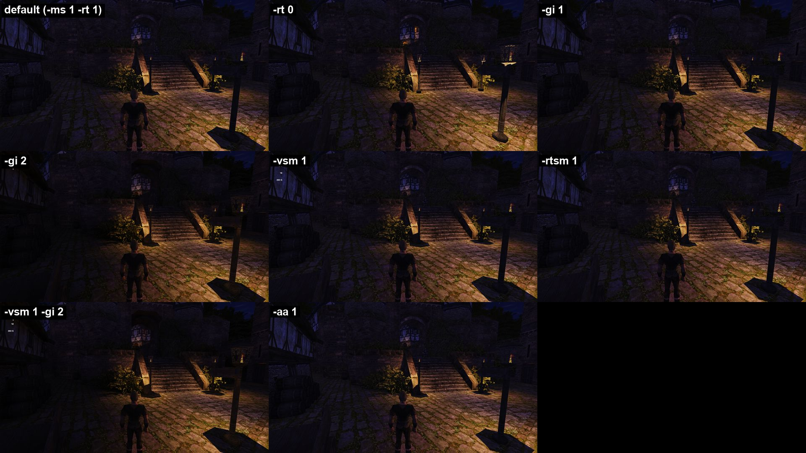
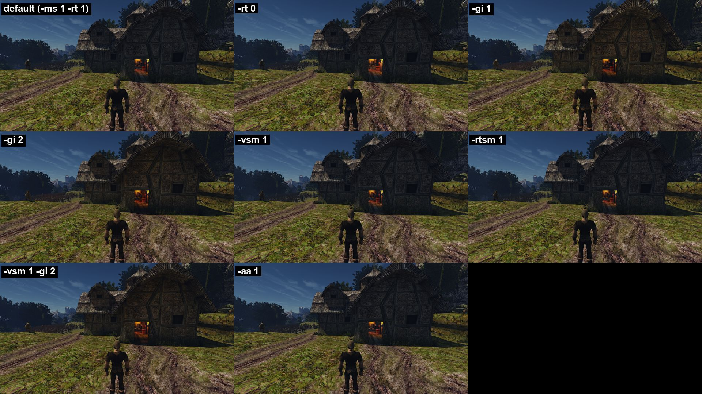
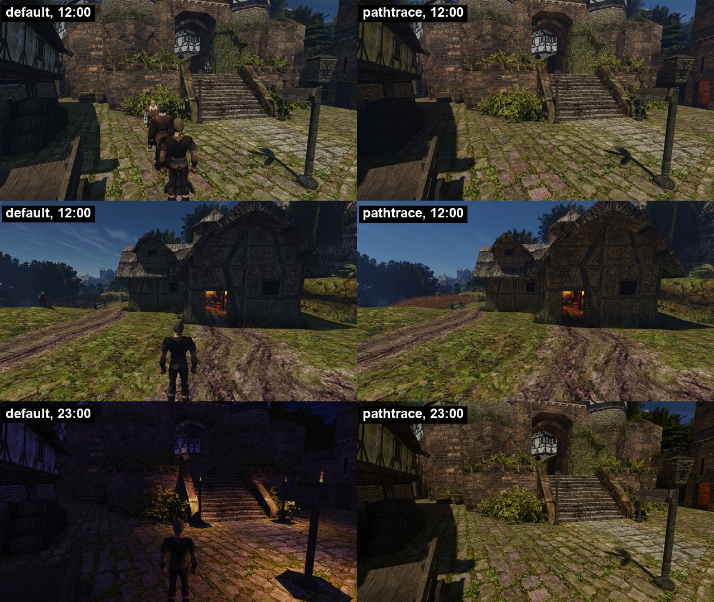
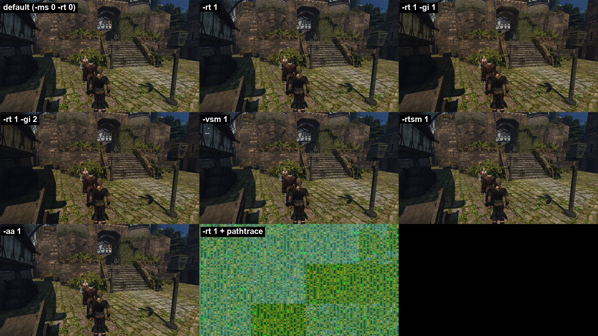
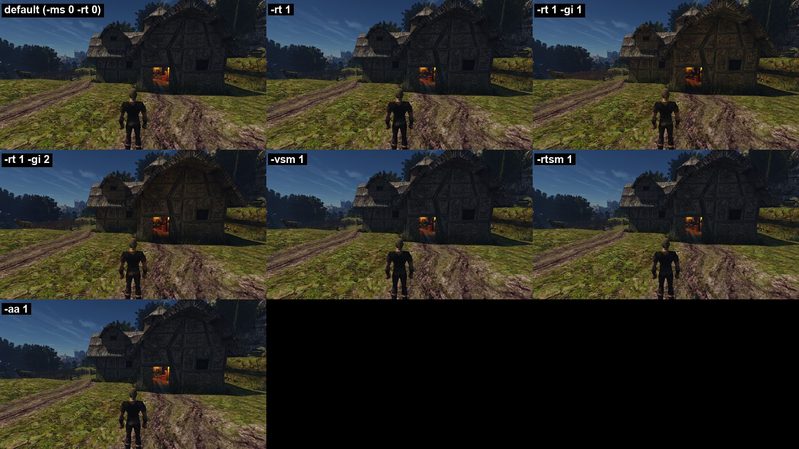
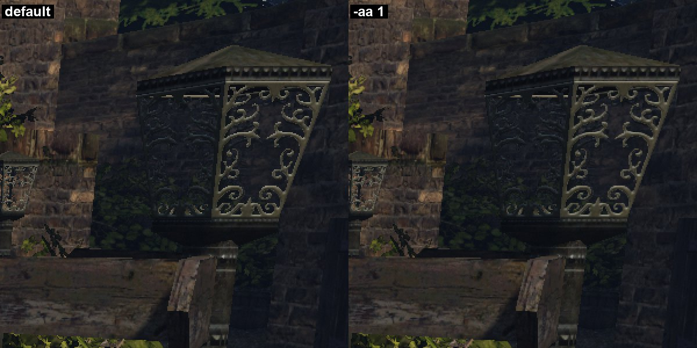

# Современные функции рендера OpenGothic на Mac и Ryzen — 2026-10-18

Проверено, какие современные функции рендера Tempest/OpenGothic работают на наших машинах сегодня, без правок кода движка. Одна сборка `main` (`f3751c1f`), две точки стенда, 1920×1080, для каждой настройки — отдельная игра.

- **На Ryzen (RTX 3080, Vulkan) запускается и рисует всё.** Стенд упирается в процессор: **136–146 FPS** при любой настройке. Видеокарте кадр стоит **≈1,4 мс** по умолчанию и **≈2,6 мс** при самом тяжёлом наборе `-vsm 1 -gi 2` (в пересчёте на 2100 МГц).
- **На Mac (M1 Pro, Metal) работает всё, кроме пути трассировки.** Это узкая машина: по умолчанию **62 FPS**, GPU занят на **≈69 %**. GI-пробы загружают его до **99 %**, FPS падает до **41–45**.
- **`-rt 1` на M1 работает без аппаратной трассировки** и даёт самую заметную разницу: ночью у фонарей и факелов появляются тени, свет перестаёт проходить сквозь стены. Цена — **−4…5 FPS** и **+0,9 ГБ** памяти GPU. На Ryzen это уже включено по умолчанию.
- **`-rtsm 1` и `-vsm 1` дают на M1 те же тени без потери FPS:** **67–68 FPS** против 62 по умолчанию. Они заменяют два прохода каскадных карт теней.
- **`-vsm 1` и `-gi 2` рисуют на экране отладочные счётчики**, на обеих машинах.
- **Путь трассировки** (`toggle pathtrace`) на Ryzen рисует только статичный мир, без героя и NPC, и не реагирует на смену времени суток. На Mac он выдаёт мусор при **1,4 FPS**.
- **`-aa 2` ничем не отличается от `-aa 1`** — это ошибка разбора флага. Остальные находки — в разделе [«Найденные ошибки»](#найденные-ошибки-не-исправлялись).

## Итог: функция × машина

«Работает» — игра стартует, проходит сценарий до конца, картинка правильная, в логе нет ошибок. FPS — среднее двух точек стенда (город / ферма). GPU — оценка по счётчикам, см. [«Как мерили»](#как-мерили).

| Функция | Флаг | Ryzen, RTX 3080, Vulkan | Mac, M1 Pro, Metal | Видимая польза |
|---|---|---|---|---|
| Меш-шейдеры, мешлеты | `-ms` | **включено по умолчанию**, работает. С `-ms 0` та же картинка, те же 138–144 FPS и ≈1,4 мс GPU | выключено по умолчанию. **`-ms 1` работает**, картинка та же, но медленнее: **55 FPS** против 62, +1 мс GPU, +0,4 ГБ | нет: картинка та же (PSNR ∞ на Ryzen; на Mac ∞ в городе, 73 дБ на ферме) |
| Ray query: тени точечных светильников, тени солнца дальше каскадов | `-rt` | **включено по умолчанию**, работает. `-rt 0` экономит ≈0,2 мс и ≈280 МБ, но теряет тени от светильников | выключено по умолчанию. **`-rt 1` работает**: **57–58 FPS**, +0,5 мс GPU, +0,9 ГБ | **большая ночью**: тени фонарей и факелов, свет не проходит сквозь стены. Днём — только дальние тени |
| GI: пробы | `-gi 1` (нужен `-rt`) | **работает**: 138 / 143 FPS, ≈2,1 мс GPU (+0,7), мощность 80 → 131 Вт | **работает, но тяжело**: GPU **99 %**, **41–45 FPS**, +1,2 ГБ | средняя: тёплый отражённый свет в тенях, стены и одежда светлее |
| GI: кэш освещённости, сурфели | `-gi 2` (нужен `-rt`) | работает, **ночью на экране счётчики**; ≈2,1 мс GPU, 127 Вт | работает, **ночью счётчики**; GPU 81 %, 56–57 FPS, +1,0 ГБ | днём как у `-gi 1`, ночью темнее |
| Виртуальные карты теней | `-vsm 1` | работает, **на экране счётчики всегда**; ≈1,7 мс GPU, +530 МБ | работает, **счётчики**; GPU 81 %, **68 FPS**, +1,1 ГБ | тени от светильников, как у `-rt` |
| Программные трассированные тени | `-rtsm 1` | **работает**, артефактов не видно; ≈1,7–2,1 мс GPU, 121 Вт | **работает**, артефактов не видно; GPU 81 %, **67–68 FPS**, +0,5 ГБ | тени от светильников без памяти под BVH |
| CMAA2 | `-aa 1` | **работает**, цена в пределах шума | **работает**, цена в пределах шума | малая: чуть мягче края (PSNR 47–48 дБ) |
| CMAA2 «ultra» | `-aa 2` | **не включается**: то же, что `-aa 1` | **не включается**: то же, что `-aa 1` | — |
| Путь трассировки | консоль `toggle pathtrace` | **частично**: только статичный мир, без героя, NPC и животных; не видит смену времени суток. ≈5 мс GPU, 277 Вт | **сломан**: мусор вместо картинки, 1,4 FPS | на Ryzen — мягкий отражённый свет, но для игры непригоден |

Сочетание `-vsm 1 -gi 2` на Ryzen тоже работает: 136 / 142 FPS, ≈2,6 мс GPU, 173 Вт, +700 МБ, со счётчиками на экране.

## Вывод: что можно включить по умолчанию

- **Mac — `-rt 1`.** Это самая большая видимая разница из всего списка: тени от светильников и никакого света сквозь стены. Цена небольшая: −4…5 FPS на стенде, +0,5 мс GPU, +0,9 ГБ. Код уже готов: на Linux это умолчание. Меш-шейдеры на Mac оставить выключенными: на M1 они только медленнее.
  - Кандидат лучше — `-rtsm 1`: на M1 он дал те же тени, FPS при этом вырос (67–68 против 62), памяти ушло +0,5 ГБ. Но в `commandline.cpp` он помечен «debug only» и проверен только на двух точках. Перед тем как делать его умолчанием, нужен осмотр: помещения, движущиеся источники света, бой.
- **Ryzen и другие дискретные GPU с трассировкой — `-gi 1`.** Из вариантов GI только он рисует без отладочного вывода. На 3080 он стоит ≈0,7 мс при 1080p, видно тёплый отражённый свет. В коде он помечен `legacy`: апстрим развивает `-gi 2`. На M1 GI включать нельзя — GPU упирается в 99 %.
- **`-aa 1` можно включить везде**, цена в пределах шума. Польза небольшая. Он сам выключается, если `vidResIndex` ≠ 0.
- **Пока не включать:**
  - `-vsm 1` и `-gi 2` — сначала убрать счётчики с экрана;
  - путь трассировки — нет персонажей и времени суток, на Metal он сломан;
  - `-aa 2` — сначала починить разбор флага.
- **Для решения OpenGothic или UE5.** Функции рендера в основном работают на обеих машинах. На 3080 у видеокарты большой запас: кадр стенда упирается в процессор. Узкое место — M1 Pro. Главный разрыв с современной графикой — в контенте: у материалов только диффузная текстура (см. ниже), а это флагами рендера не исправить.

## Как мерили

- **Движок:** `main` на `f3751c1f`, RelWithDebInfo. Собран с готовой CMake-опцией `OPENGOTHIC_ENABLE_FRAME_PROFILE=ON` — она пишет время каждого прохода главного цикла в CSV (`common/frameprofile.*`). Код движка не менялся. Mac — отдельная сборка в рабочей папке сессии, Ryzen — `~/gothic-ai/render-features/build`.
- **Сцена:** штатный стенд (`OPENGOTHIC_BENCH`), сценарий [`tools/rf.bench`](tools/rf.bench). Две точки, полдень, игровая камера за героем:
  - **город** — площадь у ворот в верхний квартал (`NW_CITY_MERCHANT_SHOP01_FRONT_03`, взгляд 0°): камень, NPC, лестница, дома;
  - **ферма** — двор Лобарта (`NW_FARM1_OUT_01`, взгляд 90°): дом с освещённой дверью, овцы, трава, дальний вид на город.

  На каждой точке: 6 с на прогрев, кадр `<точка>_a`, **20 с игрового времени замера**, кадр `<точка>`, 90 синхронных кадров через `rec`, затем снимок в 23:00 (`<точка>_night`) — ночью видно тени от факелов и фонарей.
- **Одинаковые условия:** окно 1920×1080 пикселей (на Mac 960×540 точек при Retina ×2), внутреннее разрешение 100 % (`vidResIndex=0`), HD-текстуры, мост к ИИ-серверу выключен (`GOTHIC_AI=0`), звук выключен. Одна игра на настройку, новый процесс каждый раз. Остальные настройки — из `system/Gothic.ini` игры: SSAO, отражения воды и объёмный туман включены на обеих машинах.
- **Ryzen:** RTX 3080 10 ГБ, драйвер 615.71.09, Vulkan, Xwayland, экран 1920×1080 при 200 Гц. Заявка `gq` класса `quiet`: на ядрах заявок больше никого не было.
- **Mac:** M1 Pro, macOS 27.0.1, Metal, питание от сети, окно в фоне (`TEMPEST_BACKGROUND=1`). Перед каждым запуском проверялось, что другой игры нет.

Что считали ([`tools/analyze.py`](tools/analyze.py)):

| Величина | Откуда | Что значит |
|---|---|---|
| **FPS** | показанные кадры в окне замера / настенное время | как игра идёт на стенде |
| интервал кадра, медиана / p95 / p99 | разница начал показанных кадров | плавность; в таблицы не вошёл, есть в `summary-*.json` |
| **GPU занят, %** | `nvidia-smi` каждые 100 мс / `ioreg` (`Device Utilization %`) каждые 200 мс, среднее за окно | нагрузка видеокарты |
| **≈ GPU, мс/кадр** | занятость × время окна / число кадров | сколько GPU тратит на кадр; на Ryzen — при той частоте, которую выбрал драйвер (столбец «МГц») |
| память GPU | `nvidia-smi memory.used` / `ioreg In use system memory` | сколько стоит включение |
| PSNR к default | `ffmpeg psnr` по снимкам | ∞ — картинка байт в байт та же, 70+ дБ — те же пиксели с шумом, 25–45 дБ — видимая разница |

**Ограничения метода.**
- Стенд идёт фиксированным шагом 33 мс, и главный цикл делает шаг мира на каждом проходе, даже когда GPU ещё занят прошлым кадром. Поэтому FPS на стенде ограничен процессором (5–7 мс шага на Ryzen, 4–8 мс на Mac) и не равен FPS живой игры. Для сравнения настроек между собой он годится: мир и камера одинаковые.
- Vulkan берёт режим FIFO (vsync): на Ryzen потолок 200 Гц, до него не дошли. На Mac медиана интервала кадра держится у 16,7 мс. FPS там складывается из шага мира и ожидания GPU, поэтому разницу настроек лучше видно по занятости GPU.
- Счётчики GPU грубые: `ioreg` отдаёт рваные значения, `nvidia-smi` — долю времени, когда работало хоть одно ядро. Числа «≈ GPU, мс» — оценка, точные GPU-таймеры в движке не встроены.
- Синхронный кадр через `rec` (рендер в текстуру, ожидание GPU, чтение пикселей) на Ryzen почти целиком состоит из чтения пикселей (≈110 мс), на Mac — ≈45 мс. Он в таблицы не вошёл, сырые числа — в `summary-*.json`.

## Что работает по умолчанию

Без флагов рендер уже отложенный и довольно современный, на обеих машинах одинаково:

- G-буфер и отложенное освещение;
- отсечение невидимого через HiZ: два прохода видимости на compute (`visibility_pass*`, `shader/hiz`);
- тени солнца: две каскадные карты 2048×2048;
- физическое небо на LUT (пропускание, многократное рассеяние, вид неба), облака, объёмный туман с лучами солнца (`zFogRadial=1`);
- SSAO (`zCloudShadowScale=1` в `system/Gothic.ini`; встроенное в OpenGothic умолчание включает его только на дискретной видеокарте, то есть не на M1);
- отражения воды через SSR (`zEnvMappingEnabled=1`), автоэкспозиция, тонмаппинг;
- bindless-ресурсы (`-bl`, по умолчанию включён).

Разница машин — в двух флагах, умолчания заданы в `common/commandline.h`:

| | Ryzen (Linux, Vulkan) | Mac (macOS, Metal) |
|---|---|---|
| `-ms` меш-шейдеры / мешлеты | **включены** | выключены |
| `-rt` ray query: тени точечных светильников трассировкой, тени солнца дальше каскадов | **включён** | выключен |

Всё остальное из списка ниже по умолчанию выключено на обеих: `-gi`, `-vsm`, `-rtsm`, `-aa`, путь трассировки (`toggle pathtrace` в консоли).

У материалов только диффузная текстура: карт нормалей, шероховатости и металличности в шейдерах `shader/materials` нет.

## Ryzen: числа

Одна заявка `quiet` на все 12 настроек, `default` повторён второй заявкой: разброс **1 FPS**. FPS ограничен шагом стенда на процессоре (`sim` ≈5,0–5,3 мс + запись команд ≈1,6 мс), поэтому разницу настроек видно по GPU: занятости, частоте и мощности. «≈GPU мс» — занятость × интервал кадра, пересчитанная на 2100 МГц.

| Настройка | FPS город / ферма | GPU, % | ≈GPU, мс на 2100 МГц, город / ферма | МГц | Вт | Δ VRAM | PSNR к default: город днём / ночью |
|---|---|---|---|---|---|---|---|
| default (`-ms 1 -rt 1`) | 140 / 145 | 38 | 1,4 / 1,4 | 1113 | 80 | +0 МБ | ∞ / ∞ |
| `-ms 0` | 138 / 144 | 37 | 1,4 / 1,4 | 1153 | 80 | +2 МБ | ∞ / ∞ |
| `-rt 0` | 139 / 145 | 35 | 1,2 / 1,3 | 1050 | 79 | −278 МБ | 46 / 26 |
| `-ms 0 -rt 0` | 140 / 146 | 35 | 1,3 / 1,4 | 1133 | 80 | −266 МБ | 46 / 26 |
| `-gi 1` | 138 / 143 | 37 | 2,2 / 2,0 | 1654 | 131 | +157 МБ | 37 / 53 |
| `-gi 2` | 138 / 143 | 36 | 2,1 / 2,1 | 1686 | 127 | +71 МБ | 35 / 32 |
| `-vsm 1` | 139 / 145 | 36 | 1,7 / 1,7 | 1377 | 86 | +532 МБ | 35 / 32 |
| `-rtsm 1` | 139 / 143 | 34 | 1,7 / 2,1 | 1647 | 121 | −32 МБ | 36 / 43 |
| `-vsm 1 -gi 2` | 136 / 142 | 40 | 2,6 / 2,6 | 1870 | 173 | +704 МБ | 32 / 29 |
| `-aa 1` | 136 / 145 | 36 | 1,5 / 1,4 | 1188 | 80 | −0 МБ | 48 / 48 |
| `-aa 2` | 140 / 144 | 36 | 1,4 / 1,5 | 1196 | 81 | +4 МБ | 48 / 48 |
| `toggle pathtrace` | 131 / 146 | 77 | 5,7 / 4,2 | 1881 | 277 | +31 МБ | 25 / 18 |

## Mac: числа

Каждая настройка снята два раза, кроме пути трассировки: его один проход занял 211 с. В таблице — среднее, столбец «FPS по прогонам» показывает оба прохода по отдельности.

- **Первый проход** шёл, пока Mac грузили чужие сборки: load average 33–38 на 10 ядрах.
- **Второй** — при load 6–17 вместе с самой игрой. Нагрузка записана в `load.txt` каждого прогона.

Шум FPS на Mac — до 8–9 кадров. `-aa 1` и `-aa 2` рисуют одинаково, а в первом проходе дали 54 и 62 FPS. Занятость GPU повторяется точнее: ±3 п.п. При этом рабочий стол (WindowServer, приложение Claude) сам занимает 4–24 % GPU. Эта доля входит в «GPU, %» и «≈GPU, мс» всех строк одинаково. Память GPU на Mac шумит в пределах ≈0,2 ГБ: столько показывают `-aa 1` и `-aa 2`, которым память не нужна.

Прогон с путём трассировки на Mac закончился сам после перехода на ферму, с кодом 0 и без ошибок в логе. Поэтому для него есть только город.

| Настройка | Прогонов | FPS город / ферма | FPS по прогонам | GPU, % | ≈GPU, мс, город / ферма | Δ память GPU | PSNR к default: город днём / ночью |
|---|---|---|---|---|---|---|---|
| default (`-ms 0 -rt 0`) | 2 | 62 / 62 | 63 · 60 | 69 | 11,2 / 11,3 | +0,00 ГБ | ∞ / ∞ |
| `-ms 1` | 2 | 55 / 55 | 55 · 55 | 67 | 12,5 / 12,0 | +0,39 ГБ | ∞ / ∞ |
| `-rt 1` | 2 | 58 / 57 | 59 · 57 | 68 | 11,7 / 11,9 | +0,88 ГБ | 46 / 26 |
| `-ms 1 -rt 1` | 2 | 48 / 49 | 49 · 49 | 65 | 13,8 / 13,0 | +1,21 ГБ | 46 / 26 |
| `-rt 1 -gi 1` | 2 | 45 / 41 | 43 · 43 | 99 | 22,2 / 24,2 | +1,22 ГБ | 36 / 26 |
| `-rt 1 -gi 2` | 2 | 56 / 57 | 55 · 58 | 81 | 14,6 / 14,1 | +0,99 ГБ | 35 / 25 |
| `-vsm 1` | 2 | 68 / 68 | 63 · 72 | 81 | 12,3 / 11,8 | +1,06 ГБ | 34 / 25 |
| `-rtsm 1` | 2 | 68 / 67 | 64 · 71 | 81 | 12,2 / 11,9 | +0,47 ГБ | 35 / 26 |
| `-aa 1` | 2 | 58 / 58 | 54 · 62 | 69 | 12,0 / 11,9 | +0,17 ГБ | 47 / 47 |
| `-aa 2` | 2 | 63 / 61 | 61 · 63 | 70 | 11,3 / 11,5 | +0,18 ГБ | 47 / 47 |
| `-rt 1` + `toggle pathtrace` | 1 | 1 / — | 1 | 98 | 700,7 / — | +0,75 ГБ | 9 / 9 |

## Детали

- **Детерминизм.** Одинаковый путь рендера даёт одинаковые снимки: `aa1` и `aa2` совпадают байт в байт, `-ms 0` на Ryzen совпадает с умолчанием (PSNR ∞), `rt0` совпадает с `classic`. Поэтому PSNR показывает именно работу функции, а не случайность сцены.
- **Ночь на Ryzen.** У `-gi 1` ночной снимок почти совпадает с умолчанием (PSNR 53–55 дБ), а `-gi 2` даёт 32–36 дБ: сурфели заметно затемняют ночную сцену.
- **Mac без `-rt`.** Свет точечных источников проходит сквозь геометрию: фонарь у лестницы освещает землю за столбом, теней нет. С `-rt 1`, `-vsm 1` или `-rtsm 1` тень появляется (PSNR к умолчанию ночью 25 дБ).
- **Лог.** Ошибок в `game.log` нет ни в одном прогоне. Все игры вышли с кодом 0, все, кроме пути трассировки на Mac, дошли до конца сценария. Единственный шум — исходники MSL меш-шейдеров при `-ms 1` на Mac.

## Найденные ошибки (не исправлялись)

Позже ошибки 1, 5 и 6 исправлены в [PR #227](https://github.com/kaifaty/GothicAI/pull/227). После правки снимки `-aa 1` и `-aa 2` на Mac различаются: PSNR 45 дБ, тогда как у двух прогонов `-aa 2` он 79 дБ. Цифры этого отчёта сняты до правки.

1. **`-aa 2` равен `-aa 1`.** `CommandLine::aaPreset()` в `common/commandline.h` возвращает `bool`, и номер пресета 2 превращается в 1. CMAA2 «ultra» недостижим: снимки `-aa 1` и `-aa 2` совпадают байт в байт на обеих машинах.
2. **`-vsm 1` и `-gi 2` рисуют отладочные числа в кадре.** Это три счётчика у VSM (днём и ночью) и два у `-gi 2` (ночью), в левом верхнем углу, на Vulkan и на Metal. Числа попадают и в снимки стенда, то есть рисуются в самом кадре, а не в интерфейсе. Откуда они берутся, быстрый поиск по шейдерам не нашёл.
3. **Путь трассировки на Metal выдаёт мусор:** сетку зелёно-оранжевых пятен вместо сцены, при 1,4 FPS.
4. **Путь трассировки на Vulkan не видит анимированные модели:** героя, NPC и овец нет в кадре. После `set time 23 0` картинка остаётся дневной.
5. **Metal пишет в лог исходник каждого меш-шейдера.** В `mtshader.cpp` стоит `Log::d(msl)` для `Stage::Mesh` без условия. С `-ms 1` в `game.log` около 24 000 строк MSL.
6. **В RelWithDebInfo Metal молчит об ошибках компиляции шейдеров.** Вывод ошибки в `mtshader.cpp` стоит под `#if !defined(NDEBUG)`, а сборка задаёт `NDEBUG`. Шейдер просто бросает `InvalidShaderModule`.

Не ошибки, но легко попасться:
- CMAA2 молча выключается при `vidResIndex` ≠ 0. Стенд на Mac по умолчанию пишет `vidResIndex=2`, поэтому в обычных бенчах Mac AA не бывает.
- Встроенное умолчание OpenGothic включает SSAO только на дискретной видеокарте. У нас его включает `zCloudShadowScale=1` в `system/Gothic.ini` игры, на обеих машинах.

## Как повторить

Скрипты лежат в [`tools/`](tools/).

- Сборка: `cmake -S OpenGothic -B <build> -G Ninja -DCMAKE_BUILD_TYPE=RelWithDebInfo -DOPENGOTHIC_ENABLE_FRAME_PROFILE=ON`, на Ryzen — [`tools/build-ryzen.sh`](tools/build-ryzen.sh) через `scripts/gq run --class quick`.
- Ryzen: исходники, HD-текстуры, сейв и файлы из `tools/` — в `~/gothic-ai/render-features/`, затем
  `scripts/gq submit --class quiet --threads 28 --mem 8G --gpu-mem 6G --display --max 40m -- ~/gothic-ai/render-features/run-ryzen.sh <out> <rf.bench> <cfg-ryzen.txt>`.
- Mac: `BIN=<build>/opengothic/Gothic2Notr tools/run-mac.sh <out> tools/rf.bench tools/cfg-mac.txt`. Перед запуском — `pgrep -fl Gothic2Notr`.
- Разбор: `python3 tools/analyze.py <out> city farm` → `summary.json` и таблица; `python3 tools/imgdiff.py <out> default city farm city_night farm_night` → PSNR; `uv run --with pillow python tools/sheets.py …` → сетки снимков; `tools/final_table.py` → таблицы этого отчёта.
- В файле настроек поля разделены табуляцией: метка, флаги, консольные команды перед сценарием. В первом прогоне Ryzen раннер разбирал строку через `read`, и пустое поле флагов схлопнулось: `toggle pathtrace` ушла в аргументы игры. Путь трассировки пришлось снять второй заявкой. В `tools/` раннеры уже разбирают строку через `cut`.

Сырые прогоны в git не входят: видео и PNG весят около 400 МБ. Они лежат на Mac в рабочей папке сессии и на Ryzen в `~/gothic-ai/render-features/runs`. Сводки по каждому прогону — [`summary-ryzen.json`](summary-ryzen.json), [`summary-ryzen-2.json`](summary-ryzen-2.json) (путь трассировки и повтор `default`), [`summary-mac-1.json`](summary-mac-1.json), [`summary-mac-2.json`](summary-mac-2.json).
