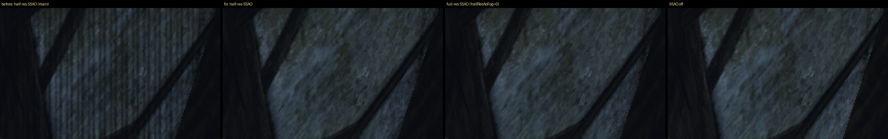
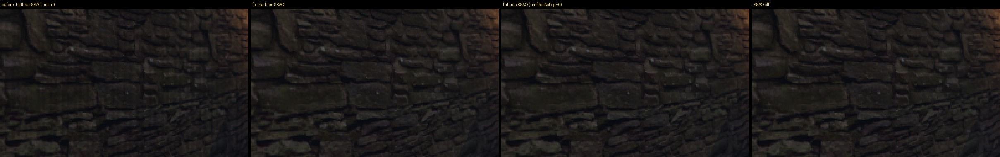
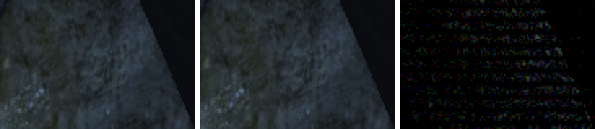

# Полосы половинного SSAO с шагом 5 px (31.10.2026)

## Что было видно

На кадрах ремастера гавани (М5, Ryzen, Vulkan, NVIDIA, 1280×720) на стенах в тени шли вертикальные
полосы: каждый пятый столбец темнее. Фаза одна во всех кадрах и каналах, по вертикали ничего.
Сильнее всего на текстуре в тени, где SSAO гасит рассеянный свет. Причина — SSAO в половинном
разрешении (`fba25927b`, `[INTERNAL] halfResAoFog=1` по умолчанию с 29.10).

## Механизм

`ssao.comp` ставил тексель AO номер x в NDC `(2x+1)/(W/2) − 1`. Это точно граница между пикселями
глубины 2x и 2x+1. При ближайшей выборке глубины пиксель выбирает ошибка округления. При W = 1280
делитель 640 = 5·128, и ошибка зависит от `x mod 5`. Выбор левого или правого пикселя повторяется
каждые 5 текселей AO, то есть 10 пикселей экрана. Его гармоники дают пики на 10, 5 и 3,3 px; по
вертикали та же история с 360 = 8·45 даёт пик 7,5 px. Модель на CPU — [`rounding.py`](rounding.py).
Деление на GPU округляет не как IEEE, поэтому сильнейшей там оказалась гармоника 5 px, но
структура та же: при 1024 (делитель 512) выбор не меняется, при 1920 и 3456 период другой.

Вторая беда того же места: точка трассировки стоит на границе, а глубина взята у соседнего
пикселя, на полпикселя в сторону. На наклонной поверхности точка уходит под неё, и SSAO
затеняет сам себя. Поэтому половинный SSAO затемнял кадр в 3–4 раза сильнее полного.

## Правка

- `ssao.comp`: тексель AO трассирует от верхнего левого пикселя глубины своего блока 2×2, то есть от
  центра пикселя, а не от границы.
- `ssao_blur.comp`: билинейная выборка половинного AO учитывает этот сдвиг на полпикселя.
- `fog.frag`: маска затенения тумана в половинном разрешении читала глубину на той же границе;
  теперь `texelFetch` того же пикселя. Её читатель делил размеры как целые, поэтому при нечётной
  ширине окна правая половина экрана теряла тени тумана; теперь отношение округляется вверх.
- При `halfResAoFog=0` формулы те же, что были: кадры полного разрешения совпали до бита (`banners-b`)
  или в пределах 0,000 из 255.

## Замер

Сцена — `harbour-motion-stripes.bench` из PR #612 (два вида, полдень, набор `harbour-motion-2`),
Ryzen, 1280×720. Метрика — [`stripes.py`](stripes.py): строки горизонтального high-pass усредняются
по высоте, затем пик FFT на периоде 5 px делится на медиану спектра. Темнота SSAO — средний
модуль разницы с кадром без SSAO (`zCloudShadowScale=0`), из 255.

| Вариант | Пик 5 px: quay-west / banners / banners-b | Темнота SSAO: quay-west / banners |
|---|---|---|
| Было: половинное (`main`) | 23,1 / 62,1 / 63,1 | 1,06 / 2,05 |
| **Стало: половинное** | **3,0 / 3,3 / 3,1** | **0,26 / 0,40** |
| Полное (`halfResAoFog=0`) | 3,1 / 3,5 / 3,3 | 0,24 / 0,39 |
| SSAO выключен | 3,1 / 3,5 / 3,3 | 0 |

Половинное против полного после правки: средняя яркость −0,01 из 255 (было −0,8 и −1,7); после
размытия разницы окном 17 px остаётся 0,03 — шум выборок, а не узор. Пик 8 px по вертикали
одинаков с SSAO и без (4,4–4,9), то есть швов на стыках групп 8×8 размытия на кадре не видно.

Слева направо: было, стало, полное разрешение, без SSAO (кропы 200×120, ×3).

## Цена кадра

Mac (Metal, 100 %, до и после попеременно), GPU mean до → после: рынок 20,4 / 18,8 → 18,1 мс,
лес 20,0 → 20,0, интерьер 21,0 → 20,6. Ryzen упирается в CPU, FPS там до и после одинаковы в
пределах соседей. Подробно — журнал [`docs/performance.md`](../../../docs/performance.md#план-и-журнал), запись 31.10.

## Mac

Движок по умолчанию включает SSAO только на дискретной видеокарте, а Metal на Apple GPU отвечает
«integrated» (общая память). На Mac SSAO работает, если в `Gothic.ini` задан `zCloudShadowScale=1`
(так у пользователя). Там те же полосы с другим периодом, зависящим от ширины: при 3456 модель
даёт ~27 px.

## Ореол горизонтального прохода размытия

`ssao_blur.comp` размывает AO раздельно, группами 8×8 пикселей, через массив `shared`
`samples[15][15]` (локальные координаты −3…11). Вертикальный проход читает по 3 строки выше и
ниже группы, поэтому горизонтальный должен размыть 14 строк: −3…10. Он размывал строки 0…14:

- строки ореола −3…−1 не размывались;
- второй круг (строки 8…14) брал центр и его глубину из строки на 8 выше;
- строки 12…14 читались и писались за массивом, то есть в строках −3…−1 соседнего справа
  столбца: у столбцов 1–7 группы верхний ореол затирался;
- результат писался на место, пока соседи ещё читали ту же строку.

Теперь поток размывает строки `y−3` и `y+5` (вторую, если она не дальше 10), держит оба результата в
регистрах, затем `barrier()` и запись. Проверка границы кадра из размытия ушла: строки ореола за краем —
копии крайней строки (clamp), их размытие и есть размытие крайней, а пиксели за краем по-прежнему
не записываются.
Модель на CPU — [`blur_model.py`](blur_model.py): каждая из 14 строк записана один раз, за массив
ничего не выходит, результат совпадает с обычным раздельным размытием до бита.

Замер — те же кадры гавани (Ryzen, 1280×720), средний модуль разницы из 255, по строкам группы —
[`tile_rows.py`](tile_rows.py):

| Пара | quay-west | banners | banners-b |
|---|---|---|---|
| Два прогона одной сборки | 0 | 0 | 0 |
| Было → стало, половинное | 0,005 | 0,010 | 0,010 |
| Было → стало, полное (`halfResAoFog=0`) | 0,005 | 0,010 | 0,010 |
| Темнота SSAO (с SSAO против без) | 0,27 | 0,40 | 0,40 |

Меняются только строки 0–2 и 5–7 каждой группы; строки 3–4 ореол не читают и остались прежними
(кроме 1–3 пикселей на кадр рядом с изменёнными — их задевает сглаживание). В столбце 0 группы
верхние строки сдвинулись втрое меньше: записи за массив в него не попадали. Больше 1 из 255
изменилось 0,03–0,16 % пикселей, максимум 8–9 из 255 — на краях по глубине. Пик 8 px по вертикали:
было 4,5–4,8, стало 4,6–4,9, без SSAO 4,4–4,6; темнота SSAO не изменилась (половинное 0,266 / 0,402,
полное 0,244 / 0,391). Шва глазом не было видно и раньше; правка убирает чтение за массивом и
неверные строки, а не заметный дефект.

Слева направо: было, стало, разница ×30 (кроп 120×80, ×3): полосы разницы идут по швам групп.

Цена кадра — Mac (Metal, 100 %, 3456×1918, SSAO из `zCloudShadowScale=1` в `Gothic.ini` игры), до и после
попеременно, по одному месту на запуск, при load average 7–14:

| Место | GPU mean, мс: было | стало | FPS: было → стало |
|---|---|---|---|
| Рынок | 17,47 / 17,61 | 17,58 / 17,61 | 62,4 / 61,8 → 62,0 / 61,9 |
| Лес | 21,96 / 19,83 | 19,81 / 19,79 | 48,8 / 54,0 → 54,1 / 54,2 |
| Интерьер | 20,69 / 20,70 | 20,58 / 20,71 | 44,4 / 44,6 → 44,8 / 44,6 |

Первый прогон леса до правки — выброс (p95 26 мс против 21). Ещё пара рынка и леса шла под нагрузкой
(load average 40–90) и разошлась на ±1,5 мс в обе стороны. Цена не изменилась: горизонтальный проход
считает 14 строк вместо 15, добавился один `barrier()`.

## Не вошло

- Путь `fogEpipolarOcclusion` (только с `-vsm 1`) с `fba25927b` пишет в половинную карту по
  координатам полного кадра: остаётся левая верхняя четверть экрана, растянутая на весь кадр.
  По умолчанию VSM выключен; правка — отдельной задачей с проверкой на `-vsm 1`.
