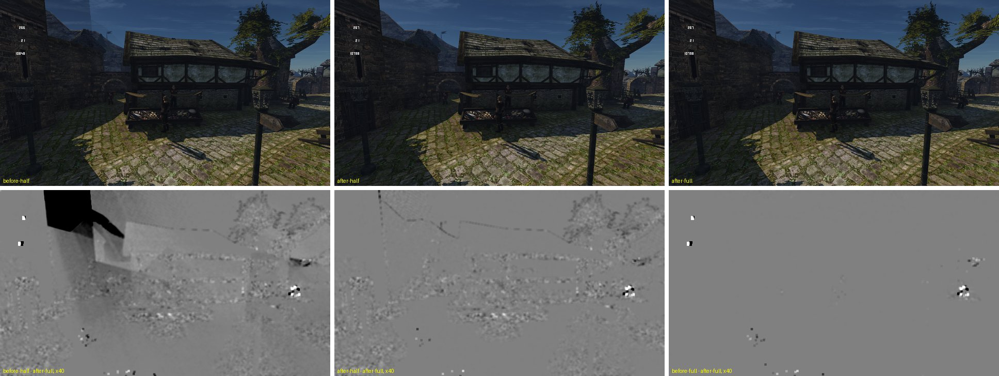
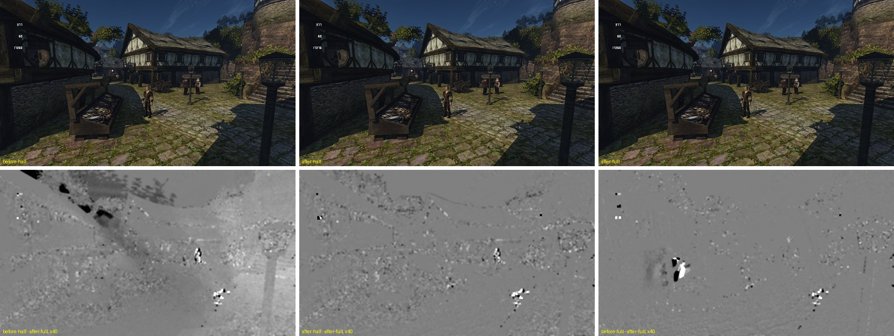

# Маска тумана с `-vsm 1` в половинном разрешении (31.10.2026)

## Что было

С `fba25927b` (`[INTERNAL] halfResAoFog=1` по умолчанию с 29.10) карта затенения тумана
`sky.occlusionLut` вдвое меньше кадра по каждой оси. Основной путь (`fog.frag`, вычислительный вариант)
это учитывает, после PR #620 — от верхнего левого пикселя глубины своего блока. Путь VSM
(`-vsm 1`, по умолчанию выключен) остался прежним: `Renderer::prepareFog` запускал
`fogEpipolarOcclusion` по размеру буфера глубины, а `fog_epipolar_occlusion.comp` писал маску по
координатам пикселя полного кадра. В карту попадала левая верхняя четверть экрана, а `fog.frag`
растягивал её на весь кадр. Ещё 3/4 потоков писали за пределы картинки.

## Правка

- `renderer.cpp`: `fogEpipolarOcclusion` запускается по размеру `occlusionLut`.
- `fog_epipolar_occlusion.comp`: тексель карты трассирует от пикселя глубины `texel·ratio`, где
  `ratio = ceil(размер глубины / размер карты)`, как вычислительный путь `fog.frag`. Срез
  эпиполярной сетки берётся по тому же пикселю, запись идёт по координате карты.
- При `halfResAoFog=0` `ratio = 1`, и формулы те же, что были.

## Проверка

Сцена — [`vsm-fog.bench`](vsm-fog.bench): гавань в 17:00 с восьми направлений и рынок в 9:00 с
четырёх. Её запускали как место `shot` стенда `scripts/perf.sh` в своей копии на Ryzen (Vulkan,
NVIDIA, 1280×720, `gq quick`, окно делилось с чужими играми). Сравнивались бинарники `main` (`60a447e6a`) и правки, с `-vsm 1`, при
`halfResAoFog` 1 и 0. Метрика — [`compare.py`](compare.py): средний модуль разницы яркости с кадром
правки в полном разрешении (из 255), сырой и после размытия окном 17 px (по четвертям кадра).
Размытие оставляет крупные формы теней тумана и убирает листья, воду и прохожих. «До, полное»
выполняет тот же код, что «после, полное», поэтому его числа — шум двух прогонов.

| Вид | Размытая разница: до, половинное | после, половинное | до, полное (шум) |
|---|---|---|---|
| h315 | 0,58 (левая верхняя четверть 1,94) | 0,06 | 0,02 |
| m000 | 0,34 | 0,08 | 0,05 |
| m090 | 0,15 | 0,06 | 0,06 |
| m180 | 0,36 | 0,09 | 0,07 |
| m270 | 0,36 | 0,08 | 0,06 |

На этих пяти тихих видах старый путь отличается от полного разрешения в 2–30 раз сильнее шума.
После правки она 0,06–0,09, близко к шуму; остаток — кромки силуэтов. Сырая разница после правки чуть выше шума (0,22–0,35 против
0,03–0,23): сказываются силуэты, у половинной маски они грубее. В h000 и h270 старый путь тоже
дальше от полного (0,41 и 0,23 против 0,17 после правки, шум 0,09). Виды h045–h225 смотрят на стены
с висящей тканью и листвой: шум двух прогонов там 0,07–0,19 (в четверти кадра до 0,43), и метрика
варианты не различает. Полная таблица — вывод `compare.py`.

Сверху — кадры (до, после, полное разрешение), снизу — размытая разница с полным разрешением ×40.
Видно, что старый путь кладёт тень башни и крыш на небо и растягивает тень кроны. После правки
остаются только кромки силуэтов.

Нечётное окно 1279×719 (карта 640×360) после правки: размытая разница с кадром 1280×720,
пересчитанным на ту же сетку, у правого и нижнего края 0,14–0,33, по всему кадру 0,18–0,26.
Края не теряют тени тумана.

Путь без `-vsm 1` (карта теней) правка не трогает.

## Замечания

- Первый прогон старого бинарника в половинном разрешении (сцена леса утром, которую потом
  заменили: камера оказывалась в кустах) завис после первого кадра. Время игры встало на 17,7 с,
  через 300 с стенд его остановил. Повтор того же бинарника на сцене гавани прошёл. Старый код
  писал за пределы картинки, но связь с зависанием не доказана.
- Цена кадра не мерилась: VSM — путь для опытов, на Ryzen кадр упирается в CPU. В половинном
  разрешении проход теперь считает вчетверо меньше текселей.
