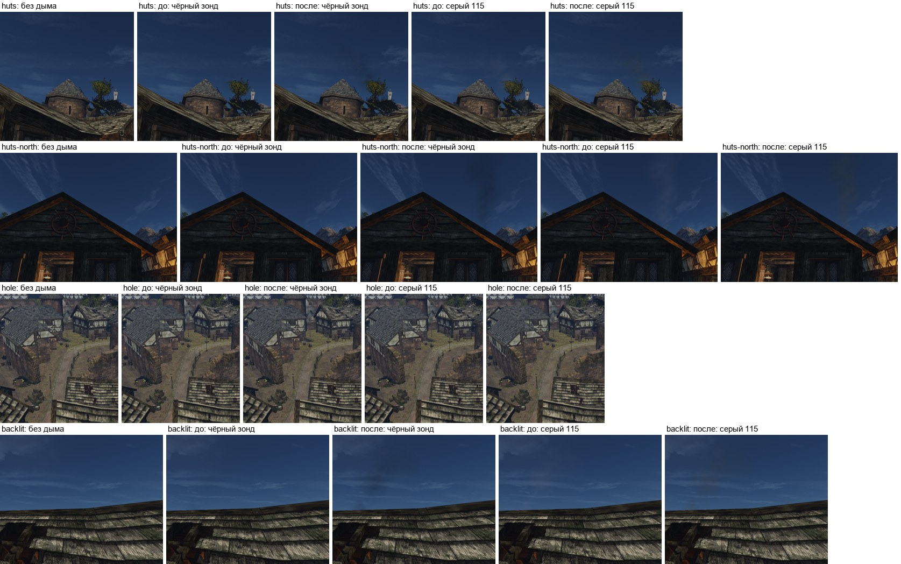

# Туман на полупрозрачном по своей глубине (1.11.2026)

## Что было

`Renderer::draw` рисовал полупрозрачное — частицы, полупрозрачные меши, призраков — раньше прохода
тумана. Проход тумана (`shader/sky/fog.frag`) берёт глубину из z-буфера, а полупрозрачное её не пишет.
Поэтому на пиксель частицы ложилась дымка того, что за ней. На фоне неба это вся дымка атмосферы:
`tr = 1`, свет по `dMax`. Днём она ярче самого дыма, и дым тонул в ней.

Так нашёлся этот дефект: дым очагов порта (М5, r5, [PR #637](https://github.com/kaifaty/GothicAI/pull/637))
днём не было видно ни в одном из шести вариантов. Чёрный непрозрачный зонд в `huts-north` в полдень
закрывал небо на 0,013, а ночью — на 0,125. Тот же сдвиг к светлому получали огонь, магия и всё
полупрозрачное на фоне неба и далёкого фона.

## Правка

- **Новый порядок проходов** (`renderer.cpp`):
  1. солнце и луна;
  2. умножающие материалы;
  3. отражения воды и туман;
  4. остальное полупрозрачное.

  Под водой — как было: туман воздуха не рисуется, поверх всего идёт `drawUnderwater`.
- **Смешивающие** (`Transparent`), **светящиеся** (`AdditiveLight`) и **призраки** берут туман своей
  глубины из той же 3D-таблицы, что и проход тумана (`main.frag`, `fogOwnDepth`):
  - смешивающие и призраки получают `цвет·T + рассеянный свет`;
  - светящиеся получают `цвет·T`.

  Как считается рассеянный свет:
  - при `zFogRadial=1` (по умолчанию, VolumetricHQ) — однократное рассеяние `fogLut3D` без затенения
    плюс многократное `fogLut3DMs`, пропускание `T` — тоже из `fogLut3DMs`;
  - при `zFogRadial=0` — одна таблица.

  Режим передаётся в `SceneDesc.fogQuality`. Таблицы привязаны в слоты 17 и 18 материалов.
- **Умножающие** (`Multiply`, `Multiply2`) остаются под туманом, как раньше. Это декали на
  поверхностях, а смешение `2·src·dst` не может добавить дымку перед ними. У них свой вариант
  фрагментного шейдера `_m`, без тумана.
- **Декали на поверхности.** Для смешивающих и светящихся декалей результат прежний: туман их глубины
  равен туману поверхности.

Цена — одна или две выборки 3D-текстуры на фрагмент полупрозрачного. Проход тумана тот же.

## Проверка

**Съёмка.** Четыре вида порта из r5: `huts`, `huts-north`, `hole`, `backlit`. Каждый — в полдень и
в полночь, с парным кадром через 0,7 с. Кадры снимал `capture_r5.sh` из PR #637 на Ryzen (Vulkan,
NVIDIA, 1280×720).

**Сборки.** Две, и между ними только эта правка: `main` `0057f57bb` и он же с правкой.

**Наборы:**
- `harbour-life-8` — порт без нашего дыма;
- `r5-k52` — тот же дым с цветом вершин 0: он только поглощает, альфа 52;
- `r5-g115a52` — серый 115.

**Метрика** — [`fog_ab.py`](fog_ab.py). Чёрный поглощает одинаково днём и ночью, поэтому его
покрытие (доля фона, которую он забирает) меняет только свет, положенный поверх.

### Покрытие чёрного зонда

Медиана в теле шлейфа: пиксели, где ночью покрытие ≥ 0,05. Значения — полдень / полночь, в скобках
их отношение. Туман по умолчанию (VolumetricHQ):

| Вид, фон за дымом | до правки | после |
|---|---|---|
| `huts-north`, небо | 0,013 / 0,125 (0,11) | 0,108 / 0,126 (0,86) |
| `huts`, небо | 0,019 / 0,104 (0,19) | 0,082 / 0,104 (0,79) |
| `backlit`, небо | 0,022 / 0,101 (0,22) | 0,089 / 0,101 (0,88) |
| `huts`, крона | 0,042 / 0,128 (0,33) | 0,084 / 0,126 (0,66) |
| `huts`, стены и кровли | 0,051 / 0,136 (0,38) | 0,063 / 0,135 (0,47) |
| `hole`, кровли в 30 м под дымом | 0,095 / 0,114 (0,83) | 0,104 / 0,114 (0,91) |

С `zFogRadial=0` отношения почти те же:
- небо: `huts-north` 0,10 → 0,87, `huts` 0,19 → 0,79, `backlit` 0,22 → 0,88;
- кровли под дымом в `hole`: 0,85 → 0,93.

Числа по видам лежат в [`fog-ab-hq.json`](fog-ab-hq.json) и [`fog-ab-lq.json`](fog-ab-lq.json).
Сборка «до» в точности повторяет замер r5, сделанный на прежней сборке.

После правки днём зонд всё ещё забирает меньше, чем ночью. Это дымка между камерой и дымом в 15–30 м,
такая же, как у непрозрачного на той же глубине. Сильнее всего она видна на тёмных стенах `huts`:
они стоят на той же дальности, и дымка перед дымом — заметная доля их яркости.

### Кадры без дыма

**Днём** все четыре вида совпадают с `main` попиксельно: ни одного пикселя со сдвигом больше 2 уровней.
**Ночью** сдвинулись 6–26 пикселей из 921 600 (с `zFogRadial=0` — до 65). Это огоньки ламп и искры:
светящиеся частицы теперь гаснут в тумане своей глубины, а не глубины стены за ними.

Внутрь дымовых отверстий смотрит умножающая тень `OWN_ROOF_HOLE_SHADE`. Она тоже не изменилась.

Первая версия правки накладывала туман и на умножающие материалы: гасила слой к нейтральному цвету.
Тень отверстия от этого темнела на 3 уровня, и голубая дымка внутри отверстия становилась тёплой
темнотой. Поэтому умножающие оставлены под проходом тумана.

### Серый дым 115

Полдень, разница яркости с кадром без дыма (`ΔY`, 0–255):

| Вид, фон | до правки | после |
|---|---|---|
| `huts`, небо | +2,6 | +0,3 |
| `huts-north`, небо | +3,6 | +0,8 |
| `backlit`, небо | +2,1 | −0,8 |
| `huts`, крона | +4,1 | +3,8 |

Добавленная дымка больше не делает дым светлее неба. Теперь он отличается от неба по яркости около
нуля и читается оттенком: серый на синем.

Должен ли он быть темнее неба (цель карточки М5 — от −8 до −20) — вопрос освещения частиц (Е1), а не
тумана. Ночью тон прежний: +1,6…+1,9.

**Лист кадров.** Полдень. Колонки: без дыма, чёрный зонд до и после, серый 115 до и после.

В журналах игр нет ошибок Vulkan.

## Замечания

- **Умножающие частицы на фоне неба** остаются под дымкой фона.
- **Затенение однократного рассеяния.** При `zFogRadial=1` полупрозрачное не берёт затенения
  однократного рассеяния (крыши и облака в лучах). В тени частица получает чуть больше дымки, чем
  непрозрачное рядом.
- **Порядок отрисовки.** Умножающие частицы теперь рисуются раньше смешивающих мешей. Раньше было
  наоборот. Сортировки полупрозрачного по глубине нет ни до правки, ни после.
