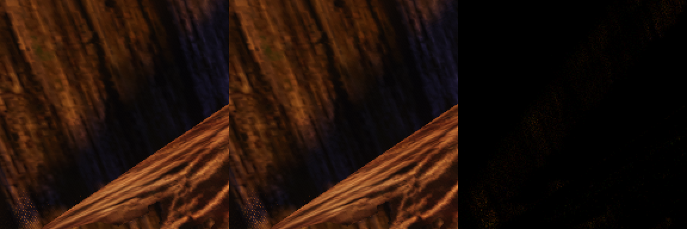
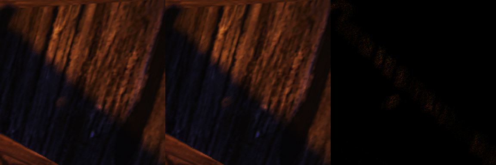
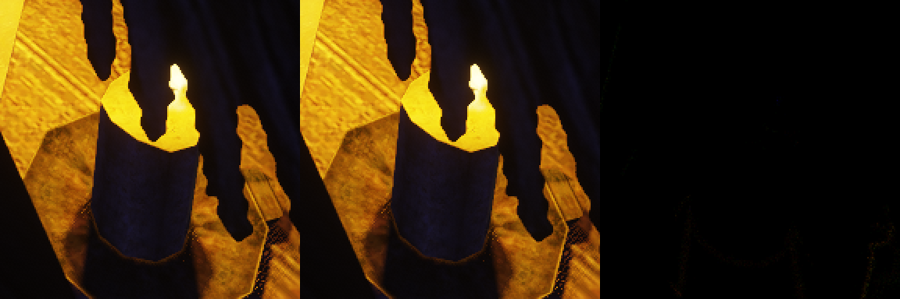
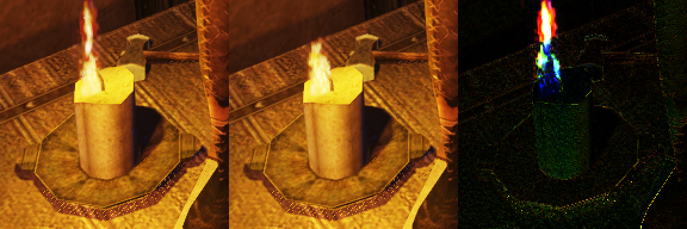

# Шаг 2в, ход 1: цена PCSS ламп на Mac и рычаг «выборки по ширине полутени» (4.11.2026)

Продолжает [исследование](README.md). Узор выборок по кадрам под TAA — следующий ход, здесь его нет.

## Итог

- **Цена фильтра в интерьере — 10–14 мс** интервала энкодера освещения (PCSS минус «жёсткая» тень в одну выборку), а не 7,6 мс, как оценивал шаг 2б. Почти вся она — в видах 3–4 (21–24 мс), где на пиксель приходится 2,5 лампы. В ночной гавани фильтр стоит в пределах шума: лампы освещают 1–5 % кадра.
- **Упор — в число выборок, а не в арифметику плоскости приёмника.** Вариант «flat» (те же выборки, сравнение с глубиной приёмника) не дешевле нынешнего. Цена растёт линейно с числом выборок: ≈1,75 мс на одну лишнюю выборку на пару «лампа — пиксель» в интерьере.
- **Рычаг 1 сделан и включён по умолчанию.** Узкую полутень (до 1,5 текселя) фильтруют 4 выборки вместо 12. Проверку соседней грани ведёт фактический радиус поиска и фильтра, а не наибольший (24 текселя). Цена фильтра в интерьере — 13,7 → 11,4 мс (−16 %), в видах 3–4 — 24,4 → 21,0 и 21,4 → 17,1 мс. В гавани разница в пределах шума.
- **Вид прежний.** Кадры двух прогонов одного кода совпадают до пикселя, так что разница с рычагом формально больше нулевого шума. Она меньше 4 уровней из 255 у 99,9 % пикселей, а больше 8 уровней — у 0,012 % пикселей, на краях теней. Соседние кадры той же неподвижной камеры (100 мс, пламя и мерцание света) отличаются в 25–100 раз сильнее.
- **Цель «втрое дешевле» одним рычагом 1 недостижима.** Даже если бы все доходящие до фильтра пары укладывались в первые 4 выборки, фильтр стоил бы ≈45 % нынешнего: 4 выборки первого поиска получает каждая пара. Третья часть требует сократить и первый поиск — это узор по кадрам под TAA (раздел «Что предлагаю для узора по кадрам»).

## Что добавлено для замера

Всё — через переменные окружения. Без них игра берёт прежний шейдер `light_vsm(_orm).frag`, в котором кода замера нет.

- **`light_vsm_probe(_orm).frag`** — тот же `light.frag` с `-DVSM_LAMP_PROBE`. Игра берёт его, если задана любая из переменных ниже.
- **`OPENGOTHIC_VSM_LAMP=hard`** — «жёсткая» тень: одна выборка `textureGather` в центре, как для `faint`.
- **`OPENGOTHIC_VSM_LAMP=flat`** — выборки прежние, но каждый тексель сравнивается с глубиной приёмника `Pf.z`, без плоскости вдоль луча.
- **`OPENGOTHIC_VSM_LAMP_NARROW=<тексели>`** — порог узкой полутени вместо `OmniNarrow` (1,5); `0` — всегда 12 выборок фильтра, то есть фильтр до рычага.
- **`OPENGOTHIC_VSM_STATS=1`** — к строке страниц VSM раз в 5 с добавляются две строки:
  - `vsm lamp stats` — пары «лампа — пиксель» у фильтра, пиксели, освещённые хоть одной лампой, лампы на пиксель, пары без `faint`, доля выходов после первых 4 выборок (освещено / в тени), выборки на пару, доля выборок с проверкой соседней грани и с чтением из неё;
  - `vsm lamp filter` — гистограмма полутени `filterR` в текселях центра грани (1 — пол, ≤1,5, ≤2, ≤3, ≤6, шире), доля поиска на полу 1,5 текселя и доля пар, которые фильтруют 4 выборки.

  Счётчики считает один кадр из пяти секунд: буфер `LampProbe` (16 счётчиков и метка на пиксель) обнуляется после чтения, и следующий кадр пишет в него атомиками. Остальные кадры счётчиков не трогают.

Разбор интервалов — [`lamp_passes.py`](lamp_passes.py): среднее за кадр энкодеров, в метках которых есть `Point lights`. На Metal это один энкодер `DirectSunLight-VSM | AmbientLight | Point lights | Sky`: солнце VSM, фон и лампы. Сравнение кадров — [`frame_diff.py`](frame_diff.py).

## Цена

M1 Pro, `scripts/perf.sh interior harbour-night`, `PERF_WINDOW=2560x1440`, `OPENGOTHIC_GPU_PASSES=1`, сборка `build-perf`. Окно упирается в экран: drawable — 5120×1918, 9,8 Мпикс, как в шаге 2б. Каждый столбец — среднее по четырём видам места, мс на кадр энкодера освещения. Два прогона каждого варианта, варианты вперемешку.

**Раунд 1** — бинарник до рычага (`19f2f0c6`):

| Вариант | interior, прогоны | interior, среднее | harbour-night, прогоны | harbour-night, среднее |
|---|---|---:|---|---:|
| нынешний PCSS | 22,01 / 22,60 | 22,3 | 5,47 / 4,89 | 5,2 |
| «жёсткая» тень | 13,98 / 9,99 | 12,0 | 6,25 / 4,72 | 5,5 |
| «flat» | 24,17 / 22,66 | 23,4 | 5,42 / 5,32 | 5,4 |
| `-vsm 0` | 5,02 / 5,36 | 5,2 | 3,00 / 2,98 | 3,0 |
| **цена фильтра** (PCSS − жёсткая) | | **10,3** | | **≈0** |

**Раунд 2** — до и после рычага, одной серией:

| Вариант | interior, прогоны | interior, среднее | виды 3 / 4 | harbour-night, среднее |
|---|---|---:|---|---:|
| PCSS до рычага | 23,87 / 25,05 | 24,5 | 35,8 / 33,4 | 4,40 |
| PCSS с рычагом | 21,16 / 23,32 | 22,2 | 32,4 / 29,1 | 4,56 |
| «жёсткая» тень | 9,88 / 11,73 | 10,8 | 11,4 / 12,0 | 4,65 |
| **цена фильтра до** | | **13,7** | 24,4 / 21,4 | ≈0 |
| **цена фильтра после** | | **11,4** (−16 %) | 21,0 / 17,1 | ≈0 |

- **Шум.** Один вариант между прогонами — до 4 мс («жёсткая» тень в раунде 1: 14,0 и 10,0), между раундами — ≈2 мс (PCSS 22,3 и 24,5). Поэтому рычаг сравнивается только внутри раунда 2.
- **Виды 1–2** интерьера (1,5 лампы на пиксель, 80–88 % выходов после 4 выборок): фильтр стоит 1–5 мс.
- **`-vsm 0`** — 5,2 мс. Разница «жёсткой» тени с ним (≈6–7 мс в интерьере) — это солнце VSM и одна выборка ламп, а не фильтр.

Папки (на хранилище — `/Volumes/shared/gothic-ai/lamp-pcss/bench-2026-11-04/`, без `run/`):
- раунд 1: `perf-20261104T124457Z-47917`, `…T124830Z-56900`, `…T125046Z-61228`, `…T125300Z-67498`, `…T125505Z-73068`, `…T125719Z-77732`, `…T125928Z-79995`, `…T130154Z-84834`;
- раунд 2: `…T155237Z-75298`, `…T155533Z-77575`, `…T155759Z-79546`, `…T160225Z-83815`, `…T160645Z-87768`, `…T161059Z-90914`;
- соответствие прогонов вариантам — в `runs.txt` там же.

## Счётчики

Прогоны `perf-20261104T130650Z-95745` (`OPENGOTHIC_VSM_LAMP_NARROW=0`, фильтр до рычага) и `…T131101Z-4778` (рычаг). Строка раз в 5 с: вид определяется по числу пар. Значения обоих прогонов в одном виде совпадают до долей процента, кроме выборок и доли 4 выборок.

| Где | Пары | Ламп на пиксель | Без `faint` | Выход после 4 (освещено / в тени) | Выборок на пару до → после | Фильтр на 4 выборках | Полутень на полу 1 тексель |
|---|---:|---:|---:|---|---|---:|---:|
| interior, лёгкий вид | 3,9 М | 1,54 | 95 % | 88 % (26 / 63 %) | 5,90 → 5,70 | 11 % | 12 % |
| interior, средний | 7,9 М | 1,66 | 89 % | 81 % (46 / 35 %) | 7,08 → 6,51 | 37 % | 52 % |
| interior, тяжёлый (вид 3) | 23,4 М | 2,52 | 94 % | 70 % (64 / 6 %) | 8,75 → 7,69 | 44 % | 78 % |
| interior, тяжёлый (вид 4) | 24,4 М | 2,56 | 92 % | 75 % (53 / 21 %) | 8,00 → 6,81 | 59 % | 75 % |
| harbour-night | 0,07–0,49 М | 1,00–1,09 | 66–86 % | 57–98 % | 10,9 → 7,7 | 56–94 % | 67–93 % |

- **Полутень.** У пар, дошедших до фильтра, в интерьере 75–78 % полутени сидят на полу (`filterR` = 1 тексель центра грани). Шире 3 текселей — 6–9 % в тяжёлых видах и до 40 % в лёгком.
- **Почему на 4 выборки уходит меньше пар, чем лежит на полу.** Порог считается в текселях там, где они мельче всего: тексель у края грани в 1/(1+x²) раз меньше центрального по углу. Пол в 1 тексель центра у края грани — до 2 местных текселей, и такие пары остаются на 12 выборках.
- **Соседняя грань.** С проверкой по фактическому радиусу доля выборок, которые выбирают грань, упала с 15–27 до 7–11 % (первый прогон со счётчиками, `perf-20261104T124102Z-42221`). Из соседней грани читают только 0,5–2 % выборок.
- **Поиск на полу 1,5 текселя** в интерьере не встречается: пламя свечи даёт широкий конус поиска.

## Во что упирается фильтр

- **Не в арифметику плоскости.** «flat» убирает деление и `clamp` на каждый тексель, но цена та же: 23,4 мс против 22,3 мс в раунде 1, в пределах шума.
- **В число выборок.** Цена ложится на прямую:
  - до рычага: 7,75 лишних выборки на пару (8,75 − 1 у «жёсткой») → 13,7 мс, то есть 1,77 мс на выборку;
  - после: ≈6,7 → 11,4 мс, 1,70 мс на выборку.
- **Что внутри выборки — `textureGather` или работа вокруг неё** (`vsmMapDirToFace`, деление `df.xy/df.z`, глубина заслонки `OmniZk/(z4 + OmniZk)` на 4 текселя, смещение и сравнения), этот замер не разделяет: «flat» снимает только плоскость. Для рычагов это не важно — все они уменьшают число выборок.
- **Дешёвый выигрыш в самой выборке почти выбран.**
  - `homeOnly` по фактическому радиусу сделан: проверок соседней грани — вдвое-втрое меньше.
  - Поиск без билинейного веса вряд ли что-то даст: поиск не использует возвращаемый `lit`, и после подстановки функции его вычисление — мёртвый код (SPIR-V до компилятора Metal это не проверялось).

## Рычаг 1

`shader/lighting/light.frag`, `omniShadow`:
- **Узкая полутень.** Если `filterR ≤ OmniNarrow·texel/(1 + x²)`, фильтр — 4 выборки на квадрате радиусом 0,7071·`filterR` с тем же поворотом IGN. Здесь `OmniNarrow` = 1,5, `x` — наибольшая координата приёмника на грани. У 12 выборок по диску тот же второй момент (r²/2). Шире — прежние 12.
- **Порог 1,5 выбран по кадрам.** С порогом 3 (`OPENGOTHIC_VSM_LAMP_NARROW=3`) разница с кодом до рычага вдвое больше: p99.9 до 7 уровней, больше 8 уровней — 0,02–0,05 % пикселей.
- **Проверка соседней грани** — отдельно для поиска (`searchHome`, по `searchR`) и для фильтра (`filterHome`, по `filterR`), раньше — одна по 24 текселям. Множитель — 2,5 вместо 2. Поворот на малый угол сдвигает координату грани до √(1+x²)·√(1+x²+y²) раз сильнее: 2 на середине края, 2,45 в углу. Выборка, которая остаётся на своей грани, в обоих путях читает одно и то же, поэтому расширение `homeOnly` вида не меняет.
- **Поиск заслонок** не сокращён. Вторые 4 выборки поиска получают только пары со смешанным ответом первых четырёх, ≈1,2 выборки на пару в тяжёлых видах. Сократить их — значит изменить оценку d₁/d₂ и ширину полутени, а это уже не «тот же вид»; место им — в узоре по кадрам.

## Вид

`scripts/bench.sh vsm-clips`, Mac, `TEMPEST_WINDOW_SIZE=1920x1080`, `OPENGOTHIC_VSM=1`; кадры 1920×959 (окно упирается в экран). Прогоны `b1` и `b2` — до рычага, `a15` — рычаг, `a3` — порог 3. Разница по наибольшему каналу, 8 бит:

| Кадр | b1 ↔ b2 (шум) | b1 ↔ a15: среднее / p99.9 / макс / >8 | b1 ↔ a3: среднее / p99.9 / >8 | соседний кадр через 100 мс: среднее / p99.9 / >8 |
|---|---|---|---|---|
| interior-1 | 0 | 0,000 / 0 / 7 / 0 % | 0,000 / 0 / 0 % | 0,048 / 2 / 0,001 % |
| interior-2 | 0 | 0,005 / 2 / 31 / 0,003 % | 0,013 / 4 / 0,020 % | 0,512 / 43 / 0,98 % |
| interior-3 | 0 | 0,020 / 4 / 45 / 0,012 % | 0,040 / 7 / 0,046 % | 0,593 / 22 / 0,65 % |
| interior-4 | 0 | 0,022 / 4 / 19 / 0,012 % | 0,034 / 6 / 0,039 % | 0,958 / 23 / 1,09 % |
| harbour-night-1 | 0 | 0,000 / 0 / 2 / 0 % | 0 | 0,271 / 7 / 0,046 % |
| harbour-night-2 | 0 | 0,000 / 0 / 1 / 0 % | 0 | 0,279 / 7 / 0,065 % |
| harbour-night-3 | 0 | 0,000 / 0 / 9 / 0 % | 0 | 0,258 / 5 / 0,017 % |
| harbour-night-4 | 0 | 0,000 / 0 / 5 / 0 % | 0 | 0,228 / 5 / 0,018 % |

- **Шум «код сам с собой» — ноль.** Сценарий детерминирован: тот же сид, то же время, кадры двух прогонов одного бинарника совпадают до пикселя. Формально любой рычаг, который меняет выборки, «больше шума».
- **Второй эталон — соседние кадры одной неподвижной камеры.** Тот же сценарий со вторым кадром через 100 мс (прогон `n1`, бинарник до рычага). Они отличаются пламенем свечи и мерцанием её света по стенам и полу — это и видит глаз. По среднему они отличаются в 25–50 раз сильнее, чем рычаг.
- **Где рычаг меняет картинку.** Только в интерьере, редкими точками на краях теней. Гавань не меняется: там почти все узкие полутени лежат на полу, и 4 и 12 выборок дают одно и то же.
- **Пары с наибольшей разницей**, вырезка 192×192 вдвое крупнее (до | рычаг | разница ×4):
  - interior-3: 
  - interior-4: 
  - interior-2: 
- **Для сравнения — соседний кадр** interior-4 через 100 мс, той же вырезкой: 

Клипы сценария (`harbour-brazier`, `walk-brazier`, `interior-pan`) сняты в тех же прогонах; кадры и клипы — на хранилище, `…/bench-2026-11-04/shots/{b1,a15,b2,a3,n1}`. Пару клипов «сейчас | дёшево» для пользователя собираем после узора по кадрам: он меняет картинку в движении, рычаг 1 — нет.

## Что предлагаю для узора по кадрам

Цель — цена фильтра в интерьере не больше трети нынешней: ≈4,5 мс из 13,7, то есть ≈2,6 лишней выборки на пару против нынешних 7,75 (≈6,7 с рычагом). По счётчикам:

- **Первый поиск — 2 выборки вместо 4**, с поворотом IGN по кадрам. Первые 4 выборки получает каждая пара, и это ≈3 из 6,7 лишних выборок. 70–88 % пар выходят на первом поиске, и для них 2 выборки × 4 текселя = 8 текселей обычно дают тот же ответ. Ошибку на краю за несколько кадров доберёт TAA.
- **Второй поиск — 2 выборки**, а не 4: до него доходят 12–30 % пар.
- **Фильтр** — 4 выборки для узкой полутени, как сейчас, и 6 для широкой вместо 12. Широкой полутени (шире 3 текселей) в тяжёлых видах 6–9 %, и шум там TAA прячет хуже всего; если клипы покажут зерно, 8.
- **Оценка:** 0,7·2 + 0,3·(4 + ≈4,6) ≈ 4,0 выборки на пару, ≈3,0 лишних → ≈5,2 мс, ≈38 % нынешнего. До трети не хватает ≈0,7 мс. Добрать их может:
  - выход после 1 выборки поиска на полу полутени (75 % фильтруемых пар сидят на полу);
  - либо порог узкой полутени в текселях центра грани, а не в местных: ещё ≈20 % фильтруемых пар уйдут на 4 выборки.

  Оба варианта решаются по клипам, а не по стоп-кадрам.
- **Без TAA (`-taa 0`)** — нынешний неподвижный узор и нынешнее число выборок с рычагом 1.

## Проверки

- `~/.codex/checks/gothic/mac-contract.sh "$PWD" gothic-taa-test gothic-vob-layer-test` и сборка `Gothic2Notr` — в итоге хода.
- Ryzen не гонялся (бриф: очередь занята обучением); ограждение «на Ryzen время кадра в пределах шума» — до включения VSM на Mac.
