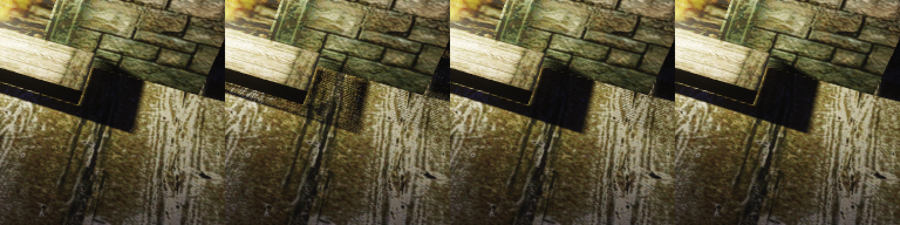
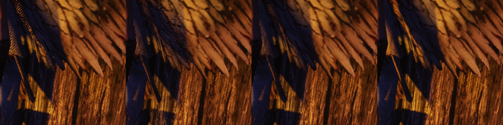

# Шаг 2в, ход 2: почему узор по кадрам не похож на main (5.11.2026)

Разбор к [ходу 2](step-2d/vsm-still.bench) ([ход 1](step-2c.md), [исследование](README.md)). Умолчание `OmniTaa*` (поиск 2+2, фильтр 4/6) не менялось.

## Итог

- **Прошлое ограждение мерило пламя main.** Заморозка света `OPENGOTHIC_LIGHT_FREEZE=1` есть только в ветке. Бинарник main её не знает, и его кадры шли с анимацией радиуса и цвета ламп. Отсюда маска полутени в 42,6 % кадра interior-3: на деле это 4,6 %. Отсюда же «ошибка main на широком столе».
- **Сдвиг в светлую сторону — это ранний выход «всё освещено» по внешнему кольцу поиска (гипотеза 1, да).** Первая ступень берёт 2 внешние выборки (0,79–0,94 `searchR`), не видит заслонку внутри кольца и отдаёт 1,0. В interior-2 запрет этого выхода до конца поиска (`litall`) возвращает контактную тень под полкой: расстояние до истины 5,39 → 2,77, у main 2,69. В interior-3 и interior-4 он снимает только часть сдвига: 7,29 → 4,79 и 7,87 → 5,29, у main 3,64 и 3,88.
- **Зерно и сетка — остаток шума после TAA, а не неверное ожидание узора (гипотеза 3, частично).** Среднее 16 узоров в одном кадре (`expect`) мерцает почти как main (+7…+18 %). Но до истины оно так же далеко, как 2+2/4/6 (interior-2..4: 5,14 / 6,90 / 7,37 против 5,39 / 7,29 / 7,87). Сдвиг сидит в самой оценке, а TAA его не создаёт и не убирает: выход TAA совпадает с ожиданием в среднем и отличается только мерцанием.
- **Постоянные радиусы ни при чём (гипотеза 2, нет).** Радиальный сдвиг по кадрам (`radial`) даёт те же числа, что 2+2/4/6, в пределах 0,05.
- **Main на широких поверхностях не ошибается (гипотеза 4, нет).** С замороженным main он ближе к истине, чем любой вариант: interior-3 — 3,64 против 4,74–17,19. Сетку на тени крыльев interior-4 даёт и сам main — это неподвижный IGN. У истины её нет.
- **Ограждение вида не прошёл ни один вариант:** ни 2+2/4/6, ни 1+1/4/6, ни лучший исправленный (`litall`). Во всех интерьерных кадрах они проваливаются по мерцанию (+28…+285 %), а в interior-2..4 — и по расстоянию до истины, кроме `litall` в interior-2. Поэтому цену исправленного варианта не снимали (пункт 8 брифа).

## Эталон main с замороженным светом

- `OPENGOTHIC_LIGHT_FREEZE` перенесён в бинарник main во временном worktree (`/tmp/lamp-pcss-main`, `cbabc302` плюс та же правка `LightGroup::tick`, без коммита).
- С режимом `still` шейдера замера он совпадает почти до пикселя: среднее 0,000. Отличаются единичные пиксели: до 17 уровней у ≤0,001 % пикселей в гавани, в интерьере не больше 2 уровней.
- Это не «до пикселя», поэтому эталон main — сам бинарник main с заморозкой (`main-fz`; в таблице `main`). Бинарник без заморозки — строка `main-bin`.
- Маска полутени — main с заморозкой против «жёсткой» тени, больше 2 уровней.

## Опыты и переключатели

Все — в шейдере замера `light_vsm_probe`, который включается любой из этих переменных. Его 2+2/4/6 совпадает с бинарником с константами до пикселя.

| Переключатель | Что делает | Гипотеза |
|---|---|---|
| `OPENGOTHIC_VSM_LAMP_EXP=still` | под TAA — неподвижный узор и число выборок main | эталон |
| `…_EXP=inner` | первая ступень поиска берёт внутренние выборки диска Фогеля, а не внешние | 1 |
| `…_EXP=litall` | «всё освещено» засчитывается только после всех выборок поиска; выход «всё в тени» прежний | 1 |
| `…_EXP=radial` | радиус выборки `sqrt((i + ξ)/n)`, ξ — второй IGN, свой на кадр | 2 |
| `…_EXP=expect` | среднее 16 узоров (`taaFrame`…`+15`) в одном кадре | 3 |
| `…_EXP=paths` | путь выхода цветом вместо света: зелёный — освещено после первой ступени, красный — в тени, синий — узкий фильтр, жёлтый — широкий, серый — `faint`; вклады ламп складываются | 1 |
| `OPENGOTHIC_VSM_LAMP=truth` | эталон истины: поиск 32 и фильтр 64 выборки по Фогелю, без ранних выходов, неподвижный узор | 4 |
| `OPENGOTHIC_LIGHT_FREEZE=1` | анимация радиуса и цвета ламп стоит на первом кадре | все |

Флаги `EXP` пишутся через запятую. Сценарий — [`step-2d/vsm-still.bench`](step-2d/vsm-still.bench): выдержка 1,5 с, затем 8 кадров подряд. Последний кадр серии снимается уже после поворота камеры к следующему виду, поэтому разбор берёт первые 7 кадров (6 пар). Разбор — [`why.py`](why.py).

## Таблица

Mac, 1920×1080 (кадр 1920×959), `-vsm 1`, TAA, `OPENGOTHIC_LIGHT_FREEZE=1`. Варианты:
- `main` — бинарник main с заморозкой; `main-bin` — без неё;
- `d6` — 2+2/4/6 (бинарник с константами);
- `a1` — 1+1/4/6 (бинарник с константами);
- остальные — шейдер замера с 2+2/4/6 и флагом `EXP`.

Числа — по маске полутени, 8 бит, наибольший канал: среднее, в скобках доля больше 8 уровней.

Вариант проходит кадр, если:
- до истины он не дальше main плюс мерцание main — шум неподвижной камеры;
- мерцание не больше, чем у main, +10 %.

Маски гавани — меньше 0,05 % кадра (несколько сотен пикселей), их числа шумные. В harbour-night-1 маска пустая, кадр пропущен.

| View | mask, % | variant | to truth (>8) | to main (>8) | flicker | flicker vs main | passes |
|---|---:|---|---:|---:|---:|---:|---|
| interior-1 | 0.6 | main | 0.74 (0.3 %) | 0.00 (0.0 %) | 0.53 | +0 % | yes |
| interior-1 | 0.6 | main-bin | 0.75 (0.3 %) | 0.01 (0.0 %) | 0.53 | +0 % | yes |
| interior-1 | 0.6 | d6 | 0.88 (0.6 %) | 0.96 (0.3 %) | 0.70 | +31 % | **no** |
| interior-1 | 0.6 | a1 | 3.76 (4.2 %) | 3.29 (2.9 %) | 1.36 | +156 % | **no** |
| interior-1 | 0.6 | inner | 1.08 (0.4 %) | 1.41 (0.1 %) | 0.69 | +29 % | **no** |
| interior-1 | 0.6 | litall | 0.84 (0.5 %) | 0.95 (0.2 %) | 0.68 | +28 % | **no** |
| interior-1 | 0.6 | radial | 0.89 (0.6 %) | 0.99 (0.3 %) | 0.70 | +32 % | **no** |
| interior-1 | 0.6 | litall-radial | 0.85 (0.5 %) | 0.97 (0.2 %) | 0.68 | +29 % | **no** |
| interior-1 | 0.6 | expect | 0.93 (0.4 %) | 1.32 (0.2 %) | 0.44 | -17 % | yes |
| interior-2 | 2.7 | main | 2.69 (4.9 %) | 0.00 (0.0 %) | 1.20 | +0 % | yes |
| interior-2 | 2.7 | main-bin | 2.69 (4.8 %) | 0.13 (0.0 %) | 1.21 | +1 % | yes |
| interior-2 | 2.7 | d6 | 5.39 (13.6 %) | 5.04 (12.4 %) | 2.48 | +106 % | **no** |
| interior-2 | 2.7 | a1 | 11.97 (36.9 %) | 11.33 (34.6 %) | 3.19 | +165 % | **no** |
| interior-2 | 2.7 | inner | 3.58 (8.6 %) | 3.90 (9.5 %) | 2.17 | +80 % | **no** |
| interior-2 | 2.7 | litall | 2.77 (5.8 %) | 3.37 (7.9 %) | 1.89 | +57 % | **no** |
| interior-2 | 2.7 | radial | 5.41 (13.7 %) | 5.07 (12.5 %) | 2.49 | +107 % | **no** |
| interior-2 | 2.7 | litall-radial | 2.81 (5.9 %) | 3.46 (8.2 %) | 1.89 | +57 % | **no** |
| interior-2 | 2.7 | expect | 5.14 (13.0 %) | 5.01 (12.5 %) | 1.40 | +16 % | **no** |
| interior-3 | 4.6 | main | 3.64 (6.8 %) | 0.00 (0.0 %) | 1.23 | +0 % | yes |
| interior-3 | 4.6 | main-bin | 5.43 (14.7 %) | 3.17 (7.3 %) | 1.32 | +7 % | **no** |
| interior-3 | 4.6 | d6 | 7.29 (22.8 %) | 6.66 (22.1 %) | 2.88 | +134 % | **no** |
| interior-3 | 4.6 | a1 | 17.19 (56.4 %) | 16.15 (54.5 %) | 4.75 | +285 % | **no** |
| interior-3 | 4.6 | inner | 5.43 (15.5 %) | 5.45 (16.7 %) | 2.51 | +103 % | **no** |
| interior-3 | 4.6 | litall | 4.79 (14.2 %) | 5.08 (15.9 %) | 2.23 | +81 % | **no** |
| interior-3 | 4.6 | radial | 7.31 (22.8 %) | 6.68 (22.2 %) | 2.89 | +134 % | **no** |
| interior-3 | 4.6 | litall-radial | 4.74 (14.1 %) | 5.12 (16.0 %) | 2.23 | +81 % | **no** |
| interior-3 | 4.6 | expect | 6.90 (21.1 %) | 6.48 (21.3 %) | 1.45 | +18 % | **no** |
| interior-4 | 5.9 | main | 3.88 (7.0 %) | 0.00 (0.0 %) | 1.27 | +0 % | yes |
| interior-4 | 5.9 | main-bin | 4.83 (8.0 %) | 1.91 (0.7 %) | 1.33 | +4 % | yes |
| interior-4 | 5.9 | d6 | 7.87 (22.6 %) | 7.60 (23.1 %) | 2.98 | +134 % | **no** |
| interior-4 | 5.9 | a1 | 16.73 (50.3 %) | 15.79 (48.4 %) | 4.43 | +248 % | **no** |
| interior-4 | 5.9 | inner | 5.69 (16.1 %) | 6.14 (17.8 %) | 2.51 | +97 % | **no** |
| interior-4 | 5.9 | litall | 5.29 (15.3 %) | 5.79 (17.3 %) | 2.32 | +82 % | **no** |
| interior-4 | 5.9 | radial | 7.84 (22.6 %) | 7.57 (23.0 %) | 2.99 | +134 % | **no** |
| interior-4 | 5.9 | litall-radial | 5.22 (15.2 %) | 5.80 (17.4 %) | 2.31 | +81 % | **no** |
| interior-4 | 5.9 | expect | 7.37 (20.8 %) | 7.22 (21.3 %) | 1.36 | +7 % | **no** |
| harbour-night-2 | 0.0 | main | 4.08 (8.3 %) | 0.00 (0.0 %) | 1.39 | +0 % | yes |
| harbour-night-2 | 0.0 | main-bin | 0.22 (0.0 %) | 4.15 (8.3 %) | 1.43 | +3 % | yes |
| harbour-night-2 | 0.0 | d6 | 0.24 (0.0 %) | 4.22 (8.3 %) | 1.44 | +3 % | yes |
| harbour-night-2 | 0.0 | a1 | 0.62 (0.6 %) | 4.56 (8.8 %) | 1.56 | +12 % | **no** |
| harbour-night-2 | 0.0 | inner | 0.28 (0.0 %) | 4.27 (8.3 %) | 1.45 | +4 % | yes |
| harbour-night-2 | 0.0 | litall | 0.21 (0.0 %) | 4.18 (8.3 %) | 1.43 | +3 % | yes |
| harbour-night-2 | 0.0 | radial | 0.24 (0.0 %) | 4.19 (8.3 %) | 1.44 | +3 % | yes |
| harbour-night-2 | 0.0 | litall-radial | 0.20 (0.0 %) | 4.18 (8.3 %) | 1.43 | +3 % | yes |
| harbour-night-2 | 0.0 | expect | 0.15 (0.0 %) | 4.13 (8.3 %) | 1.41 | +2 % | yes |
| harbour-night-3 | 0.0 | main | 0.64 (0.0 %) | 0.00 (0.0 %) | 1.50 | +0 % | yes |
| harbour-night-3 | 0.0 | main-bin | 0.91 (0.0 %) | 1.07 (0.0 %) | 1.48 | -1 % | yes |
| harbour-night-3 | 0.0 | d6 | 2.00 (2.2 %) | 2.22 (2.2 %) | 1.64 | +9 % | yes |
| harbour-night-3 | 0.0 | a1 | 6.29 (24.4 %) | 5.93 (24.4 %) | 2.03 | +35 % | **no** |
| harbour-night-3 | 0.0 | inner | 1.36 (0.0 %) | 1.36 (0.0 %) | 1.45 | -3 % | yes |
| harbour-night-3 | 0.0 | litall | 1.16 (0.0 %) | 1.42 (0.0 %) | 1.57 | +5 % | yes |
| harbour-night-3 | 0.0 | radial | 1.62 (2.2 %) | 1.78 (2.2 %) | 1.61 | +7 % | yes |
| harbour-night-3 | 0.0 | litall-radial | 1.24 (0.0 %) | 1.36 (0.0 %) | 1.52 | +2 % | yes |
| harbour-night-3 | 0.0 | expect | 1.02 (0.0 %) | 1.38 (0.0 %) | 1.37 | -9 % | yes |
| harbour-night-4 | 0.0 | main | 1.18 (1.5 %) | 0.00 (0.0 %) | 2.28 | +0 % | yes |
| harbour-night-4 | 0.0 | main-bin | 1.00 (0.7 %) | 0.93 (2.2 %) | 2.34 | +3 % | yes |
| harbour-night-4 | 0.0 | d6 | 1.60 (0.7 %) | 1.80 (1.5 %) | 2.49 | +9 % | yes |
| harbour-night-4 | 0.0 | a1 | 4.29 (12.5 %) | 4.84 (14.7 %) | 2.74 | +20 % | **no** |
| harbour-night-4 | 0.0 | inner | 1.40 (0.0 %) | 2.15 (2.2 %) | 2.48 | +9 % | yes |
| harbour-night-4 | 0.0 | litall | 1.30 (0.0 %) | 1.99 (1.5 %) | 2.43 | +7 % | yes |
| harbour-night-4 | 0.0 | radial | 1.76 (0.7 %) | 2.01 (1.5 %) | 2.46 | +8 % | yes |
| harbour-night-4 | 0.0 | litall-radial | 1.15 (0.0 %) | 1.84 (2.2 %) | 2.39 | +5 % | yes |
| harbour-night-4 | 0.0 | expect | 1.32 (1.5 %) | 1.95 (2.9 %) | 2.33 | +2 % | yes |

## Вырезки

Замороженный main | 2+2/4/6 | `litall` | истина, 192×192 вдвое крупнее, место наибольшей разницы main и 2+2/4/6:

- interior-2, контактная тень под полкой. У 2+2/4/6 в неё сеткой проходит свет, у `litall` она снова тёмная: 
- interior-3: 
- interior-4, тень крыльев на стене. Сетка — у main и у вариантов, у истины её нет: 

## TAA: почему шум не сходится

По коду `shader/antialiasing/taa_resolve.frag` и `common/graphics/renderer.cpp`, `taa.h`:
- **Доля нового кадра `alpha` = 0,1.** Экспоненциальная история гасит дисперсию в α/(2 − α) ≈ 0,053 раза, это ≈19 кадров. Разброс оценки после TAA — ≈0,23 от разброса одного кадра. При 2 выборках поиска с ответом «да / нет» этого мало, отсюда +30…+130 % мерцания против main.
- **Свежие кадры весят больше.** Остаток в кадре — это в основном узор IGN последних 2–3 кадров, а у IGN правильная пространственная структура. Отсюда «правильный узор, а не шум» на тени крыльев.
- **Отсечение по разбросу 3×3 (γ = 1).** Шумная полутень раздувает разброс соседей, поэтому отсечение историю почти не трогает и не мешает усреднению. Шлейф в движении будет держаться дольше — это смотреть в клипах.
- **Периоды.** Сдвиг IGN — 64 кадра (`frame & 63`), дрожание камеры — 8 фаз Halton: они не совпадают, и это не причина.
- `expect` показывает то же: когда 16 узоров усреднены до TAA, мерцание почти как у main, а сдвиг до истины тот же.

## Что предлагаю для следующего круга

1. **Убрать ранний выход «всё освещено» после первой ступени** — без него сдвига в контактных тенях нет (`litall`). Но этот выход даёт большую часть экономии: по счётчикам [хода 1](step-2c.md#счётчики) «всё освещено» после первой ступени — 26–64 % пар в интерьере. С `litall` поиск освещённой пары стоит 4 выборки, как в main. Экономия останется только в фильтре (6 вместо 12) и у пар в тени.
2. **Мерцание.** При поиске в 4 выборки и фильтре 4/6 узор по кадрам всё равно шумит на +57…+82 %. Чтобы попасть в «+10 %», нужно больше выборок на кадр — это съедает выигрыш. Либо сглаживание оценки до TAA, по соседям в пространстве, по глубине и нормали. Это новый приём, ему нужно своё исследование.
3. **Честная оценка.** Под TAA узор по кадрам в этой схеме дешевле main только за счёт ошибок раннего выхода. Без них выигрыш, по оценке из модели «≈1,7 мс на выборку на пару», — порядка 1–3 мс из ≈11, а не втрое. Цену `litall` не мерили. Предлагаю показать пользователю этот разбор и решить:
   - взять рычаг 1 (ход 1, −16 %) как итог шага и включать VSM на Mac с нынешним PCSS;
   - или исследовать полутень в половинном разрешении — README отложил её как меняющую устройство прохода.

## Данные

`/mnt/shared/gothic-ai/lamp-pcss/bench-2026-11-04-turn2/why/`:
- кадры вариантов — по папке на вариант; `main-fz` — main с заморозкой, `main-bin` — без неё;
- пути выхода — `paths-main`, `paths-d6`;
- таблица — `table.md`.
