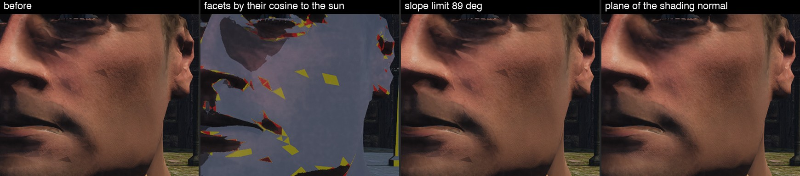
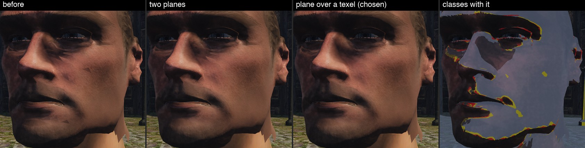
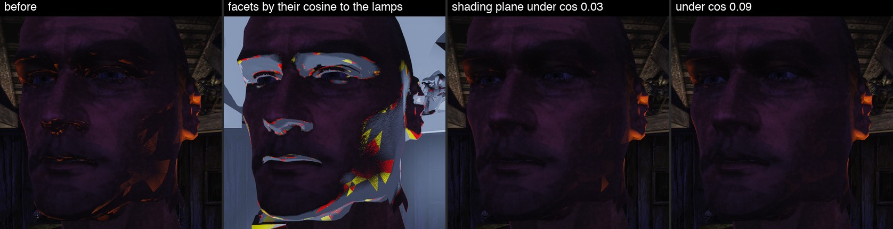
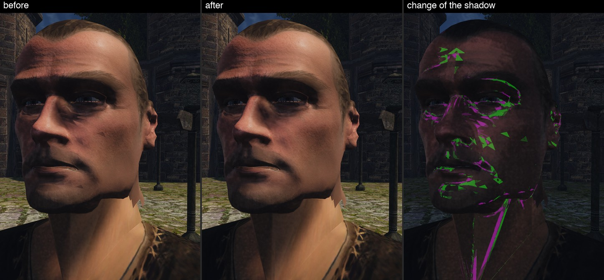
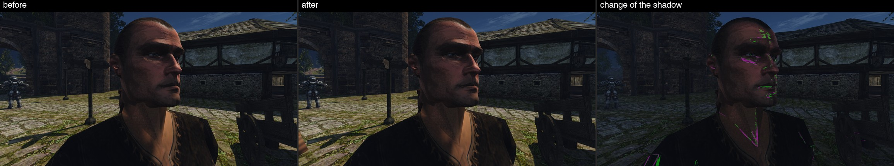
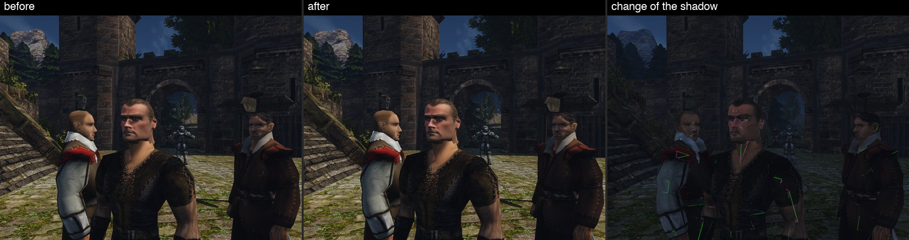
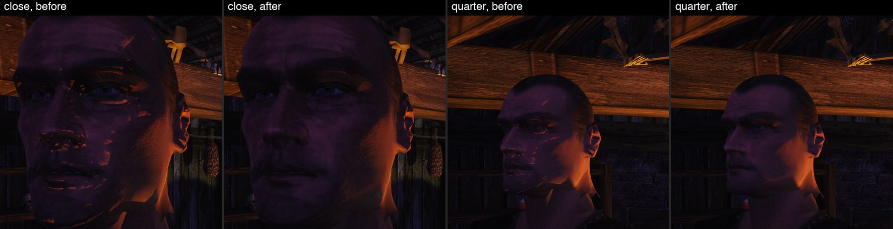
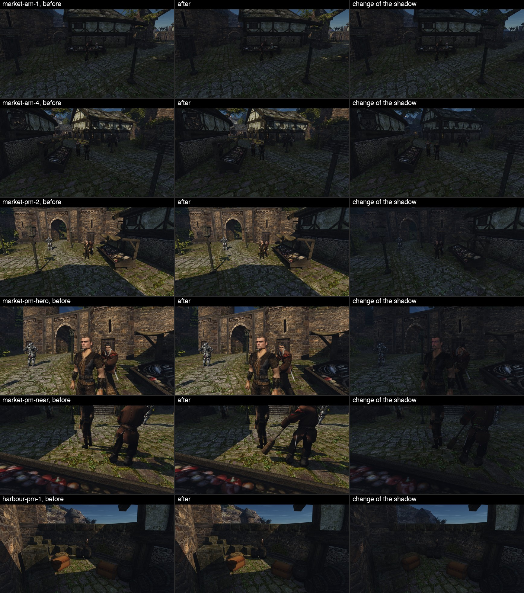
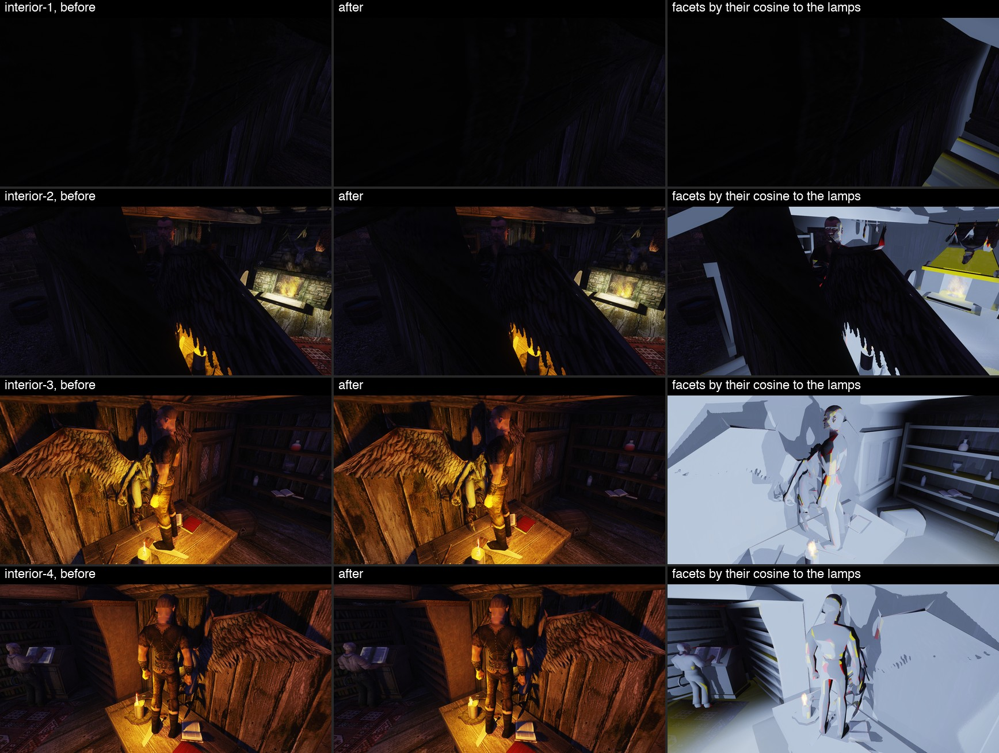

# Осколки тени на плотной сетке (11.11.2026)

На своей голове героя ([конвейер NPC](../../../docs/npc-pipeline.md)) при свете, скользящем по лицу, появлялись острые треугольники размером с грань сетки: тёмные от солнца, светлые оранжевые от свечи. Разбор кожи и прядей показал, что к ним осколки не относятся — это проверка тени. Тени солнца и ламп из VSM — принятые шаги [плана графики](../../../docs/graphics-plan.md), поэтому причина и правка разобраны отдельно.

Пользователь принял вид по парам кадров 2026-11-11.

## Коротко

- **Причина общая для солнца и ламп:** проверка тени сравнивает глубину из карты с плоскостью приёмника, а плоскость берётся от одной грани сетки. У стен и земли грань большая, и плоскость точна. У головы грани мельче ядра фильтра тени, и плоскость одной грани описывает поверхность под ядром неверно.
- **Солнце.** Вблизи камеры тексель карты солнца — 0,5 см, фильтр 4×4 текселя. Медианное ребро грани головы — 0,53 см. Плоскость крутой к солнцу грани, продолженная на соседей, уходит под них, и соседи её затеняют: грань темнеет целиком, с резким краем по своим рёбрам. По той же причине край настоящей тени (от носа, от челюсти на шее) шёл ступенями по граням.
- **Лампы.** У грани, стоящей к лампе ребром или спиной, глубина её плоскости на лучах текселей вырождается в ноль, и каждый тексель читается как «освещено». Сглаженная нормаль такой грани ещё берёт свет лампы, и на тёмной стороне лица загораются треугольники.
- **Правка для солнца:** нормаль плоскости берётся по буферу глубины на шаге в один тексель тени, а не в один пиксель. Где тексель не больше пикселя (всё, что дальше нескольких метров), шаг остаётся в пиксель и ответ прежний по построению.
- **Правка для ламп:** если плоскость грани круче 84° к лампе, берётся плоскость сглаженной нормали.
- **Лицо:** на кадрах `sunface-close` и `candle-close` осколков нет ([лист солнца](3-sun-face.jpg), [лист свечи](7-candle.jpg)).
- **Город при низком солнце:** в четырнадцати видах рынка и гавани правка меняет тень солнца больше чем на десятую у ≤ 0,002 % пикселей, больше чем на пятидесятую — у ≤ 0,08 %. Новых дефектов на парах нет ([лист](8-city-low-sun.jpg)).
- **Цена — 0,17 мс видеокарты на рынке, в интерьере её не видно** (RTX 3080, 1920×1080): проверка солнца стоит 6,9 % времени видеокарты там, где солнце светит на весь кадр, правило ламп — ничего измеримого ([числа](#цена-в-кадре)).

## Цель и приёмка

- **Цель:** на своей голове героя нет треугольников тени размером с грань ни от солнца, ни от лампы; тени мира остаются прежними.
- **Приёмка:**
  - причина подтверждена опытом на кадрах, а не только чтением кода;
  - пары «до | после» лица крупно и на расстоянии разговора, у солнца и у свечи;
  - пары города при низком солнце и интерьера с лампами: нет новых угрей и протечек;
  - для солнца — карта изменения тени, снятая в том же кадре: пары шумят, потому что мир между кадрами не стоит.

## Что было видно

Сцены — как в заметке о коже: рынок Хориниса в полдень, герой лицом к солнцу, камера в 40 см от лица; дом в гавани в 22:00, свеча сбоку и сзади.



Слева — кадр до правки: тёмные треугольники на щеке и у подбородка, рваный край тени у носа. Второй кадр — отладочная окраска `vsm study 4`: грани по косинусу их плоскости к солнцу там, где сглаженная нормаль берёт свет. Красные стоят к солнцу спиной, жёлтые — круче 84°, серо-синие — остальные; тёмный тон значит «проверка ответила: тень». Осколки кадра «до» совпадают с жёлтыми и красными гранями.

## Причина: солнце

Проверка — `vsmSunShadow` в [`vsm_sun_shadow.glsl`](../../../OpenGothic/shader/virtual_shadow/vsm_sun_shadow.glsl). Она берёт 4×4 текселя карты и каждый сравнивает с опорной глубиной, продолженной от приёмника вдоль его плоскости. Нормаль плоскости даёт `depthNormal` в [`direct_light.frag`](../../../OpenGothic/shader/lighting/direct_light.frag): разность позиций соседних пикселей из буфера глубины, то есть плоская нормаль одной грани.

Размеры, из кода и из файла головы:

| величина | значение |
|---|---|
| тексель карты солнца на самом подробном уровне (`Camera::mkViewShadowVsm`, 2048 см на 4096 текселей) | 0,5 см |
| ядро фильтра | 4×4 текселя, до 2 см |
| ребро грани кожи головы, медиана (10-й и 90-й процентили) | 0,53 см (0,17 и 1,5 см); 8360 треугольников |
| тексель на экране при камере в 40 см | около 20 пикселей |
| смещение опорной глубины к солнцу (2/65535 диапазона 512 м) | 1,56 см |

Ядро накрывает три-четыре грани. Плоскость точна только на своей грани. У грани под 85° к солнцу глубина вдоль плоскости меняется на 5–10 см на сантиметр карты. С одной стороны ядра такая плоскость уходит на сантиметры под соседние грани, которые наклонены слабее, и они читаются как заслонка. Грань теряет около половины выборок и темнеет вся: ответ зависит от наклона грани, а он постоянен по ней.

Гипотеза задачи подтвердилась с уточнением: дело не в скользящем свете самом по себе, а в том, что грань мельче ядра фильтра. Опыты, все в одном кадре переключателем стенда (варианты — в коммите `751e176cb` ветки, в итоговом коде остались только нужные):

| вариант | итог |
|---|---|
| плоскость сглаженной нормали везде | осколков нет, край тени ровный — причина в плоскости грани |
| предел наклона плоскости 89° вместо 84° | без изменений — предел ни при чём |
| у грани спиной к солнцу поднять точку над гранью по нормали | осколки на щеке уходят, рваный край тени у носа остаётся |
| тексель освещён, если проходит по плоскости грани или по плоскости сглаженной нормали | осколки уходят, у носа остаются мелкие ступени |
| **нормаль грани на шаге в тексель тени** | осколков нет, край тени ровный; выбран |



Плоскость сглаженной нормали везде не годится как правка: в G-буфере эта нормаль уже с картой нормалей, и на стене с рельефом плоскость наклонялась бы вслед за ним. Поэтому проверка и брала нормаль из глубины.

## Причина: лампы

Проверка — `omniGatherFace` в [`light.frag`](../../../OpenGothic/shader/lighting/light.frag): глубина приёмника на луче каждого текселя — пересечение луча с плоскостью приёмника. Нормаль плоскости — тоже плоская, из производных позиции.

- У грани спиной к лампе луч плоскость не пересекает; глубина зажимается в ноль, и ни один тексель не считается заслонкой.
- У грани почти ребром к лампе плоскость сдвинута к лампе на 0,5 см и тексель (смещение по нормали двусторонней карты), а вдоль луча это сантиметры: при косинусе 0,05 — больше 10 см. У края собственной тени головы заслонка ближе.

Сглаженная нормаль таких граней ещё повёрнута к лампе, а свет рядом с ней сильный, поэтому треугольник горит ярко.



Светлые осколки кадра «до» совпадают с красными и жёлтыми гранями. Плоскость сглаженной нормали для граней с косинусом меньше 0,03 убирает почти все, один остаётся на челюсти; при пороге 0,09 уходит и он.

## Правка

- **Солнце** (`depthNormalWide`, `direct_light.frag`): нормаль плоскости считается по соседям на расстоянии одного текселя тени в пикселях экрана, от 1 до 24.
  - Где поверхность идёт через пиксель гладко, берутся оба соседа по оси, иначе — ближний по глубине, как раньше.
  - Если нормаль на широком шаге расходится с нормалью пикселя больше чем на 60° (тонкая вещь, силуэт внутри шага), остаётся нормаль пикселя.
  - Шаг в один пиксель — прежний код без лишних выборок. Он получается везде, где тексель тени не больше пикселя: тексель выбирается по следу пикселя, так что это всё дальше нескольких метров.
- **Лампы** (`main` в `light.frag`, `OmniFacetMinCos` = 0,1): плоскость грани круче 84° к лампе не читается, берётся плоскость сглаженной нормали. У сетки мира такие грани раньше читались как «всегда освещено».
- **Переключатель для стенда** — команда `vsm study <биты>`, в игре всегда 0:
  - `1` — солнце читает плоскость по одному пикселю, `2` — лампы оставляют плоскость грани; оба как до правки;
  - `4` — классы граней цветом; `8` — где правка меняет тень солнца в этом же кадре: пурпурный темнее, зелёный светлее.
- **Сценарий** — [`facet-shards.bench`](../../../scripts/bench/facet-shards.bench), счёт пар — [`tools/pairs.py`](tools/pairs.py).

Поле `vsmStudy` заняло одно из двух запасных полей блока сцены (`scene.glsl`, `SceneGlobals::UboGlobal`).

## Пары

Солнце, лицо крупно: осколки на щеке и подбородке ушли, край тени у носа и тени челюсти на шее ровный.



Второй ракурс и расстояние разговора (140 см):





Свеча: светлых треугольников на тёмной стороне лица нет, освещённый край щеки остался.



Город при низком солнце (рынок в 7:30 и 17:30, гавань в 17:30). Третий столбец — карта изменения тени; она почти пустая.



Дом в гавани ночью, четыре вида. Третий столбец — классы граней: правило ламп действует только на красных и жёлтых.



## Числа

Карта изменения тени солнца (`vsm study 8`) считается в одном кадре и не шумит. Доля пикселей кадра 1920×1080, где правка меняет тень:

| вид | темнее, > 0,1 солнца | темнее, > 0,02 | светлее, > 0,1 | светлее, > 0,02 |
|---|---|---|---|---|
| лицо, 40 см | 0,26 % | 0,38 % | 0,26 % | 0,29 % |
| лицо, второй ракурс | 0,13 % | 0,17 % | 0,13 % | 0,11 % |
| лицо, 140 см | 0,009 % | 0,07 % | 0,02 % | 0,08 % |
| рынок утром, 4 вида и 2 ближних | ≤ 0,001 % | ≤ 0,02 % | ≤ 0,001 % | ≤ 0,014 % |
| рынок вечером, 4 вида и 2 ближних | ≤ 0,002 % | ≤ 0,025 % | 0 | ≤ 0,05 % |
| гавань вечером, 2 вида | 0 | 0 | 0 | 0 |

«Темнее» на лице — это сдвиг края настоящих теней: он перестал идти по рёбрам граней. В городе изменения — линии на телах NPC рядом с камерой.

Для ламп такой карты нет. Пары «до | после | до» мерят верхнюю границу: доля пикселей, где «после» отличается от обоих «до», пока те совпадают между собой, — 0,003–1,2 % в интерьере при шуме самих «до» 0–3,2 % (NPC и герой шевелятся). Изменения лежат на телах; на стенах и полу их на листах не видно.

## Цена в кадре

Одна сборка, две стороны: `OPENGOTHIC_VSM_STUDY=3` возвращает обе прежние проверки (солнце читает плоскость грани по одному пикселю, лампы её не отбрасывают), `OPENGOTHIC_VSM_STUDY=0` — нынешние. Стенд `scripts/perf.sh`, Ryzen с RTX 3080, окно 1920×1080, свет заморожен, по два повтора на сторону, места `market` (солнце над всем кадром) и `interior` (лампы в доме гавани).

Кадр на обоих местах ждёт процессора (8–9 мс кадр против 2,5 мс видеокарты), поэтому правку прохода видно только в собственном времени видеокарты:

| место | p50 видеокарты, прежняя → нынешняя | Δ мс | Δ % | разброс повторов |
|---|---|---|---|---|
| market | 2,471 → 2,640 мс | +0,169 | +6,9 % | 0,065 мс |
| interior | 2,532 → 2,524 мс | −0,008 | −0,3 % | 0,077 мс |

Повторы не перекрываются: на рынке 2,422 и 2,487 мс против 2,623 и 2,663 мс. В интерьере разница меньше разброса, то есть правило ламп в кадре не стоит ничего измеримого — оно добавляет одно скалярное произведение на пару «лампа — пиксель».

Рыночные 0,17 мс — это четыре лишние выборки глубины на пиксель, и только там, где тексель тени больше пикселя, то есть в первых метрах от камеры. Место выбрано худшим из обычных: солнце в кадре целиком и близкая геометрия. FPS и p95 кадра на рынке тоже разошлись (120,5 → 112,4), но сильнее, чем позволяет время видеокарты: сторона «нынешняя» снималась, когда в очереди Ryzen стояло девять заявок, и эта разница — загрузка машины, а не правка.

Воспроизвести:

```
NO_BUILD=1 BENCH_HOST=ryzen PERF_WINDOW=1920x1080 PERF_REPEAT=2 \
  PERF_ENV='OPENGOTHIC_VSM_STUDY=3 OPENGOTHIC_LIGHT_FREEZE=1' scripts/perf.sh market interior
NO_BUILD=1 BENCH_HOST=ryzen PERF_WINDOW=1920x1080 PERF_REPEAT=2 \
  PERF_ENV='OPENGOTHIC_VSM_STUDY=0 OPENGOTHIC_LIGHT_FREEZE=1' scripts/perf.sh market interior
python3 scripts/perf_report.py compare <папка STUDY=3> <папка STUDY=0>
```

## Ограничения и что не сделано

- **По проходам не разложено:** пара прогонов с `OPENGOTHIC_GPU_PASSES=1` не снята, очередь Ryzen была занята (девять заявок, ожидание в часах). Со стороны солнца правка одна, поэтому 0,17 мс относятся к ней без разбора проходов.
- **Mac не проверялся.** VSM на Mac по умолчанию выключен; шейдеры проверены сборкой для Vulkan.
- **Настоящее самозатенение складок остаётся.** Грани в вогнутой складке затеняют друг друга по геометрии; на кадрах лица таких осколков не осталось, но правка их не исключает.
- **Широкий шаг у края предмета.** Рядом с силуэтом ближе текселя берётся сосед с одной стороны; на парах дефектов от этого нет, отдельно не мерялось.
- **Прямой проход не тронут:** вода, полупрозрачное и частицы берут плоскость из производных позиции, как раньше.
- **Ночная гавань** (жаровня и два общих вида) в этом прогоне вышла почти без света ламп в кадре; правило ламп там оценено только числом: до 0,05 % пикселей.
- **Съёмка шла на движке `main`** с контентом `hero-head-3a-skin1-nogroom`: кожа с картой нормалей, без прядей. Ветка кожи и прядей влита (#1221) после этой съёмки: поля блока сцены разошлись сами — `vsmStudy` и `viewFlags` стоят рядом в `scene.glsl` и `sceneglobals.h` в одном порядке, разводить нечего. Пары с прядями не переснимались.

## Как повторить

```
C=~/.local/share/gothic-ai/content-tests/hero-head-3a-skin1-nogroom
TEMPEST_WINDOW_SIZE=1920x1080 OPENGOTHIC_LIGHT_FREEZE=1 BENCH_HOST=ryzen OPENGOTHIC_CONTENT=$C \
  scripts/bench.sh facet-shards <папка>
server/.venv/bin/python reports/render-features/2026-11-11-facet-shards/tools/pairs.py <папка> <папка листов>
```

Полные кадры трёх прогонов лежат вне git на Mac: `~/.local/share/gothic-ai/render/facet-shards/` (`study1`, `study2` — опыты, `final1` — итог). Листы заметки собраны `tools/sheet.py`.
