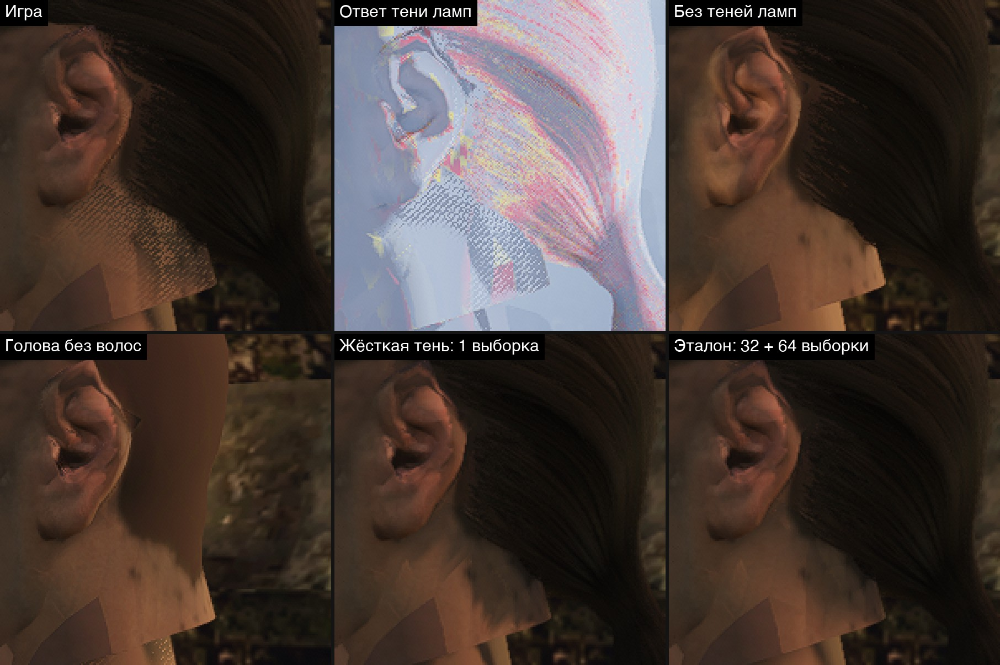
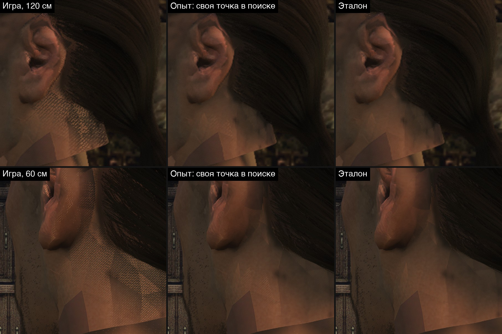
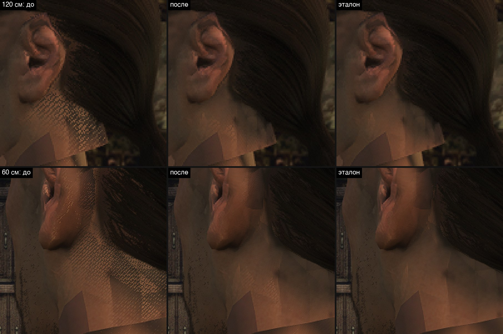
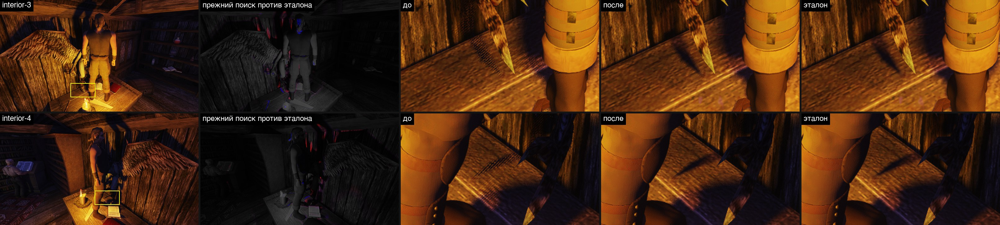

# Сетка точек в тени лампы под волосами (14.11.2026)

На кадре своей головы героя при факеле ([лист похожести и игра](../../content/2026-11-npc-pipeline/likeness.md#blender-и-игра-почему-голова-выглядит-по-разному-2026-11-14)) кожа затылка под хвостом покрыта мелкой частой сеткой тёмных и светлых точек. В карте кожи её нет, Cycles с той же картой её не рисует, при солнце на том же месте её нет. Пользователь 2026-11-14: «да, давай разберем».

Разбор причины и правка. Тени ламп — принятый шаг [плана графики](../../../docs/graphics-plan.md), поэтому сначала был только разбор. Пользователь по нему: «мы можем исправить?» — правка сделана тем же днём, раздел [«Правка в игре»](#правка-в-игре).

## Коротко

- **Сетку рисует фильтр мягкой тени лампы.** Не карта кожи, не пряди в кадре и не сглаживание по времени: без теней ламп затылок ровный, без сглаживания сетка остаётся.
- **Тень на затылке настоящая:** её бросают пряди хвоста. С головой без волос затылок освещён; с эталонным фильтром (32 + 64 выборки) на этом месте ровная мягкая тень.
- **Шумит поиск заслона.** Первый шаг фильтра читает четыре выборки в 5–12 см от точки и, если они пусты, считает точку освещённой, не посмотрев прямо над ней. Заслон мельче этого круга и вплотную к поверхности — волосы над кожей — выборки то задевают, то нет.
- **Сетка — потому что выборки повёрнуты по шуму пикселя,** и поворот от кадра к кадру не меняется. Соседние пиксели получают «освещено» и «в тени» вперемешку, и узор стоит на месте: восемь кадров за 2,4 с совпадают на 99 %.
- **Причина подтверждена вмешательством.** Опыт `own` добавляет в первый шаг четыре текселя самой точки. Зерно на затылке падает с 0,231 до 0,034 (эталон — 0,027), а кадр совпадает с эталоном: больше чем на 8 уровней отличаются 0,0003 % пикселей со 120 см и 0,0045 % с 60 см.
- **Правка в игре:** первый шаг поиска читает и тексели самой точки. В башне от эталона отличаются 0,001 % и 0,007 % пикселей вместо 0,039 % и 0,368 %, в доме гавани — 0,07–0,09 % вместо 0,31–0,40 %; ночная гавань не меняется. Цена — 0,05–0,14 мс видеокарты на кадр (+2–4 %) в 1440p на RTX 3080.

## Что видно

Башня Ксардаса, герой в профиль со 120 см и из-за уха с 60 см, окно 3840×2160, Ryzen (Vulkan, VSM, мягкие тени ламп). Сценарий — [`tools/lamp-stipple.bench`](tools/lamp-stipple.bench).



*Один и тот же участок кадра 200×200 пикселей, увеличен втрое без сглаживания. «Ответ тени ламп» — отладочный вид `vsm study 4`: цвет грани и ответ тени (тёмное — в тени, светлое — освещено), без текстур.*

- **Игра:** на затылке под хвостом и за ухом — частая косая сетка. Границы пятен сетки прямые: это края граней шеи головы и воротника тела под срезом.
- **Ответ тени ламп:** та же сетка в самом ответе тени. Свет, текстуры и материал кожи ни при чём.
- **Без теней ламп** (`OPENGOTHIC_VSM=0`): затылок ровный и светлый. Видны отдельные тёмные точки у линии волос — они стоят в карте кожи ([разбор](../../content/2026-11-npc-pipeline/likeness.md#blender-и-игра-почему-голова-выглядит-по-разному-2026-11-14)), к сетке не относятся.
- **Голова без волос:** затылок освещён и ровный. Значит, тень на нём — от прядей.
- **Жёсткая тень** (одна выборка): сетки нет, тень рваная, ступенями по 10 пикселей кадра. Пиксель кадра на голове — 0,74 мм, значит тексель карты теней — около 0,7 см.
- **Эталон** (32 выборки поиска и 64 фильтра, без ранних выходов): ровная мягкая тень. Карта теней верная — шумит оценка по ней.

Числа — на коже затылка, прямоугольник 56×50 пикселей кадра со 120 см ([`tools/stipple.py`](tools/stipple.py)). Зерно — среднее отклонение пикселя от среднего по его клетке 3×3, в долях средней яркости; яркость линейная, 0–1.

| Вариант | Переключатель | Зерно | Яркость |
|---|---|---|---|
| Игра | — | 0,231 | 0,053 |
| Тот же узор в шейдере замера | `OPENGOTHIC_VSM_LAMP_EXP=still` | 0,231 | 0,053 |
| Без сглаживания по времени | `OPENGOTHIC_TAA=0` | 0,207 | 0,052 |
| Узор выборок меняется по кадрам | `OPENGOTHIC_VSM_LAMP_TAA=1` | 0,105 | 0,072 |
| Грани ламп хранят только дальнюю сторону | `OPENGOTHIC_VSM_LAMP_SIDES=1` | 0,067 | 0,077 |
| Жёсткая тень | `OPENGOTHIC_VSM_LAMP_SOFT=0` | 0,032 | 0,040 |
| Эталон | `OPENGOTHIC_VSM_LAMP=truth` | 0,027 | 0,041 |
| Опыт: своя точка в поиске | `OPENGOTHIC_VSM_LAMP_EXP=still,own` | 0,034 | 0,042 |
| Голова без волос | контент без `groom` | 0,027 | 0,090 |
| Без теней ламп | `OPENGOTHIC_VSM=0` | 0,025 | 0,085 |

Что из них следует:

- **Не сглаживание и не хешированная альфа волос.** Без TAA хеш выключен, а сетка остаётся: 0,207. С TAA зерно даже выше — вероятно, от его резкости (0,75); отдельно это не проверялось.
- **Узор стоит.** В серии из восьми кадров через 0,3 с ([`tools/lamp-stipple-series.bench`](tools/lamp-stipple-series.bench)) зерно 0,30–0,31, кадры совпадают с первым на 0,985–0,994 (корреляция яркости на том же прямоугольнике). С замороженным мерцанием факела (`OPENGOTHIC_LIGHT_FREEZE=1`) — те же числа. В серии зерно выше, чем в таблице (0,23): голова там стоит на пиксель в стороне, и прямоугольник накрывает чуть другую кожу.
- **Игра светлее эталона на 28 %:** 0,053 против 0,041. Сетка — это пиксели, которые фильтр ошибочно считает освещёнными.
- **Узор по кадрам сетку не лечит.** Зерно падает вдвое, но затылок светлеет до 0,072 при 0,041 у эталона: свет протекает в тень. Тот же итог был в [разборе 5 ноября](../2026-11-04-lamp-pcss/step-2d-why.md), поэтому этот режим и выключен.
- **С гранями «только дальняя сторона» тени прядей на затылке нет вовсе** (0,077 — почти как без теней): лента пряди повёрнута к лампе лицом, и такая грань её не хранит. Это не правка: так возвращаются протечки света сквозь односторонние поверхности, исправленные [10](../2026-11-10-lamp-one-sided/README.md) и [11 ноября](../2026-11-11-lamp-objects-two-sided/README.md).

## Причина

Тень лампы считает `omniShadow` в [`light.frag`](../../../OpenGothic/shader/lighting/light.frag): поиск заслона, по нему ширина полутени, затем фильтр. Сетку дают три вещи вместе.

**1. Поиск смотрит далеко от точки и редко.** Радиус поиска — `2·S/dist` от лампы, где `S` — размер пламени. На поверхности это круг радиусом `2·S`: 12 см при пламени 6 см (умолчание), на каком бы расстоянии ни стояла лампа. Радиус рассчитан на заслон в пятой части пути от лампы. Первый шаг берёт четыре выборки из восьми, на 0,43–0,97 радиуса, то есть в 5–12 см от точки; каждая читает четыре текселя. Если все шестнадцать пусты, точка считается освещённой, и остальные выборки не читаются. Саму точку первый шаг не читает.

**2. Заслон мелкий и лежит вплотную.** Пряди бросают тень лентами по 2 мм ([`vertex_process.glsl`](../../../OpenGothic/shader/materials/vertex_process.glsl), `strandShadowRibbon`), а тексель карты лампы у головы — около 0,7 см: грань куба не больше 512 текселей, и по разметке страниц тексель не мельче четырёх пикселей кадра. Лента тоньше текселя ложится в карту пунктиром. Хвост и волосы у края причёски у́же круга поиска, поэтому четыре выборки то попадают в них, то нет. Попали — фильтр доходит до точки и даёт тень. Не попали — «освещено».

**3. Выборки повёрнуты по шуму пикселя, и поворот не меняется по кадрам.** Угол берётся из `interleavedGradientNoise` по координате пикселя. У соседних пикселей углы разные, поэтому «попали» и «не попали» чередуются от пикселя к пикселю, косыми рядами этого шума. Пиксель примерно в десять раз мельче текселя тени, поэтому сетка частая. По кадрам угол тот же, и сглаживание по времени усредняет одинаковые кадры.

При солнце сетки нет: у фильтра солнца нет ни поиска с ранним выходом, ни поворота выборок — 4×4 текселя вокруг точки. На Mac её быть не должно: VSM там по умолчанию выключен, а с `-vsm 1` тени ламп жёсткие, в одну выборку. На Mac не снималось.

Вид путей фильтра (`OPENGOTHIC_VSM_LAMP_EXP=still,paths`) это поддерживает, но не доказывает: у тёмных пикселей сетки красный канал выше, чем у светлых (224 против 198 — они дошли до фильтра), но в кадре складываются цвета нескольких ламп, и по ним путь одной лампы не прочитать. Доказательство — опыт ниже.

## Опыт: своя точка в поиске

В шейдер замера (`light_vsm_probe`) был добавлен опыт `own` к `OPENGOTHIC_VSM_LAMP_EXP`: первый шаг поиска читает ещё четыре текселя самой точки. «Освещено» значит, что пусты и они. В игре этот шейдер не работает, он включается только переменными замера. С правкой в игре опыт из кода убран: то, что он делал, стало поведением игры.



- **Сетки нет**, тень под хвостом и за ухом ровная и мягкая, как у эталона. Зерно 0,231 → 0,034, яркость 0,053 → 0,042 (эталон 0,027 и 0,041).
- **Кадр совпадает с эталоном.** Кадры разных прогонов повторяются: игра и её узор в шейдере замера с 60 см совпадают до пикселя, со 120 см расходятся не больше чем на 5 уровней. Поэтому сравнение точное:

| Пара | Вид | Отличаются больше чем на 8 уровней | Больше чем на 24 |
|---|---|---|---|
| Игра → опыт | 120 см | 0,030 % пикселей | 0,005 % |
| Опыт → эталон | 120 см | 0,0003 % | 0 |
| Игра → опыт | 60 см | 0,354 % | 0,064 % |
| Опыт → эталон | 60 см | 0,0045 % | 0 |

- **Меняется не только затылок.** Та же сетка была на спине героя под воротом и по краю тени факела на стене; у основания колонны свет протекал на камень. С опытом эти места ровные и темнее. Все изменения — в тёмную сторону, остальной кадр прежний.
- **Остаток:** в маленьком треугольнике шеи у воротника слабая сетка видна и с опытом, и на голове без волос. Пряди тут ни при чём; откуда она, не разбиралось.

## Правка в игре

Первый шаг поиска заслона в `omniShadow` ([`light.frag`](../../../OpenGothic/shader/lighting/light.frag)) читает пять выборок: четыре прежние и тексели самой точки. «Освещено» значит, что пусты все двадцать текселей, «в тени» — что все двадцать закрыты. Остальной фильтр прежний.

- Прежний поиск возвращает команда стенда `vsm study 16`, на весь прогон — `OPENGOTHIC_VSM_STUDY=16`.
- Жёстких теней ламп (умолчание на Metal) правка не касается: там и так одна выборка по самой точке.
- Тени солнца считает другой шейдер, их правка не трогает.

### Вид

Сценарий [`tools/lamp-own.bench`](tools/lamp-own.bench), окно 2560×1440, Ryzen, свет заморожен. Каждый вид снят трижды одной камерой: прежний поиск, нынешний, снова прежний. Эталон — тот же прогон с `OPENGOTHIC_VSM_LAMP=truth`.

Мир между снимками одного вида не стоит: пламя, дым, дыхание героя. Зато два прогона повторяют друг друга снимок в снимок, поэтому каждый снимок сравнивается с эталонным снимком того же момента ([`tools/own_pairs.py`](tools/own_pairs.py)).





*Во второй колонке синее — игра светлее эталона, красное — темнее. Жёлтая рамка на кадре — место, увеличенное справа.*

Доля пикселей кадра, которые отличаются от эталона больше чем на 8 уровней из 255:

| Вид | Контент | До | После | Снова до |
|---|---|---|---|---|
| Башня, затылок со 120 см | мир оригинала, голова 3a | 0,039 % | 0,001 % | 0,040 % |
| Башня, из-за уха с 60 см | мир оригинала, голова 3a | 0,368 % | 0,007 % | 0,376 % |
| Дом в гавани, вид 2 | мир оригинала, голова 3a | 0,064 % | 0,045 % | 0,063 % |
| Дом в гавани, вид 3 | мир оригинала, голова 3a | 0,272 % | 0,085 % | 0,264 % |
| Дом в гавани, вид 4 | мир оригинала, голова 3a | 0,340 % | 0,105 % | 0,338 % |
| Дом в гавани, вид 3 | игровой | 0,404 % | 0,065 % | 0,404 % |
| Дом в гавани, вид 4 | игровой | 0,312 % | 0,093 % | 0,360 % |
| Жаровня гавани, полночь | игровой | 0,637 % | 0,688 % | 0,704 % |
| Гавань в полночь, четыре вида | игровой | ≤ 0,001 % | 0 | 0 |

- **Башня:** сетки на затылке и за ухом нет, тень как у эталона.
- **Дом в гавани:** та же сетка была на тени пера на столе, у сапога и на руке героя, по краю тени балки. С правкой тень ровная. Остаток после правки (0,05–0,1 %) — зерно по краям широких полутеней: там 12 повёрнутых выборок фильтра против 64 у эталона. Оно было и до правки, это известное ограничение фильтра ([разбор 5 ноября](../2026-11-04-lamp-pcss/step-2d-why.md)).
- **Гавань ночью не меняется.** У жаровни все три числа одинаковы: это дым и огонь, частицы между прогонами не повторяются. В четырёх ночных видах ламп в кадре почти нет.
- **Вид 1 дома** смотрит в тёмную стену, отличий нет ни до, ни после. **Вид 2 с игровым контентом** в таблицу не вошёл: 1,2 % во всех трёх колонках — огонь и дым очага.
- **Остаток у воротника.** В маленьком треугольнике шеи слабая сетка видна и после правки, у эталона её нет. Это шум узкого фильтра из четырёх выборок, а не поиска; причина не разбиралась.

### Цена в кадре

Одна сборка, две стороны: `OPENGOTHIC_VSM_STUDY=16` — прежний поиск, `0` — нынешний. Стенд `scripts/perf.sh`, Ryzen с RTX 3080, окно 2560×1440, свет заморожен, по два повтора на сторону, места `interior` (дом в гавани) и `harbour-night`.

Кадр на обоих местах ждёт процессора (8,4 мс кадр против 2,5–4,3 мс видеокарты), поэтому цена видна в собственном времени видеокарты:

| Место, вид | Видеокарта, среднее: прежний → нынешний | Δ мс | Δ % | Повторы: прежний / нынешний |
|---|---|---|---|---|
| interior, вид 1 | 2,482 → 2,531 мс | +0,049 | +2,0 % | 2,491 и 2,473 / 2,543 и 2,519 |
| interior, вид 2 | 2,807 → 2,875 мс | +0,068 | +2,4 % | 2,797 и 2,817 / 2,873 и 2,878 |
| interior, вид 3 | 4,145 → 4,269 мс | +0,124 | +3,0 % | 4,130 и 4,160 / 4,262 и 4,277 |
| interior, вид 4 | 3,895 → 4,037 мс | +0,143 | +3,7 % | 3,882 и 3,907 / 4,031 и 4,044 |
| harbour-night, вид 1 | 2,350 → 2,470 мс | +0,120 | +5,1 % | 2,373 и 2,327 / 2,533 и 2,409 |
| harbour-night, вид 2 | 2,527 → 2,604 мс | +0,077 | +3,1 % | 2,566 и 2,489 / 2,584 и 2,623 |
| harbour-night, вид 3 | 2,795 → 2,846 мс | +0,052 | +1,8 % | 2,770 и 2,820 / 2,866 и 2,827 |
| harbour-night, вид 4 | 2,626 → 2,696 мс | +0,070 | +2,7 % | 2,635 и 2,617 / 2,708 и 2,685 |

- **Повторы сторон не перекрываются ни в одном виде.** В среднем по месту: интерьер 3,291 → 3,386 мс (+0,095, +2,9 %), ночная гавань 2,562 → 2,644 мс (+0,082, +3,2 %).
- **Это пятая выборка глубины** на каждую пару «лампа — пиксель», дошедшую до поиска. Дороже всего виды, где лампы освещают большую часть кадра (виды 3 и 4 дома).
- **FPS:** интерьер 119,7 → 118,8, ночная гавань 119,4 → 116,1. В гавани это больше, чем даёт прибавка видеокарты (0,08 мс при кадре 8,4 мс — 1 %): кадр ждёт процессора, и в разнице FPS есть шум стенда.
- Ночная гавань на стенде — с лампами оригинала: слоя света игрового контента на Ryzen нет.
- Если цена окажется важна, можно заменить своей точкой одну из четырёх дальних выборок вместо добавления пятой. Не проверялось.

Замер снят на отдельной копии стенда. Общий стенд `perf-stand` на Ryzen делят сессии, и между загрузкой, сборкой и прогоном в нём дважды оказался движок другой сессии. Признаки своей сборки: строка `vsm: study bits = 16` в журнале стороны «прежний» (движок без правки обрезает биты до 15) и одна контрольная сумма бинарника у обеих сторон.

### Что не покрыто

- **Mac не снимался.** VSM там по умолчанию выключен, а с `-vsm 1` тени ламп жёсткие — правка их не касается. С мягкими тенями на Mac (`vsmLampSoft=1`) цена не снята.
- **Приёмка вида — за пользователем.** Правка сводит кадр к эталону на 64 выборках, но эталон — это более тёмные мелкие тени при лампах во всей игре.
- Узор выборок по кадрам, жёсткая тень и грани «только дальняя сторона» как замена не годятся (таблица вариантов выше). Более широкие ленты прядей в картах ламп не проверялись.

## Как повторить

Разбор причины:

```bash
TEMPEST_WINDOW_SIZE=3840x2160 BENCH_HOST=ryzen OPENGOTHIC_CONTENT=<контент головы> \
  scripts/bench.sh reports/render-features/2026-11-14-lamp-stipple/tools/lamp-stipple.bench .bench/clean-base
```

Варианты — тот же прогон с переключателем из таблицы в папку `.bench/clean-<вариант>` (`still`, `own`, `truth`, `hard`, `nohair`, `notaa`, `lamptaa`, `novsm`, `sides1`). Контент головы 3a — `~/.local/share/gothic-ai/mpfb/work/build/hero-3a/content`; «без волос» — его копия без строки `groom` в `characters.json`. Вариант `own` снимался опытом, которого в коде больше нет: с правкой это сама игра, а прежний поиск — вариант `base` с `OPENGOTHIC_VSM_STUDY=16`. Листы и числа:

```bash
~/.local/share/gothic-ai/mpfb/venv/bin/python reports/render-features/2026-11-14-lamp-stipple/tools/stipple.py .bench reports/render-features/2026-11-14-lamp-stipple
```

Пары правки (второй прогон каждой пары — с `OPENGOTHIC_VSM_LAMP=truth`; игровой контент — `~/.local/share/gothic-ai/content`):

```bash
TEMPEST_WINDOW_SIZE=2560x1440 OPENGOTHIC_LIGHT_FREEZE=1 BENCH_HOST=ryzen OPENGOTHIC_CONTENT=<контент> \
  scripts/bench.sh reports/render-features/2026-11-14-lamp-stipple/tools/lamp-own.bench .bench/own-game
```

```bash
~/.local/share/gothic-ai/mpfb/venv/bin/python reports/render-features/2026-11-14-lamp-stipple/tools/own_pairs.py .bench/own-game .bench/own-truth reports/render-features/2026-11-14-lamp-stipple
```

Лист интерьера — те же два прогона с игровым контентом и виды в конце команды: `own_pairs.py .bench/own-game-full .bench/own-truth-full <папка> interior-3 interior-4`.

Цена (вторая сторона — `OPENGOTHIC_VSM_STUDY=0` и `NO_BUILD=1`; перед тем как верить числам, проверить строку `vsm: study bits = 16` в `game.log` первой стороны):

```bash
PERF_WINDOW=2560x1440 PERF_REPEAT=2 BENCH_HOST=ryzen PERF_ENV='OPENGOTHIC_VSM_STUDY=16 OPENGOTHIC_LIGHT_FREEZE=1' scripts/perf.sh interior harbour-night
```

## Ограничения

- Разбор причины — одна сцена, одна голова, два вида. Правка снята в одиннадцати видах: башня, дом в гавани, ночная гавань. Город днём не снимался: тени солнца считает другой шейдер. Сетка на веке у свечи из [заметки о волосах](../../content/2026-11-npc-hair/README.md) не проверялась; по описанию она того же рода.
- На Ryzen без игрового контента лампы гавани не горят: слой света лежит в контенте, а папки контента по умолчанию там нет. Первый прогон пар гавани вышел тёмным и переснят с `OPENGOTHIC_CONTENT` с Mac.
- Размер пламени факелов башни взят по умолчанию (6 см); слой мира его не проверялся.
- **Первая партия кадров была снята неверно.** Кадр команды `shot` берётся через несколько кадров после неё, а переключатель в сценарии стоял сразу за ней — кадры вышли с уже переключённым режимом и смесью с историей сглаживания. Зерно «игры» по ним было 0,107 вместо 0,23–0,31. Вся таблица пересчитана по второй партии, где после `shot` стоит `wait`.
