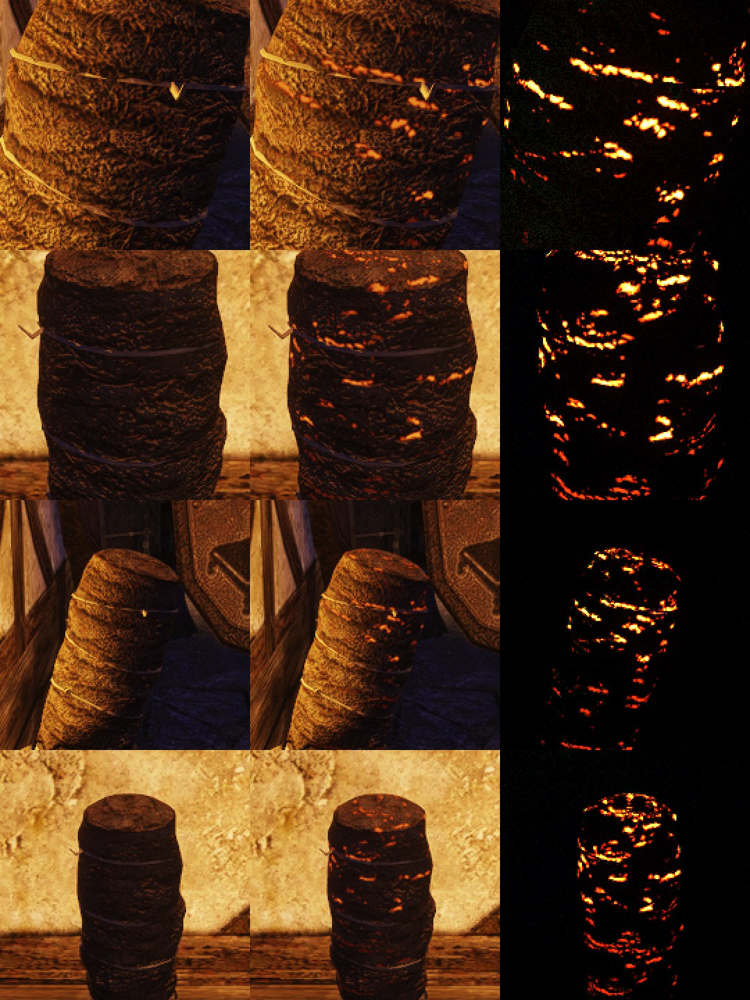

# Ночь и интерьеры: исследование перед первым шагом

Статус: исследование, 2026-11-15; [шаг 0](#шаг-0-сделано-2026-11-15) сделан в тот же день. Пункт 1 [порядка по отдаче](../../../docs/graphics-plan.md#порядок-по-отдаче): окна светятся по времени суток, лампы светят в воздухе, контактные тени. Пользователь сказал начинать («Да, начинай»). В самом исследовании кода нет; правка шага 0 описана в конце.

Источники: аудит кода движка (ссылки на файлы ниже), два обзора открытых источников (ссылки в тексте). Где число — оценка, а не измерение, это сказано.

## Коротко

- **Сначала чинить.** Свечение своих материалов на ПК по умолчанию не рисовалось: его добавлял только `ambient_light.frag`, а с GI-пробами работает `probe_ambient.frag`, где этой добавки не было. Подтверждено в кадре и исправлено — [шаг 0](#шаг-0-сделано-2026-11-15).
- **Окна — первый и самый заметный шаг.** Настоящее окно ночью тусклое: на 3–7 ступеней ярче стены под луной. Механизм свечения у нас есть, но сделан под угли; ему нужен режим окна, кривая по времени суток и маски в текстурах окон.
- **Контактные тени — второй шаг, начать с замера.** Тени солнца у нас уже с текселем 0,5 см вблизи. Разрыв ожидается у ламп и у травы; где он на деле, покажут пары крупных планов.
- **Лампы в воздухе — не сейчас.** В ясном воздухе ореол лампы — это блик глаза и объектива, его уже делает блум. Объёмный свет виден только в дымке и тумане, а погоды с дымкой у нас нет. Шаг имеет смысл вместе с решением о погоде или дыме в помещениях.

## Цель и рамки

Цель — ночной город и помещения, в которых свет рассказывает о жизни: где не спят, там светится окно; предмет у свечи стоит на столе, а не висит над ним.

Рамки из [арт-библии](../../../docs/khorinis-art-bible.md):

- «Город тёмный в тени днём и ночью. Не осветлять и не добавлять света, которого не было».
- Ночью светятся: окна таверны и гостиницы, свинцовые окна верхнего квартала («сильнее, чем в нижнем городе», [план мира](../../../docs/world-detail-plan.md)), фонари набережной.
- В нижнем городе окна — маленькие закрытые ставни. Там уместен только свет в щелях.
- У хижин порта главная деталь — большое свинцовое окно (модель `NW_CITY_WINDOW_WOOD_OUT_01`, 43 в городе).

## 1. Окна

### Эталон

Измеренное и цитируемое:

- Свеча — около 1 кд, 1850 K; самое яркое место пламени — около 16 000 кд/м² ([сила света](https://compuphase.com/electronics/candela_lumen.htm), [цветовая температура](https://en.wikipedia.org/wiki/Color_temperature), [яркость пламени](https://amper.ped.muni.cz/light/luminance/candle/)).
- Полная луна даёт 0,05–0,3 лк, безлунное ясное небо — около 0,002 лк ([лунный свет](https://en.wikipedia.org/wiki/Moonlight)).
- Стекло было дорогим. Окна затягивали промасленной тканью или пергаментом, вставляли пластины рога, мелкие стёкла в свинце ([обзор](https://buildingconservation.com/articles/histwindowglass/histwindowglass.html)). На ночь ставни запирали; к 21–22 часам ложились, огонь в очаге прикрывали, а не гасили ([Экирх в пересказе](https://humanprogress.org/grim-old-days-roger-ekirchs-at-days-close-part-2/)).

Оценка разведки (яркость окна L = E·τ/π при пропускании 0,3; надёжных чисел пропускания рога и ткани не нашлось):

| Случай | Яркость, кд/м² |
|---|---:|
| Свеча в метре за окном | ≈ 0,1 |
| Свеча в 2–3 м | 0,01–0,03 |
| Очаг и несколько огней, таверна | 0,5–2 |
| Оштукатуренная стена под полной луной | ≈ 0,01 |
| Стена под звёздами | ≈ 0,0003 |

Вывод для нас: окно ярче лунной стены в 10–100 раз, то есть на 3–7 ступеней экспозиции. Свет из окна на земле в двух метрах — около 0,07 лк, уровень полной луны: слабое пятно в безлунную ночь, под луной почти ничего.

### Как делают другие

- **Маска свечения и случайность на окно.** У City Sample от Epic — доля выключенных окон, разброс яркости и цвета, случайное число на экземпляр ([разбор](https://www.versluis.com/2025/10/how-to-change-the-distribution-of-lit-windows-in-epics-city-sample-project/)). Обычный рецепт — номер или хеш окна против порога по времени.
- **Ложные интерьеры** (interior mapping) — для больших прозрачных окон ([автор приёма](https://joostdevblog.blogspot.com/2018/09/interior-mapping-real-rooms-without.html)). Маленькому окну с рогом или ставнями не нужны: параллакса за ним не видно.
- **Свет от окна.** Lumen берёт свечение поверхностей в GI, но мелкие яркие источники шумят ([документация](https://dev.epicgames.com/documentation/en-us/unreal-engine/lumen-global-illumination-and-reflections-in-unreal-engine)). Мод ELFX для Skyrim пришёл к правилу «свет только там, где есть источник» и убрал ложные огни за окнами.
- **Вдали.** GTA V рисует далёкие огни тысячами маленьких карточек ([разбор кадра](https://www.adriancourreges.com/blog/2015/11/02/gta-v-graphics-study-part-2/)).
- Первичных источников о том, как окна сделаны в «Ведьмаке 3», Kingdom Come и RDR2, не нашлось.

Ловушки:

- все окна загораются разом и одинаково;
- окно светится, а внутри дома темно;
- свечение, настроенное для дня, ночью выгорает (так у City Sample);
- экспозиция качается, когда окно входит в кадр;
- мелкие яркие стёкла мерцают под TAA;
- свечение пропадает на дальних уровнях, и город теряет ночной силуэт.

### Что умеет наш движок

Есть (пути от `OpenGothic/`):

- Поле `"emissive"` 0–1 в `materials.json` (`common/resources_textures.cpp:220`), только у материалов с картой ORM (`common/graphics/material.cpp:93`). Маска — альфа ORM.
- Запись в G-буфер: `shader/materials/main.frag:615` — доля свечения уходит в альфу ORM, альбедо темнеет на эту долю, доля «дышит» пятнами (`emberBreath`).
- Добавка света: `shader/lighting/ambient_light.frag:166` — цвет по шкале жара (`emberColour`), усиление под экспозицию до ×6.
- Признак ночи `isNight` и направление солнца есть в общем блоке сцены (`shader/scene.glsl`), но материалы их не читают. Игрового часа в блоке нет.
- Включение по времени суток есть только у очагов и фонарей оригинала (`Wld_SetMobRoutine`, `common/world/objects/fireplace.cpp:23`). Лампы своего слоя горят круглые сутки (`common/world/voblayer.cpp:459`).

Пробелы:

1. **Свечение под GI-пробами.** `probe_ambient.frag` его не добавлял. С 2026-11-15 пробы — умолчание на RTX, и жар на ПК не светился, оставаясь затемнённым альбедо. Исправлено шагом 0.
2. **Режим под угли.** Цвет — шкала жара, а не цвет стекла; затемнение альбедо и «дыхание» окну не нужны.
3. **Нет случайной фазы на окно.** Во фрагментный шейдер приходит номер корзины материала и место в мире. Фазу можно взять хешем от места, как у `emberBreath`.
4. **Светящееся ничего не освещает.** Пробы освещают попадания солнцем, лампами и небом (`shader/lighting/rt/probe_lighting.comp`). В сцене лучей у геометрии только диффузная текстура (`common/graphics/rtscene.h:47`).
5. **Маски нет в текстурах.** Окна оригинала нарисованы в полях стен (`NW_CITY_WINDOW_03`, `NW_CITY_RICH_WINDOW_01`, `NW_CITY_FACHWERKBASEMENT_WINDOW_01`). Свечение работает только у своих материалов с ORM, поэтому каждое окно ждёт своей текстуры с маской.
6. **Эталона нет.** Трассировщик путей не знает светящихся поверхностей (`shader/lighting/pt/pathtrace.frag`).

### Способ

- **Шаг 0, сделан.** Кадр с пробами и без них на Ryzen; добавка свечения перенесена в общее место обоих путей окружающего света.
- **Шаг 1, пилот на одном доме с настоящим окном** (свинцовое окно хижины порта или таверна):
  - режим окна у материала: цвет — альбедо стекла с тёплым оттенком 1700–2000 K, без затемнения и «дыхания», медленное мерцание 5–15 %;
  - кривая по высоте солнца и хеш от места окна: окна загораются в сумерках вразнобой, гаснут по классу — дом, таверна, пост стражи, пустой дом;
  - яркость задаётся относительно ночной стены: 3–7 ступеней, окно дома ниже порога свечения блума (2–6 белых кадра), таверна может его касаться;
  - днём свечения нет.
- **Шаг 2, одно состояние дома.** Окно и огни внутри ведёт один источник. Для этого лампам слоя нужно расписание, а часу игры — место в блоке сцены, чтобы шейдер и процессор считали один и тот же хеш. Дальше состояние можно вести от жильцов: распорядок NPC уже снят в данные.
- **Шаг 3, свет от окна.** Одна дешёвая лампа без тени у ближних окон первого этажа, слабая (уровень луны). Свечение в попаданиях проб потребует ORM в сцене лучей — отложено.
- **Позже:** свечение на дальних уровнях (шаг Д6 [плана ландшафта](../../../docs/landscape-plan.md)), свет в щелях ставен нижнего города.

### Приёмка

Вид принимает пользователь по клипам:

- сумерки с неподвижной камеры, 17:00–23:00 ускоренно: окна загораются и гаснут вразнобой;
- проход по улице в лунную и в безлунную ночь;
- вход в дом со светом и в тёмный дом: снаружи и внутри сходится;
- полдень: свечения нет.

Ограничители: яркость окна к стене в ступенях по HDR-кадру; след экспозиции при повороте камеры через окно; цена не больше 0,3 мс видеокарты в 1440p на RTX 3080.

## 2. Контактные тени

### Эталон и чужой опыт

- Разрыв тени у опоры даёт смещение, которое растёт с размером текселя карты ([Microsoft](https://learn.microsoft.com/en-us/windows/win32/dxtecharts/common-techniques-to-improve-shadow-depth-maps)).
- Epic пишет, что с виртуальными картами контактные тени для резкого контакта «больше не нужны»; они остаются для того, что в карты не рисуется, и для травы ([документация VSM](https://dev.epicgames.com/documentation/en-us/unreal-engine/virtual-shadow-maps-in-unreal-engine)).
- Экранный луч по буферу глубины: у Unity HDRP 0,5–1,3 мс на PS4 в 1080p ([документация](https://docs.unity3d.com/Packages/com.unity.render-pipelines.high-definition@14.0/manual/Override-Contact-Shadows.html)). Проход Bend Studio (Days Gone) — 60 выборок без шума, открытый код под Apache 2.0 ([описание](https://bendstudio.com/blog/inside-bend-screen-space-shadows)).
- Простой луч с шумом на RTX 3080 в 4K: 8 выборок — около 0,23 мс, 32 — 0,95 мс ([замер моддера](https://frostbone25.github.io/p/ff7-rebirth-contact-shadows/)).

Ловушки: толщина поверхности в буфере глубины (мало — свет протекает, много — ложная тень); заслон за краем экрана не даёт тени; двойное затемнение вместе с SSAO; предмет в руке перед камерой бросает ложную тень на мир.

### Что умеет наш движок

- Солнце: тексель VSM вблизи 0,5 см, фильтр 4×4 с плоскостью приёмника (`shader/virtual_shadow/vsm_sun_shadow.glsl:58`). Здесь разрыв должен быть мал.
- Лампы: плоскость приёмника сдвинута к лампе на 0,5 см и тексель, и отчёты прямо называют это ослаблением контактной тени ([односторонние поверхности](../2026-11-10-lamp-one-sided/README.md), [осколки тени](../2026-11-11-facet-shards/README.md)). На Mac тень лампы жёсткая, в одну выборку.
- Место для экранного луча есть: `direct_light.frag` уже читает глубину и восстанавливает точку мира (`shadowFactor`, `:216`). Буферы глубины, нормалей и движения на этом проходе доступны.
- SSAO затеняет только окружающий свет и под пробами выключен (`common/graphics/renderer.cpp:1268`), так что двойного затемнения на ПК не будет.
- Лучи: героя, NPC и травы в сцене лучей нет. Короткий луч по ней не даст тени от ног и лица, и трассировщик путей для персонажей не эталон.

### Способ

- **Шаг 0, замер.** Пары крупных планов «как сейчас | эталон»: кружка на столе у свечи, ноги на брусчатке в полдень и при низком солнце, лицо под факелом, трава у стены. Для неподвижных предметов эталон — трассировщик путей с одним прямым светом; для персонажей — тень с большим числом выборок. Итог — где разрыв виден глазом.
- **Шаг 1.** Экранный луч там, где замер показал разрыв. Ожидание: сначала лампы (ближние к пикселю, 12–16 выборок с шумом под TAA), солнце — для травы. Результат умножает прямой свет только своей лампы.
- Короткие лучи по сцене лучей — после того как в неё попадут персонажи; сейчас не берём.

### Приёмка

Клипы «выключено | включено» с облётом: кружки и тарелки у свечи, ноги на брусчатке, лицо крупно, трава у стены, оружие в руке перед камерой (ложной тени нет), персонаж на краю экрана (тень не выскакивает). Ограничитель — цена на RTX 3080 и на Mac.

## 3. Лампы в воздухе

### Эталон

- Дальность видимости и ослабление связаны формулой Кошмидера: V = 3,912/σ ([видимость](https://en.wikipedia.com/wiki/Visibility)). Оценка: ясная ночь — σ около 0,0001–0,0002 1/м, дымка — 0,002–0,004, туман — 0,02–0,08.
- Видимый ореол вокруг источника — многократное рассеяние; при оптической толщине до 1 «ореол не виден» ([Narasimhan и Nayar, 2003](https://cave.cs.columbia.edu/old/publications/pdfs/Narasimhan_CVPR03.pdf)).
- Оценка разведки: яркость воздуха на луче в метре от лампы относительно белой стены на том же расстоянии — около σ·π·d/4. Это 3 % в густом тумане, 0,3 % в дымке и 0,02 % в ясном воздухе.

Вывод: в ясную ночь ореол вокруг факела — блик глаза и объектива. Его даёт блум, и он у нас есть (свечение от мест ярче 2–6 белых).

### Что умеет наш движок

- Туман считает только солнце и небо (`shader/sky/fog_view_lut.comp`). Его объём — 128×64×32 на всю дальность вида, слои линейны по дальности: на метры у лампы слоёв почти нет.
- Плотность воздуха — атмосферные константы (`shader/sky/sky_common.glsl:9`), путь луча растянут в 50 раз. По моей оценке это 0,0002–0,002 1/м у земли: ясный воздух и лёгкая дымка. Единицы в кадре не проверял.
- Лампы рисуются объёмами по одной, списка ламп по плиткам нет; ночью в гавани их видно до 1 591 ([замер](../2026-11-03-lamp-shadows/step-2a.md)).
- Погоды с дымкой или туманом нет; дождь движок не рисует.

### Как делают другие

- Объём из ячеек с лампами: AC4 — около 1,1 мс на Xbox One, лампы без теней ([Wronski, 2014](https://www.advances.realtimerendering.com/s2014/wronski/bwronski_volumetric_fog_siggraph2014.pdf)); Frostbite — 2,95 мс на PS4 с 14 лампами ([Hillaire, 2015](https://www.slideshare.net/DICEStudio/physically-based-and-unified-volumetric-rendering-in-frostbite)). Нужен список ламп по ячейкам; движущиеся и мерцающие лампы оставляют шлейф.
- Формула на лампу без объёма: рассеяние точечного источника в однородной среде считается в замкнутом виде ([Sun и др., 2005](https://cave.cs.columbia.edu/old/publications/pdfs/Sun_TOG05.pdf)). Теней нет, цена — несколько операций на пиксель лампы.
- Ловушки: свет лампы в воздухе за стеной, «молочный» кадр, разное мерцание воздуха и стен.

### Вывод

С нынешним воздухом честный вклад ламп в туман глазом не виден. Строить объём с лампами сейчас — работа без результата на экране. Шаг возвращается вместе с одним из решений:

- погода с дымкой или туманом (ночная дымка порта);
- дым в помещениях (таверна, кузница).

Тогда первым идёт формула на лампу в её проходе света: она ложится на нашу отрисовку ламп объёмами и ничего не стоит в ясном воздухе. Объём из ячеек — только если формулы не хватит.

## Порядок шагов

| № | Шаг | Готово, когда |
|---|---|---|
| 0 | Свечение своих материалов под GI-пробами — сделан | жар факела на ПК по умолчанию светится так же, как без проб |
| 1 | Окна: режим, кривая по времени суток, пилот на одном доме | клипы сумерек и ночной улицы приняты пользователем |
| 2 | Окна: одно состояние дома, расписание ламп слоя | вход в дом со светом и в тёмный дом сходится с видом снаружи |
| 3 | Контактные тени: замер разрыва | листы пар показаны пользователю, выбрано, где делать |
| 4 | Контактные тени: экранный луч | клипы «выключено \| включено» приняты |
| — | Лампы в воздухе | после решения о погоде или дыме в помещениях |

Код шейдеров и текстуры окон — работа Claude ([правила](../../../AGENTS.md)).

## Чего не знаем

- Какие текстуры окон уже заменены своими и у скольких есть ORM.
- Пропускание рога, ткани и старого стекла: числа — оценка.
- Как привыкание глаза поведёт себя с яркими окнами в кадре: замер идёт по окну гистограммы 50–95 %, окна должны оставаться выше него.
- Плотность нашего воздуха в единицах 1/м — оценка по константам шейдера.
- Цена короткого луча по сцене лучей на RTX 3080: опубликованных чисел не нашлось.

## Шаг 0, сделано 2026-11-15

**Что было.** С GI-пробами жар своих мешей не светился. В рабочем контенте (`working-18`) свечение задано у одного материала — головки настенного факела `OWN_WALL_TORCH_FIRE` (жар в складках обмотки); у очагов в рабочем наборе его нет. Поэтому проверка шла на факеле у «Красного фонаря».

**Правка.** Свечение считает одна функция `emissiveMeshGlow` в `OpenGothic/shader/common.glsl`. Её вызывают оба шейдера окружающего света: `lighting/ambient_light.frag` (формула прежняя) и `lighting/rt/probe_ambient.frag` (добавки раньше не было).

**Проверка.** Ryzen, RTX 3080, Vulkan, окно 1280×720, полночь, четыре вида головки факела, частицы скрыты, мерцание лампы заморожено (`OPENGOTHIC_LIGHT_FREEZE=1`). Стенд — [`emissive-probes.bench`](emissive-probes.bench), сравнение — [`emissive_probes_compare.py`](emissive_probes_compare.py). По одному прогону на вариант.

| Вид | С пробами: пикселей жара | Прибавка красного, уровней из 255 | Изменилось пикселей кадра | Без лучей: изменилось пикселей |
|---|---:|---:|---:|---:|
| `side-close` | 4 624 | +61,5 | 0,84 % | 0 |
| `front-close` | 4 251 | +60,4 | 0,63 % | 0 |
| `side-1m` | 1 452 | +48,7 | 0,23 % | 0 |
| `front-1m` | 1 872 | +46,4 | 0,28 % | 0 |

- **С пробами жар появился**, и только на обмотке: разница «до | после» лежит в рамке головки факела.
- **Без лучей кадр не изменился** ни в одном пикселе: перенос формулы точный.
- **Яркость жара сошлась с путём без лучей.** В тех же пикселях средний красный канал с пробами после правки — 86–111, без лучей — 78–94 (до правки с пробами было 36–51). С пробами чуть ярче: к жару добавляется отражённый свет.

Слева направо: до правки, после правки, разница ×8; сверху вниз — `side-close`, `front-close`, `side-1m`, `front-1m`.

**Что заметил попутно.** С пробами обмотка факела сбоку залита золотым отражённым светом стены, и жар на ней читается слабее, чем на тёмной обмотке без лучей. Это вид факела под GI, а не ошибка свечения; в этом шаге не менялось.

**Не проверено:** Mac (пробы там выключены, а `ambient_light.frag` считает ту же формулу через общую функцию — кадр на Metal не снимал); очаги со свечением вне рабочего набора.
