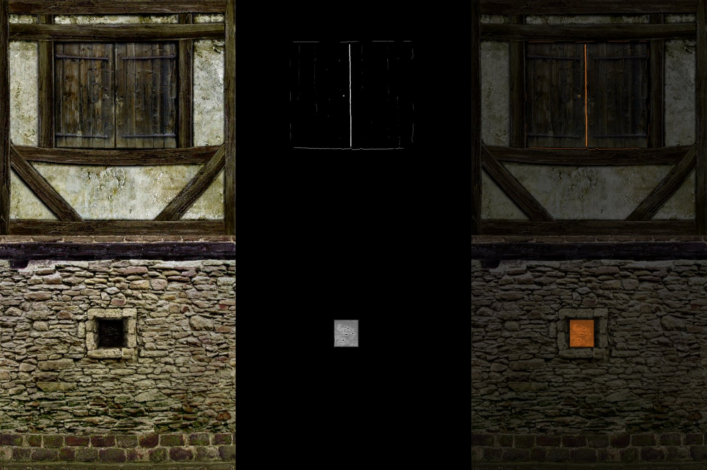
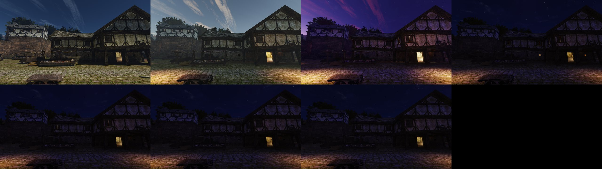
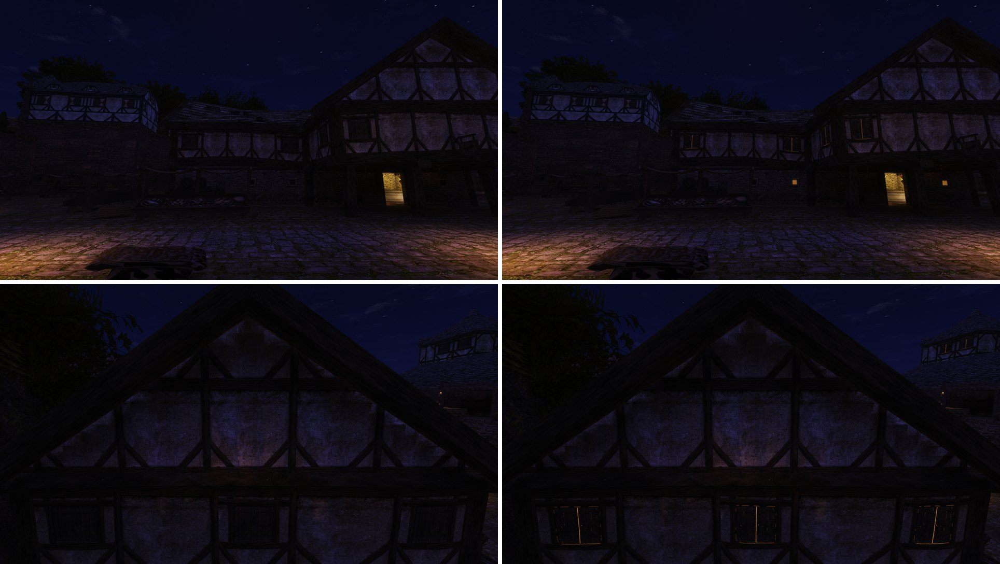
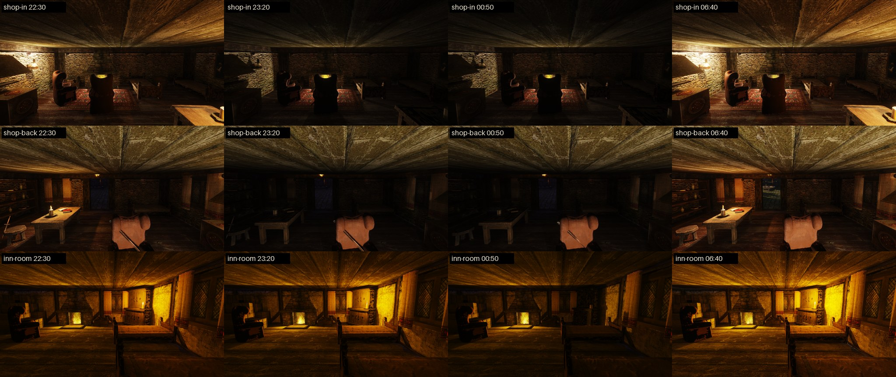
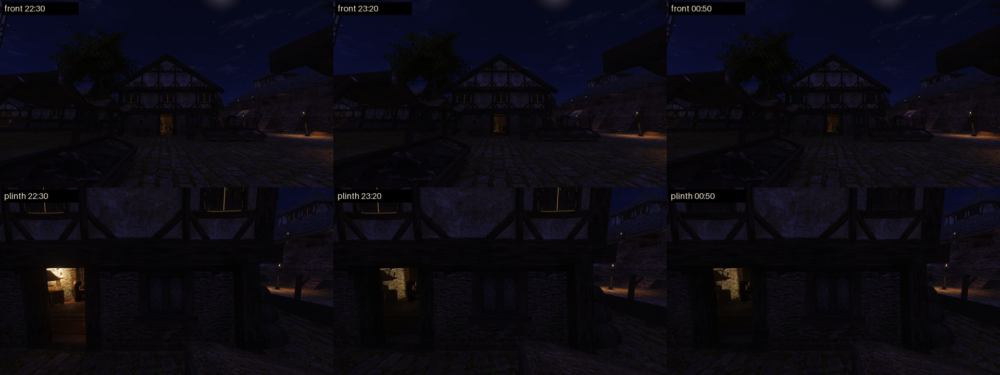
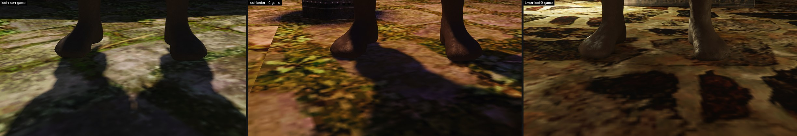
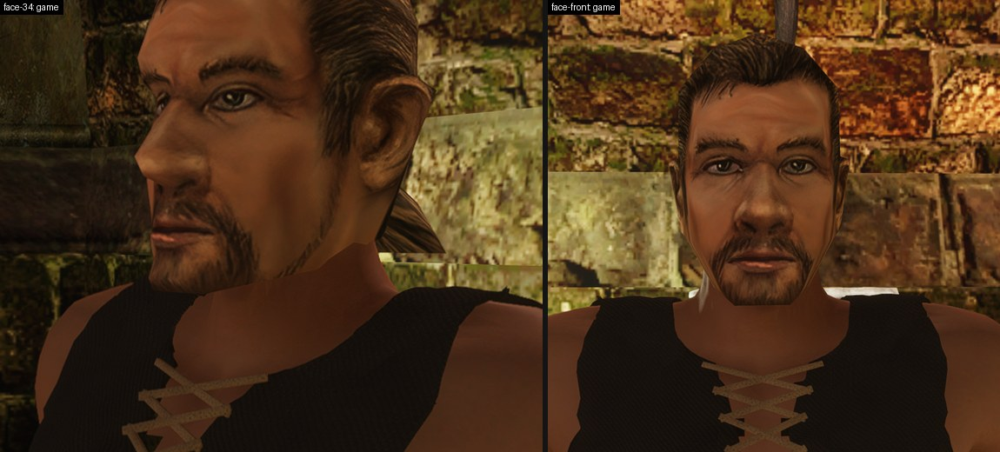
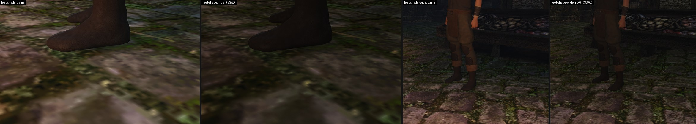
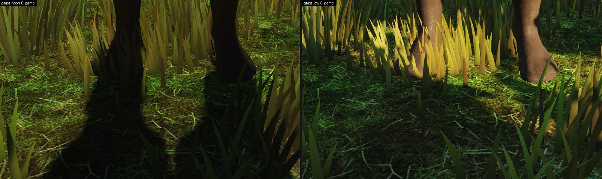

# Ночь и интерьеры: исследование перед первым шагом

Статус: исследование, 2026-11-15; [шаг 0](#шаг-0-сделано-2026-11-15) сделан в тот же день, [пилот шага 1](#шаг-1-окна-пилот-на-доме-у-рынка) и [шаг 2](#шаг-2-одно-состояние-дома) сделаны тогда же; вид шага 2 пользователь принял по листам кадров; [замер контактных теней](#шаг-3-замер-контактных-теней) сделан тогда же. Пункт 1 [порядка по отдаче](../../../docs/graphics-plan.md#порядок-по-отдаче): окна светятся по времени суток, лампы светят в воздухе, контактные тени. Пользователь сказал начинать («Да, начинай»). В самом исследовании кода нет; правка шага 0 описана в конце.

Источники: аудит кода движка (ссылки на файлы ниже), два обзора открытых источников (ссылки в тексте). Где число — оценка, а не измерение, это сказано.

## Коротко

- **Сначала чинить.** Свечение своих материалов на ПК по умолчанию не рисовалось: его добавлял только `ambient_light.frag`, а с GI-пробами работает `probe_ambient.frag`, где этой добавки не было. Подтверждено в кадре и исправлено — [шаг 0](#шаг-0-сделано-2026-11-15).
- **Окна — первый и самый заметный шаг.** Настоящее окно ночью тусклое: на 3–7 ступеней ярче стены под луной. Механизм свечения у нас есть, но сделан под угли; ему нужен режим окна, кривая по времени суток и маски в текстурах окон.
- **Контактные тени — второй шаг, начать с замера.** Тени солнца у нас уже с текселем 0,5 см вблизи. Разрыв ожидался у ламп и у травы. [Замер](#шаг-3-замер-контактных-теней) показал другое: у опоры тень держится и у солнца, и у ламп; не хватает мелких теней на лице под лампой, теней травинок и затенения у опоры там, куда прямой свет не доходит.
- **Лампы в воздухе — не сейчас.** В ясном воздухе ореол лампы — это блик глаза и объектива, его уже делает блум. Объёмный свет виден только в дымке и тумане, а погоды с дымкой у нас нет. Шаг имеет смысл вместе с решением о погоде или дыме в помещениях.

## Цель и рамки

Цель — ночной город и помещения, в которых свет рассказывает о жизни: где не спят, там светится окно; предмет у свечи стоит на столе, а не висит над ним.

Рамки из [арт-библии](../../../docs/khorinis-art-bible.md):

- «Город тёмный в тени днём и ночью. Не осветлять и не добавлять света, которого не было».
- Ночью светятся: окна таверны и гостиницы, свинцовые окна верхнего квартала («сильнее, чем в нижнем городе», [план мира](../../../docs/world-detail-plan.md)), фонари набережной.
- В нижнем городе окна — маленькие закрытые ставни. Там уместен только свет в щелях.
- У хижин порта главная деталь — большое свинцовое окно (модель `NW_CITY_WINDOW_WOOD_OUT_01`, 43 в городе).

## 1. Окна

### Эталон

Измеренное и цитируемое:

- Свеча — около 1 кд, 1850 K; самое яркое место пламени — около 16 000 кд/м² ([сила света](https://compuphase.com/electronics/candela_lumen.htm), [цветовая температура](https://en.wikipedia.org/wiki/Color_temperature), [яркость пламени](https://amper.ped.muni.cz/light/luminance/candle/)).
- Полная луна даёт 0,05–0,3 лк, безлунное ясное небо — около 0,002 лк ([лунный свет](https://en.wikipedia.org/wiki/Moonlight)).
- Стекло было дорогим. Окна затягивали промасленной тканью или пергаментом, вставляли пластины рога, мелкие стёкла в свинце ([обзор](https://buildingconservation.com/articles/histwindowglass/histwindowglass.html)). На ночь ставни запирали; к 21–22 часам ложились, огонь в очаге прикрывали, а не гасили ([Экирх в пересказе](https://humanprogress.org/grim-old-days-roger-ekirchs-at-days-close-part-2/)).

Оценка разведки (яркость окна L = E·τ/π при пропускании 0,3; надёжных чисел пропускания рога и ткани не нашлось):

| Случай | Яркость, кд/м² |
|---|---:|
| Свеча в метре за окном | ≈ 0,1 |
| Свеча в 2–3 м | 0,01–0,03 |
| Очаг и несколько огней, таверна | 0,5–2 |
| Оштукатуренная стена под полной луной | ≈ 0,01 |
| Стена под звёздами | ≈ 0,0003 |

Вывод для нас: окно ярче лунной стены в 10–100 раз, то есть на 3–7 ступеней экспозиции. Свет из окна на земле в двух метрах — около 0,07 лк, уровень полной луны: слабое пятно в безлунную ночь, под луной почти ничего.

### Как делают другие

- **Маска свечения и случайность на окно.** У City Sample от Epic — доля выключенных окон, разброс яркости и цвета, случайное число на экземпляр ([разбор](https://www.versluis.com/2025/10/how-to-change-the-distribution-of-lit-windows-in-epics-city-sample-project/)). Обычный рецепт — номер или хеш окна против порога по времени.
- **Ложные интерьеры** (interior mapping) — для больших прозрачных окон ([автор приёма](https://joostdevblog.blogspot.com/2018/09/interior-mapping-real-rooms-without.html)). Маленькому окну с рогом или ставнями не нужны: параллакса за ним не видно.
- **Свет от окна.** Lumen берёт свечение поверхностей в GI, но мелкие яркие источники шумят ([документация](https://dev.epicgames.com/documentation/en-us/unreal-engine/lumen-global-illumination-and-reflections-in-unreal-engine)). Мод ELFX для Skyrim пришёл к правилу «свет только там, где есть источник» и убрал ложные огни за окнами.
- **Вдали.** GTA V рисует далёкие огни тысячами маленьких карточек ([разбор кадра](https://www.adriancourreges.com/blog/2015/11/02/gta-v-graphics-study-part-2/)).
- Первичных источников о том, как окна сделаны в «Ведьмаке 3», Kingdom Come и RDR2, не нашлось.

Ловушки:

- все окна загораются разом и одинаково;
- окно светится, а внутри дома темно;
- свечение, настроенное для дня, ночью выгорает (так у City Sample);
- экспозиция качается, когда окно входит в кадр;
- мелкие яркие стёкла мерцают под TAA;
- свечение пропадает на дальних уровнях, и город теряет ночной силуэт.

### Что умеет наш движок

Есть (пути от `OpenGothic/`):

- Поле `"emissive"` 0–1 в `materials.json` (`common/resources_textures.cpp:220`), только у материалов с картой ORM (`common/graphics/material.cpp:93`). Маска — альфа ORM.
- Запись в G-буфер: `shader/materials/main.frag:615` — доля свечения уходит в альфу ORM, альбедо темнеет на эту долю, доля «дышит» пятнами (`emberBreath`).
- Добавка света: `shader/lighting/ambient_light.frag:166` — цвет по шкале жара (`emberColour`), усиление под экспозицию до ×6.
- Признак ночи `isNight` и направление солнца есть в общем блоке сцены (`shader/scene.glsl`), но материалы их не читают. Игрового часа в блоке нет.
- Включение по времени суток есть только у очагов и фонарей оригинала (`Wld_SetMobRoutine`, `common/world/objects/fireplace.cpp:23`). Лампы своего слоя горят круглые сутки (`common/world/voblayer.cpp:459`).

Пробелы:

1. **Свечение под GI-пробами.** `probe_ambient.frag` его не добавлял. С 2026-11-15 пробы — умолчание на RTX, и жар на ПК не светился, оставаясь затемнённым альбедо. Исправлено шагом 0.
2. **Режим под угли.** Цвет — шкала жара, а не цвет стекла; затемнение альбедо и «дыхание» окну не нужны.
3. **Нет случайной фазы на окно.** Во фрагментный шейдер приходит номер корзины материала и место в мире. Фазу можно взять хешем от места, как у `emberBreath`.
4. **Светящееся ничего не освещает.** Пробы освещают попадания солнцем, лампами и небом (`shader/lighting/rt/probe_lighting.comp`). В сцене лучей у геометрии только диффузная текстура (`common/graphics/rtscene.h:47`).
5. **Маски нет в текстурах.** Окна оригинала нарисованы в полях стен (`NW_CITY_WINDOW_03`, `NW_CITY_RICH_WINDOW_01`, `NW_CITY_FACHWERKBASEMENT_WINDOW_01`). Свечение работает только у своих материалов с ORM, поэтому каждое окно ждёт своей текстуры с маской.
6. **Эталона нет.** Трассировщик путей не знает светящихся поверхностей (`shader/lighting/pt/pathtrace.frag`).

### Способ

- **Шаг 0, сделан.** Кадр с пробами и без них на Ryzen; добавка свечения перенесена в общее место обоих путей окружающего света.
- **Шаг 1, пилот на одном доме с настоящим окном** (свинцовое окно хижины порта или таверна):
  - режим окна у материала: цвет — альбедо стекла с тёплым оттенком 1700–2000 K, без затемнения и «дыхания», медленное мерцание 5–15 %;
  - кривая по высоте солнца и хеш от места окна: окна загораются в сумерках вразнобой, гаснут по классу — дом, таверна, пост стражи, пустой дом;
  - яркость задаётся относительно ночной стены: 3–7 ступеней, окно дома ниже порога свечения блума (2–6 белых кадра), таверна может его касаться;
  - днём свечения нет.
- **Шаг 2, одно состояние дома.** Окно и огни внутри ведёт один источник. Для этого лампам слоя нужно расписание, а часу игры — место в блоке сцены, чтобы шейдер и процессор считали один и тот же хеш. Кто задаёт час отбоя — дело игры, не этого плана.
- **Шаг 3, свет от окна.** Одна дешёвая лампа без тени у ближних окон первого этажа, слабая (уровень луны). Свечение в попаданиях проб потребует ORM в сцене лучей — отложено.
- **Позже:** свечение на дальних уровнях (шаг Д6 [плана ландшафта](../../../docs/landscape-plan.md)), свет в щелях ставен нижнего города.

### Приёмка

Вид принимает пользователь по клипам:

- сумерки с неподвижной камеры, 17:00–23:00 ускоренно: окна загораются и гаснут вразнобой;
- проход по улице в лунную и в безлунную ночь;
- вход в дом со светом и в тёмный дом: снаружи и внутри сходится;
- полдень: свечения нет.

Ограничители: яркость окна к стене в ступенях по HDR-кадру; след экспозиции при повороте камеры через окно; цена не больше 0,3 мс видеокарты в 1440p на RTX 3080.

## 2. Контактные тени

### Эталон и чужой опыт

- Разрыв тени у опоры даёт смещение, которое растёт с размером текселя карты ([Microsoft](https://learn.microsoft.com/en-us/windows/win32/dxtecharts/common-techniques-to-improve-shadow-depth-maps)).
- Epic пишет, что с виртуальными картами контактные тени для резкого контакта «больше не нужны»; они остаются для того, что в карты не рисуется, и для травы ([документация VSM](https://dev.epicgames.com/documentation/en-us/unreal-engine/virtual-shadow-maps-in-unreal-engine)).
- Экранный луч по буферу глубины: у Unity HDRP 0,5–1,3 мс на PS4 в 1080p ([документация](https://docs.unity3d.com/Packages/com.unity.render-pipelines.high-definition@14.0/manual/Override-Contact-Shadows.html)). Проход Bend Studio (Days Gone) — 60 выборок без шума, открытый код под Apache 2.0 ([описание](https://bendstudio.com/blog/inside-bend-screen-space-shadows)).
- Простой луч с шумом на RTX 3080 в 4K: 8 выборок — около 0,23 мс, 32 — 0,95 мс ([замер моддера](https://frostbone25.github.io/p/ff7-rebirth-contact-shadows/)).

Ловушки: толщина поверхности в буфере глубины (мало — свет протекает, много — ложная тень); заслон за краем экрана не даёт тени; двойное затемнение вместе с SSAO; предмет в руке перед камерой бросает ложную тень на мир.

### Что умеет наш движок

- Солнце: тексель VSM вблизи 0,5 см, фильтр 4×4 с плоскостью приёмника (`shader/virtual_shadow/vsm_sun_shadow.glsl:58`). Здесь разрыв должен быть мал.
- Лампы: плоскость приёмника сдвинута к лампе на 0,5 см и тексель, и отчёты прямо называют это ослаблением контактной тени ([односторонние поверхности](../2026-11-10-lamp-one-sided/README.md), [осколки тени](../2026-11-11-facet-shards/README.md)). На Mac тень лампы жёсткая, в одну выборку.
- Место для экранного луча есть: `direct_light.frag` уже читает глубину и восстанавливает точку мира (`shadowFactor`, `:216`). Буферы глубины, нормалей и движения на этом проходе доступны.
- SSAO затеняет только окружающий свет и под пробами выключен (`common/graphics/renderer.cpp:1268`), так что двойного затемнения на ПК не будет.
- Лучи: героя, NPC и травы в сцене лучей нет. Короткий луч по ней не даст тени от ног и лица, и трассировщик путей для персонажей не эталон.

### Способ

- **Шаг 0, замер.** Пары крупных планов «как сейчас | эталон»: кружка на столе у свечи, ноги на брусчатке в полдень и при низком солнце, лицо под факелом, трава у стены. Для неподвижных предметов эталон — трассировщик путей с одним прямым светом; для персонажей — тень с большим числом выборок. Итог — где разрыв виден глазом.
- **Шаг 1.** Экранный луч там, где замер показал разрыв. Ожидание: сначала лампы (ближние к пикселю, 12–16 выборок с шумом под TAA), солнце — для травы. Результат умножает прямой свет только своей лампы.
- Короткие лучи по сцене лучей — после того как в неё попадут персонажи; сейчас не берём.

### Приёмка

Клипы «выключено | включено» с облётом: кружки и тарелки у свечи, ноги на брусчатке, лицо крупно, трава у стены, оружие в руке перед камерой (ложной тени нет), персонаж на краю экрана (тень не выскакивает). Ограничитель — цена на RTX 3080 и на Mac.

## 3. Лампы в воздухе

### Эталон

- Дальность видимости и ослабление связаны формулой Кошмидера: V = 3,912/σ ([видимость](https://en.wikipedia.com/wiki/Visibility)). Оценка: ясная ночь — σ около 0,0001–0,0002 1/м, дымка — 0,002–0,004, туман — 0,02–0,08.
- Видимый ореол вокруг источника — многократное рассеяние; при оптической толщине до 1 «ореол не виден» ([Narasimhan и Nayar, 2003](https://cave.cs.columbia.edu/old/publications/pdfs/Narasimhan_CVPR03.pdf)).
- Оценка разведки: яркость воздуха на луче в метре от лампы относительно белой стены на том же расстоянии — около σ·π·d/4. Это 3 % в густом тумане, 0,3 % в дымке и 0,02 % в ясном воздухе.

Вывод: в ясную ночь ореол вокруг факела — блик глаза и объектива. Его даёт блум, и он у нас есть (свечение от мест ярче 2–6 белых).

### Что умеет наш движок

- Туман считает только солнце и небо (`shader/sky/fog_view_lut.comp`). Его объём — 128×64×32 на всю дальность вида, слои линейны по дальности: на метры у лампы слоёв почти нет.
- Плотность воздуха — атмосферные константы (`shader/sky/sky_common.glsl:9`), путь луча растянут в 50 раз. По моей оценке это 0,0002–0,002 1/м у земли: ясный воздух и лёгкая дымка. Единицы в кадре не проверял.
- Лампы рисуются объёмами по одной, списка ламп по плиткам нет; ночью в гавани их видно до 1 591 ([замер](../2026-11-03-lamp-shadows/step-2a.md)).
- Погоды с дымкой или туманом нет; дождь движок не рисует.

### Как делают другие

- Объём из ячеек с лампами: AC4 — около 1,1 мс на Xbox One, лампы без теней ([Wronski, 2014](https://www.advances.realtimerendering.com/s2014/wronski/bwronski_volumetric_fog_siggraph2014.pdf)); Frostbite — 2,95 мс на PS4 с 14 лампами ([Hillaire, 2015](https://www.slideshare.net/DICEStudio/physically-based-and-unified-volumetric-rendering-in-frostbite)). Нужен список ламп по ячейкам; движущиеся и мерцающие лампы оставляют шлейф.
- Формула на лампу без объёма: рассеяние точечного источника в однородной среде считается в замкнутом виде ([Sun и др., 2005](https://cave.cs.columbia.edu/old/publications/pdfs/Sun_TOG05.pdf)). Теней нет, цена — несколько операций на пиксель лампы.
- Ловушки: свет лампы в воздухе за стеной, «молочный» кадр, разное мерцание воздуха и стен.

### Вывод

С нынешним воздухом честный вклад ламп в туман глазом не виден. Строить объём с лампами сейчас — работа без результата на экране. Шаг возвращается вместе с одним из решений:

- погода с дымкой или туманом (ночная дымка порта);
- дым в помещениях (таверна, кузница).

Тогда первым идёт формула на лампу в её проходе света: она ложится на нашу отрисовку ламп объёмами и ничего не стоит в ясном воздухе. Объём из ячеек — только если формулы не хватит.

## Порядок шагов

| № | Шаг | Готово, когда |
|---|---|---|
| 0 | Свечение своих материалов под GI-пробами — сделан | жар факела на ПК по умолчанию светится так же, как без проб |
| 1 | Окна: режим, расписание по часу суток, пилот на доме у рынка — код и кадры есть | клипы сумерек и ночной улицы приняты пользователем |
| 2 | Окна: одно состояние дома — сделан, вид принят по листам кадров | вход в дом со светом и в тёмный дом сходится с видом снаружи |
| 3 | Контактные тени: замер разрыва — сделан, листы есть | листы пар показаны пользователю, выбрано, где делать |
| 4 | Контактные тени: экранный луч | клипы «выключено \| включено» приняты |
| — | Лампы в воздухе | после решения о погоде или дыме в помещениях |

Код шейдеров и текстуры окон — работа Claude ([правила](../../../AGENTS.md)).

## Чего не знаем

- Какие текстуры окон уже заменены своими и у скольких есть ORM.
- Пропускание рога, ткани и старого стекла: числа — оценка.
- Как привыкание глаза поведёт себя с яркими окнами в кадре: замер идёт по окну гистограммы 50–95 %, окна должны оставаться выше него.
- Плотность нашего воздуха в единицах 1/м — оценка по константам шейдера.
- Цена короткого луча по сцене лучей на RTX 3080: опубликованных чисел не нашлось.

## Шаг 0, сделано 2026-11-15

**Что было.** С GI-пробами жар своих мешей не светился. В рабочем контенте (`working-18`) свечение задано у одного материала — головки настенного факела `OWN_WALL_TORCH_FIRE` (жар в складках обмотки); у очагов в рабочем наборе его нет. Поэтому проверка шла на факеле у «Красного фонаря».

**Правка.** Свечение считает одна функция `emissiveMeshGlow` в `OpenGothic/shader/common.glsl`. Её вызывают оба шейдера окружающего света: `lighting/ambient_light.frag` (формула прежняя) и `lighting/rt/probe_ambient.frag` (добавки раньше не было).

**Проверка.** Ryzen, RTX 3080, Vulkan, окно 1280×720, полночь, четыре вида головки факела, частицы скрыты, мерцание лампы заморожено (`OPENGOTHIC_LIGHT_FREEZE=1`). Стенд — [`emissive-probes.bench`](emissive-probes.bench), сравнение — [`emissive_probes_compare.py`](emissive_probes_compare.py). По одному прогону на вариант.

| Вид | С пробами: пикселей жара | Прибавка красного, уровней из 255 | Изменилось пикселей кадра | Без лучей: изменилось пикселей |
|---|---:|---:|---:|---:|
| `side-close` | 4 624 | +61,5 | 0,84 % | 0 |
| `front-close` | 4 251 | +60,4 | 0,63 % | 0 |
| `side-1m` | 1 452 | +48,7 | 0,23 % | 0 |
| `front-1m` | 1 872 | +46,4 | 0,28 % | 0 |

- **С пробами жар появился**, и только на обмотке: разница «до | после» лежит в рамке головки факела.
- **Без лучей кадр не изменился** ни в одном пикселе: перенос формулы точный.
- **Яркость жара сошлась с путём без лучей.** В тех же пикселях средний красный канал с пробами после правки — 86–111, без лучей — 78–94 (до правки с пробами было 36–51). С пробами чуть ярче: к жару добавляется отражённый свет.


Слева направо: до правки, после правки, разница ×8; сверху вниз — `side-close`, `front-close`, `side-1m`, `front-1m`.

**Что заметил попутно.** С пробами обмотка факела сбоку залита золотым отражённым светом стены, и жар на ней читается слабее, чем на тёмной обмотке без лучей. Это вид факела под GI, а не ошибка свечения; в этом шаге не менялось.

**Не проверено:** Mac (пробы там выключены, а `ambient_light.frag` считает ту же формулу через общую функцию — кадр на Metal не снимал); очаги со свечением вне рабочего набора.

## Шаг 1: окна, пилот на доме у рынка

Статус: код и кадры — 2026-11-15. Пользователь оставил свечение базовым слоем (выбор «Свечение + шаг 2»); отдельного вердикта по клипу сумерек не было. В рабочем контенте с набора `working-20` ([включение](#включение-в-рабочий-контент)).

**Почему дом у рынка, а не «настоящее» окно.** Своих текстур окон с ORM в рабочем наборе две, обе на этом доме: закрытые ставни в поле фахверка (`NW_CITY_WINDOW_03`) и проём в каменном цоколе (`NW_CITY_FACHWERKBASEMENT_WINDOW_01`). Свинцовое окно хижины порта и окна верхнего квартала — оригинал; им нужен круг ремастера с концептом. У ставен уместен только свет в щелях — так и требует арт-библия для нижнего города.

**Что сделано.**

- **Поле `window`** записи `materials.json` рядом с `emissive`: `{"lit": 0.6, "until": 23.5}` — доля окон, которые вообще зажигают, и час, к которому половина гаснет. Числа записи и вечер одного окна — `OpenGothic/common/graphics/windowglow.h`.
- **Одно окно — один повтор текстуры.** Три его числа (зажигают ли, когда, когда гасят) берутся из номера повтора и плавного шума от места стены, чтобы две стены с одинаковыми повторами не горели одинаково. Середина повтора в мире считается по производным; её ошибка вблизи (по оценке, до ~10 см в метре от стены; не измерена) сдвигает числа на сотые и окно не делит.
- **Расписание.** Первые свечи — в 21:15 (солнце в игре садится в 21:33), последние — на час позже; гаснут в пределах часа вокруг `until`; подъём и угасание — 12 игровых минут; до рассвета (04:45) не доживает ни одно, кроме записей с `until` от 28,75. Свеча чуть качается: до 18 % яркости, у каждого окна в своё время.
- **Свет окна.** Тёплый свет свечи (1,0; 0,45; 0,10) вместо шкалы жара, альбедо не темнеет. В G-буфере — бит 7 подсказок рядом с долей свечения в альфе ORM; добавляют его оба шейдера окружающего света (`emissiveMeshGlow`).
- **Час суток** в блоке сцены (`dayHour`): занял одно из двух свободных полей выравнивания, размер блока прежний. Числа окна лежат в поле корзины `foliage` под флагом `BK_WINDOW` — шаг массива корзин прежний.
- **Маски.** `scripts/content/window_glow.py pilot` клонирует папку контента, пишет маску в альфу ORM двух текстур и добавляет поля в записи; исходную папку не трогает. Маска берётся из альбедо: свет выходит там, где на картинке щель. У ставен — щель между створками (сплошная), зазор по периметру отрезками, раскрывшиеся стыки досок, сучок. У цоколя — тёмная глубина проёма с рисунком камней дальней стены.



**Круги.** Первый круг — щели читались неоновой решёткой: слишком ярко, почти бело, каждый стык светил на всю высоту, а свечи загорались при дневном небе (начало стояло на 20:15). Второй — вечер сдвинут к закату, яркость ниже на треть, цвет теплее, стыки досок светят только там, где щель на текстуре раскрыта. Третий — зазор по периметру отрезками, проём цоколя тусклее.

**Кадры.** Ryzen, RTX 3080, Vulkan, 1280×720, лучи и пробы по умолчанию, NPC скрыты. Стенд `scripts/content/window-glow.bench`: четыре вида дома в семь моментов.



Слева направо, сверху вниз: 12:00, 21:00, 21:45, 22:30, 23:30, 00:30, 02:00.



Слева — рабочий контент, справа — пилот; сверху вид сбоку, снизу фасад, 22:30.

Доля пикселей кадра, которые стали теплее и ярче, чем с рабочим контентом (красный +10 уровней и больше синего), по одному прогону:

| Час | Сбоку | Фасад | Спереди | У цоколя |
|---|---:|---:|---:|---:|
| 12:00 | 0 | 0 | 0 | 0 |
| 21:00 | 0 | 0 | 0 | 0 |
| 21:45 | 0,085 % | 0,152 % | 0,057 % | 0,150 % |
| 22:30 | 0,141 % | 0,375 % | 0,095 % | 0,258 % |
| 23:30 | 0,076 % | 0,361 % | 0,083 % | 0,248 % |
| 00:30 | 0 | 0 | 0 | 0 |
| 02:00 | 0 | 0 | 0 | 0 |

- **Днём и после полуночи кадр тот же, что без свечения:** отличий больше 8 уровней — не более 0,0008 % пикселей, это шум стенда.
- **Яркость щели к стене** (фасад, 22:30, по яркости на экране): в среднем в 6 раз ярче поля штукатурки (2,6 ступени), самые яркие 5 % — в 31 раз (4,9 ступени). Ограждение исследования — 3–7 ступеней.
- **Клип сумерек** — вид сбоку с 21:00 до 00:30, кадр каждые три игровые минуты (`window-glow-dusk.bench`, сборка `window_glow.py clip`). В git не лежит.

**Проверки.** `gothic-window-glow-test` (разбор и упаковка записи, вечер окна) — локально на Mac, 19 339 утверждений; на Ryzen цель не собиралась. Сборка движка с шейдерами прошла на Ryzen. После ранних выходов в шейдере (числа окна считаются только на текселях маски и только с 21:15 до рассвета) те же 28 кадров сняты заново и совпали с третьим кругом: отличий больше 8 уровней — не более 0,0005 % пикселей.

**Что заметил попутно.**

- В цоколе этого дома стоит свинцовое окно — модель оригинала с тёмным стеклом, а внутри горит лампа, и это видно через дверь. Это расхождение «внутри светло, окно тёмное» лечится своим материалом для модели окна — шаг 2 и круг ремастера.
- Свет скромный намеренно: с площади дом ночью — тёмный силуэт с тёплыми контурами ставен. Заметными будут стеклянные окна таверны и верхнего квартала.

**Не сделано и не проверено.**

- Отдельной приёмки вида по клипу сумерек не было: пользователь оставил свечение базовым слоем и принял шаг 2, в кадрах которого эти окна есть.
- Цена в кадре не измерена. Числа окна считаются только на текселях маски и только с 21:15 до рассвета.
- Mac не снимался.
- Окна-предметы с развёрткой в один повтор получат одинаковые числа с соседями: им нужен номер объекта во фрагментном шейдере.
- Свет от окна на улицу и одно состояние дома с огнями внутри — шаги 2 и 3.
- Маска пишется поверх ORM, который раскодирован и сжат заново; набор из исходных карт должен писать её из них.

## Шаг 2: одно состояние дома

Статус: код и кадры — 2026-11-15; вид принят пользователем в тот же день по листам кадров («Принимаю, вливай»). В рабочем контенте с набора `working-20` ([включение](#включение-в-рабочий-контент)).

**Решение пользователя 2026-11-15.** На вопрос, что свечение окна — подмена (светятся сами ставни, свет из комнаты через стену не проходит), ответ был да, и пользователь выбрал: свечение остаётся базовым слоем, а окно связывается с огнями дома. Настоящие проёмы со светом изнутри — только у домов, которые перестраивает ремастер.

### Что нашлось в данных

- **Огни внутри домов — лампы оригинала**, своих ламп слоя там почти нет. Свеча — модель `NW_CITY_CANDLE_01` с тремя детьми: картинка пламени (декаль `FIRE_COMPLETE_A0`) и две лампы, ровная и мерцающая. Масляная лампа — модель и две лампы. Очаг — лампа с частицами `FIRE.pfx`, дымом и звуком и вторая лампа рядом. Заливки `AMBIENCE_*` и `*_DARKBLUE` движок гасит при загрузке (`common/world/voblight.cpp`).
- **Комнаты оригинала дом не выделяют.** Объёмов комнат в мире 154, но их коробки перекрываются, а у соседних домов совпадают (`BOGNER` и `GRITTA` — одна коробка); внутренние стены лавки и гостиницы у рынка помечены секторами `ZURIS` и `HOTEL`, которые делят один дом по этажам. Поэтому дом описывает запись в нашем контенте.
- **Дом у рынка — два хозяйства.** Первый этаж под передней половиной — лавка Зуриса; этаж над ней и задняя половина — гостиница.

### Что сделано

- **Запись дома** — файлы `worlds/<МИР>/houses.d/*.json` контента (сначала это был один `houses.json`; папка появилась при включении в рабочий контент, чтобы каждая часть набора приносила свои дома): ключ, коробка (центр, размер, поворот вокруг вертикали) и час отбоя `until`. Без `until` дом ложится между 23:00 и 00:30 по своему ключу. Числа и правила — `OpenGothic/common/graphics/houselights.h`.
- **Лампы.** Лампа мира, которая стоит глубже 20 см внутри коробки, принадлежит дому (`common/graphics/houselamps.*`). Лампы ближе 80 см друг к другу — один светильник. Светильники дома гаснут один за другим за девять игровых минут до отбоя, последний — ровно в отбой; утром возвращаются между 05:30 и 06:30. Днём и вечером лампы горят, как раньше.
- **Пламя.** Картинка пламени рядом с лампой пропадает вместе с ней и возвращается утром.
- **Очаг** с частицами огня и лампы у него горят всю ночь: очаг на ночь прикрывали, а не гасили.
- **Окна.** Окно с полем `window`, чья середина лежит в коробке дома (с полем 50 см наружу под вынос этажа), гаснет за те же девять минут и к отбою тёмное. Шейдер читает дома из блока сцены (до 32 домов, по три вектора) и тот же час суток, что и лампы. Окно вне всех домов живёт по своему расписанию, как в шаге 1.
- **Включение лампы.** `LightGroup::Light::setEnabled(true)` раньше оставлял дальность нулевой; теперь лампа возвращает свою дальность.

### Пилот

`scripts/content/window_glow.py pilot` пишет два дома: `market-zuris-shop` (отбой 23:00) и `market-inn` (отбой 00:30). Лавка стоит в файле первой: точку берёт первый дом по порядку. `window_glow.py lamps --base <база>` печатает лампы базы в каждом доме: в лавке их 6 (свеча, масляная лампа и очаг — по две), в гостинице 20.

Кадры: Ryzen, RTX 3080, Vulkan, 1280×720, лучи и пробы по умолчанию, NPC скрыты. Стенд `scripts/content/house-lights.bench`: лавка с двух сторон, комната гостиницы, фасад и цоколь в семь моментов суток. По одному прогону.



Сверху вниз: лавка от фасада, лавка от задней стены, комната гостиницы; слева направо 22:30, 23:20, 00:50, 06:40.



Средняя яркость кадра, уровни из 255:

| Вид | 12:00 | 22:30 | 23:20 | 00:20 | 00:50 | 03:00 | 06:40 |
|---|---:|---:|---:|---:|---:|---:|---:|
| Лавка от фасада | 51,8 | 37,8 | 14,9 | 14,9 | 14,8 | 14,9 | 50,9 |
| Лавка от задней стены | 45,1 | 36,2 | 25,3 | 25,2 | 25,3 | 25,3 | 45,4 |
| Комната гостиницы | 49,8 | 34,0 | 35,4 | 34,1 | 21,8 | 21,7 | 50,0 |

- **Лавка** после 23:00 темнеет и остаётся при свете очага; свеча на столе без пламени. **Гостиница** светла до 00:30, потом тоже остаётся при очаге. К 06:40 свет вернулся в оба хозяйства.
- **Снаружи** в 22:30 светятся щели ставен и дверной проём лавки. В 23:20 в проёме виден только отсвет очага, ставни гостиницы над лавкой ещё светятся. В 00:50 все ставни тёмные.
- **Прежние виды окон** (`window-glow.bench`) до 22:30 совпали с кадрами шага 1: отличий больше 8 уровней — не более 0,0005 % пикселей. Позже отличается только то, что погасло. Этот прогон снят до правок пламени и очага.
- **Уличные огни** у дома в кадрах те же: фонари площади и свет на мостовой не изменились.

### Проверки

`gothic-window-glow-test` дополнен домом: разбор записей домов, повёрнутая коробка с полями для окон и ламп, лампы гаснут по очереди и возвращаются утром, окно дома не светится без лампы внутри, дом без отбоя. Локально на Mac — 26 385 утверждений.

### Не сделано и не проверено

- Клипа прохода в дом со светом и в тёмный дом нет: вид принят по листам кадров.
- Отбой задаёт запись, а не жильцы: Зурис и постояльцы о нём не знают. Вести отбой от распорядка NPC — игровая логика, в план графики она не входит (решение пользователя 2026-11-15); движку для неё хватает часа `until` в записи дома.
- Лампа гаснет разом, без угасания; свет в GI-пробах уходит за их обычное время.
- Светильник определяется расстоянием 80 см, пламя — именем декали `FIRE*`. Собственное свечение модели лампы, если оно появится у своих моделей, с домом не связано.
- Очаг горит в полную силу всю ночь, прикрытым он не выглядит.
- Дома задаются вручную, по одному на круг ремастера; больше 32 домов блок сцены не несёт.
- Цена в кадре измерена позже, она в пределах шума — [замер](#цена-окон-и-домов-в-кадре).
- Mac не снимался. Сохранения не проверялись: состояние ламп считается от часа суток и в сохранение не пишется.

## Включение в рабочий контент

2026-11-15, пользователь: «Да, включи».

- **Дома по частям.** Движок читает все файлы `worlds/<МИР>/houses.d/*.json` по порядку имён: каждая часть набора приносит свои дома. Ключи между файлами не повторяются, всего домов не больше 32; файл, который это нарушает, отклоняется целиком.
- **Часть дома у рынка** — `market-16`: копия `market-15` с масками в альфе ORM двух текстур окон, полями `emissive` и `window` и файлом `houses.d/market-house.json` (`scripts/content/window_glow.py part --from market-15 --set market-16`).
- **Набор** — `building_set.py compose working-20 working-19 market-16 --without market-15`. Ключ `--without` новый: часть рабочего набора остаётся позади, её место занимает новая. Сборщик переносит файлы `houses.d` вместе с частью.
- **Сверка.** `working-20` отличается от `working-19` четырьмя файлами (два ORM окон, `materials.json`, `composition.json`) и добавленным файлом домов. Съёмка `house-lights.bench` с этим набором на Ryzen совпала с пилотной: средняя яркость видов изнутри та же до десятой доли уровня.

Чего нет:

- Слои луговой земли (`ground.sward`, `ground.earth`) сборщик из `main` не переносит: это добавляет открытый PR [#1426](https://github.com/kaifaty/GothicAI/pull/1426). Набор собран с его правкой, применённой на время сборки; после слияния #1426 сборка повторяется одной командой.
- Маска по-прежнему пишется поверх раскодированного ORM, а не из исходных карт ассета.
- На Mac с рабочим контентом игра не запускалась и не снималась.

### Цена окон и домов в кадре

RTX 3080, 2560×1440, место `house-night` стенда кадра (`scripts/bench/perf-house-night.bench`): дом у рынка в 22:05, окна светятся, лампы лавки и гостиницы горят. Четыре прогона вперемежку — `working-20` и `working-19` (тот же набор без масок окон и без записей домов), по два на набор:

| Вид | G-буфер с окнами, мс | G-буфер без окон, мс |
|---|---|---|
| фасад с площади | 0,567 / 0,600 | 0,734 / 0,657 |
| проёмы цоколя крупно | 0,435 / 0,436 | 0,428 / 0,433 |
| лавка изнутри | 0,276 / 0,271 | 0,290 / 0,278 |
| этаж гостиницы над лавкой | 0,632 / 0,633 | 0,661 / 0,645 |

Свечение считается в проходе G-буфера. На виде, где окна занимают больше всего кадра, он дороже на 0,005–0,01 мс; на остальных разница между наборами меньше разброса между прогонами одного набора. Время видеокарты целиком с окнами не выше (7,9–8,1 против 8,5–8,7 мс на фасаде), кадр упирается в процессор — 8,6–9,4 мс в обоих наборах. Ограничитель в 0,3 мс выдержан.

```bash
BENCH_HOST=ryzen PERF_WINDOW=2560x1440 PERF_ENV='OPENGOTHIC_CONTENT=<набор на Ryzen> OPENGOTHIC_GPU_PASSES=1' scripts/perf.sh house-night
```

## Шаг 3: замер контактных теней

2026-11-15, пользователь: «Да, контактные тени». Шаг 0 [способа](#способ-1): где тени не хватает у опоры на глаз. Кода в игре этот шаг не менял.

### Как снято

RTX 3080, 2560×1440, рабочий контент `working-20`, свет ламп заморожен (`OPENGOTHIC_LIGHT_FREEZE=1`). Сценарий — [`tools/contact-shadow.bench`](tools/contact-shadow.bench), 26 кадров, три прогона одних и тех же видов:

- **игра** — как рисует по умолчанию: карты теней, лучи, GI-пробы;
- **эталон** — `OPENGOTHIC_VSM=0`: лампы и солнце берут тень точным лучом по сцене лучей;
- **без GI** — `OPENGOTHIC_GI=0`: окружающий свет получает SSAO вместо проб.

Листы собирает [`tools/contact_sheets.py`](tools/contact_sheets.py). Перед этим был разведочный проход на 38 кадров; по нему убраны лишние виды и добавлены ноги у фонаря, ноги у факела и герой в траве.

**Эталон годится не для всего.** В сцене лучей есть сетка мира и статичные предметы. Подбираемых предметов (кружка, кубок, еда), героя и травы в ней нет: в эталоне они тени не бросают. По ним вывод сделан на глаз по кадру игры.

### Что видно

| Случай | Что в кадре | Лист |
|---|---|---|
| Ноги на брусчатке, солнце в полдень | тень начинается от подошвы, разрыва нет | [держится](contact-holds.jpg) |
| Ноги у фонаря ночью, ноги у факела в башне | то же | [держится](contact-holds.jpg) |
| Кружка и кубок у свечи | тень начинается от основания; ядро тени кружки неровное, пятнами в 1–2 см | [свеча](contact-candle.jpg), [кубок](contact-cup.jpg) |
| Подставка свечи | тень под краем есть, но рваная: у эталона под подставкой ровная тёмная полоса, в игре от неё остались осколки | [свеча](contact-candle.jpg) |
| Лицо у факела | мелких теней нет: от носа на щеке, от подбородка на шее, от ворота на груди; шея под подбородком освещена так же, как лицо | [лицо](contact-face.jpg) |
| Ноги в тени домов (рынок в 20:30, прямого света нет) | под подошвой нет затемнения, стопа не привязана к земле | [тень](contact-shade.jpg) |
| Герой в траве | травинки не затеняют ни землю у корня, ни друг друга; тень героя на траву ложится | [трава](contact-grass.jpg) |









### Почему так

- **Разрыва у опоры нет.** У солнца сдвига по нормали нет, тексель вблизи 0,5 см. У ламп плоскость приёмника сдвинута на 0,5 см и тексель, но грань куба лампы вблизи камеры получает до 512 текселей (`vsm_mark_omni_pages.comp`: четыре страницы по 128, один тексель на четыре пикселя экрана): в метре от лампы тексель около 0,4 см. Сдвиг меньше сантиметра съедает тень только от самого низа предмета, и на глаз это не читается.
- **Мелкие тени у ламп теряются в фильтре.** Того же текселя и мягкой полутени PCSS не хватает на детали в 1–3 см: нос, подбородок, край подставки. Отсюда осколки вместо ровной тени под подставкой и гладкое лицо.
- **Трава в карты теней не рисуется.** Землю под ней темнит множитель материала (0,65 под стоячей травой), формы у этого затемнения нет.
- **В окружающем свете у опоры темнить нечему.** С GI-пробами SSAO выключен: пробы считают заслон сами (`renderer.cpp`, `prepareSSAO`). Но считают они его по сцене лучей, где нет героя, NPC и предметов. Поэтому в тени и в помещении без прямого света персонаж стоит на полу без пятна под ногами.
- **Вернуть SSAO как есть мало.** В прогоне без GI земля у стопы темнее дальней на 5–17 % (отношение яркостей кадров «без GI / игра» в полосах у подошвы, нормированное на дальнюю землю); под самой подошвой затемнения нет. На листе разница едва видна.

### Вывод

Экранный луч к источнику света нужен не там, где его ждало исследование:

1. **Лампы на персонажах.** Нос, подбородок, ворот, пальцы, складки одежды. Короткий луч (10–20 см) к лампе по буферу глубины, результат умножает свет только этой лампы. Заодно он выровняет тень под мелкими предметами у свечи.
2. **Солнце на траве.** Луч в 10–15 см к солнцу для пикселей травы и земли под ней: тень травинок на земле и друг на друге.
3. **Солнце и лампы у ног и у предметов на камне** — не нужен: тень уже прилегает.

Затемнение у опоры в окружающем свете — отдельная задача, луч к источнику её не решает. Ей нужно своё короткое исследование: затенение малого радиуса поверх проб или тени-капсулы персонажей; готовый SSAO даёт слишком мало.

### Не сделано и не проверено

- Вид оценён по неподвижным кадрам; клипов нет.
- Эталона для предметов, героя и травы нет: в сцене лучей их нет.
- Лицо снято на голове оригинала в одной сцене (башня Ксардаса, факел в 2–3 м). На своей голове героя и под свечой вблизи не проверено.
- Mac не снимался: там тень лампы жёсткая, в одну выборку, и картина может отличаться.
- Цена экранного луча у нас не измерена: шаг 4 начинается с неё.

