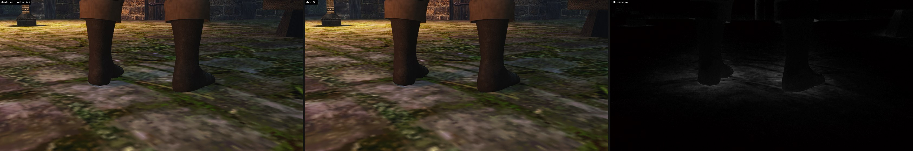
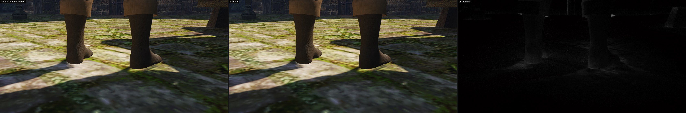
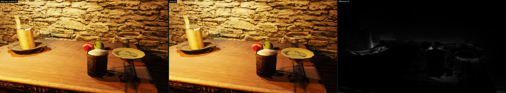
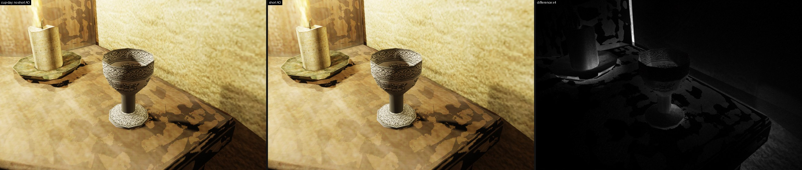
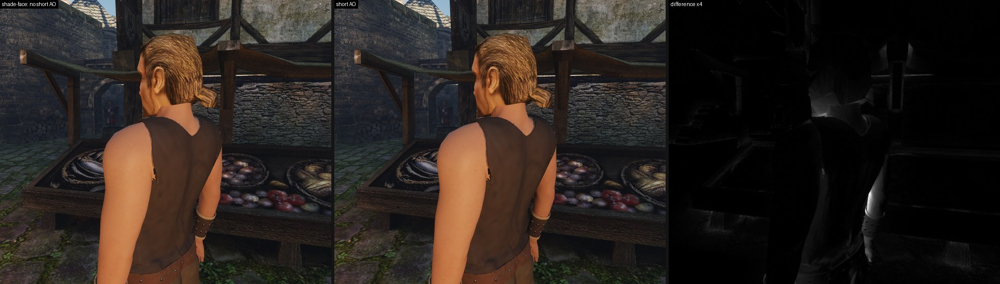
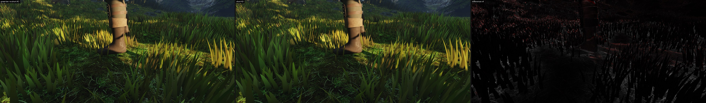
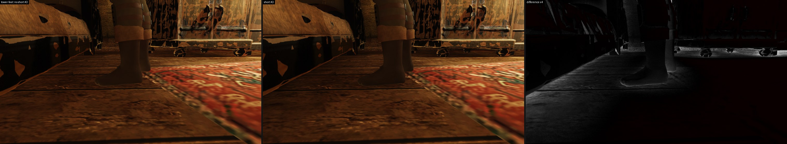

# Опора в тени: короткое затенение поверх света проб

Статус: исследование и первый круг, 2026-11-16. Вид ждёт приёмки пользователя по клипам.

Продолжение [замера контактных теней](../2026-11-15-night-interiors/README.md#шаг-3-замер-контактных-теней). Из его вывода пользователь выбрал «Опора в тени»: там, куда прямой свет не доходит, ногу с землёй ничего не связывает.

## Коротко

- **Причина.** С GI-пробами рассеянный свет не затеняется вблизи вообще. Пробы стоят сеткой с шагом 25 см у камеры и дальше вдвое реже на каждой ступени, и видят только сетку мира и неподвижные объекты. Героя, людей и предметов для них нет. SSAO с пробами выключен целиком, чтобы не затенять углы дважды.
- **Как в жизни.** Под пасмурным небом и в тени земля у ноги темнее на 20–35 %, между ступнями — на 40–50 %, и это сходит на нет за полметра.
- **Как у других.** Грубый рассеянный свет почти всегда дополняют коротким затенением по экрану: Lumen — «Short Range AO», DDGI — AO лучами. Отдельный приём для персонажей — тени от капсул по костям.
- **Способ.** Тот же проход SSAO, но со сферой 25 см вместо метра, и только когда работают пробы. Метровое затенение остаётся пробам, короткое берёт то, чего они не видят.

## Что видно сейчас

Замер 2026-11-15, RTX 3080, 2560×1440: герой в вечерней тени рынка.

- С пробами земля у ноги той же яркости, что в метре от неё. Нога «висит».
- С `OPENGOTHIC_GI=0` рассеянный свет берёт SSAO, и земля у ноги темнее на 5–17 %. Это мало: SSAO считает сферу 50–150 см, ступня в ней занимает малую долю.

## Как это выглядит в жизни

Рассеянный свет приходит со всей полусферы неба. Тень у опоры — это доля полусферы, закрытая предметом, с весом по косинусу к нормали.

| Точка на земле | Что закрывает небо | Темнее на |
|---|---|---|
| вплотную к длинной стенке | половина полусферы | 50 % |
| на трети высоты стенки от неё | (1 − cos(atan 3))/2 | 34 % |
| на высоте стенки от неё | (1 − cos 45°)/2 | 15 % |
| между ступнями стоящего человека | две голени по 6 см в 10 см от точки и торс над ней | 40–50 % |
| в 3 см от ботинка сбоку | ботинок 10 см и голень над ним | 20–35 % |
| в полуметре от человека | тело под углом около 60° от зенита, узкое | до 5 % |

Числа — расчёт по формуле доли полусферы, не измерение по фотографии. Они задают порядок: десятки процентов вплотную, почти ничего в полуметре.

## Как решают другие

- **Короткое затенение по экрану поверх грубого GI.** В Lumen экранные пробы грубее пикселя, и мелкую деталь возвращает попиксельный проход «Short Range AO» с загнутой нормалью ([разбор](https://howuerenderacube.super.site/short-range-ao-with-bent-normal)). Документация DDGI от NVIDIA советует брать пробы для рассеянного света и сочетать их с AO лучами ([алгоритм](https://git.tdem.in/NVIDIAGameWorks/RTXGI-DDGI/blob/main/docs/Algorithms.md), зеркало репозитория).
- **Ловушка — двойное затенение.** Если AO длинный, угол комнаты темнят и пробы, и AO. Работа про Contact GI отмечает и обратное: AO поверх проб гасит отражённый свет там, где рядом ярко освещённая поверхность ([статья](https://arxiv.org/pdf/2007.14394)).
- **GTAO.** Точнее нашего SSAO на тонких предметах. XeGTAO (MIT, архив) стоит около 0,56 мс в 1080p на RTX 2060 и 1,4 мс в 4K на RTX 3070 на высоком качестве ([репозиторий](https://github.com/GameTechDev/XeGTAO)). Это новый проход; у нас есть свой, с накоплением по кадрам и половинным размером.
- **Тени от капсул.** В Unreal персонажу дают капсулы по костям, и в местах с одним отражённым светом они бросают мягкую тень в сторону самого сильного рассеянного света ([документация](https://dev.epicgames.com/documentation/en-us/unreal-engine/capsule-shadows-overview-in-unreal-engine)). Цена растёт с числом капсул и площадью тени. Это тень шире полуметра, которую экранный AO не даст.
- **Лучи.** AO лучами точен, но у нас в сцене лучей нет ни героя, ни людей, ни предметов. Добавлять туда скиннинг — отдельная большая работа.

## Что умеет наш движок

- **Пробы** (`shader/lighting/rt/probe_*`): шаг сетки 25 см у камеры (`probeGridStep`), каждая ступень вдвое реже. Лучи пробы идут по сцене лучей — сетка мира и неподвижные объекты.
- **SSAO** (`shader/ssao/ssao.comp`): 32 выборки по полусфере с весом по косинусу, на расстоянии 50–150 см от точки, по 8 за кадр с накоплением; половинный размер, размытие с учётом глубины. Попадание весит 2,6 промаха вблизи — так подогнан вид без проб.
- **Выключение с пробами** (`Renderer::prepareSSAO`): проход не считался вовсе, `probe_ambient.frag` затенения не брал.
- **Пробел:** всё, что ближе шага проб, и всё подвижное в рассеянном свете не затеняется никак.

## Способ

Проход SSAO с пробами считается, но со сферой 25 см: выборки на 12–37 см от точки. `probe_ambient.frag` умножает на него рассеянный свет и отражение неба.

- **Радиус 25 см** — шаг проб у камеры. Что крупнее, пробы видят сами.
- **Попадание весит как промах.** Выборки розданы по косинусу, значит доля попавших — это доля света неба, которую предмет закрыл. Так затенение сходится с таблицей выше без подгонки.
- **Дальний предмет не считается.** Вес попадания падает, когда преграда дальше радиуса: нога на фоне дальней стены стену не темнит.
- **Отражение неба в глазу** затенение не берёт, как и без проб: у глаза своё затенение веками.
- **Листья и трава затенение не берут.** У травинки своё затенение у корня (`grass.frag`), у листа — своё в кроне; по карточкам в буфере глубины оно легло бы второй раз. Землю между травинками они при этом затеняют.
- **Без проб ничего не меняется:** сфера метровая, вес прежний.

Выключатель — `[INTERNAL] giContactAo=0`, `OPENGOTHIC_GI_CONTACT_AO=0|1` сильнее.

## Приёмка

- **Глазом, по клипам «выключено | включено»:** герой идёт и стоит в тени, стол днём в доме, лес и луг в движении. Стоп-кадры — только листы с разницей.
- **Ограждения числами:**
  - земля у ноги в тени темнее на 15–45 %;
  - ровная открытая земля темнее не больше чем на 2 %;
  - ярче не становится ни один пиксель;
  - цена прохода в 1440p на RTX 3080 — в пределах 0,5 мс.
- **Чего смотреть в движении:** мерцание в траве и листве, след за идущим героем, ореол вокруг героя на фоне дальней стены.

## Первый круг: что вышло

RTX 3080, 2560×1440, [`tools/contact-ambient.bench`](tools/contact-ambient.bench) двумя прогонами — без затенения (`OPENGOTHIC_GI_CONTACT_AO=0`) и с ним. Листы: слева без затенения, в середине с ним, справа разница ×4 ([`tools/contact_ambient_sheets.py`](tools/contact_ambient_sheets.py)).

### Что видно

| Вид | Что добавилось |
|---|---|
| Ноги в вечерней тени рынка | мягкое тёмное пятно вокруг ступней, темнее всего вплотную к подошве |
| Ноги утром, одна в тени | затемнение только там, где нет солнца; на освещённой мостовой ничего |
| Стол днём, свет из окна | тень у основания кружки, под краем тарелки и подставки свечи |
| Кубок у стены | основание кубка, чаша изнутри, стык стола со стеной |
| Герой со спины в тени | объём: подмышки, шея под хвостом волос, складки рубахи |
| Трава вечером | травинки не изменились; земля между ними чуть темнее |
| Комната с кроватью | пол у ног и полоса пола вдоль кровати |
| Игровая камера с 3 м | почти ничего: ступни малы в кадре, пятно узкое |

### Ограждения

| Ограждение | Цель | Вышло |
|---|---|---|
| земля у ноги в тени | темнее на 15–45 % | 12–20 % в полосе 15 см у ступни, до 28 % вплотную |
| ровная открытая земля и стол | не больше 2 % | 0,0–0,4 % |
| ярче не становится | ни один пиксель | до 0,02 % вырезки; в траве 2,5 % — её качает ветер между прогонами |
| цена прохода | до 0,5 мс | 0,22–0,32 мс |

### Цена

RTX 3080, 2560×1440, четыре прогона вперемежку (с затенением, без, без, с ним), среднее двух. Проходы `SSAO-depth`, `SSAO` и `SSAO-blur` вместе:

| Место | Проходы SSAO, мс | Вся видеокарта без → с, мс |
|---|---|---|
| рынок, четыре вида | 0,22–0,26 | 2,82 → 3,03; 3,31 → 3,51; 5,40 → 5,49; 3,65 → 3,86 |
| интерьер, четыре вида | 0,25–0,28 | 3,02 → 3,26; 4,06 → 4,26; 6,06 → 6,14; 5,70 → 5,95 |
| луг, четыре вида | 0,22–0,26 | 3,10 → 3,30; 3,50 → 3,71; 3,70 → 3,94; 4,05 → 4,31 |
| лес, четыре вида | 0,24–0,32 | 3,35 → 3,67; 2,82 → 3,12; 3,88 → 4,13; 3,82 → 4,07 |

Кадр упирается в процессор: его время с затенением и без совпадает в пределах шума (7,1–8,9 мс).

### Что нашлось по ходу

- **Трава.** В первой пробе затенение ложилось и на травинки: луг вечером темнел в среднем на 17 %. У травы своё затенение у корня, и вид луга принят пользователем, поэтому листья и трава исключены. После правки тот же кадр темнее на 3 % — это земля между травинками.
- **Двойное затенение у неподвижных вещей.** Пол вдоль кровати темнеет на полосе около 30 см, хотя кровать пробы видят. Пробы стоят через 25 см и такую узкую тень сами не дают; в кадре полоса читается как тень от кровати. Оставлено как есть.

### Не сделано и не проверено

- **Вид не принят.** Клипы «без затенения | с затенением» сняты ([`tools/contact-ambient-clips.bench`](tools/contact-ambient-clips.bench), склейка — `../2026-11-15-night-interiors/tools/lamp_contact_clips.py --labels … --prefix contact-ambient-`), решение за пользователем.
- **С игровой камеры эффект почти не виден.** Пятно у ноги узкое, как в жизни; широкую мягкую тень под человеком в рассеянном свете оно не заменяет. Её дают тени от капсул по костям — это отдельный шаг.
- **Сила не подгонялась.** Затенение считается честной долей закрытого неба. Если нужно заметнее, это вопрос вкуса, а не ошибки.
- **Лес снят плохо:** стоп-кадры попали в куст, в клипе тропа тёмная. Мерцания в листве на клипе не видно, но вид слабый.
- **Mac не проверен:** пробы там выключены по умолчанию, проход не меняется.
- **NPC крупно не сняты.**
