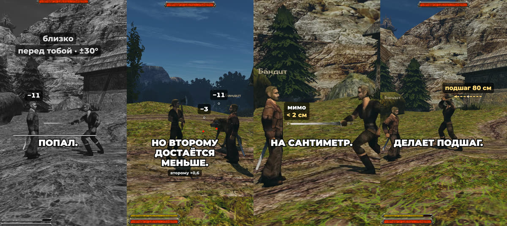

+++
title = "The sword hits now, not a rule: the numbers"
summary = "What decides a melee hit now, how the blade's speed, the spot on the blade and its angle scale the damage, and what follows from it: the formulas behind the short."
date = 2026-11-02T18:00:02+03:00
cover = "cover.jpg"
youtube = "TgeheWkXcwI"
+++
In a sword fight a hit used to be decided by a rule: the enemy is close and in front of you. Now the blade
decides it: where it went, what it touched and at what angle. The short shows it in 50 seconds (a Russian
voice with English captions); here are the formulas.

## The rule it replaces

In [OpenGothic](https://github.com/Try/OpenGothic) as we started from it, a melee hit is one moment: at the
hit frame of the animation the engine checks that the chosen target is within the weapon's reach and within
±30° in front of the attacker. The weapon itself has no collision. On the test bench a swing at a bandit
215 cm away dealt 11 damage while the sword passed him by.

## The blade

The blade is now a capsule of 2 cm radius from the hand to the end of the weapon's real mesh (90 cm for the
common sword). On every physics step, 60 a second, it sweeps from its last pose to the new one in turns of
at most 5°, so a thin target between two poses is not skipped, and checks the bodies' capsules (head, trunk,
limbs) and the world. Humans hit this way now, the hero and NPCs; monsters still attack by the old rule.

Gothic's own damage (the weapon, strength, the critical roll, the armour) is computed as before, and the
blade multiplies it:

**multiplier = clamp(speed × lever × edge, 0.5, 1.5) × 0.6ⁿ**

- **speed**: the touching point's speed over a typical one for this swing (0.7 of the tip's peak speed in
  this animation);
- **lever**: 0.5 + 0.5 × the place on the blade, 0 at the hilt and 1 at the tip;
- **edge**: 0.5 + 0.5 × sin of the angle, 0.5 with the flat and 1 with the edge;
- **n**: how many bodies this swing has already hit.

From the short: the same 215 cm swing, with the blade deciding, touches the bandit's trunk with the tip
(lever 1) at 78° (edge 0.99) and 1920 cm/s against a typical 1177 (speed 1.63). That is 1.61, clamped to
1.5: Gothic's 11 becomes 17.

## What follows from it

- **A post stops the swing.** A wall or a post stops a blade moving forward along the attacker's look; the
  backswing and the follow-through pass, and the ground does not stop it. The swing ends with a hit
  effect and a return to the stance. Before, a two-handed axe went through a fence post.
- **Two targets in one swing.** The blade checks every body on its way (an NPC's blade passes through its
  allies). A two-handed swing hits a bandit (×0.94, −11), then a wolf's foreleg almost flat, at 4° and
  slower: 0.30, raised to 0.5, then ×0.6, so −3.
- **The push.** The impulse is the weapon's mass (fist 1.5 kg, one-handed 2.5, two-handed 4) × the contact
  speed × the edge, at most 60 N·s, along the blade's motion. The struck part of the body takes 15% of it,
  and its motors pull it back into the animation.
- **A miss by a centimetre.** A swing at a bandit 264 cm away hits; at 266 cm it misses by under 2 cm. The
  old rule would have counted both.
- **The step-in.** So at the start of a swing the attacker steps toward a target within ±60°: up to 120 cm
  forward or 40 back, at most 6 m/s, turning at most 30°, only until the predicted contact. The 215 cm swing
  took 24 cm, a forward swing at 275 cm took 80; both hit.

## What we keep honest

- The "before" shots are OpenGothic with blade physics off (`melee_physics_hits=0`), not the original
  Gothic II executable, which we did not check.
- The targets are placed by the test bench. The slow motion is the game's own frames with its time slowed,
  not interpolated. Every number on screen comes from the take's log.
- The voice is a person's recording. The music is Gothic II's (Kai Rosenkranz).

## Next

Balancing the whole fight (the blade, stamina, parries) is planned as one pass of its own, not step by step.

Not playable yet: it runs from source on macOS and needs your own copy of Gothic II: Night of the Raven.
How it works now is in [`docs/physics.md`](https://github.com/kaifaty/GothicAI/blob/main/docs/physics.md)
(stage 7), the multiplier in
[`damagecalculator.cpp`](https://github.com/kaifaty/GothicAI/blob/main/OpenGothic/common/game/damagecalculator.cpp),
the push in [`meleeimpact.cpp`](https://github.com/kaifaty/GothicAI/blob/main/OpenGothic/common/game/meleeimpact.cpp).
The short was filmed on the [test bench](https://github.com/kaifaty/GothicAI/tree/main/scripts/bench) and
drawn with [`shorts/explain`](https://github.com/kaifaty/GothicAI/tree/0061fde837235378936b735d9669f20bfeef56f8/shorts/explain).
