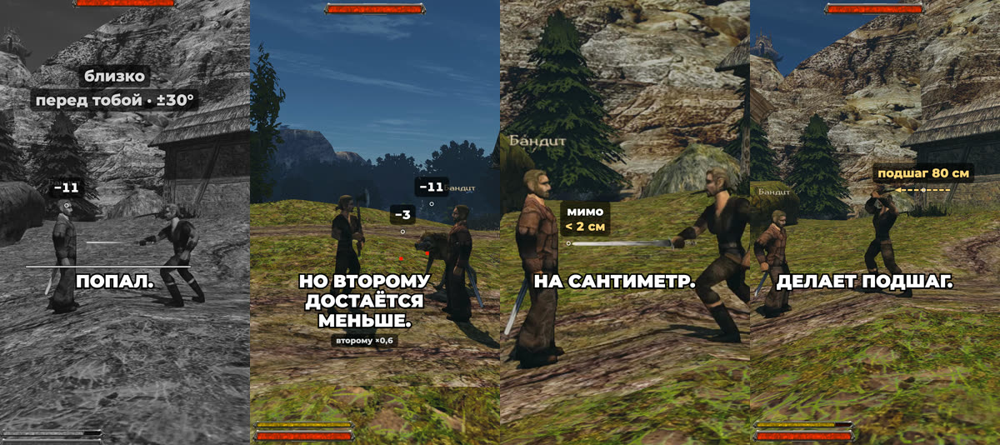

+++
title = "Попадает меч, а не правило: формулы и цифры"
summary = "Что теперь решает попадание в ближнем бою, как скорость клинка, место на клинке и угол лезвия меняют урон и что из этого следует: формулы, стоящие за шортсом."
date = 2026-11-02T18:00:02+03:00
cover = "cover-ru.jpg"
youtube = "TgeheWkXcwI"
+++
Раньше в бою на мечах попадание засчитывало правило: враг близко и стоит перед тобой. Теперь его решает сам
клинок: где он прошёл, чего коснулся и под каким углом. Шортс показывает это за 50 секунд, а здесь формулы.

## Правило, которое мы заменили

В [OpenGothic](https://github.com/Try/OpenGothic), каким мы его взяли, попадание в ближнем бою — один момент:
на кадре удара анимации движок проверяет, что выбранная цель в пределах дальности оружия и в секторе ±30°
перед атакующим. У самого оружия коллизии нет. На тестовом стенде замах по бандиту в 215 см снял с него 11
здоровья, хотя меч прошёл мимо.

## Клинок

Теперь клинок — капсула радиусом 2 см от кисти до конца настоящего меша оружия (у обычного меча 90 см). На
каждом шаге физики, 60 раз в секунду, он проходит от прошлой позы к новой кусками не больше 5° поворота,
поэтому тонкая цель между двумя позами не проскакивает, и проверяет капсулы тел (голова, корпус, конечности)
и мир. Так теперь бьют люди, герой и NPC; монстры атакуют по старому правилу.

Урон Готики (оружие, сила, крит, броня) считается как раньше, а клинок его умножает:

**множитель = clamp(скорость × рычаг × лезвие, 0,5, 1,5) × 0,6ⁿ**

- **скорость**: скорость точки касания, делённая на обычную для этого удара (0,7 пиковой скорости кончика в
  этой анимации);
- **рычаг**: 0,5 + 0,5 × место на клинке, 0 у рукояти и 1 у кончика;
- **лезвие**: 0,5 + 0,5 × синус угла, 0,5 плашмя и 1 ребром;
- **n**: сколько тел этот замах уже задел.

Пример из шортса: тот же замах на 215 см, но решает клинок. Он касается корпуса бандита кончиком (рычаг 1)
под 78° (лезвие 0,99) на 1920 см/с при обычных 1177 (скорость 1,63). Выходит 1,61, зажато до 1,5: из 11
урона Готики получается 17.

## Что из этого следует

- **Столб останавливает удар.** Стена или столб останавливают клинок, который идёт вперёд по взгляду
  атакующего; замах назад и проводка проходят, а земля удар не останавливает. Удар кончается
  эффектом попадания и возвратом в стойку. Раньше двуручный топор проходил сквозь столб забора.
- **Двое за один замах.** Клинок проверяет все тела на своём пути (клинок NPC проходит сквозь союзников).
  Двуручный замах задевает бандита (×0,94, −11), потом лапу волка почти плашмя, под 4°, и медленнее: 0,30,
  поднято до 0,5 и умножено на 0,6, итого −3.
- **Толчок.** Импульс — масса оружия (кулак 1,5 кг, одноручное 2,5, двуручное 4) × скорость касания ×
  лезвие, не больше 60 Н·с, вдоль движения клинка. Задетой части тела достаётся 15% от него, и моторы тянут
  её обратно к анимации.
- **Промах на сантиметр.** Замах по бандиту на 264 см попадает, на 266 см проходит мимо меньше чем на 2 см.
  Старое правило засчитало бы оба.
- **Подшаг.** Поэтому в начале удара атакующий подшагивает к цели в пределах ±60°: до 120 см вперёд или 40
  назад, не быстрее 6 м/с, доворот не больше 30°, только до предсказанного касания. Замах на 215 см получил
  24 см, прямой удар на 275 см — 80; оба попали.

## Что мы не скрываем

- Кадры «до» сняты в OpenGothic с выключенной физикой клинка (`melee_physics_hits=0`), а не в оригинальном
  exe Готики II: его мы не проверяли.
- Цели ставит тестовый стенд. Замедление — собственные кадры игры с замедленным временем, а не
  интерполяция. Все цифры на экране взяты из журнала дубля.
- Голос записан человеком. Музыка из Готики II (Кай Розенкранц).

## Дальше

Баланс всего боя (клинок, выносливость, парирование) в планах отдельным проходом, а не по шагам.

Поиграть пока нельзя: проект запускается из исходников на macOS и требует своей копии Gothic II: Ночь
Ворона. Как это работает сейчас, описано в
[`docs/physics.md`](https://github.com/kaifaty/GothicAI/blob/main/docs/physics.md) (этап 7), множитель лежит в
[`damagecalculator.cpp`](https://github.com/kaifaty/GothicAI/blob/main/OpenGothic/common/game/damagecalculator.cpp),
толчок — в [`meleeimpact.cpp`](https://github.com/kaifaty/GothicAI/blob/main/OpenGothic/common/game/meleeimpact.cpp).
Шортс снят на [тестовом стенде](https://github.com/kaifaty/GothicAI/tree/main/scripts/bench) и нарисован
с помощью [`shorts/explain`](https://github.com/kaifaty/GothicAI/tree/0061fde837235378936b735d9669f20bfeef56f8/shorts/explain).
